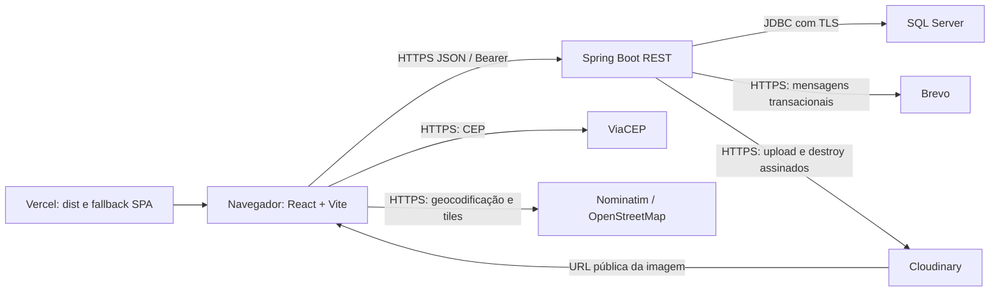
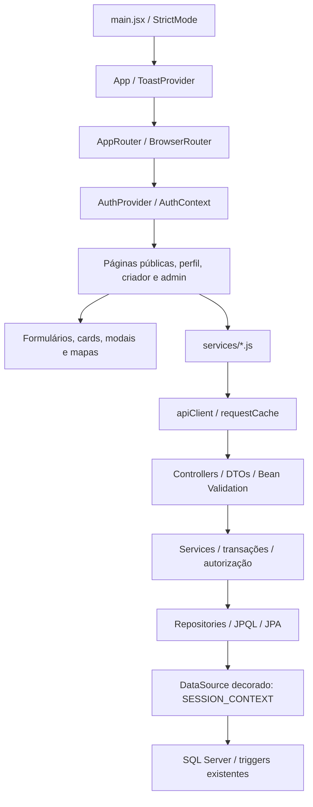
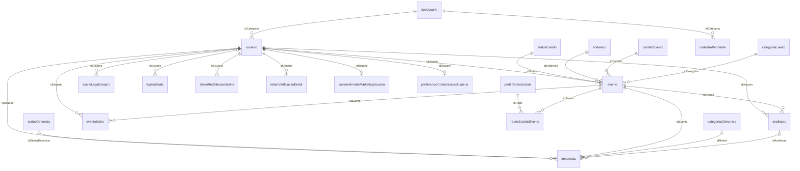
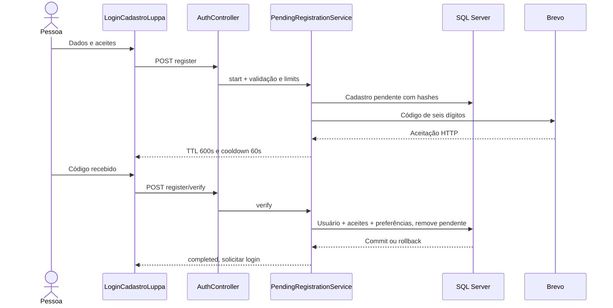
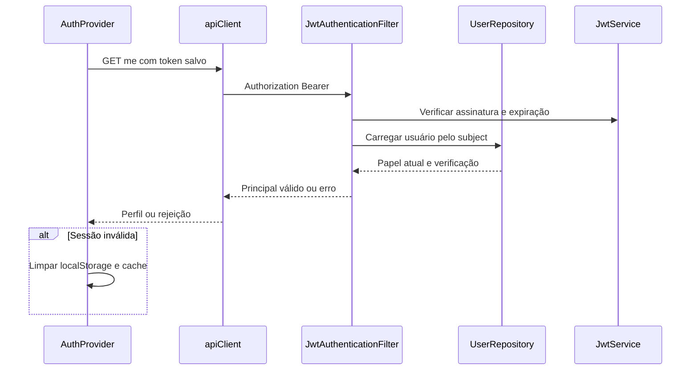
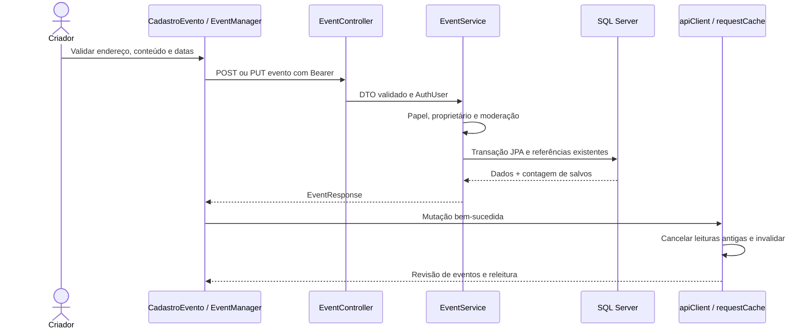
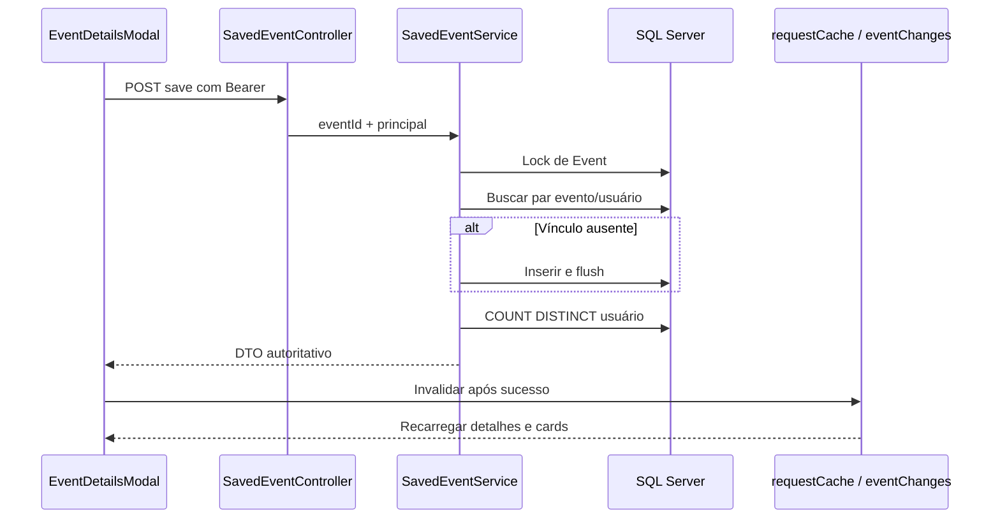
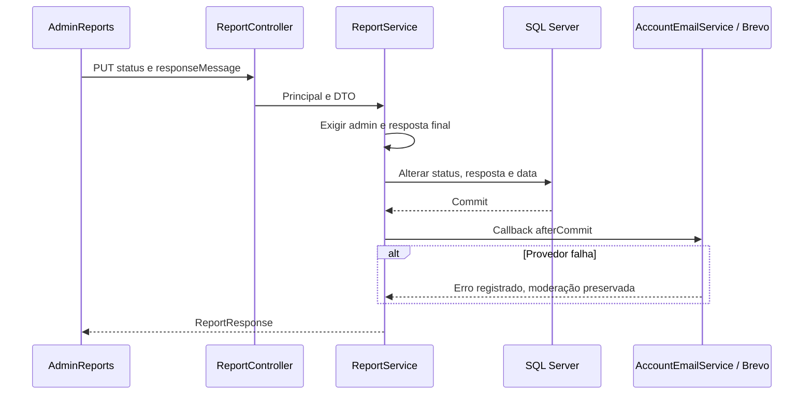
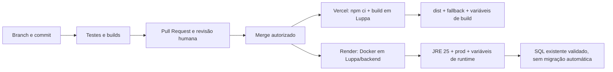

# LUPPA — documentação técnica completa

Manual do código de `ThyagoGontijoITB/Luppa`, baseado no commit `4ba207b65389b43b25a4fde8411902513494aeed`, incluindo contato real, fallback SPA, interessados, gerenciamento do criador e cache. A branch deste documento é `docs/documentacao-completa-luppa`. A revisão foi analisada na branch de implementação `fix/luppa-contact-events-cache`; antes da entrega, confirmou-se que o PR #1 foi integrado pelo GitHub à `main` em `da8b186`, com árvore funcional idêntica à revisão analisada. A branch documental foi alinhada a essa main para apresentar somente o manual no diff. Isso não comprova publicação em produção.

**Convenções de evidência:** **CÓDIGO** significa comportamento identificado em fonte/configuração versionada; **SCRIPT** significa definição encontrada em SQL versionado, sem afirmar que foi aplicada; **INFERIDO JPA** significa contrato esperado pelo mapeamento, não DDL observado; **NÃO VERIFICADO** identifica dependência externa ou informação não comprovada. Exemplos usam dados fictícios e não são capturas de produção. As referências a outros arquivos servem para rastreabilidade; as explicações necessárias estão neste manual. Nenhuma migração ou escrita no banco foi executada para produzir a documentação.

## Sumário

1. [Introdução e visão geral](#s1)
2. [Arquitetura completa](#s2)
3. [Tecnologias utilizadas](#s3)
4. [Estrutura completa do projeto](#s4)
5. [Frontend — React e Vite](#s5)
6. [Backend — Java e Spring Boot](#s6)
7. [Banco de dados — SQL Server](#s7)
8. [Regras de negócio completas](#s8)
9. [API REST completa](#s9)
10. [Autenticação e segurança](#s10)
11. [Fluxos completos do sistema](#s11)
12. [Infraestrutura e produção](#s12)
13. [Ambiente de desenvolvimento](#s13)
14. [Testes e qualidade](#s14)
15. [Tratamento de erros e troubleshooting](#s15)
16. [Decisões arquiteturais e limitações](#s16)
17. [Inventário completo do código](#s17)
18. [Glossário técnico](#s18)
19. [Conclusão e estado atual](#s19)

<a id="s1"></a>
## 1. Introdução e visão geral

LUPPA é uma aplicação de descoberta, divulgação e administração de eventos, com comunicação orientada à região de Barueri. Visitantes consultam a agenda, categorias, detalhes e avaliações, acessam documentos legais e enviam mensagens ao suporte. Usuários autenticados mantêm perfil, imagens, preferências, eventos salvos, avaliações e denúncias. Criadores também cadastram e gerenciam seus eventos. Administradores moderam publicação e denúncias, gerenciam usuários e eventos, enviam mensagens individuais e consultam auditoria.

| Ator | Papel efetivo | Limites |
| --- | --- | --- |
| Visitante | Leituras públicas e contato; cadastro/login/recuperação | Não salva, avalia nem denuncia sem autenticação |
| Usuário | `USER`, ID de tipo 2 | Próprio perfil e interações; não cria eventos |
| Criador | `CREATOR`, ID 1 | Próprios eventos; não aprova publicação |
| Administrador | `ADMIN`, ID 0 | Administração comum; não promove administradores nem altera o administrador principal |
| Administrador principal | `LUPPA_ADMIN`, ID 3 | Herda autoridade ADMIN; pode gerenciar administradores comuns; provisionamento manual |

A aplicação não implementa venda de ingressos, pagamento, presença confirmada, chat, lista de participantes pagos, upload múltiplo de galeria ou um serviço de recomendação personalizado em execução. A categoria “Pagamentos” no suporte não comprova integração de pagamentos. “Interessados” conta usuários que salvaram o evento, não comparecimento. Preferências de lembretes são armazenadas, mas não há scheduler de lembretes identificado.

<a id="s2"></a>
## 2. Arquitetura completa

### 2.1 Visão de implantação



Vercel e Render são destinos documentados no repositório; a configuração real dos painéis e o estado dos serviços são **NÃO VERIFICADO**. O frontend é uma SPA compilada, não SSR. O backend é um monólito modular organizado por camadas, não um conjunto de microsserviços. Não há fila, Redis, Kubernetes, mensageria ou cache de servidor configurado.

### 2.2 Componentes e responsabilidades



Estado de formulário e de lista reside em `useState`; sessão em `AuthContext`; mensagens em `ToastContext`. A revisão global de eventos, publicada por `eventChanges.js`, é lida com `useSyncExternalStore`. TanStack Query Core deduplica e armazena resultados HTTP por URL/escopo em memória; não substitui o estado de todas as páginas por hooks `useQuery`.

### 2.3 Processamento de requisição

`apiRequest` ordena parâmetros, acrescenta JSON ou `FormData` e, quando habilitado, o token do armazenamento local. `SecurityConfig` aplica autorização por caminho/método; `JwtAuthenticationFilter` verifica a assinatura, carrega o usuário atual e instala `AuthUser` no contexto. O controller valida DTO, chama o service e serializa records. O service abre a transação quando anotado, confere propriedade/papel, consulta repositories e produz respostas por mappers. No checkout da conexão SQL, o DataSource informa o usuário ao `SESSION_CONTEXT`; ao fechar, limpa esse valor para evitar atribuição incorreta em conexões reutilizadas. Exceções são traduzidas para HTTP pelo advice ou pelo filtro JWT.

### 2.4 Dados derivados e efeitos externos

`interestCount`, médias, rankings, endereço formatado, slug e URL de imagem são derivados. Imagem de evento não possui tabela própria: a referência persistida é `evento.pathImagemCapa`; metadados mais completos existem apenas durante upload/resposta. Upload e e-mail não participam de uma transação distribuída com o SQL. A aplicação usa compensação para imagens e, em alguns fluxos, envio após commit; não há outbox nem confirmação de entrega ao destinatário.

<a id="s3"></a>
## 3. Tecnologias utilizadas

A tabela de dependências diretas e versões efetivamente resolvidas será apresentada abaixo. Os intervalos do package.json não equivalem automaticamente à versão instalada; `package-lock.json` é a referência da resolução frontend. Maven usa o BOM do parent Spring Boot, portanto versões transitivas não fixadas explicitamente não devem ser inventadas.

| Tecnologia backend | Versão/evidência | Finalidade |
| --- | --- | --- |
| Java | `java.version=25` no pom | Compilação e runtime da API |
| Spring Boot | 3.5.6 | Inicialização, configuração e starters |
| Spring Web / Jackson | Gerenciadas pelo parent | Controllers REST, JSON, multipart |
| Spring Data JPA / Hibernate | Gerenciadas pelo parent | Persistência e JPQL; validação do esquema |
| Spring Security | Gerenciada pelo parent | Filtro JWT, autorização, BCrypt, sessão stateless |
| Bean Validation | Starter validation | Constraints nos records de entrada |
| SQL Server JDBC | `com.microsoft.sqlserver:mssql-jdbc`, runtime | Protocolo JDBC SQL Server |
| JJWT | 0.12.6 (`api`, `impl`, `jackson`) | Assinatura e leitura de JWT |
| springdoc-openapi | 2.8.9 | Swagger/OpenAPI em desenvolvimento |
| Maven | 3.9.11 no Dockerfile | Build; sem wrapper Maven versionado |
| JUnit / Mockito / AssertJ / Spring Test | Starter test e security-test | Testes unitários e slices/integrados |
| Java HttpClient / ImageIO | JDK | Brevo, Cloudinary e validação de imagens |
| Docker | Build multi-stage; runtime Temurin 25 | Pacote executável em usuário sem privilégios |

Não há dependência de Flyway nem execução de migrations pelo aplicativo identificada no pom; o README usa a expressão “desabilitado” para esse fluxo. Não há arquivo Compose ou pipeline CI versionado encontrado na revisão analisada.

### 3.1 Dependências frontend diretas

| Pacote | Intervalo declarado | Versão no lock | Uso |
| --- | --- | --- | --- |
| `@tanstack/query-core` | `^5.104.5` | 5.104.5 | Cliente de cache imperativo |
| `maplibre-gl` | `^6.11.2` | 6.11.2 | Mapas WebGL |
| `react` | `^19.2.6` | 19.2.7 | Componentes e hooks |
| `react-dom` | `^19.2.6` | 19.2.7 | createRoot e portals |
| `react-router-dom` | `^7.18.1` | 7.18.1 | BrowserRouter, Routes, navegação e guards |
| `@babel/core` | `^7.29.0` | 7.29.7 | Pipeline Babel |
| `@eslint/js` | `^10.0.1` | 10.0.1 | Regras JS |
| `@rolldown/plugin-babel` | `^0.2.3` | 0.2.3 | Babel na pipeline Rolldown |
| `@testing-library/react` | `^16.3.3` | 16.3.3 | Renderização e assertions de UI |
| `@testing-library/user-event` | `^14.6.8` | 14.6.8 | Interações de usuário nos testes |
| `@types/react` | `^19.2.14` | 19.2.17 | Declarações de tipos React; projeto continua JS |
| `@types/react-dom` | `^19.2.3` | 19.2.3 | Declarações DOM React |
| `@vitejs/plugin-react` | `^6.0.1` | 6.0.2 | Transformação React no Vite |
| `babel-plugin-react-compiler` | `^1.0.0` | 1.0.0 | Compilação React |
| `eslint` | `^10.3.0` | 10.5.0 | Análise estática |
| `eslint-plugin-react-hooks` | `^7.1.1` | 7.1.1 | Regras de hooks e compilador |
| `eslint-plugin-react-refresh` | `^0.5.2` | 0.5.3 | Regras de fast refresh |
| `globals` | `^17.6.0` | 17.6.0 | Definições de globais |
| `jsdom` | `^30.1.3` | 30.1.3 | DOM dos testes |
| `vite` | `^8.0.12` | 8.0.16 | Servidor de desenvolvimento e build |
| `vitest` | `^5.0.5` | 5.0.5 | Runner de testes |

O package.json da raiz contém somente `gh-pages` como dependência de desenvolvimento. O script de deploy está no pacote interno; não há workspace npm declarado. Instalar somente na raiz não instala o frontend. O caminho suportado para executar Vite é `Luppa/`.

<a id="s4"></a>
## 4. Estrutura completa do projeto

```text
Luppa/ (raiz Git)
├── DOCUMENTACAO_COMPLETA_LUPPA.md
├── IMPLEMENTACAO.md (relato anterior da implementação)
├── package.json / package-lock.json (apoio gh-pages)
├── .gitignore / .idea/ (configuração local de ferramentas)
└── Luppa/ (pacote frontend)
    ├── package.json / package-lock.json
    ├── index.html / vite.config.js / vitest.config.js / eslint.config.js
    ├── vercel.json / .env.example / public/
    ├── src/
    │   ├── main.jsx / App.jsx / index.css / App.css
    │   ├── assets/ (identidade visual e ilustrações PNG)
    │   ├── auth/ (contexto e sessão)
    │   ├── routes/ (árvore de rotas e guard)
    │   ├── pages/ (Home, Menu, LoginCadastro, ExploreEvents, CategoryEvents,
    │   │          CadastroEvento, MyEvents, Profile e Admin)
    │   ├── components/ (common, forms, events, insights, seo)
    │   ├── services/ (HTTP, dados e integrações no navegador)
    │   ├── hooks/ / config/ / constants/ / utils/ / test/
    └── backend/ (projeto Maven independente)
        ├── pom.xml / Dockerfile / .dockerignore / .env.example
        ├── README.md / DEPLOYMENT.md
        ├── sql/ (8 scripts específicos; não são baseline completo)
        └── src/
            ├── main/java/com/luppa/api/
            │   ├── LuppaApiApplication.java
            │   ├── controller/ / service/ / service/image/
            │   ├── repository/ / entity/ / dto/ / mapper/
            │   ├── security/ / audit/ / config/ / exception/
            ├── main/resources/ (application*.yml, spring.factories e logo)
            └── test/ (JUnit e application-test.yml)
```

Esta árvore agrupa arquivos por responsabilidade. A [seção 17](#s17) contém o inventário arquivo a arquivo, com símbolos e dependências, incluindo todos os fontes, folhas CSS, testes, recursos e arquivos de configuração versionados. `node_modules`, `dist`, `target` e uploads são saídas ignoradas, não fontes nem novos módulos. Os arquivos `.env.example` são modelos e não carregam variáveis automaticamente.

<a id="s5"></a>
## 5. Frontend — React e Vite

### 5.1 Inicialização, estado e navegação

`Luppa/index.html` oferece `#root` e carrega `src/main.jsx`. Este importa `index.css`, usa `createRoot` e envolve `App` em `StrictMode`. `App` instala `ToastProvider` e `AppRouter`. O router usa `BrowserRouter basename={import.meta.env.BASE_URL}` e coloca `AuthProvider` antes de `Routes`. Não há hydration, SSR, service worker ou roteamento por hash. `App.css` contém estilos remanescentes do template; os estilos globais efetivamente importados são `index.css`.

`ProtectedRoute` retorna `null` durante carregamento da sessão. Visitante é redirecionado com `replace` para `/login-cadastro`, guardando o pathname de origem. Um usuário sem o papel de criador recebe `InfoDialog`; ausência de papel administrativo redireciona à Home. `hasRole` permite a `LUPPA_ADMIN` satisfazer um requisito ADMIN. Esses guards melhoram UX; a proteção real deve existir na API. Não há rota catch-all nem página 404 React identificada. O fallback do servidor entrega a SPA para URLs internas, mas não cria novas rotas React.

### 5.2 Todas as páginas e rotas

Os caminhos de arquivos desta tabela são relativos a `Luppa/src/pages/`. Os endpoints completos e contratos estão na [seção 9](#s9).

| Rota | Arquivo / componente | Dados, execução e serviços | Acesso |
| --- | --- | --- | --- |
| `/` | `HomeLuppa/HomeLuppa.jsx` → `MenuLuppa/MenuLuppa.jsx` | Busca eventos PUBLISHED, destaque e categorias; filtros locais/servidor; `eventService`; contato por `supportService` | Público |
| `/events` | `ExploreEventsLuppa/ExploreEventsLuppa.jsx` | `searchEvents`, `getFeaturedEvents`, `groupEventsByCategory`; agenda filtrada e agrupada; modal detalhado | Público |
| `/events/category/:slug` | `CategoryEventsLuppa/CategoryEventsLuppa.jsx` | `getCategoryBySlug`, eventos da categoria ou busca; categoria ausente/erro é estado de tela | Público |
| `/login-cadastro` | `LoginCadastroLuppa/LoginCadastroLuppa.jsx` | `AuthProvider.login/register`, código de cadastro e reenvio por `authService`; estados form/verify | Público, noindex |
| `/forgot-password` | `LoginCadastroLuppa/AccountActionPage.jsx`, tipo forgot | `POST /api/auth/forgot-password`; mensagem genérica contra enumeração | Público, noindex |
| `/reset-password` | Mesmo componente, tipo reset | Query `token`, confirmação de senha; `POST /api/auth/reset-password` | Público, noindex |
| `/verify-email` | Mesmo componente, tipo verify | Confirmação explícita usando query `token`; `GET /api/auth/verify-email` | Público, noindex |
| `/resend-verification` | Mesmo componente, tipo resend | E-mail para `POST /api/auth/resend-verification` | Público, noindex |
| `/support` | `MenuLuppa/SupportPage.jsx` | Nome/e-mail/categoria/assunto/mensagem, preenche identidade disponível; `POST /api/support/contact` | Público; autenticação opcional |
| `/faq` | `MenuLuppa/FaqPage.jsx` | Conteúdo estático agrupado, schema FAQ; sem endpoint | Público |
| `/terms` | `MenuLuppa/LegalPage.jsx`, tipo terms | `legalDocuments.js`, estrutura de capítulos e navegação local | Público |
| `/privacy` | Mesmo componente, tipo privacy | Documento estático de privacidade; não consulta consentimento da conta | Público |
| `/profile` | `ProfileLuppa/ProfileLuppa.jsx` | Perfil, imagem, preferências, salvos, próprias avaliações e eventos próprios quando criador; `authService`, `accountService`, `eventService` | Autenticado |
| `/communication-preferences` | Mesmo `ProfileLuppa` | Aba inicial preferences; GET/PUT `/api/me/communication-preferences` | Autenticado |
| `/cadastrar-evento` | `CadastroEventoLuppa/CadastroEventoLuppa.jsx` | Categorias, endereço, datas, capa e preview; cria REVIEW e depois envia imagem em chamada separada | CREATOR ou ADMIN |
| `/my-events` | `MyEventsLuppa/MyEventsLuppa.jsx` | `GET /api/events/mine` em todas as páginas; tabela/editor compartilhado `EventManager` | CREATOR ou ADMIN |
| `/creator/insights` | `MyEventsLuppa/CreatorInsightsLuppa.jsx` | `fetchCreatorEventInsights`, estado loading/erro e dashboard de métricas próprias | CREATOR ou ADMIN |
| `/admin` (index) | `AdminLuppa/AdminShell.jsx` + `AdminOverview.jsx` | Shell carrega `getEvents` e `fetchUsers`, distribui dados por Outlet; overview calcula indicadores desses arrays | ADMIN |
| `/admin/insights` | `AdminLuppa/AdminInsights.jsx` | `GET /api/insights/events/platform`; métricas agregadas no banco | ADMIN |
| `/admin/users` | `AdminLuppa/AdminUsers.jsx` | CRUD `/api/users`, filtros, confirmação de exclusão e mensagem individual `/api/admin/users/{id}/message` | ADMIN com limites de hierarquia |
| `/admin/events` | `AdminLuppa/AdminEvents.jsx` | Wrapper de `EventManager administrative`; CRUD, imagem e destaque principal | ADMIN |
| `/admin/review` | `AdminLuppa/AdminModeration.jsx` | Filtra pending_review; aprova com PUT status PUBLISHED ou cancela com CANCELLED | ADMIN |
| `/admin/reports` | `AdminLuppa/AdminReports.jsx` | Lista denúncias, status, resposta de moderação e consulta ao evento relacionado | ADMIN |
| `/admin/audit` | `AdminLuppa/AdminAuditLogs.jsx` | GET logs/tables, filtros aplicados explicitamente, paginação 25 e detalhe de dados antigos/novos | ADMIN |

`AdminLayout` fornece navegação lateral/identidade e recebe o conteúdo do shell; não é uma API nem rota independente. `NoIndexPage` é um wrapper interno do router, não um arquivo separado. Login após autenticação usa o destino original ou `/admin` somente quando o papel textual é ADMIN; para LUPPA_ADMIN sem origem, o padrão atual é Home, embora o papel tenha acesso administrativo.

### 5.3 Sessão, contextos e hooks

`AuthProvider` guarda `user`, `token` e `loading`. `getInitialToken` lê `luppa.auth.token`; uma sessão restaurada é validada com `fetchCurrentUser` (`GET /api/auth/me`). Falha limpa usuário/token e cache. Login armazena o objeto normalizado em `luppa.auth.user` e JWT em `luppa.auth.token`, além do estado React. Logout não chama endpoint de revogação: limpa estado e localStorage. Atualizações de perfil podem substituir usuário e token por `setAuthenticatedSession`. Evento `storage` de outra aba força releitura da sessão e limpeza do cache.

`authContext.js` exporta `AuthContext` e `useAuth`; usar o hook fora do provider lança erro. `ToastProvider` mantém no máximo os três itens mais recentes, evita mensagens idênticas simultâneas por chave tom/texto, usa duração de 3.600 ms e transição de saída de 180 ms. `useToast` expõe success/error/warning/info; esses textos não são respostas autoritativas do backend por si mesmos.

`useEventRevision` assina o número global de revisão de `eventChanges`. `useEventDetails` mantém seleção associada ao `userId` ou anonymous; carrega os detalhes ao abrir ou quando muda a revisão, ignora resultados após cleanup e fecha logicamente a seleção ao mudar de conta. `updateSelectedEvent` relê detalhes e só aplica a resposta à mesma seleção/escopo. O estado da sessão é persistido; os resultados do cache não são.

### 5.4 Cliente HTTP e normalização

`apiClient.js` usa `VITE_API_BASE_URL` ou a origem do navegador quando vazio. Query parameters são ordenados por chave e omitem `undefined`, `null`, string vazia e `all`. JSON recebe `Content-Type: application/json`; `FormData` deixa o navegador definir boundary. `auth:false` desabilita o Bearer inclusive se houver token salvo. Respostas vazias viram `null`; texto não JSON gera `ApiError` com o status recebido. Resposta HTTP não OK também gera `ApiError(status,payload)`.

`normalizeEvent` converte IDs para strings, REVIEW para `pending_review`, datas em data/hora de formulário, referências de imagem em URL e endereço em texto estruturado. `interestCount` vem do backend; `participants` é somente alias de compatibilidade desse número. `loadEventDetails` busca em paralelo evento, avaliações públicas e links sociais; havendo sessão, acrescenta estado salvo e avaliação própria. Erros 401/403 das consultas pessoais não impedem os dados públicos. `getMyRatedEvents` pode produzir um item mínimo se o detalhe do evento falhar. Esse fallback não comprova que o evento continue acessível.

`getMyEvents` percorre `totalPages` com ordenação `id,asc`. Outras listagens de eventos/usuários usam página 0 de tamanho 200, portanto não são inventário ilimitado. Filtro e ordenação de eventos combinam consulta de backend com `searchAndSortEvents` em memória. O texto é normalizado sem acentos; nearest/furthest ordenam por data de início, não distância geográfica. `getCategories` calcula contagens a partir da lista pública carregada; essa contagem também herda o limite dessa lista.

### 5.5 Cache e sincronização

`requestCache.js` instancia `QueryClient` de `@tanstack/query-core`; não usa React Query Provider nem persistência de consultas. `fetchQuery` reutiliza dados frescos e deduplica chamadas simultâneas. Chave: `['api', scope, sessionRevision-ou-0, URL-completa]`, sem token textual. Requisições com headers customizados ou signal externo não entram nessa política. Não há retry automático nem refetch por foco. A aplicação não fica consultando o servidor periodicamente só porque staleTime venceu; é necessária nova leitura ou uma revisão que provoque carga.

| Grupo | staleTime | gcTime | Escopo |
| --- | --- | --- | --- |
| Categorias e categoria por slug | 300.000 ms | 600.000 ms | Público |
| Listas/detalhes/destaques, avaliações e links públicos | 30.000 ms | 300.000 ms | Público |
| Salvos, ratings pessoais, mine, estado save e insights | 15.000 ms | 60.000 ms | Privado com sessão |
| Conta, preferências, usuários administrativos, auditoria e denúncias | Sem cache dessa camada | Não aplicável | Requisição normal |

Mutações sob `/api/events`, `/api/reports`, `/api/users` e `/api/admin/users` cancelam consultas `['api']`, invalidam as entradas e notificam `eventChanges` após sucesso. A invalidação é ampla para esse conjunto de cache, não uma atualização otimista de todos os objetos. Erro de mutação não invalida nem incrementa contador. `resetRequestCache` limpa resultados e cancela operações na troca de sessão; `syncCacheSession` também detecta mudança do token. O isolamento do cache não elimina a persistência preexistente do JWT no localStorage.

### 5.6 Componentes de eventos e gerenciamento

`EventCard` mostra capa, categoria, status, título, horário, local e interessados usando `formatParticipants`. `EventDetailsModal` exibe descrição, datas, localização, mapa, contatos sociais, avaliação, compartilhamento e denúncia. Preview desabilita interação de interesse. `toggleInterest` bloqueia repetição enquanto salva/remove, aguarda o backend, solicita atualização e só então mostra toast; nenhuma soma local fictícia determina o total.

`EventManager` é o editor/tabela compartilhado. A variante administrativa expõe criação e curadoria; a do criador oferece edição dos itens carregados de mine, detalhes e exclusão confirmada. Formulário conserva os dados originais de endereço/datas, valida novamente o que foi alterado e envia mudanças de eventos publicados para `pending_review` quando não administrativo. `updateEvent` preserva segundos/frações originais quando data/hora não mudaram. O upload é outra requisição: falha de imagem no manager informa que os dados já foram salvos e não deve levar a recriar o evento. `ConfirmDialog.confirmDisabled` impede cancelar/confirmar durante exclusão.

Na página `CadastroEventoLuppa`, `saveDraft` apenas abre um diálogo informativo; não há persistência de rascunho por esse botão. `publishEventToApi` cria REVIEW, não PUBLISHED, apesar do toast da Home dizer “publicado”. Se o upload da capa falhar depois da criação nessa página, o catch é genérico e o evento pode já existir; esse fluxo não possui a mesma recuperação parcial do manager.

### 5.7 Formulários e validações

- `FieldError` conecta mensagens com IDs e `aria-invalid/aria-describedby`; `focusFirstInvalidField` rola até o primeiro inválido e aplica foco após 220 ms.
- `PasswordInput` alterna visibilidade e exibe os ícones correspondentes. Confirmação de senha acontece no React, não é campo do DTO de cadastro.
- `CoverImageUpload` e `validateCoverImage` aceitam JPEG, PNG ou WebP até 2 MiB; validação de assinatura dos bytes é responsabilidade do backend.
- `StructuredAddressFields` consulta ViaCEP após 300 ms, busca ruas/sugestões após 450 ms e resolve mapa após 700 ms, com AbortController, limpeza de timeout e identificador de requisição para não aplicar sugestões antigas. Estado diferencia idle/loading/not-found/error/resolved. CEP com oito dígitos, rua, número, cidade, UF e país são necessários; a confirmação do mapa deve estar verificada antes da publicação.
- `LocationAutocomplete` é um componente alternativo de sugestões; sua presença não significa que todos os formulários o utilizem. Ver imports no inventário.
- Nome/e-mail/telefone/data de nascimento têm limites nos inputs e validadores locais. O backend repete os limites de contrato. `isValidDate` usa Date; não equivale a toda a validação civil de datas que Bean Validation realiza.
- Suporte da Home fornece categoria/assunto fixos; a página suporte permite escolhê-los. Estado de envio desabilita campos e só limpa após aceitação.

### 5.8 Mapas, compartilhamento e SEO

O navegador usa Nominatim por padrão; `VITE_GEOCODING_PROVIDER` diferente de nominatim causa erro de provedor não suportado. `resolveEventLocation` prefere coordenadas já numéricas; senão tenta endereço estruturado, consultas de fallback e endereço completo. `searchLocations` exige três caracteres, pede cinco resultados e restringe país a br. `cepService` consulta ViaCEP e trata `erro:true` como CEP não encontrado. Não há chave de API para essas consultas no código.

`EventMap` cria MapLibre, Marker e NavigationControl; atualiza resize em animation frames, trata erros recuperáveis separadamente e possui watchdog de oito segundos. Desmontagem remove mapa, marker, listeners e frames. Fallback oferece links OpenStreetMap e Google Maps; link externo de rota não é SDK Google Maps nem integração paga identificada. `mapConfig` usa tiles raster OpenStreetMap, salvo override `VITE_MAP_STYLE_URL`.

`EventShareDialog` usa links sociais/cópia e dados formatados. O URL compartilhado termina em `#event-{id}` no caminho atual; não há rota React `/events/:id` nem resolvedor dedicado desse hash identificado. O link que `AccountEmailService.eventPublished` monta em `/events/{id}` não corresponde a uma rota cadastrada; ver [limitações](#s16).

`Seo` altera título, canonical, robots, OpenGraph, Twitter e JSON-LD no DOM; áreas privadas recebem noindex/nofollow. `seoMetadata.js` fixa a origem pública usada nos metadados. `public/robots.txt`, sitemap e `index.html` também participam. Não há geração SSR de metadados por evento; crawlers sem execução de JavaScript podem ver apenas o HTML inicial. Conteúdo de FAQ e textos legais são estáticos; armazenar aceite no SQL é um fluxo independente.

### 5.9 Estilos e responsividade

`index.css` centraliza tokens de cor, tipografia, espaçamento e estados de foco; CSS Modules isolam as classes dos componentes. Os módulos ajustam grids, navs, formulários, modais e tabelas por media queries. Layouts administrativos usam a folha compartilhada `AdminLuppa.module.css`, inclusive diálogos e o EventManager. Há regras `prefers-reduced-motion` para notificações e telas menores. Breakpoints e seletores por arquivo constam do inventário; não existe framework CSS externo identificado. A existência de regras responsivas não comprova teste visual em todos os dispositivos.

<a id="s6"></a>
## 6. Backend — Java e Spring Boot

### 6.1 Inicialização e pacotes

`LuppaApiApplication` contém `@SpringBootApplication`. `AppConfig` registra records `@ConfigurationProperties` para CORS, JWT, storage, geocoding, bootstrap administrativo, e-mail, Brevo, segurança de produção, rate limit e Cloudinary. `ProductionEnvironmentPostProcessor`, registrado em `META-INF/spring.factories`, verifica requisitos de produção antes de criar beans. `ProductionSafetyValidator` repete garantias na fase ApplicationRunner. `AdminBootstrap` é CommandLineRunner transacional e cria ADMIN apenas quando e-mail/senha estão configurados e a conta ainda não existe; não é cadastro público nem mecanismo para criar LUPPA_ADMIN.

| Pacote | Responsabilidade | Contratos |
| --- | --- | --- |
| controller | Bind de HTTP e DTO, principal e validação | 15 controllers; catálogo integral na seção 9 |
| dto | Records de entrada/saída e paginação | Tipos, campos e constraints na seção 9 |
| service | Regras, transações e orquestração | Não retorna entidades diretamente ao HTTP |
| repository | JPA/JPQL e operações de persistência | Consultas e métodos relacionados na seção 17 |
| entity | Mapeamentos do esquema existente e valores derivados | Dicionário seção 7 |
| mapper | Conversão explícita de entidades/projeções para records | Sem MapStruct ou geração automática |
| security | JWT, cadeia HTTP, UserDetails e limites públicos | Seção 10 |
| audit | Atribuição do usuário ao contexto da conexão SQL | Seção 7 |
| config | Binding, bootstrap, caminhos estáticos e validação de produção | Seções 12 e 13 |
| exception | Exceções de negócio e advice REST | Seção 15 |
| service/image | Validação de imagem, storage assinado e resultado de upload | Seção 11 |

### 6.2 Serviços e participação no fluxo

| Classe | Responsabilidade e métodos centrais | Dependências e efeito |
| --- | --- | --- |
| `AuthService` | login, me, updateMe | AuthenticationManager, JwtService, UserRepository; troca de perfil gera JWT com novo subject |
| `PendingRegistrationService` | start/resend/verify | PendingRegistrationRepository, UserRepository, RoleRepository, BCrypt, preferências e e-mail; usuário só nasce após código válido |
| `AccountTokenService` | createVerification, resendVerification, verifyEmail, forgotPassword, resetPassword | Repositories de usuário e tokens; hashes SHA-256, consumo/expiração; BCrypt na nova senha |
| `CommunicationPreferenceService` | createForRegistration/get/update | Aceites legais, consentimento, preferências e usuário; PK compartilhada nas relações 1:1 |
| `UserService` | search/get/create/update/delete | Repositories, BCrypt e storage legado; hierarquia de papéis e limpeza ordenada dos vínculos do usuário |
| `EventService` | search/findFeatured/findMine/get/create/update/updateStatus/updateFeatured/clearFeatured/delete | EventRepository, CategoryRepository, AccountEmailService, EventResponseFactory, EventDeletionGuard |
| `EventResponseFactory` | one, mapper, page, list | Adiciona interestCount consultado no SavedEventRepository, agrupado em listas |
| `EventDeletionGuard` | check | Repositories de salvos, ratings, reports e links; evita exclusão física de histórico vinculado |
| `SavedEventService` | save/unsave/findMine/status | Evento bloqueado antes da mutação; relação por usuário do principal; idempotência |
| `RatingService` | findByEvent/findMine/upsert/delete | Evento deve ter terminado; uma avaliação por usuário/evento; projeção pública sem e-mail |
| `ReportService` | categories/findAll/findByEvent/findMine/create/updateStatus | Valida alvo rating/evento; resposta obrigatória ao resolver/dispensar; e-mail após commit |
| `EventInsightsService` | creatorInsights/platformInsights | Agregações por escopo, top 5, média com uma casa e zero para contagens nulas |
| `CategoryService` | findAll/findBySlug | Categoria derivada da descrição existente; slug não é coluna |
| `EventSocialLinkService` | findByEvent | Relações sociais somente leitura na API atual |
| `AuditLogService` | search/findTableNames | Filtro por texto/IDs/operação/tabela/usuário/período; fim exclusivo no dia seguinte |
| `SupportService` | create | Aciona `internalSupport`; sem entidade/ticket próprio persistido; retorno id null |
| `AdminUserMessageService` | send | Autoriza emissor/destinatário, valida tamanho, rate limit, Brevo e log de resultado |
| `AdminUserMessageRateLimiter` | tryAcquire | Até 5 por 10 min/admin, repetição alvo/assunto/texto em 30s bloqueada; memória local |
| `AccountEmailService` | reset/verification/cadastro/welcome/moderação/suporte/mensagem admin | Templates e `TransactionalEmailSender`; não contém credenciais frontend |
| `LuppaEmailTemplateService` | render, escape, paragraph e helpers | HTML com logo, CTA e alternativa de texto preparada pelo chamador; escape de conteúdo |
| `BrevoTransactionalEmailSender` | send | HttpClient, timeouts, API key e JSON; aceita 2xx, falha em não 2xx/IO/interrupção |
| `EventImageService` | replace/delete | Propriedade/admin; upload e referência no evento; compensações de storage |
| `ProfileImageService` | replace | Somente identidade atual; atualiza referência no usuário e compensações |
| `CloudinaryImageStorage` | upload/delete/isManagedReference | Multipart com SHA-1 do conjunto de parâmetros assinado, UUID e public_id por pasta |
| `ImageFileValidator` | validate | Até 2 MiB, MIME permitido, bytes de assinatura e ImageIO para JPEG/PNG |
| `NoopGeocodingService` | implementação da interface GeocodingService | Placeholder backend; não confundir com geocodificação real no navegador |

Os métodos completos de cada classe, tipos e colaboradores estão no [inventário](#s17); esta tabela explica sua função no domínio. `TransactionalEmailMessage`, `ImageUploadTarget` e `StoredImage` são contratos de efeitos externos, não tabelas.

### 6.3 Transações e efeitos de commit

Mutações de eventos, salvos, avaliações, denúncias, cadastro, tokens, perfil e preferências usam `@Transactional`; leituras de domínio em geral usam `readOnly=true`. A anotação de service opera pelo proxy Spring: não se deve inferir um novo limite de transação para uma chamada interna ao próprio objeto. `EventSocialLinkService` não abre explicitamente uma transação de service; a consulta e o acesso à associação EAGER dependem do comportamento repository/mapeamento.

- Salvar interesse bloqueia `Event` com PESSIMISTIC_WRITE e usa saveAndFlush antes de contar. Remover usa o mesmo bloqueio. A constraint única de salvamento continua sendo a última proteção de banco esperada.
- Exclusão de evento confere proprietário, verifica vínculos, chama delete e flush; conflito de constraint vira 409. Não apaga avaliações/denúncias para forçar sucesso.
- Exclusão administrativa de usuário é diferente: `UserDeletionRepository` remove vínculos em ordem, eventos e dados de usuário, e somente depois o usuário. Preservação da auditoria depende da FK/trigger de histórico. Limpeza de imagens legadas ocorre após commit; não se deve generalizar esse fluxo como exclusão segura de imagens Cloudinary.
- `ReportService` agenda e-mail de moderação em `afterCommit` e registra erro sem desfazer moderação já gravada. `EventService.updateStatus` chama e-mail dentro da transação; falha pode reverter a alteração de status.
- Substituir imagem registra limpeza do novo arquivo se rollback e limpeza do antigo após commit. Exclusão explícita da imagem chama storage antes de limpar a referência; não há atomicidade distribuída se o commit SQL falhar depois.
- Em `PendingRegistrationService.verify`, incrementar tentativas e lançar `InvalidRequestException` ocorre na mesma transação. Como a exceção é RuntimeException e não há `noRollbackFor`, **a persistência desse incremento em falha não está garantida e pode sofrer rollback**. O limite em memória do controller continua existindo; não afirmar que o contador SQL de cinco tentativas funciona em produção sem teste específico.

### 6.4 Mappers e respostas derivadas

`EventMapper.toResponse(event, featured, interestCount)` exige explicitamente a contagem; `EventResponseFactory` decide como consultá-la. `SavedEventMapper` recebe a resposta de evento já montada. `RatingMapper` usa `PublicUserResponse` ou a projeção pública para omitir dados de contato do avaliador. `UserMapper` compõe URL de imagem por public_id Cloudinary ou base legada. `ReportMapper` inclui autor da denúncia e alvo opcional de avaliação. `AuditLogMapper` resolve usuário vivo e identifica usuário excluído por ID histórico. `CategoryMapper`, `EventSocialLinkMapper` e `EventImageMapper` transformam dados para contratos próprios. Não há serialização direta de entidades com senha pela API.

<a id="s7"></a>
## 7. Banco de dados — SQL Server

### 7.1 Escopo da evidência

O esquema completo do servidor **NÃO VERIFICADO**. O repositório contém mapeamentos para **21 tabelas** (a contagem efetiva do inventário abaixo prevalece) e scripts parciais; não contém o CREATE de todas as tabelas nem exportação integral de triggers. `ddl-auto=validate` faz a aplicação falhar quando o banco diverge do mapeamento, não o corrige. Nomes e nulabilidade da maior parte do dicionário abaixo são **INFERIDO JPA**. `String` com length não prova se a coluna existente é varchar ou nvarchar; `LocalDateTime` não prova sua precisão física. Campos de payload não são automaticamente colunas.

### 7.2 Dicionário de tabelas e atributos

Cada tabela relaciona atributo Java, coluna SQL, tipo/nullable esperado e annotations de integridade. As definições SCRIPT confirmadas são detalhadas na subseção seguinte. `@Transient` e getters derivados não devem originar migrações.

#### Tabela `endereco` — `Address`

Fonte: `Luppa/backend/src/main/java/com/luppa/api/entity/Address.java`. Evidência padrão: **INFERIDO JPA**, não inspeção de produção.

| Coluna | Atributo Java | Tipo SQL esperado / Java | Nulabilidade e integridade |
| --- | --- | --- | --- |
| `idEndereco` | `id: Integer` | int | NOT NULL; PK; IDENTITY |
| `cep` | `zipCode: String` | varchar/nvarchar(12); físico NÃO VERIFICADO | NOT NULL |
| `rua` | `street: String` | varchar/nvarchar(100); físico NÃO VERIFICADO | NOT NULL |
| `cidade` | `city: String` | varchar/nvarchar(40); físico NÃO VERIFICADO | NOT NULL |
| `estado` | `state: String` | varchar/nvarchar(30); físico NÃO VERIFICADO | NOT NULL |
| `pais` | `country: String` | varchar/nvarchar(40); físico NÃO VERIFICADO | NOT NULL |
| `numero` | `number: Integer` | int | NOT NULL |

#### Tabela `logAuditoria` — `AuditLog`

Fonte: `Luppa/backend/src/main/java/com/luppa/api/entity/AuditLog.java`. Evidência padrão: **INFERIDO JPA**, não inspeção de produção.

| Coluna | Atributo Java | Tipo SQL esperado / Java | Nulabilidade e integridade |
| --- | --- | --- | --- |
| `idLog` | `id: Long` | bigint | NOT NULL; PK; IDENTITY |
| `tabela` | `tableName: String` | varchar/nvarchar(100); físico NÃO VERIFICADO | NOT NULL |
| `operacao` | `operation: String` | varchar/nvarchar(10); físico NÃO VERIFICADO | NOT NULL |
| `idRegistro` | `recordId: Integer` | int | NULL permitido no mapping |
| `idUsuario` | `userId: Integer` | int | NULL permitido no mapping |
| `idUsuarioHistorico` | `historicalUserId: Integer` | int | NULL permitido no mapping |
| `idUsuario` | `user: User` | int FK → usuario | NULL permitido no mapping; FK esperada; LAZY; somente leitura para esta associação |
| `dadosAntigos` | `oldData: String` | varchar(max) (columnDefinition) | NULL permitido no mapping |
| `dadosNovos` | `newData: String` | varchar(max) (columnDefinition) | NULL permitido no mapping |
| `dataOperacao` | `operatedAt: LocalDateTime` | datetime2 esperado; precisão NÃO VERIFICADO | NOT NULL |

#### Tabela `categoriaEvento` — `Category`

Fonte: `Luppa/backend/src/main/java/com/luppa/api/entity/Category.java`. Evidência padrão: **INFERIDO JPA**, não inspeção de produção.

| Coluna | Atributo Java | Tipo SQL esperado / Java | Nulabilidade e integridade |
| --- | --- | --- | --- |
| `idCategoria` | `id: Integer` | int | NOT NULL; PK; IDENTITY |
| `descricao` | `description: String` | varchar/nvarchar(200); físico NÃO VERIFICADO | NOT NULL |

#### Tabela `preferenciaComunicacaoUsuario` — `CommunicationPreference`

Fonte: `Luppa/backend/src/main/java/com/luppa/api/entity/CommunicationPreference.java`. Evidência padrão: **INFERIDO JPA**, não inspeção de produção.

| Coluna | Atributo Java | Tipo SQL esperado / Java | Nulabilidade e integridade |
| --- | --- | --- | --- |
| `idUsuario` | `userId: Integer` | int | NOT NULL; PK |
| `idUsuario` | `user: User` | int FK → usuario | NOT NULL; PK compartilhada / MapsId; FK esperada; LAZY |
| `receberNovidadesLuppa` | `receiveLuppaNews: boolean` | bit | NOT NULL |
| `receberRecomendacoesEvento` | `receiveEventRecommendations: boolean` | bit | NOT NULL |
| `receberLembretesEventoSalvo` | `receiveSavedEventReminders: boolean` | bit | NOT NULL |
| `dataAtualizacao` | `updatedAt: LocalDateTime` | datetime2 esperado; precisão NÃO VERIFICADO | NOT NULL |

#### Tabela `tokenVerificacaoEmail` — `EmailVerificationToken`

Fonte: `Luppa/backend/src/main/java/com/luppa/api/entity/EmailVerificationToken.java`. Evidência padrão: **INFERIDO JPA**, não inspeção de produção.

| Coluna | Atributo Java | Tipo SQL esperado / Java | Nulabilidade e integridade |
| --- | --- | --- | --- |
| `idTokenVerificacaoEmail` | `id: Long` | bigint | NOT NULL; PK; IDENTITY |
| `idUsuario` | `user: User` | int FK → usuario | NOT NULL; FK esperada; LAZY |
| `emailDestino` | `destinationEmail: String` | varchar/nvarchar(60); físico NÃO VERIFICADO | NOT NULL |
| `hashToken` | `tokenHash: byte[]` | binary/varbinary(32) | NOT NULL |
| `dataExpiracao` | `expiresAt: LocalDateTime` | datetime2 esperado; precisão NÃO VERIFICADO | NOT NULL |
| `dataConsumo` | `consumedAt: LocalDateTime` | datetime2 esperado; precisão NÃO VERIFICADO | NULL permitido no mapping |
| `dataCriacao` | `createdAt: LocalDateTime` | datetime2 esperado; precisão NÃO VERIFICADO | NOT NULL |

#### Tabela `evento` — `Event`

Fonte: `Luppa/backend/src/main/java/com/luppa/api/entity/Event.java`. Evidência padrão: **INFERIDO JPA**, não inspeção de produção.

| Coluna | Atributo Java | Tipo SQL esperado / Java | Nulabilidade e integridade |
| --- | --- | --- | --- |
| `idEvento` | `id: Integer` | int | NOT NULL; PK; IDENTITY |
| `titulo` | `title: String` | varchar/nvarchar(40); físico NÃO VERIFICADO | NOT NULL |
| `descricao` | `description: String` | varchar/nvarchar(150); físico NÃO VERIFICADO | NOT NULL |
| `idCategoria` | `category: Category` | int FK → categoriaEvento | NOT NULL; FK esperada; LAZY |
| `idEndereco` | `address: Address` | int FK → endereco | NOT NULL; FK esperada; LAZY; cascade PERSIST, sem REMOVE |
| `idContato` | `contact: EventContact` | int FK → contatoEvento | NOT NULL; FK esperada; LAZY; cascade PERSIST, sem REMOVE |
| `dataInicio` | `startDateTime: LocalDateTime` | datetime2 esperado; precisão NÃO VERIFICADO | NOT NULL |
| `dataFinal` | `endDateTime: LocalDateTime` | datetime2 esperado; precisão NÃO VERIFICADO | NOT NULL |
| `idUsuario` | `creator: User` | int FK → usuario | NOT NULL; FK esperada; LAZY |
| `idStatus` | `status: StatusEvent` | int FK → statusEvento | NOT NULL; FK esperada; EAGER |
| `pathImagemCapa` | `coverImagePath: String` | varchar/nvarchar(200); físico NÃO VERIFICADO | NOT NULL |
| `destaquePrincipal` | `destaquePrincipal: boolean` | bit | NOT NULL |
| `dataPostagem` | `createdAt: LocalDateTime` | datetime2 esperado; precisão NÃO VERIFICADO | NOT NULL |

Campos **não persistidos**: `latitude`, `longitude`, `coverImage`.

#### Tabela `contatoEvento` — `EventContact`

Fonte: `Luppa/backend/src/main/java/com/luppa/api/entity/EventContact.java`. Evidência padrão: **INFERIDO JPA**, não inspeção de produção.

| Coluna | Atributo Java | Tipo SQL esperado / Java | Nulabilidade e integridade |
| --- | --- | --- | --- |
| `idContato` | `id: Integer` | int | NOT NULL; PK; IDENTITY |
| `email` | `email: String` | varchar/nvarchar(200); físico NÃO VERIFICADO | NOT NULL |
| `numero` | `phone: String` | varchar/nvarchar(20); físico NÃO VERIFICADO | NOT NULL |

#### Tabela `redesSociaisEvento` — `EventSocialLink`

Fonte: `Luppa/backend/src/main/java/com/luppa/api/entity/EventSocialLink.java`. Evidência padrão: **INFERIDO JPA**, não inspeção de produção.

| Coluna | Atributo Java | Tipo SQL esperado / Java | Nulabilidade e integridade |
| --- | --- | --- | --- |
| `idEvento`, `idRede` | `id: EventSocialLinkId` | int/int esperados | PK composta; FKs nos campos event/socialProfile |
| `idEvento` | `event: Event` | int FK → evento | NOT NULL; PK compartilhada / MapsId; FK esperada; LAZY |
| `idRede` | `socialProfile: SocialProfile` | int FK → perfilRedesSociais | NOT NULL; PK compartilhada / MapsId; FK esperada; EAGER |
| `urlPerfil` | `url: String` | varchar/nvarchar(250); físico NÃO VERIFICADO | NOT NULL |

#### Tabela `aceiteLegalUsuario` — `LegalAcceptance`

Fonte: `Luppa/backend/src/main/java/com/luppa/api/entity/LegalAcceptance.java`. Evidência padrão: **INFERIDO JPA**, não inspeção de produção.

| Coluna | Atributo Java | Tipo SQL esperado / Java | Nulabilidade e integridade |
| --- | --- | --- | --- |
| `idAceiteLegal` | `id: Long` | bigint | NOT NULL; PK; IDENTITY |
| `idUsuario` | `user: User` | int FK → usuario | NOT NULL; FK esperada; LAZY |
| `tipoDocumento` | `documentType: LegalDocumentType` | varchar/nvarchar(30), conversão explícita | NOT NULL |
| `versaoDocumento` | `documentVersion: String` | varchar/nvarchar(30); físico NÃO VERIFICADO | NOT NULL |
| `dataAceite` | `acceptedAt: LocalDateTime` | datetime2 esperado; precisão NÃO VERIFICADO | NOT NULL |

#### Tabela `consentimentoMarketingUsuario` — `MarketingConsent`

Fonte: `Luppa/backend/src/main/java/com/luppa/api/entity/MarketingConsent.java`. Evidência padrão: **INFERIDO JPA**, não inspeção de produção.

| Coluna | Atributo Java | Tipo SQL esperado / Java | Nulabilidade e integridade |
| --- | --- | --- | --- |
| `idUsuario` | `userId: Integer` | int | NOT NULL; PK |
| `idUsuario` | `user: User` | int FK → usuario | NOT NULL; PK compartilhada / MapsId; FK esperada; LAZY |
| `aceitouMarketing` | `acceptedMarketing: boolean` | bit | NOT NULL |
| `dataConsentimento` | `consentedAt: LocalDateTime` | datetime2 esperado; precisão NÃO VERIFICADO | NULL permitido no mapping |
| `dataRevogacao` | `revokedAt: LocalDateTime` | datetime2 esperado; precisão NÃO VERIFICADO | NULL permitido no mapping |
| `dataAtualizacao` | `updatedAt: LocalDateTime` | datetime2 esperado; precisão NÃO VERIFICADO | NOT NULL |

#### Tabela `tokenRedefinicaoSenha` — `PasswordResetToken`

Fonte: `Luppa/backend/src/main/java/com/luppa/api/entity/PasswordResetToken.java`. Evidência padrão: **INFERIDO JPA**, não inspeção de produção.

| Coluna | Atributo Java | Tipo SQL esperado / Java | Nulabilidade e integridade |
| --- | --- | --- | --- |
| `idTokenRedefinicaoSenha` | `id: Long` | bigint | NOT NULL; PK; IDENTITY |
| `idUsuario` | `user: User` | int FK → usuario | NOT NULL; FK esperada; LAZY |
| `hashToken` | `tokenHash: byte[]` | binary/varbinary(32) | NOT NULL |
| `dataExpiracao` | `expiresAt: LocalDateTime` | datetime2 esperado; precisão NÃO VERIFICADO | NOT NULL |
| `dataConsumo` | `consumedAt: LocalDateTime` | datetime2 esperado; precisão NÃO VERIFICADO | NULL permitido no mapping |
| `dataCriacao` | `createdAt: LocalDateTime` | datetime2 esperado; precisão NÃO VERIFICADO | NOT NULL |

#### Tabela `cadastroPendente` — `PendingRegistration`

Fonte: `Luppa/backend/src/main/java/com/luppa/api/entity/PendingRegistration.java`. Evidência padrão: **INFERIDO JPA**, não inspeção de produção.

| Coluna | Atributo Java | Tipo SQL esperado / Java | Nulabilidade e integridade |
| --- | --- | --- | --- |
| `idCadastroPendente` | `id: Long` | bigint | NOT NULL; PK; IDENTITY |
| `nomeCompleto` | `name: String` | varchar/nvarchar(85); físico NÃO VERIFICADO | NOT NULL |
| `email` | `email: String` | varchar/nvarchar(60); físico NÃO VERIFICADO | NOT NULL; UNIQUE esperado |
| `aniversario` | `dateOfBirth: LocalDate` | date | NOT NULL |
| `numeroTelefone` | `phone: String` | varchar/nvarchar(20); físico NÃO VERIFICADO | NOT NULL |
| `senhaHash` | `passwordHash: String` | varchar/nvarchar(255); físico NÃO VERIFICADO | NOT NULL |
| `idCategoria` | `role: Role` | int FK → tipoUsuario | NOT NULL; FK esperada; EAGER |
| `aceitouMarketing` | `acceptedMarketing: boolean` | bit | NOT NULL |
| `hashCodigo` | `codeHash: String` | varchar/nvarchar(255); físico NÃO VERIFICADO | NOT NULL |
| `dataExpiracao` | `expiresAt: LocalDateTime` | datetime2 esperado; precisão NÃO VERIFICADO | NOT NULL |
| `tentativasFalhas` | `failedAttempts: int` | int | NOT NULL |
| `dataUltimoEnvio` | `lastSentAt: LocalDateTime` | datetime2 esperado; precisão NÃO VERIFICADO | NOT NULL |
| `dataCriacao` | `createdAt: LocalDateTime` | datetime2 esperado; precisão NÃO VERIFICADO | NOT NULL |
| `dataAtualizacao` | `updatedAt: LocalDateTime` | datetime2 esperado; precisão NÃO VERIFICADO | NOT NULL |

#### Tabela `avaliacao` — `Rating`

Fonte: `Luppa/backend/src/main/java/com/luppa/api/entity/Rating.java`. Evidência padrão: **INFERIDO JPA**, não inspeção de produção.

| Coluna | Atributo Java | Tipo SQL esperado / Java | Nulabilidade e integridade |
| --- | --- | --- | --- |
| `idAvaliacao` | `id: Integer` | int | NOT NULL; PK; IDENTITY |
| `dataAvaliacao` | `ratedAt: LocalDateTime` | datetime2 esperado; precisão NÃO VERIFICADO | NOT NULL |
| `nota` | `score: Byte` | tinyint esperado (confirmar tipo JDBC/SQL) | NOT NULL |
| `descricao` | `description: String` | varchar/nvarchar(500); físico NÃO VERIFICADO | NOT NULL |
| `idEvento` | `event: Event` | int FK → evento | NOT NULL; FK esperada; LAZY |
| `idUsuario` | `user: User` | int FK → usuario | NOT NULL; FK esperada; LAZY |

Constraint composta esperada no mapping: `uq_avaliacao_usuario_evento` sobre `idEvento`, `idUsuario`. A presença no servidor não foi consultada.

#### Tabela `denuncias` — `Report`

Fonte: `Luppa/backend/src/main/java/com/luppa/api/entity/Report.java`. Evidência padrão: **INFERIDO JPA**, não inspeção de produção.

| Coluna | Atributo Java | Tipo SQL esperado / Java | Nulabilidade e integridade |
| --- | --- | --- | --- |
| `idDenuncia` | `id: Integer` | int | NOT NULL; PK; IDENTITY |
| `descricaoDenuncia` | `description: String` | varchar/nvarchar(350); físico NÃO VERIFICADO | NOT NULL |
| `idUsuario` | `reporter: User` | int FK → usuario | NOT NULL; FK esperada; LAZY |
| `idEvento` | `event: Event` | int FK → evento | NOT NULL; FK esperada; LAZY |
| `idAvaliacao` | `rating: Rating` | int FK → avaliacao | NULL permitido no mapping; FK esperada; LAZY |
| `idMotivo` | `category: ReportCategory` | int FK → categoriasDenuncia | NOT NULL; FK esperada; EAGER |
| `idStatusDenuncia` | `status: StatusReport` | int FK → statusDenuncia | NOT NULL; FK esperada; EAGER |
| `dataDenuncia` | `reportedAt: LocalDateTime` | datetime2 esperado; precisão NÃO VERIFICADO | NOT NULL |
| `respostaModeracao` | `moderationResponse: String` | varchar/nvarchar(1000); físico NÃO VERIFICADO | NULL permitido no mapping |
| `dataRespostaModeracao` | `moderationRespondedAt: LocalDateTime` | datetime2 esperado; precisão NÃO VERIFICADO | NULL permitido no mapping |

#### Tabela `categoriasDenuncia` — `ReportCategory`

Fonte: `Luppa/backend/src/main/java/com/luppa/api/entity/ReportCategory.java`. Evidência padrão: **INFERIDO JPA**, não inspeção de produção.

| Coluna | Atributo Java | Tipo SQL esperado / Java | Nulabilidade e integridade |
| --- | --- | --- | --- |
| `idMotivo` | `id: Integer` | int | NOT NULL; PK; IDENTITY |
| `categoria` | `category: String` | varchar/nvarchar(50); físico NÃO VERIFICADO | NOT NULL |

#### Tabela `tipoUsuario` — `Role`

Fonte: `Luppa/backend/src/main/java/com/luppa/api/entity/Role.java`. Evidência padrão: **INFERIDO JPA**, não inspeção de produção.

| Coluna | Atributo Java | Tipo SQL esperado / Java | Nulabilidade e integridade |
| --- | --- | --- | --- |
| `idCategoria` | `id: Integer` | int | NOT NULL; PK; IDENTITY |
| `descricaoCategoria` | `description: String` | varchar/nvarchar(80); físico NÃO VERIFICADO | NOT NULL |

#### Tabela `eventoSalvo` — `SavedEvent`

Fonte: `Luppa/backend/src/main/java/com/luppa/api/entity/SavedEvent.java`. Evidência padrão: **INFERIDO JPA**, não inspeção de produção.

| Coluna | Atributo Java | Tipo SQL esperado / Java | Nulabilidade e integridade |
| --- | --- | --- | --- |
| `idSalvamento` | `id: Integer` | int | NOT NULL; PK; IDENTITY |
| `idEvento` | `event: Event` | int FK → evento | NOT NULL; FK esperada; LAZY |
| `idUsuario` | `user: User` | int FK → usuario | NOT NULL; FK esperada; LAZY |
| `dataSalvamento` | `savedAt: LocalDateTime` | datetime2 esperado; precisão NÃO VERIFICADO | NOT NULL |

Constraint composta esperada no mapping: `uq_eventoSalvo` sobre `idEvento`, `idUsuario`. A presença no servidor não foi consultada.

#### Tabela `perfilRedesSociais` — `SocialProfile`

Fonte: `Luppa/backend/src/main/java/com/luppa/api/entity/SocialProfile.java`. Evidência padrão: **INFERIDO JPA**, não inspeção de produção.

| Coluna | Atributo Java | Tipo SQL esperado / Java | Nulabilidade e integridade |
| --- | --- | --- | --- |
| `idRede` | `id: Integer` | int | NOT NULL; PK; IDENTITY |
| `plataforma` | `platform: String` | varchar/nvarchar(50); físico NÃO VERIFICADO | NOT NULL |

#### Tabela `statusEvento` — `StatusEvent`

Fonte: `Luppa/backend/src/main/java/com/luppa/api/entity/StatusEvent.java`. Evidência padrão: **INFERIDO JPA**, não inspeção de produção.

| Coluna | Atributo Java | Tipo SQL esperado / Java | Nulabilidade e integridade |
| --- | --- | --- | --- |
| `idStatus` | `id: Integer` | int | NOT NULL; PK; IDENTITY |
| `descricao` | `description: String` | varchar/nvarchar(200); físico NÃO VERIFICADO | NOT NULL |

#### Tabela `statusDenuncia` — `StatusReport`

Fonte: `Luppa/backend/src/main/java/com/luppa/api/entity/StatusReport.java`. Evidência padrão: **INFERIDO JPA**, não inspeção de produção.

| Coluna | Atributo Java | Tipo SQL esperado / Java | Nulabilidade e integridade |
| --- | --- | --- | --- |
| `idStatusDenuncia` | `id: Integer` | int | NOT NULL; PK; IDENTITY |
| `descricao` | `description: String` | varchar/nvarchar(50); físico NÃO VERIFICADO | NOT NULL |

#### Tabela `usuario` — `User`

Fonte: `Luppa/backend/src/main/java/com/luppa/api/entity/User.java`. Evidência padrão: **INFERIDO JPA**, não inspeção de produção.

| Coluna | Atributo Java | Tipo SQL esperado / Java | Nulabilidade e integridade |
| --- | --- | --- | --- |
| `idUsuario` | `id: Integer` | int | NOT NULL; PK; IDENTITY |
| `nome` | `firstName: String` | varchar/nvarchar(35); físico NÃO VERIFICADO | NOT NULL |
| `sobrenome` | `lastName: String` | varchar/nvarchar(50); físico NÃO VERIFICADO | NOT NULL |
| `email` | `email: String` | varchar/nvarchar(60); físico NÃO VERIFICADO | NOT NULL; UNIQUE esperado |
| `aniversario` | `dateOfBirth: LocalDate` | date | NOT NULL |
| `numeroTelefone` | `phone: String` | varchar/nvarchar(20); físico NÃO VERIFICADO | NOT NULL |
| `senha` | `passwordHash: String` | varchar/nvarchar(255); físico NÃO VERIFICADO | NOT NULL |
| `idCategoria` | `role: Role` | int FK → tipoUsuario | NOT NULL; FK esperada; EAGER |
| `pathImagemPerfil` | `profileImagePath: String` | varchar/nvarchar(200); físico NÃO VERIFICADO | NULL permitido no mapping |
| `emailVerificado` | `emailVerified: boolean` | bit | NOT NULL |
| `dataVerificacaoEmail` | `emailVerifiedAt: LocalDateTime` | datetime2 esperado; precisão NÃO VERIFICADO | NULL permitido no mapping |

Campos **não persistidos**: `status`.

### 7.3 O que os scripts realmente comprovam

| Script em `Luppa/backend/sql/` | Definição/efeito contido no arquivo | Estado de aplicação |
| --- | --- | --- |
| `2026-10-04-create-cadastro-pendente.sql` | CREATE condicional de cadastroPendente, PK/FK, UNIQUE e CHECKs; índice de expiração | NÃO VERIFICADO no servidor |
| `2026-10-06-add-evento-destaque-principal.sql` | `evento.destaquePrincipal BIT NOT NULL`, default `DF_evento_destaquePrincipal=0` | NÃO VERIFICADO |
| `2026-10-07-add-luppa-admin-role.sql` | Valida conflito do tipo ID 3 e insere o tipo principal com IDENTITY_INSERT | NÃO VERIFICADO |
| `2026-10-08-preserve-audit-user-history.sql` | Coluna histórica int NULL, backfill, FK com ON DELETE SET NULL e trigger preservador | NÃO VERIFICADO |
| `2026-10-08-verify-audit-user-history.sql` | Consulta metadados, backfill, FK trusted, nested triggers, definições visíveis de triggers e contagens | Não executado nesta tarefa |
| `2026-10-08-rollback-audit-user-history.sql` | Restaura FK NO ACTION, remove trigger preservador e mantém coluna histórica por padrão | Não executado; não é rollback da aplicação |
| `manual-export-admin-user-24-from-local.sql` | Lê uma conta específica e gera comandos de importação com hash de senha e vínculos | Utilitário manual sensível; não executar como setup geral |
| `manual-verify-admin-user-24-remote.sql` | Verifica a conta provisionada e seus vínculos sem selecionar o hash | Destino/conta específicos; não é teste genérico |

Os scripts com `USE luppaBD` ou verificação de DB_NAME estão vinculados a esse nome. Não executá-los automaticamente contra outro banco nem remover as proteções para fazê-los passar. A documentação não reproduz dados de conta nem SQL gerado pelo exportador.

#### CREATE comprovado de cadastroPendente (dicionário físico SCRIPT)

| Coluna | Tipo e nulabilidade confirmados no arquivo |
| --- | --- |
| `idCadastroPendente` | `bigint IDENTITY(1,1) NOT NULL` |
| `nomeCompleto` | `varchar(85) NOT NULL` |
| `email` | `varchar(60) NOT NULL` |
| `aniversario` | `date NOT NULL` |
| `numeroTelefone` | `varchar(20) NOT NULL` |
| `senhaHash` | `varchar(255) NOT NULL` |
| `idCategoria` | `int NOT NULL` |
| `aceitouMarketing` | `bit NOT NULL` |
| `hashCodigo` | `varchar(255) NOT NULL` |
| `dataExpiracao` | `datetime2 NOT NULL` |
| `tentativasFalhas` | `int NOT NULL CONSTRAINT df_cadastroPendente_tentativasFalhas DEFAULT 0` |
| `dataUltimoEnvio` | `datetime2 NOT NULL` |
| `dataCriacao` | `datetime2 NOT NULL CONSTRAINT df_cadastroPendente_dataCriacao DEFAULT sysdatetime()` |
| `dataAtualizacao` | `datetime2 NOT NULL CONSTRAINT df_cadastroPendente_dataAtualizacao DEFAULT sysdatetime()` |

Constraints SCRIPT: `pk_cadastroPendente(idCadastroPendente)`; `uq_cadastroPendente_email(email)`; `fk_cadastroPendente_tipoUsuario(idCategoria → tipoUsuario.idCategoria)`; `ck_cadastroPendente_tentativasFalhas >= 0`; CHECK LEN(hashCodigo)>20 e LEN(senhaHash)>20; defaults de zero tentativas e `sysdatetime()` nas datas de criação/atualização. Índice explicitamente criado: `ix_cadastroPendente_dataExpiracao(dataExpiracao)`. A existência física de índices para outras consultas é **NÃO VERIFICADO**; JPA UNIQUE não comprova implantação.

### 7.4 Relacionamentos e cardinalidades esperadas



O DER mostra relações mapeadas, não todas as relações possíveis no banco externo. `usuario` ↔ consentimento/preferência usa chave compartilhada; registros podem faltar e o serviço fornece defaults. `EventImage` não é entidade JPA e não deve aparecer como tabela. Coordenadas de Event e status de User são `@Transient`. `Event.createdAt` adapta LocalDateTime para Instant usando UTC; não prova que a data local original foi capturada em UTC. Categoria/usuário possuem getters de datas que retornam null, portanto esses campos de DTO não comprovam colunas de auditoria temporal.

### 7.5 Papéis, estados e dados de referência

| Domínio | IDs SQL esperados | Enum/API | Observação |
| --- | --- | --- | --- |
| tipoUsuario | 0 / 1 / 2 / 3 | ADMIN / CREATOR / USER / LUPPA_ADMIN | Enum não é armazenado por ordinal; conversão explícita Role |
| statusEvento | 0 / 1 / 2 / 3 | PUBLISHED / DRAFT / CANCELLED / REVIEW | React usa pending_review para REVIEW |
| statusDenuncia | 0 / 1 / 2 / 3 | PENDING / UNDER_REVIEW / RESOLVED / DISMISSED | Resposta exigida para dois estados finais |
| tipoDocumento | Strings | TERMS_OF_USE → TERMOS_USO; PRIVACY_POLICY → POLITICA_PRIVACIDADE | LegalDocumentTypeConverter |

Essas linhas precisam existir no banco antes do runtime. Não foi encontrada carga completa de referência para todos os domínios. IDs de categorias de evento e motivos de denúncia não devem ser fixados com base em exemplos.

### 7.6 Auditoria, triggers e procedures

`AuditLog` é `@Immutable`: a API lê os logs; não os grava pelo repository. `SqlServerSessionContextDataSource` prepara `EXEC sys.sp_set_session_context @key=N'idUsuario', @value=?` para cada conexão obtida e repõe NULL no fechamento, mesmo com pooling. O ID vem exclusivamente de `AuthenticatedUserIdProvider` com principal AuthUser. O postprocessor decora beans DataSource e evita decorar o mesmo tipo novamente.

O script de histórico cria **`dbo.trg_logAuditoria_preserva_idUsuarioHistorico` AFTER INSERT em logAuditoria**, copiando `inserted.idUsuario` para idUsuarioHistorico quando ainda nulo. Faz backfill, valida tipos, PKs, permissões e nested triggers, mantém contagem de logs e exige FK trusted `fk_logAuditoria_usuario` com ON DELETE SET NULL. A coluna histórica não depende da permanência da conta. O rollback volta a NO ACTION e só remove a coluna mediante opção explícita e verificação de ausência de perda.

Os triggers de negócio `trg_auditoria_*` são esperados pelo script verificador, mas suas definições completas não estão no repositório. Não há lista comprovada de quais tabelas/operações eles cobrem, nem prova de mascaramento de campos sensíveis. A procedure usada é a **procedure de sistema** `sys.sp_set_session_context`; não foram identificadas procedures ou views de aplicação definidas pelos scripts. Interfaces `EventRatingView` e `EventInsights*View` são projeções Java de consulta, não CREATE VIEW SQL.

### 7.7 Consultas e integridade operacional

`EventRepository.search` junta categoria/endereço e filtra texto, categoria e status opcionais. `findByIdForUpdate` adquire bloqueio de escrita; a efetividade no SQL Server precisa de teste integrado. `SavedEventRepository.countInterests` agrupa por evento e conta usuários distintos; os totais/rankings de insights usam agregações próprias. `RatingRepository.findPublicByEventIdOrderByRatedAtDesc` seleciona somente dados necessários do autor. `AuditLogRepository` combina texto, IDs numéricos, operação, tabela, usuário atual/histórico e intervalo de datas. `UserDeletionRepository` executa deletes JPQL em ordem de dependência; esse fluxo é deliberadamente diferente de excluir um evento isolado.

Não há permissão para declarar toda operação livre de conflito concorrente só por existir um teste unitário. Upsert de rating/cadastro e consumo de tokens não usam todos o mesmo bloqueio pessimista dos salvos. Índices, planos, contenção e latência em produção são **NÃO VERIFICADO**.

<a id="s8"></a>
## 8. Regras de negócio completas

As regras abaixo descrevem a implementação, não uma especificação ideal. As constraints de campo e todos os records de transporte constam da seção 9. Validações adicionais só no React não são garantia de integridade no servidor.

| Regra | Condições, resultado e exceções | Responsáveis |
| --- | --- | --- |
| RN-01 Cadastro público | Somente USER/CREATOR; privileged é rejeitado; termos precisam ser true; e-mail de usuário existente causa conflito | PendingRegistrationService.start, RegisterRequest |
| RN-02 Normalização de identidade | Cadastro trim/lowercase e nome/telefone trim; nome do usuário divide na primeira ocorrência de espaço e trunca partes em 35/50 | PendingRegistrationService, User.setName |
| RN-03 Senha | Cadastro/reset 8–128 caracteres no DTO; guarda BCrypt, nunca senha em claro na entidade | PasswordEncoder, DTOs de cadastro/reset |
| RN-04 Cadastro pendente | Não cria usuario no primeiro POST; persiste hash de senha, código BCrypt e dados em cadastroPendente | start, PendingRegistrationRepository |
| RN-05 Código de cadastro | Seis dígitos SecureRandom, expira em 600 s; novo envio exige 60 s; reenvio renova hash/expiração e zera tentativas | start/resend/applyPendingRegistration |
| RN-06 Reenvio genérico | Sem cadastro pendente ou com usuário já registrado retorna o mesmo formato, sem prometer que enviou | PendingRegistrationService.resend |
| RN-07 Verificação do código | Rejeita limite de 5 tentativas, vencimento ou hash divergente; incremento antes de exception pode sofrer rollback | verify; ressalva transacional seção 6 |
| RN-08 Conclusão de cadastro | Código válido cria usuário verificado, aceites e preferências, remove pendente; falha de preferências reverte o usuário; welcome falho é tolerado | verify, CommunicationPreferenceService |
| RN-09 Login | AuthenticationManager/BCrypt; desabilitado ou não verificado não admin recebe 403; credenciais inválidas de negócio geram 400 | AuthService.login, AuthUser.isEnabled |
| RN-10 JWT | Subject=e-mail, claims userId e role, iat e exp; token é assinado com chave HMAC e validade configurada em minutos | JwtService |
| RN-11 Identidade vigente | Cada Bearer válido carrega usuário por e-mail e suas authorities atuais; role do claim não substitui essa carga | JwtAuthenticationFilter |
| RN-12 Perfil próprio | ID vem do principal; e-mail deve ser único; atualização de nome/e-mail/data/telefone gera novo JWT | AuthService.updateMe |
| RN-13 Mudança de e-mail | updateMe não zera emailVerified nem força nova verificação do novo endereço; lacuna de segurança observável | AuthService.updateMe |
| RN-14 Verificação por link | Token aleatório de 32 bytes, hash SHA-256 no banco, validade 24h; rejeita consumido/vencido; consumo e verificação na mesma transação | AccountTokenService |
| RN-15 Esqueci senha | Resposta vazia genérica mesmo sem usuário; invalida tokens abertos; novo token 15 min; falha de e-mail consome o token criado | forgotPassword |
| RN-16 Redefinição | Token precisa existir, não consumido e não vencido; atualiza BCrypt e marca consumo; não há revogação global dos JWTs em uso | resetPassword |
| RN-17 Hierarquia admin | Cadastro público não cria privilegiados; somente LUPPA_ADMIN cria/promove/rebaixa ADMIN; LUPPA_ADMIN não é criado/editado por CRUD | UserService.authorizeCreate/authorizeUpdate |
| RN-18 Exclusão de conta | Não pode excluir a própria conta admin; LUPPA_ADMIN é protegido; somente principal remove ADMIN comum; limpeza ordenada e conflito 409 em vínculos remanescentes | UserService.delete, UserDeletionRepository |
| RN-19 Status do usuário | ACTIVE/INACTIVE/SUSPENDED aparecem em UI/DTO, mas status é @Transient e não persiste no mapping atual | User, UserRepository.search |
| RN-20 Categorias | Slug deriva de descrição normalizada sem acentos; setSlug não grava coluna; slug inexistente causa 404 na consulta específica | Category, Slugs, CategoryService |
| RN-21 Autor do evento | create exige CREATOR/admin e atribui creator/contact a partir do principal, não de idUsuario do JSON | EventService.create |
| RN-22 Endereço | DTO obriga objeto válido; CEP oito dígitos; número não negativo; limites de rua/cidade/estado/país. UF de duas letras, Brasil e mapa confirmado são condições adicionais do React | EventAddressRequest, StructuredAddressFields |
| RN-23 Datas de evento | Início/fim obrigatórios; criação não aceita passado nem mais de um ano; fim pode ser igual ao início, mas não anterior | validateDates, EventCreateRequest |
| RN-24 Edição de evento antigo | Datas inalteradas podem permanecer no passado; se qualquer data mudar, valida a janela de criação novamente | validateDatesForUpdate |
| RN-25 Texto de evento | Título até 40 e descrição até 150, validados no DTO e truncados no frontend/entity; categoria é resolvida no banco | Event DTOs, buildEventPayload, apply |
| RN-26 Publicação moderada | Creator solicitando PUBLISHED recebe REVIEW; administrador pode publicar; edição de publicado pelo creator também retorna à análise | creatorStatus, EventManager |
| RN-27 Proprietário | Edição/exclusão só do creator atual ou admin; manter papel CREATOR/admin também é exigido pelo service/HTTP | requireOwnerOrAdmin, SecurityConfig |
| RN-28 Mine | Usuário atual define o filtro; HTTP GET específico é protegido antes do wildcard público; frontend carrega todas as páginas | findMine, getMyEvents |
| RN-29 Leituras públicas | Busca geral aceita status opcional e detalhe não verifica visibilidade; não afirmar que a API pública só expõe PUBLISHED | EventService.search/get, SecurityConfig |
| RN-30 Destaque | Somente admin define/limpa; alvo tem de estar PUBLISHED; limpa outros destaques; ausência de manual usa próximo PUBLISHED futuro | updateFeatured, findFeatured |
| RN-31 E-mail de status | Mudança para PUBLISHED ou CANCELLED aciona e-mail dentro da transação; repetição do mesmo status não reenvia | updateStatus |
| RN-32 Rejeição | Não existe estado REJECTED nem motivo persistido de rejeição; UI pede motivo mas envia só CANCELLED | AdminModeration, EventStatusUpdateRequest |
| RN-33 Exclusão de evento | Bloqueia fisicamente se há salvos/ratings/reports/links; permite cancelar para manter histórico; outros conflitos de integridade retornam 409 | EventDeletionGuard, delete, advice |
| RN-34 Interesse | Salvar é idempotente por par evento/usuário; lock no evento precede procura/inserção e remoção; não equivale a comprar ingresso | SavedEventService |
| RN-35 Contador autoritativo | COUNT DISTINCT usuário por evento; zero para evento sem salvamento; respostas de mine, saved, lista/detalhe usam mesma fábrica | SavedEventRepository, EventResponseFactory |
| RN-36 Avaliação | Nota inteira 1–5; descrição até 500; somente evento terminado; upsert por evento/usuário e remoção própria | RatingService, RatingRequest |
| RN-37 Meia estrela | StarRating permite seleção em passos de 0,5, mas o DTO/backend só aceita Integer; não documentar meia nota como persistível | StarRating, RatingRequest |
| RN-38 Denúncia | Qualquer autenticado pode criar; categoria deve existir, texto até 350 e rating opcional deve pertencer ao mesmo evento | ReportService.create |
| RN-39 Duplicidade de denúncia | `createReport` retorna duplicate:false, mas não existe deduplicação de negócio no backend analisado | reportService.js, ReportService |
| RN-40 Moderação de denúncia | Somente admin; RESOLVED/DISMISSED exigem resposta não vazia até 1000; grava data; mudança de status envia e-mail após commit | updateStatus, scheduleModerationEmail |
| RN-41 Aceites legais | Cria TERMS_OF_USE e PRIVACY_POLICY na versão 2026-10-04; get consulta existência dos dois tipos, não compara a versão atual | CommunicationPreferenceService |
| RN-42 Marketing | Registro opcional separado; aceitar define consentedAt quando ausente e limpa revogação; revogar após aceite define revokedAt | MarketingConsent.touch |
| RN-43 Preferências | PK compartilhada por usuário; faltando linha, defaults false. No cadastro marketing habilita novidades/recomendações, não lembretes | createForRegistration/get/update |
| RN-44 Ausência de scheduler | Salvar preferências não prova que newsletters/recomendações/lembretes sejam disparados automaticamente | Inventário de serviços e configuração |
| RN-45 Upload de imagem | JPEG/PNG/WebP ≤2 MiB; MIME e assinatura real, ImageIO para JPEG/PNG; proprietário/admin em capa, identidade atual no perfil | ImageFileValidator, serviços de imagem |
| RN-46 Storage | Única implementação ativa ImageStorage é Cloudinary; credenciais são necessárias mesmo fora do perfil prod para novos uploads | CloudinaryImageStorage.requireConfigured |
| RN-47 Referências legadas | Só public_ids sob rootFolder são considerados gerenciados para remoção; nomes antigos podem continuar servidos via resources locais | CloudinaryProperties, WebConfig, mappers |
| RN-48 Suporte | Mensagem passa pelo backend; retorna aceitação somente depois do envio interno aceito; sem ticket salvo ou garantia de entrega final | SupportController/SupportService |
| RN-49 Spam público | Limites por IP/conta na memória; headers forwarded só são usados de proxy confiável; 429 ao exceder | PublicEndpointRateLimiter, ClientIpResolver |
| RN-50 Mensagem admin | Assunto trim 5–150; texto 10–5000; alvo principal proibido; ADMIN só pode ser alvo do principal; destinatário vem do banco | AdminUserMessageService |
| RN-51 Limite de mensagem admin | Cinco por 10 min/admin, duplicata em 30s; tentativa é consumida antes do provedor; violação retorna 400 de negócio, não 429 | AdminUserMessageRateLimiter, send |
| RN-52 Auditoria | Usuário de sessão SQL é principal autenticado ou NULL; logs são somente leitura na JPA; histórico preservado depende de script aplicado | audit package, AuditLog |
| RN-53 Produção segura | JWT ≥32 bytes sem placeholder, URLs HTTPS não locais, banco e provedores configurados, JDBC encrypt=true e trustServerCertificate=false | PostProcessor/Validator |
| RN-54 Cache pós-mutação | Só sucesso invalida consultas relacionadas; contadores são relidos; sessão limpa cache em memória e seleção pessoal | apiClient, requestCache, useEventDetails |
| RN-55 Recurso de saúde | GET health responde UP sem consultar SQL/provedores; não é readiness de todas as dependências | HealthController |
| RN-56 Imagem e dados em duas chamadas | Criação de evento e capa não são atômicas; manager distingue falha parcial, página de criação ainda pode mostrar erro genérico após criar | publishEventToApi, CadastroEventoLuppa, EventManager |

Validações `@NotNull`, `@Size`, `@Pattern`, ranges e formatos por campo estão integralmente no dicionário de DTOs a seguir. As regras de exclusão de usuário e evento são diferentes; não copiar o cascade administrativo para liberar o DELETE de um evento.

<a id="s9"></a>
## 9. API REST completa

### 9.1 Convenções comuns

URLs são relativas à origem da API, não à Vercel. JSON usa camelCase nos DTOs; as colunas SQL conservam nomes em português. Controller não define `@ResponseStatus` de criação: sucesso padrão é **HTTP 200**, inclusive POST e métodos void; void devolve corpo vazio (não presumir 201/204). Spring Security pode devolver 403 sem credencial no entrypoint atual; JWT inválido tratado pelo filtro gera 401. Não padronizar isso como uma regra universal de 401 em todos os acessos anônimos.

Falhas de negócio: 400 validação/InvalidRequestException; 403 propriedade/papel; 404 recurso inexistente; 409 conflito/constraint; 429 rate limit público; 500 erro não traduzido, inclusive algumas falhas de provedor. Erros de binding/tipo/multipart podem ser tratados por Spring e não necessariamente pelo mesmo formato do advice. Resposta usual de erro: `{"status":400,"message":"mensagem de validação","timestamp":"2026-10-22T12:00:00Z","path":"/api/exemplo"}`.

Paginação Spring: `page` começa em 0; `size` e `sort=campo,asc|desc`; resposta PageResponse contém content/page/size/totalElements/totalPages. Auditoria define 25 e operatedAt DESC; os demais usam o resolvedor Pageable sem um default explícito por controller (comportamento padrão do Spring, configurável). Não há limite de paginação customizado no código analisado.

Exemplos são estruturais e fictícios; trocar IDs/slugs por dados existentes e ajustar datas à janela válida. Para upload usar multipart `file`. JWT/código de exemplo não autentica nenhuma conta. Nenhuma requisição mutante deste catálogo foi executada no banco de produção.

### 9.2 Catálogo de endpoints


#### API-01 — `GET /api/admin/audit-logs`

**Finalidade:** Pesquisa logs paginados e filtrados. **Controller:** `Luppa/backend/src/main/java/com/luppa/api/controller/AdminAuditLogController.java` → `search`.

- **Acesso:** ADMIN; hierarquia e restrições de alvo no service quando aplicáveis.
- **Parâmetros:** `@RequestParam(required = false) String search`; `@RequestParam(required = false) String operation`; `@RequestParam(required = false) String tableName`; `@RequestParam(required = false) String user`; `@RequestParam(required = false) @DateTimeFormat(iso = DateTimeFormat.ISO.DATE) LocalDate startDate`; `@RequestParam(required = false) @DateTimeFormat(iso = DateTimeFormat.ISO.DATE) LocalDate endDate`; `@PageableDefault(size = 25, sort = "operatedAt", direction = Sort.Direction.DESC) Pageable pageable`.
- **Entrada:** sem corpo de entrada declarado.
- **Resposta:** `PageResponse<AuditLogResponse>`; sucesso HTTP 200, JSON.
- **Execução:** `auditLogService.search`. **Dados/efeitos:** logAuditoria e LEFT JOIN usuario; sem escrita de logs.
- **Erros/validações:** contrato 9.3 quando há DTO; condições RN da seção 8 e status comuns 9.1. Recursos/relacionamentos inexistentes geram 404 onde o service os procura; 403 para autorização; falhas de vínculo 409. Não há tratamento especial que torne toda falha de provedor uma resposta 200.

```http
GET /api/admin/audit-logs?page=0&size=20 HTTP/1.1
Host: api.example.invalid
Authorization: Bearer <JWT-da-sessao>
```

Exemplo estrutural da resposta (valores ilustrativos, não fixture de produção):

```json
{
  "content": [
    {
      "id": 1,
      "operatedAt": "2026-11-15T18:00:00",
      "user": {
        "id": 1,
        "name": "Pessoa Exemplo",
        "email": "pessoa@example.invalid"
      },
      "userId": 1,
      "historicalUserId": 1,
      "tableName": "exemplo",
      "operation": "exemplo",
      "recordId": 1,
      "oldData": "exemplo",
      "newData": "exemplo"
    }
  ],
  "page": 0,
  "size": 20,
  "totalElements": 1,
  "totalPages": 1
}
```

#### API-02 — `GET /api/admin/audit-logs/tables`

**Finalidade:** Lista nomes de tabelas que possuem logs. **Controller:** `Luppa/backend/src/main/java/com/luppa/api/controller/AdminAuditLogController.java` → `tableNames`.

- **Acesso:** ADMIN; hierarquia e restrições de alvo no service quando aplicáveis.
- **Parâmetros:** nenhum parâmetro HTTP declarado.
- **Entrada:** sem corpo de entrada declarado.
- **Resposta:** `List<String>`; sucesso HTTP 200, JSON.
- **Execução:** `auditLogService.findTableNames`. **Dados/efeitos:** logAuditoria e LEFT JOIN usuario; sem escrita de logs.
- **Erros/validações:** contrato 9.3 quando há DTO; condições RN da seção 8 e status comuns 9.1. Recursos/relacionamentos inexistentes geram 404 onde o service os procura; 403 para autorização; falhas de vínculo 409. Não há tratamento especial que torne toda falha de provedor uma resposta 200.

```http
GET /api/admin/audit-logs/tables HTTP/1.1
Host: api.example.invalid
Authorization: Bearer <JWT-da-sessao>
```

Exemplo estrutural da resposta (valores ilustrativos, não fixture de produção):

```json
[
  "exemplo"
]
```

#### API-03 — `POST /api/admin/users/{idUsuario}/message`

**Finalidade:** Envia mensagem administrativa para destinatário do banco. **Controller:** `Luppa/backend/src/main/java/com/luppa/api/controller/AdminUserMessageController.java` → `send`.

- **Acesso:** ADMIN; hierarquia e restrições de alvo no service quando aplicáveis.
- **Parâmetros:** `@PathVariable Integer idUsuario`.
- **Entrada:** JSON `AdminUserMessageRequest`; constraints no dicionário 9.3.
- **Resposta:** `AdminUserMessageResponse`; sucesso HTTP 200, JSON.
- **Execução:** `service.send`. **Dados/efeitos:** usuario/tipoUsuario para destinatário; envio Brevo, sem tabela de mensagem.
- **Erros/validações:** contrato 9.3 quando há DTO; condições RN da seção 8 e status comuns 9.1. Recursos/relacionamentos inexistentes geram 404 onde o service os procura; 403 para autorização; falhas de vínculo 409. Não há tratamento especial que torne toda falha de provedor uma resposta 200.

```http
POST /api/admin/users/1/message HTTP/1.1
Host: api.example.invalid
Authorization: Bearer <JWT-da-sessao>
Content-Type: application/json

{
  "subject": "Solicitação demonstrativa",
  "message": "Mensagem demonstrativa para a equipe."
}
```

Exemplo estrutural da resposta (valores ilustrativos, não fixture de produção):

```json
{
  "accepted": true,
  "message": "Mensagem demonstrativa para a equipe."
}
```

#### API-04 — `POST /api/auth/register`

**Finalidade:** Inicia cadastro pendente e envia código. **Controller:** `Luppa/backend/src/main/java/com/luppa/api/controller/AuthController.java` → `register`.

- **Acesso:** Público.
- **Parâmetros:** nenhum parâmetro HTTP declarado.
- **Entrada:** JSON `RegisterRequest`; constraints no dicionário 9.3.
- **Resposta:** `RegisterStartResponse`; sucesso HTTP 200, JSON.
- **Execução:** `rateLimiter.checkVerificationRequest`, `request.email`, `pendingRegistrationService.start`. **Dados/efeitos:** usuario; cadastroPendente; tipoUsuario; aceiteLegalUsuario; preferenciaComunicacaoUsuario; consentimentoMarketingUsuario; tokenVerificacaoEmail ou tokenRedefinicaoSenha conforme a ação.
- **Erros/validações:** contrato 9.3 quando há DTO; condições RN da seção 8 e status comuns 9.1. Recursos/relacionamentos inexistentes geram 404 onde o service os procura; 403 para autorização; falhas de vínculo 409. Não há tratamento especial que torne toda falha de provedor uma resposta 200.

```http
POST /api/auth/register HTTP/1.1
Host: api.example.invalid
Content-Type: application/json

{
  "name": "Pessoa Exemplo",
  "email": "pessoa@example.invalid",
  "dateOfBirth": "1995-01-01",
  "phone": "11900000000",
  "password": "<senha-forte-informada-localmente>",
  "role": "USER",
  "termsAccepted": true,
  "marketingEmails": true
}
```

Exemplo estrutural da resposta (valores ilustrativos, não fixture de produção):

```json
{
  "email": "pessoa@example.invalid",
  "codeExpiresInSeconds": 600,
  "resendCooldownSeconds": 60
}
```

#### API-05 — `POST /api/auth/register/verify`

**Finalidade:** Conclui cadastro por código. **Controller:** `Luppa/backend/src/main/java/com/luppa/api/controller/AuthController.java` → `verifyRegistration`.

- **Acesso:** Público.
- **Parâmetros:** nenhum parâmetro HTTP declarado.
- **Entrada:** JSON `RegisterVerifyRequest`; constraints no dicionário 9.3.
- **Resposta:** `RegisterCompleteResponse`; sucesso HTTP 200, JSON.
- **Execução:** `rateLimiter.checkVerificationAttempt`, `request.email`, `pendingRegistrationService.verify`. **Dados/efeitos:** usuario; cadastroPendente; tipoUsuario; aceiteLegalUsuario; preferenciaComunicacaoUsuario; consentimentoMarketingUsuario; tokenVerificacaoEmail ou tokenRedefinicaoSenha conforme a ação.
- **Erros/validações:** contrato 9.3 quando há DTO; condições RN da seção 8 e status comuns 9.1. Recursos/relacionamentos inexistentes geram 404 onde o service os procura; 403 para autorização; falhas de vínculo 409. Não há tratamento especial que torne toda falha de provedor uma resposta 200.

```http
POST /api/auth/register/verify HTTP/1.1
Host: api.example.invalid
Content-Type: application/json

{
  "email": "pessoa@example.invalid",
  "code": "123456"
}
```

Exemplo estrutural da resposta (valores ilustrativos, não fixture de produção):

```json
{
  "email": "pessoa@example.invalid",
  "completed": true
}
```

#### API-06 — `POST /api/auth/register/resend`

**Finalidade:** Reenvia código respeitando cooldown. **Controller:** `Luppa/backend/src/main/java/com/luppa/api/controller/AuthController.java` → `resendRegistrationCode`.

- **Acesso:** Público.
- **Parâmetros:** nenhum parâmetro HTTP declarado.
- **Entrada:** JSON `RegisterResendRequest`; constraints no dicionário 9.3.
- **Resposta:** `RegisterStartResponse`; sucesso HTTP 200, JSON.
- **Execução:** `rateLimiter.checkVerificationRequest`, `request.email`, `pendingRegistrationService.resend`. **Dados/efeitos:** usuario; cadastroPendente; tipoUsuario; aceiteLegalUsuario; preferenciaComunicacaoUsuario; consentimentoMarketingUsuario; tokenVerificacaoEmail ou tokenRedefinicaoSenha conforme a ação.
- **Erros/validações:** contrato 9.3 quando há DTO; condições RN da seção 8 e status comuns 9.1. Recursos/relacionamentos inexistentes geram 404 onde o service os procura; 403 para autorização; falhas de vínculo 409. Não há tratamento especial que torne toda falha de provedor uma resposta 200.

```http
POST /api/auth/register/resend HTTP/1.1
Host: api.example.invalid
Content-Type: application/json

{
  "email": "pessoa@example.invalid"
}
```

Exemplo estrutural da resposta (valores ilustrativos, não fixture de produção):

```json
{
  "email": "pessoa@example.invalid",
  "codeExpiresInSeconds": 600,
  "resendCooldownSeconds": 60
}
```

#### API-07 — `POST /api/auth/login`

**Finalidade:** Autentica e emite JWT. **Controller:** `Luppa/backend/src/main/java/com/luppa/api/controller/AuthController.java` → `login`.

- **Acesso:** Público.
- **Parâmetros:** nenhum parâmetro HTTP declarado.
- **Entrada:** JSON `LoginRequest`; constraints no dicionário 9.3.
- **Resposta:** `LoginResponse`; sucesso HTTP 200, JSON.
- **Execução:** `rateLimiter.checkLogin`, `request.email`, `authService.login`. **Dados/efeitos:** usuario; cadastroPendente; tipoUsuario; aceiteLegalUsuario; preferenciaComunicacaoUsuario; consentimentoMarketingUsuario; tokenVerificacaoEmail ou tokenRedefinicaoSenha conforme a ação.
- **Erros/validações:** contrato 9.3 quando há DTO; condições RN da seção 8 e status comuns 9.1. Recursos/relacionamentos inexistentes geram 404 onde o service os procura; 403 para autorização; falhas de vínculo 409. Não há tratamento especial que torne toda falha de provedor uma resposta 200.

```http
POST /api/auth/login HTTP/1.1
Host: api.example.invalid
Content-Type: application/json

{
  "email": "pessoa@example.invalid",
  "password": "<senha-forte-informada-localmente>"
}
```

Exemplo estrutural da resposta (valores ilustrativos, não fixture de produção):

```json
{
  "token": "<token-exemplificativo-nao-real>",
  "user": {
    "id": 1,
    "name": "Pessoa Exemplo",
    "email": "pessoa@example.invalid",
    "dateOfBirth": "1995-01-01",
    "phone": "11900000000",
    "profileImageUrl": "",
    "profileImagePath": null,
    "role": "USER",
    "status": "ACTIVE",
    "emailVerified": true,
    "createdAt": null,
    "updatedAt": null
  },
  "requiresEmailVerification": true
}
```

#### API-08 — `POST /api/auth/forgot-password`

**Finalidade:** Solicita link genérico de recuperação. **Controller:** `Luppa/backend/src/main/java/com/luppa/api/controller/AuthController.java` → `forgotPassword`.

- **Acesso:** Público.
- **Parâmetros:** nenhum parâmetro HTTP declarado.
- **Entrada:** JSON `ForgotPasswordRequest`; constraints no dicionário 9.3.
- **Resposta:** `void`; sucesso HTTP 200 e corpo vazio.
- **Execução:** `rateLimiter.checkPasswordRecovery`, `request.email`, `accountTokenService.forgotPassword`. **Dados/efeitos:** usuario; cadastroPendente; tipoUsuario; aceiteLegalUsuario; preferenciaComunicacaoUsuario; consentimentoMarketingUsuario; tokenVerificacaoEmail ou tokenRedefinicaoSenha conforme a ação.
- **Erros/validações:** contrato 9.3 quando há DTO; condições RN da seção 8 e status comuns 9.1. Recursos/relacionamentos inexistentes geram 404 onde o service os procura; 403 para autorização; falhas de vínculo 409. Não há tratamento especial que torne toda falha de provedor uma resposta 200.

```http
POST /api/auth/forgot-password HTTP/1.1
Host: api.example.invalid
Content-Type: application/json

{
  "email": "pessoa@example.invalid"
}
```

Resposta de sucesso: corpo vazio.

#### API-09 — `POST /api/auth/reset-password`

**Finalidade:** Consome token e troca senha. **Controller:** `Luppa/backend/src/main/java/com/luppa/api/controller/AuthController.java` → `resetPassword`.

- **Acesso:** Público.
- **Parâmetros:** nenhum parâmetro HTTP declarado.
- **Entrada:** JSON `ResetPasswordRequest`; constraints no dicionário 9.3.
- **Resposta:** `void`; sucesso HTTP 200 e corpo vazio.
- **Execução:** `rateLimiter.checkPasswordReset`, `accountTokenService.resetPassword`. **Dados/efeitos:** usuario; cadastroPendente; tipoUsuario; aceiteLegalUsuario; preferenciaComunicacaoUsuario; consentimentoMarketingUsuario; tokenVerificacaoEmail ou tokenRedefinicaoSenha conforme a ação.
- **Erros/validações:** contrato 9.3 quando há DTO; condições RN da seção 8 e status comuns 9.1. Recursos/relacionamentos inexistentes geram 404 onde o service os procura; 403 para autorização; falhas de vínculo 409. Não há tratamento especial que torne toda falha de provedor uma resposta 200.

```http
POST /api/auth/reset-password HTTP/1.1
Host: api.example.invalid
Content-Type: application/json

{
  "token": "<token-exemplificativo-nao-real>",
  "password": "<senha-forte-informada-localmente>"
}
```

Resposta de sucesso: corpo vazio.

#### API-10 — `GET /api/auth/verify-email`

**Finalidade:** Consome token de verificação de conta existente. **Controller:** `Luppa/backend/src/main/java/com/luppa/api/controller/AuthController.java` → `verifyEmail`.

- **Acesso:** Público.
- **Parâmetros:** `@RequestParam String token`.
- **Entrada:** sem corpo de entrada declarado.
- **Resposta:** `void`; sucesso HTTP 200 e corpo vazio.
- **Execução:** `rateLimiter.checkVerificationAttempt`, `accountTokenService.verifyEmail`. **Dados/efeitos:** usuario; cadastroPendente; tipoUsuario; aceiteLegalUsuario; preferenciaComunicacaoUsuario; consentimentoMarketingUsuario; tokenVerificacaoEmail ou tokenRedefinicaoSenha conforme a ação.
- **Erros/validações:** contrato 9.3 quando há DTO; condições RN da seção 8 e status comuns 9.1. Recursos/relacionamentos inexistentes geram 404 onde o service os procura; 403 para autorização; falhas de vínculo 409. Não há tratamento especial que torne toda falha de provedor uma resposta 200.

```http
GET /api/auth/verify-email?token=<token-exemplificativo> HTTP/1.1
Host: api.example.invalid
```

Resposta de sucesso: corpo vazio.

#### API-11 — `POST /api/auth/resend-verification`

**Finalidade:** Solicita novo link de verificação. **Controller:** `Luppa/backend/src/main/java/com/luppa/api/controller/AuthController.java` → `resendVerification`.

- **Acesso:** Público.
- **Parâmetros:** nenhum parâmetro HTTP declarado.
- **Entrada:** JSON `ResendVerificationRequest`; constraints no dicionário 9.3.
- **Resposta:** `void`; sucesso HTTP 200 e corpo vazio.
- **Execução:** `rateLimiter.checkVerificationRequest`, `request.email`, `accountTokenService.resendVerification`. **Dados/efeitos:** usuario; cadastroPendente; tipoUsuario; aceiteLegalUsuario; preferenciaComunicacaoUsuario; consentimentoMarketingUsuario; tokenVerificacaoEmail ou tokenRedefinicaoSenha conforme a ação.
- **Erros/validações:** contrato 9.3 quando há DTO; condições RN da seção 8 e status comuns 9.1. Recursos/relacionamentos inexistentes geram 404 onde o service os procura; 403 para autorização; falhas de vínculo 409. Não há tratamento especial que torne toda falha de provedor uma resposta 200.

```http
POST /api/auth/resend-verification HTTP/1.1
Host: api.example.invalid
Content-Type: application/json

{
  "email": "pessoa@example.invalid"
}
```

Resposta de sucesso: corpo vazio.

#### API-12 — `GET /api/auth/me`

**Finalidade:** Consulta identidade atual. **Controller:** `Luppa/backend/src/main/java/com/luppa/api/controller/AuthController.java` → `me`.

- **Acesso:** Autenticado; identidade atual.
- **Parâmetros:** nenhum parâmetro HTTP declarado.
- **Entrada:** sem corpo de entrada declarado.
- **Resposta:** `UserResponse`; sucesso HTTP 200, JSON.
- **Execução:** `authService.me`. **Dados/efeitos:** usuario; cadastroPendente; tipoUsuario; aceiteLegalUsuario; preferenciaComunicacaoUsuario; consentimentoMarketingUsuario; tokenVerificacaoEmail ou tokenRedefinicaoSenha conforme a ação.
- **Erros/validações:** contrato 9.3 quando há DTO; condições RN da seção 8 e status comuns 9.1. Recursos/relacionamentos inexistentes geram 404 onde o service os procura; 403 para autorização; falhas de vínculo 409. Não há tratamento especial que torne toda falha de provedor uma resposta 200.

```http
GET /api/auth/me HTTP/1.1
Host: api.example.invalid
Authorization: Bearer <JWT-da-sessao>
```

Exemplo estrutural da resposta (valores ilustrativos, não fixture de produção):

```json
{
  "id": 1,
  "name": "Pessoa Exemplo",
  "email": "pessoa@example.invalid",
  "dateOfBirth": "1995-01-01",
  "phone": "11900000000",
  "profileImageUrl": "",
  "profileImagePath": null,
  "role": "USER",
  "status": "ACTIVE",
  "emailVerified": true,
  "createdAt": null,
  "updatedAt": null
}
```

#### API-13 — `PUT /api/auth/me`

**Finalidade:** Altera perfil próprio e emite token atualizado. **Controller:** `Luppa/backend/src/main/java/com/luppa/api/controller/AuthController.java` → `updateMe`.

- **Acesso:** Autenticado; identidade atual.
- **Parâmetros:** nenhum parâmetro HTTP declarado.
- **Entrada:** JSON `ProfileUpdateRequest`; constraints no dicionário 9.3.
- **Resposta:** `LoginResponse`; sucesso HTTP 200, JSON.
- **Execução:** `authService.updateMe`. **Dados/efeitos:** usuario; cadastroPendente; tipoUsuario; aceiteLegalUsuario; preferenciaComunicacaoUsuario; consentimentoMarketingUsuario; tokenVerificacaoEmail ou tokenRedefinicaoSenha conforme a ação.
- **Erros/validações:** contrato 9.3 quando há DTO; condições RN da seção 8 e status comuns 9.1. Recursos/relacionamentos inexistentes geram 404 onde o service os procura; 403 para autorização; falhas de vínculo 409. Não há tratamento especial que torne toda falha de provedor uma resposta 200.

```http
PUT /api/auth/me HTTP/1.1
Host: api.example.invalid
Authorization: Bearer <JWT-da-sessao>
Content-Type: application/json

{
  "name": "Pessoa Exemplo",
  "email": "pessoa@example.invalid",
  "dateOfBirth": "1995-01-01",
  "phone": "11900000000"
}
```

Exemplo estrutural da resposta (valores ilustrativos, não fixture de produção):

```json
{
  "token": "<token-exemplificativo-nao-real>",
  "user": {
    "id": 1,
    "name": "Pessoa Exemplo",
    "email": "pessoa@example.invalid",
    "dateOfBirth": "1995-01-01",
    "phone": "11900000000",
    "profileImageUrl": "",
    "profileImagePath": null,
    "role": "USER",
    "status": "ACTIVE",
    "emailVerified": true,
    "createdAt": null,
    "updatedAt": null
  },
  "requiresEmailVerification": true
}
```

#### API-14 — `POST /api/auth/me/image`

**Finalidade:** Substitui imagem do perfil autenticado. **Controller:** `Luppa/backend/src/main/java/com/luppa/api/controller/AuthController.java` → `uploadProfileImage`.

- **Acesso:** Autenticado; identidade atual.
- **Parâmetros:** `@RequestPart("file") MultipartFile file`.
- **Entrada:** multipart/form-data, campo `file`.
- **Resposta:** `UserResponse`; sucesso HTTP 200, JSON.
- **Execução:** `profileImageService.replace`. **Dados/efeitos:** usuario; cadastroPendente; tipoUsuario; aceiteLegalUsuario; preferenciaComunicacaoUsuario; consentimentoMarketingUsuario; tokenVerificacaoEmail ou tokenRedefinicaoSenha conforme a ação.
- **Erros/validações:** contrato 9.3 quando há DTO; condições RN da seção 8 e status comuns 9.1. Recursos/relacionamentos inexistentes geram 404 onde o service os procura; 403 para autorização; falhas de vínculo 409. Não há tratamento especial que torne toda falha de provedor uma resposta 200.

```http
POST /api/auth/me/image HTTP/1.1
Host: api.example.invalid
Authorization: Bearer <JWT-da-sessao>
Content-Type: multipart/form-data; boundary=EXEMPLO

--EXEMPLO
Content-Disposition: form-data; name="file"; filename="capa.png"
Content-Type: image/png

<bytes-de-uma-imagem-valida>
--EXEMPLO--
```

Exemplo estrutural da resposta (valores ilustrativos, não fixture de produção):

```json
{
  "id": 1,
  "name": "Pessoa Exemplo",
  "email": "pessoa@example.invalid",
  "dateOfBirth": "1995-01-01",
  "phone": "11900000000",
  "profileImageUrl": "",
  "profileImagePath": null,
  "role": "USER",
  "status": "ACTIVE",
  "emailVerified": true,
  "createdAt": null,
  "updatedAt": null
}
```

#### API-15 — `GET /api/categories`

**Finalidade:** Lista categorias. **Controller:** `Luppa/backend/src/main/java/com/luppa/api/controller/CategoryController.java` → `list`.

- **Acesso:** Público.
- **Parâmetros:** nenhum parâmetro HTTP declarado.
- **Entrada:** sem corpo de entrada declarado.
- **Resposta:** `List<CategoryResponse>`; sucesso HTTP 200, JSON.
- **Execução:** `categoryService.findAll`. **Dados/efeitos:** categoriaEvento; no endpoint events, evento/endereco/usuario/statusEvento e contagem eventoSalvo.
- **Erros/validações:** contrato 9.3 quando há DTO; condições RN da seção 8 e status comuns 9.1. Recursos/relacionamentos inexistentes geram 404 onde o service os procura; 403 para autorização; falhas de vínculo 409. Não há tratamento especial que torne toda falha de provedor uma resposta 200.

```http
GET /api/categories HTTP/1.1
Host: api.example.invalid
```

Exemplo estrutural da resposta (valores ilustrativos, não fixture de produção):

```json
[
  {
    "id": 1,
    "name": "Música",
    "slug": "musica",
    "description": "Descrição demonstrativa para documentação.",
    "createdAt": null,
    "updatedAt": null
  }
]
```

#### API-16 — `GET /api/categories/{slug}`

**Finalidade:** Consulta categoria por slug derivado. **Controller:** `Luppa/backend/src/main/java/com/luppa/api/controller/CategoryController.java` → `get`.

- **Acesso:** Público.
- **Parâmetros:** `@PathVariable String slug`.
- **Entrada:** sem corpo de entrada declarado.
- **Resposta:** `CategoryResponse`; sucesso HTTP 200, JSON.
- **Execução:** `categoryService.findBySlug`. **Dados/efeitos:** categoriaEvento; no endpoint events, evento/endereco/usuario/statusEvento e contagem eventoSalvo.
- **Erros/validações:** contrato 9.3 quando há DTO; condições RN da seção 8 e status comuns 9.1. Recursos/relacionamentos inexistentes geram 404 onde o service os procura; 403 para autorização; falhas de vínculo 409. Não há tratamento especial que torne toda falha de provedor uma resposta 200.

```http
GET /api/categories/1 HTTP/1.1
Host: api.example.invalid
```

Exemplo estrutural da resposta (valores ilustrativos, não fixture de produção):

```json
{
  "id": 1,
  "name": "Música",
  "slug": "musica",
  "description": "Descrição demonstrativa para documentação.",
  "createdAt": null,
  "updatedAt": null
}
```

#### API-17 — `GET /api/categories/{slug}/events`

**Finalidade:** Lista eventos publicados da categoria. **Controller:** `Luppa/backend/src/main/java/com/luppa/api/controller/CategoryController.java` → `events`.

- **Acesso:** Público.
- **Parâmetros:** `@PathVariable String slug`; `Pageable pageable`.
- **Entrada:** sem corpo de entrada declarado.
- **Resposta:** `PageResponse<EventResponse>`; sucesso HTTP 200, JSON.
- **Execução:** `categoryService.findBySlug`, `eventService.search`. **Dados/efeitos:** categoriaEvento; no endpoint events, evento/endereco/usuario/statusEvento e contagem eventoSalvo.
- **Erros/validações:** contrato 9.3 quando há DTO; condições RN da seção 8 e status comuns 9.1. Recursos/relacionamentos inexistentes geram 404 onde o service os procura; 403 para autorização; falhas de vínculo 409. Não há tratamento especial que torne toda falha de provedor uma resposta 200.

```http
GET /api/categories/1/events?page=0&size=20 HTTP/1.1
Host: api.example.invalid
```

Exemplo estrutural da resposta (valores ilustrativos, não fixture de produção):

```json
{
  "content": [
    {
      "id": 1,
      "title": "Evento demonstrativo",
      "description": "Descrição demonstrativa para documentação.",
      "category": {
        "id": 1,
        "name": "Música",
        "slug": "musica",
        "description": "Descrição demonstrativa para documentação.",
        "createdAt": null,
        "updatedAt": null
      },
      "location": "exemplo",
      "address": {
        "cep": "06400000",
        "rua": "Rua Exemplo",
        "numero": 1,
        "cidade": "Barueri",
        "estado": "SP",
        "pais": "Brasil"
      },
      "latitude": null,
      "longitude": null,
      "startDateTime": "2026-11-15T18:00:00",
      "endDateTime": "2026-11-15T20:00:00",
      "creator": {
        "id": 1,
        "name": "Pessoa Exemplo",
        "email": "pessoa@example.invalid",
        "dateOfBirth": "1995-01-01",
        "phone": "11900000000",
        "profileImageUrl": "",
        "profileImagePath": null,
        "role": "CREATOR",
        "status": "ACTIVE",
        "emailVerified": true,
        "createdAt": null,
        "updatedAt": null
      },
      "status": "REVIEW",
      "destaquePrincipal": true,
      "featured": true,
      "coverImage": null,
      "createdAt": "2026-10-22T12:00:00Z",
      "updatedAt": null,
      "interestCount": 1
    }
  ],
  "page": 0,
  "size": 20,
  "totalElements": 1,
  "totalPages": 1
}
```

#### API-18 — `GET /api/me/communication-preferences`

**Finalidade:** Lê preferências e aceites próprios. **Controller:** `Luppa/backend/src/main/java/com/luppa/api/controller/CommunicationPreferenceController.java` → `get`.

- **Acesso:** Autenticado; identidade atual.
- **Parâmetros:** nenhum parâmetro HTTP declarado.
- **Entrada:** sem corpo de entrada declarado.
- **Resposta:** `CommunicationPreferencesResponse`; sucesso HTTP 200, JSON.
- **Execução:** `service.get`, `authUser.idUsuario`. **Dados/efeitos:** preferenciaComunicacaoUsuario, consentimentoMarketingUsuario, aceiteLegalUsuario e usuario.
- **Erros/validações:** contrato 9.3 quando há DTO; condições RN da seção 8 e status comuns 9.1. Recursos/relacionamentos inexistentes geram 404 onde o service os procura; 403 para autorização; falhas de vínculo 409. Não há tratamento especial que torne toda falha de provedor uma resposta 200.

```http
GET /api/me/communication-preferences HTTP/1.1
Host: api.example.invalid
Authorization: Bearer <JWT-da-sessao>
```

Exemplo estrutural da resposta (valores ilustrativos, não fixture de produção):

```json
{
  "acceptedTerms": true,
  "marketingEmails": true,
  "luppaNews": true,
  "eventRecommendations": true,
  "savedEventReminders": true
}
```

#### API-19 — `PUT /api/me/communication-preferences`

**Finalidade:** Altera consentimento de marketing e preferências próprias. **Controller:** `Luppa/backend/src/main/java/com/luppa/api/controller/CommunicationPreferenceController.java` → `update`.

- **Acesso:** Autenticado; identidade atual.
- **Parâmetros:** nenhum parâmetro HTTP declarado.
- **Entrada:** JSON `CommunicationPreferencesUpdateRequest`; constraints no dicionário 9.3.
- **Resposta:** `CommunicationPreferencesResponse`; sucesso HTTP 200, JSON.
- **Execução:** `service.update`, `authUser.idUsuario`. **Dados/efeitos:** preferenciaComunicacaoUsuario, consentimentoMarketingUsuario, aceiteLegalUsuario e usuario.
- **Erros/validações:** contrato 9.3 quando há DTO; condições RN da seção 8 e status comuns 9.1. Recursos/relacionamentos inexistentes geram 404 onde o service os procura; 403 para autorização; falhas de vínculo 409. Não há tratamento especial que torne toda falha de provedor uma resposta 200.

```http
PUT /api/me/communication-preferences HTTP/1.1
Host: api.example.invalid
Authorization: Bearer <JWT-da-sessao>
Content-Type: application/json

{
  "marketingEmails": true,
  "luppaNews": true,
  "eventRecommendations": true,
  "savedEventReminders": true
}
```

Exemplo estrutural da resposta (valores ilustrativos, não fixture de produção):

```json
{
  "acceptedTerms": true,
  "marketingEmails": true,
  "luppaNews": true,
  "eventRecommendations": true,
  "savedEventReminders": true
}
```

#### API-20 — `GET /api/events`

**Finalidade:** Pesquisa paginada com filtros opcionais. **Controller:** `Luppa/backend/src/main/java/com/luppa/api/controller/EventController.java` → `search`.

- **Acesso:** Público; não há filtro obrigatório de publicação em search/get.
- **Parâmetros:** `@RequestParam(required = false) String search`; `@RequestParam(required = false) String category`; `@RequestParam(required = false) EventStatus status`; `Pageable pageable`.
- **Entrada:** sem corpo de entrada declarado.
- **Resposta:** `PageResponse<EventResponse>`; sucesso HTTP 200, JSON.
- **Execução:** `eventService.search`. **Dados/efeitos:** evento, categoriaEvento, endereco, contatoEvento, usuario/statusEvento; contagem em eventoSalvo; exclusão também verifica avaliacao, denuncias e redesSociaisEvento.
- **Erros/validações:** contrato 9.3 quando há DTO; condições RN da seção 8 e status comuns 9.1. Recursos/relacionamentos inexistentes geram 404 onde o service os procura; 403 para autorização; falhas de vínculo 409. Não há tratamento especial que torne toda falha de provedor uma resposta 200.

```http
GET /api/events?page=0&size=20 HTTP/1.1
Host: api.example.invalid
```

Exemplo estrutural da resposta (valores ilustrativos, não fixture de produção):

```json
{
  "content": [
    {
      "id": 1,
      "title": "Evento demonstrativo",
      "description": "Descrição demonstrativa para documentação.",
      "category": {
        "id": 1,
        "name": "Música",
        "slug": "musica",
        "description": "Descrição demonstrativa para documentação.",
        "createdAt": null,
        "updatedAt": null
      },
      "location": "exemplo",
      "address": {
        "cep": "06400000",
        "rua": "Rua Exemplo",
        "numero": 1,
        "cidade": "Barueri",
        "estado": "SP",
        "pais": "Brasil"
      },
      "latitude": null,
      "longitude": null,
      "startDateTime": "2026-11-15T18:00:00",
      "endDateTime": "2026-11-15T20:00:00",
      "creator": {
        "id": 1,
        "name": "Pessoa Exemplo",
        "email": "pessoa@example.invalid",
        "dateOfBirth": "1995-01-01",
        "phone": "11900000000",
        "profileImageUrl": "",
        "profileImagePath": null,
        "role": "CREATOR",
        "status": "ACTIVE",
        "emailVerified": true,
        "createdAt": null,
        "updatedAt": null
      },
      "status": "REVIEW",
      "destaquePrincipal": true,
      "featured": true,
      "coverImage": null,
      "createdAt": "2026-10-22T12:00:00Z",
      "updatedAt": null,
      "interestCount": 1
    }
  ],
  "page": 0,
  "size": 20,
  "totalElements": 1,
  "totalPages": 1
}
```

#### API-21 — `GET /api/events/featured`

**Finalidade:** Consulta destaque manual ou próximo futuro. **Controller:** `Luppa/backend/src/main/java/com/luppa/api/controller/EventController.java` → `featured`.

- **Acesso:** Público; não há filtro obrigatório de publicação em search/get.
- **Parâmetros:** nenhum parâmetro HTTP declarado.
- **Entrada:** sem corpo de entrada declarado.
- **Resposta:** `List<EventResponse>`; sucesso HTTP 200, JSON.
- **Execução:** `eventService.findFeatured`. **Dados/efeitos:** evento, categoriaEvento, endereco, contatoEvento, usuario/statusEvento; contagem em eventoSalvo; exclusão também verifica avaliacao, denuncias e redesSociaisEvento.
- **Erros/validações:** contrato 9.3 quando há DTO; condições RN da seção 8 e status comuns 9.1. Recursos/relacionamentos inexistentes geram 404 onde o service os procura; 403 para autorização; falhas de vínculo 409. Não há tratamento especial que torne toda falha de provedor uma resposta 200.

```http
GET /api/events/featured HTTP/1.1
Host: api.example.invalid
```

Exemplo estrutural da resposta (valores ilustrativos, não fixture de produção):

```json
[
  {
    "id": 1,
    "title": "Evento demonstrativo",
    "description": "Descrição demonstrativa para documentação.",
    "category": {
      "id": 1,
      "name": "Música",
      "slug": "musica",
      "description": "Descrição demonstrativa para documentação.",
      "createdAt": null,
      "updatedAt": null
    },
    "location": "exemplo",
    "address": {
      "cep": "06400000",
      "rua": "Rua Exemplo",
      "numero": 1,
      "cidade": "Barueri",
      "estado": "SP",
      "pais": "Brasil"
    },
    "latitude": null,
    "longitude": null,
    "startDateTime": "2026-11-15T18:00:00",
    "endDateTime": "2026-11-15T20:00:00",
    "creator": {
      "id": 1,
      "name": "Pessoa Exemplo",
      "email": "pessoa@example.invalid",
      "dateOfBirth": "1995-01-01",
      "phone": "11900000000",
      "profileImageUrl": "",
      "profileImagePath": null,
      "role": "CREATOR",
      "status": "ACTIVE",
      "emailVerified": true,
      "createdAt": null,
      "updatedAt": null
    },
    "status": "PUBLISHED",
    "destaquePrincipal": true,
    "featured": true,
    "coverImage": null,
    "createdAt": "2026-10-22T12:00:00Z",
    "updatedAt": null,
    "interestCount": 1
  }
]
```

#### API-22 — `GET /api/events/mine`

**Finalidade:** Lista eventos do criador atual. **Controller:** `Luppa/backend/src/main/java/com/luppa/api/controller/EventController.java` → `mine`.

- **Acesso:** CREATOR/ADMIN; mine sempre filtra identidade atual.
- **Parâmetros:** `Pageable pageable`.
- **Entrada:** sem corpo de entrada declarado.
- **Resposta:** `PageResponse<EventResponse>`; sucesso HTTP 200, JSON.
- **Execução:** `eventService.findMine`. **Dados/efeitos:** evento, categoriaEvento, endereco, contatoEvento, usuario/statusEvento; contagem em eventoSalvo; exclusão também verifica avaliacao, denuncias e redesSociaisEvento.
- **Erros/validações:** contrato 9.3 quando há DTO; condições RN da seção 8 e status comuns 9.1. Recursos/relacionamentos inexistentes geram 404 onde o service os procura; 403 para autorização; falhas de vínculo 409. Não há tratamento especial que torne toda falha de provedor uma resposta 200.

```http
GET /api/events/mine?page=0&size=20 HTTP/1.1
Host: api.example.invalid
Authorization: Bearer <JWT-da-sessao>
```

Exemplo estrutural da resposta (valores ilustrativos, não fixture de produção):

```json
{
  "content": [
    {
      "id": 1,
      "title": "Evento demonstrativo",
      "description": "Descrição demonstrativa para documentação.",
      "category": {
        "id": 1,
        "name": "Música",
        "slug": "musica",
        "description": "Descrição demonstrativa para documentação.",
        "createdAt": null,
        "updatedAt": null
      },
      "location": "exemplo",
      "address": {
        "cep": "06400000",
        "rua": "Rua Exemplo",
        "numero": 1,
        "cidade": "Barueri",
        "estado": "SP",
        "pais": "Brasil"
      },
      "latitude": null,
      "longitude": null,
      "startDateTime": "2026-11-15T18:00:00",
      "endDateTime": "2026-11-15T20:00:00",
      "creator": {
        "id": 1,
        "name": "Pessoa Exemplo",
        "email": "pessoa@example.invalid",
        "dateOfBirth": "1995-01-01",
        "phone": "11900000000",
        "profileImageUrl": "",
        "profileImagePath": null,
        "role": "CREATOR",
        "status": "ACTIVE",
        "emailVerified": true,
        "createdAt": null,
        "updatedAt": null
      },
      "status": "REVIEW",
      "destaquePrincipal": true,
      "featured": true,
      "coverImage": null,
      "createdAt": "2026-10-22T12:00:00Z",
      "updatedAt": null,
      "interestCount": 1
    }
  ],
  "page": 0,
  "size": 20,
  "totalElements": 1,
  "totalPages": 1
}
```

#### API-23 — `GET /api/events/{id}`

**Finalidade:** Lê evento por ID. **Controller:** `Luppa/backend/src/main/java/com/luppa/api/controller/EventController.java` → `get`.

- **Acesso:** Público; não há filtro obrigatório de publicação em search/get.
- **Parâmetros:** `@PathVariable Integer id`.
- **Entrada:** sem corpo de entrada declarado.
- **Resposta:** `EventResponse`; sucesso HTTP 200, JSON.
- **Execução:** `eventService.get`. **Dados/efeitos:** evento, categoriaEvento, endereco, contatoEvento, usuario/statusEvento; contagem em eventoSalvo; exclusão também verifica avaliacao, denuncias e redesSociaisEvento.
- **Erros/validações:** contrato 9.3 quando há DTO; condições RN da seção 8 e status comuns 9.1. Recursos/relacionamentos inexistentes geram 404 onde o service os procura; 403 para autorização; falhas de vínculo 409. Não há tratamento especial que torne toda falha de provedor uma resposta 200.

```http
GET /api/events/1 HTTP/1.1
Host: api.example.invalid
```

Exemplo estrutural da resposta (valores ilustrativos, não fixture de produção):

```json
{
  "id": 1,
  "title": "Evento demonstrativo",
  "description": "Descrição demonstrativa para documentação.",
  "category": {
    "id": 1,
    "name": "Música",
    "slug": "musica",
    "description": "Descrição demonstrativa para documentação.",
    "createdAt": null,
    "updatedAt": null
  },
  "location": "exemplo",
  "address": {
    "cep": "06400000",
    "rua": "Rua Exemplo",
    "numero": 1,
    "cidade": "Barueri",
    "estado": "SP",
    "pais": "Brasil"
  },
  "latitude": null,
  "longitude": null,
  "startDateTime": "2026-11-15T18:00:00",
  "endDateTime": "2026-11-15T20:00:00",
  "creator": {
    "id": 1,
    "name": "Pessoa Exemplo",
    "email": "pessoa@example.invalid",
    "dateOfBirth": "1995-01-01",
    "phone": "11900000000",
    "profileImageUrl": "",
    "profileImagePath": null,
    "role": "CREATOR",
    "status": "ACTIVE",
    "emailVerified": true,
    "createdAt": null,
    "updatedAt": null
  },
  "status": "REVIEW",
  "destaquePrincipal": true,
  "featured": true,
  "coverImage": null,
  "createdAt": "2026-10-22T12:00:00Z",
  "updatedAt": null,
  "interestCount": 1
}
```

#### API-24 — `POST /api/events`

**Finalidade:** Cria evento com autor do principal. **Controller:** `Luppa/backend/src/main/java/com/luppa/api/controller/EventController.java` → `create`.

- **Acesso:** CREATOR/ADMIN; mine sempre filtra identidade atual.
- **Parâmetros:** nenhum parâmetro HTTP declarado.
- **Entrada:** JSON `EventCreateRequest`; constraints no dicionário 9.3.
- **Resposta:** `EventResponse`; sucesso HTTP 200, JSON.
- **Execução:** `eventService.create`. **Dados/efeitos:** evento, categoriaEvento, endereco, contatoEvento, usuario/statusEvento; contagem em eventoSalvo; exclusão também verifica avaliacao, denuncias e redesSociaisEvento.
- **Erros/validações:** contrato 9.3 quando há DTO; condições RN da seção 8 e status comuns 9.1. Recursos/relacionamentos inexistentes geram 404 onde o service os procura; 403 para autorização; falhas de vínculo 409. Não há tratamento especial que torne toda falha de provedor uma resposta 200.

```http
POST /api/events HTTP/1.1
Host: api.example.invalid
Authorization: Bearer <JWT-da-sessao>
Content-Type: application/json

{
  "title": "Evento demonstrativo",
  "description": "Descrição demonstrativa para documentação.",
  "categorySlug": "musica",
  "location": "exemplo",
  "address": {
    "cep": "06400000",
    "rua": "Rua Exemplo",
    "numero": 1,
    "cidade": "Barueri",
    "estado": "SP",
    "pais": "Brasil"
  },
  "latitude": -23.5,
  "longitude": -46.8,
  "startDateTime": "2026-11-15T18:00:00",
  "endDateTime": "2026-11-15T20:00:00",
  "status": "REVIEW"
}
```

Exemplo estrutural da resposta (valores ilustrativos, não fixture de produção):

```json
{
  "id": 1,
  "title": "Evento demonstrativo",
  "description": "Descrição demonstrativa para documentação.",
  "category": {
    "id": 1,
    "name": "Música",
    "slug": "musica",
    "description": "Descrição demonstrativa para documentação.",
    "createdAt": null,
    "updatedAt": null
  },
  "location": "exemplo",
  "address": {
    "cep": "06400000",
    "rua": "Rua Exemplo",
    "numero": 1,
    "cidade": "Barueri",
    "estado": "SP",
    "pais": "Brasil"
  },
  "latitude": null,
  "longitude": null,
  "startDateTime": "2026-11-15T18:00:00",
  "endDateTime": "2026-11-15T20:00:00",
  "creator": {
    "id": 1,
    "name": "Pessoa Exemplo",
    "email": "pessoa@example.invalid",
    "dateOfBirth": "1995-01-01",
    "phone": "11900000000",
    "profileImageUrl": "",
    "profileImagePath": null,
    "role": "CREATOR",
    "status": "ACTIVE",
    "emailVerified": true,
    "createdAt": null,
    "updatedAt": null
  },
  "status": "REVIEW",
  "destaquePrincipal": true,
  "featured": true,
  "coverImage": null,
  "createdAt": "2026-10-22T12:00:00Z",
  "updatedAt": null,
  "interestCount": 1
}
```

#### API-25 — `PUT /api/events/{id}`

**Finalidade:** Atualiza conteúdo do evento autorizado. **Controller:** `Luppa/backend/src/main/java/com/luppa/api/controller/EventController.java` → `update`.

- **Acesso:** CREATOR/ADMIN no HTTP; proprietário ou admin no service.
- **Parâmetros:** `@PathVariable Integer id`.
- **Entrada:** JSON `EventUpdateRequest`; constraints no dicionário 9.3.
- **Resposta:** `EventResponse`; sucesso HTTP 200, JSON.
- **Execução:** `eventService.update`. **Dados/efeitos:** evento, categoriaEvento, endereco, contatoEvento, usuario/statusEvento; contagem em eventoSalvo; exclusão também verifica avaliacao, denuncias e redesSociaisEvento.
- **Erros/validações:** contrato 9.3 quando há DTO; condições RN da seção 8 e status comuns 9.1. Recursos/relacionamentos inexistentes geram 404 onde o service os procura; 403 para autorização; falhas de vínculo 409. Não há tratamento especial que torne toda falha de provedor uma resposta 200.

```http
PUT /api/events/1 HTTP/1.1
Host: api.example.invalid
Authorization: Bearer <JWT-da-sessao>
Content-Type: application/json

{
  "title": "Evento demonstrativo",
  "description": "Descrição demonstrativa para documentação.",
  "categorySlug": "musica",
  "location": "exemplo",
  "address": {
    "cep": "06400000",
    "rua": "Rua Exemplo",
    "numero": 1,
    "cidade": "Barueri",
    "estado": "SP",
    "pais": "Brasil"
  },
  "latitude": -23.5,
  "longitude": -46.8,
  "startDateTime": "2026-11-15T18:00:00",
  "endDateTime": "2026-11-15T20:00:00",
  "status": "REVIEW"
}
```

Exemplo estrutural da resposta (valores ilustrativos, não fixture de produção):

```json
{
  "id": 1,
  "title": "Evento demonstrativo",
  "description": "Descrição demonstrativa para documentação.",
  "category": {
    "id": 1,
    "name": "Música",
    "slug": "musica",
    "description": "Descrição demonstrativa para documentação.",
    "createdAt": null,
    "updatedAt": null
  },
  "location": "exemplo",
  "address": {
    "cep": "06400000",
    "rua": "Rua Exemplo",
    "numero": 1,
    "cidade": "Barueri",
    "estado": "SP",
    "pais": "Brasil"
  },
  "latitude": null,
  "longitude": null,
  "startDateTime": "2026-11-15T18:00:00",
  "endDateTime": "2026-11-15T20:00:00",
  "creator": {
    "id": 1,
    "name": "Pessoa Exemplo",
    "email": "pessoa@example.invalid",
    "dateOfBirth": "1995-01-01",
    "phone": "11900000000",
    "profileImageUrl": "",
    "profileImagePath": null,
    "role": "CREATOR",
    "status": "ACTIVE",
    "emailVerified": true,
    "createdAt": null,
    "updatedAt": null
  },
  "status": "REVIEW",
  "destaquePrincipal": true,
  "featured": true,
  "coverImage": null,
  "createdAt": "2026-10-22T12:00:00Z",
  "updatedAt": null,
  "interestCount": 1
}
```

#### API-26 — `PUT /api/events/{id}/status`

**Finalidade:** Modera estado do evento como admin. **Controller:** `Luppa/backend/src/main/java/com/luppa/api/controller/EventController.java` → `updateStatus`.

- **Acesso:** ADMIN (LUPPA_ADMIN herda); verificação adicional no service.
- **Parâmetros:** `@PathVariable Integer id`.
- **Entrada:** JSON `EventStatusUpdateRequest`; constraints no dicionário 9.3.
- **Resposta:** `EventResponse`; sucesso HTTP 200, JSON.
- **Execução:** `eventService.updateStatus`. **Dados/efeitos:** evento, categoriaEvento, endereco, contatoEvento, usuario/statusEvento; contagem em eventoSalvo; exclusão também verifica avaliacao, denuncias e redesSociaisEvento.
- **Erros/validações:** contrato 9.3 quando há DTO; condições RN da seção 8 e status comuns 9.1. Recursos/relacionamentos inexistentes geram 404 onde o service os procura; 403 para autorização; falhas de vínculo 409. Não há tratamento especial que torne toda falha de provedor uma resposta 200.

```http
PUT /api/events/1/status HTTP/1.1
Host: api.example.invalid
Authorization: Bearer <JWT-da-sessao>
Content-Type: application/json

{
  "status": "REVIEW"
}
```

Exemplo estrutural da resposta (valores ilustrativos, não fixture de produção):

```json
{
  "id": 1,
  "title": "Evento demonstrativo",
  "description": "Descrição demonstrativa para documentação.",
  "category": {
    "id": 1,
    "name": "Música",
    "slug": "musica",
    "description": "Descrição demonstrativa para documentação.",
    "createdAt": null,
    "updatedAt": null
  },
  "location": "exemplo",
  "address": {
    "cep": "06400000",
    "rua": "Rua Exemplo",
    "numero": 1,
    "cidade": "Barueri",
    "estado": "SP",
    "pais": "Brasil"
  },
  "latitude": null,
  "longitude": null,
  "startDateTime": "2026-11-15T18:00:00",
  "endDateTime": "2026-11-15T20:00:00",
  "creator": {
    "id": 1,
    "name": "Pessoa Exemplo",
    "email": "pessoa@example.invalid",
    "dateOfBirth": "1995-01-01",
    "phone": "11900000000",
    "profileImageUrl": "",
    "profileImagePath": null,
    "role": "CREATOR",
    "status": "ACTIVE",
    "emailVerified": true,
    "createdAt": null,
    "updatedAt": null
  },
  "status": "REVIEW",
  "destaquePrincipal": true,
  "featured": true,
  "coverImage": null,
  "createdAt": "2026-10-22T12:00:00Z",
  "updatedAt": null,
  "interestCount": 1
}
```

#### API-27 — `PUT /api/events/{id}/featured`

**Finalidade:** Define destaque principal publicado. **Controller:** `Luppa/backend/src/main/java/com/luppa/api/controller/EventController.java` → `updateFeatured`.

- **Acesso:** ADMIN (LUPPA_ADMIN herda); verificação adicional no service.
- **Parâmetros:** `@PathVariable Integer id`.
- **Entrada:** sem corpo de entrada declarado.
- **Resposta:** `EventResponse`; sucesso HTTP 200, JSON.
- **Execução:** `eventService.updateFeatured`. **Dados/efeitos:** evento, categoriaEvento, endereco, contatoEvento, usuario/statusEvento; contagem em eventoSalvo; exclusão também verifica avaliacao, denuncias e redesSociaisEvento.
- **Erros/validações:** contrato 9.3 quando há DTO; condições RN da seção 8 e status comuns 9.1. Recursos/relacionamentos inexistentes geram 404 onde o service os procura; 403 para autorização; falhas de vínculo 409. Não há tratamento especial que torne toda falha de provedor uma resposta 200.

```http
PUT /api/events/1/featured HTTP/1.1
Host: api.example.invalid
Authorization: Bearer <JWT-da-sessao>
```

Exemplo estrutural da resposta (valores ilustrativos, não fixture de produção):

```json
{
  "id": 1,
  "title": "Evento demonstrativo",
  "description": "Descrição demonstrativa para documentação.",
  "category": {
    "id": 1,
    "name": "Música",
    "slug": "musica",
    "description": "Descrição demonstrativa para documentação.",
    "createdAt": null,
    "updatedAt": null
  },
  "location": "exemplo",
  "address": {
    "cep": "06400000",
    "rua": "Rua Exemplo",
    "numero": 1,
    "cidade": "Barueri",
    "estado": "SP",
    "pais": "Brasil"
  },
  "latitude": null,
  "longitude": null,
  "startDateTime": "2026-11-15T18:00:00",
  "endDateTime": "2026-11-15T20:00:00",
  "creator": {
    "id": 1,
    "name": "Pessoa Exemplo",
    "email": "pessoa@example.invalid",
    "dateOfBirth": "1995-01-01",
    "phone": "11900000000",
    "profileImageUrl": "",
    "profileImagePath": null,
    "role": "CREATOR",
    "status": "ACTIVE",
    "emailVerified": true,
    "createdAt": null,
    "updatedAt": null
  },
  "status": "PUBLISHED",
  "destaquePrincipal": true,
  "featured": true,
  "coverImage": null,
  "createdAt": "2026-10-22T12:00:00Z",
  "updatedAt": null,
  "interestCount": 1
}
```

#### API-28 — `DELETE /api/events/featured`

**Finalidade:** Limpa destaque manual. **Controller:** `Luppa/backend/src/main/java/com/luppa/api/controller/EventController.java` → `clearFeatured`.

- **Acesso:** ADMIN (LUPPA_ADMIN herda); verificação adicional no service.
- **Parâmetros:** nenhum parâmetro HTTP declarado.
- **Entrada:** sem corpo de entrada declarado.
- **Resposta:** `void`; sucesso HTTP 200 e corpo vazio.
- **Execução:** `eventService.clearFeatured`. **Dados/efeitos:** evento, categoriaEvento, endereco, contatoEvento, usuario/statusEvento; contagem em eventoSalvo; exclusão também verifica avaliacao, denuncias e redesSociaisEvento.
- **Erros/validações:** contrato 9.3 quando há DTO; condições RN da seção 8 e status comuns 9.1. Recursos/relacionamentos inexistentes geram 404 onde o service os procura; 403 para autorização; falhas de vínculo 409. Não há tratamento especial que torne toda falha de provedor uma resposta 200.

```http
DELETE /api/events/featured HTTP/1.1
Host: api.example.invalid
Authorization: Bearer <JWT-da-sessao>
```

Resposta de sucesso: corpo vazio.

#### API-29 — `DELETE /api/events/{id}`

**Finalidade:** Exclui fisicamente apenas sem dependências. **Controller:** `Luppa/backend/src/main/java/com/luppa/api/controller/EventController.java` → `delete`.

- **Acesso:** CREATOR/ADMIN no HTTP; proprietário ou admin no service.
- **Parâmetros:** `@PathVariable Integer id`.
- **Entrada:** sem corpo de entrada declarado.
- **Resposta:** `void`; sucesso HTTP 200 e corpo vazio.
- **Execução:** `eventService.delete`. **Dados/efeitos:** evento, categoriaEvento, endereco, contatoEvento, usuario/statusEvento; contagem em eventoSalvo; exclusão também verifica avaliacao, denuncias e redesSociaisEvento.
- **Erros/validações:** contrato 9.3 quando há DTO; condições RN da seção 8 e status comuns 9.1. Recursos/relacionamentos inexistentes geram 404 onde o service os procura; 403 para autorização; falhas de vínculo 409. Não há tratamento especial que torne toda falha de provedor uma resposta 200.

```http
DELETE /api/events/1 HTTP/1.1
Host: api.example.invalid
Authorization: Bearer <JWT-da-sessao>
```

Resposta de sucesso: corpo vazio.

#### API-30 — `POST /api/events/{eventId}/image`

**Finalidade:** Substitui capa por upload assinado. **Controller:** `Luppa/backend/src/main/java/com/luppa/api/controller/EventImageController.java` → `replace`.

- **Acesso:** CREATOR/ADMIN no HTTP; proprietário ou admin no service.
- **Parâmetros:** `@PathVariable Integer eventId`; `@RequestPart("file") MultipartFile file`.
- **Entrada:** multipart/form-data, campo `file`.
- **Resposta:** `EventImageResponse`; sucesso HTTP 200, JSON.
- **Execução:** `eventImageService.replace`. **Dados/efeitos:** evento.pathImagemCapa; efeito externo em Cloudinary.
- **Erros/validações:** contrato 9.3 quando há DTO; condições RN da seção 8 e status comuns 9.1. Recursos/relacionamentos inexistentes geram 404 onde o service os procura; 403 para autorização; falhas de vínculo 409. Não há tratamento especial que torne toda falha de provedor uma resposta 200.

```http
POST /api/events/1/image HTTP/1.1
Host: api.example.invalid
Authorization: Bearer <JWT-da-sessao>
Content-Type: multipart/form-data; boundary=EXEMPLO

--EXEMPLO
Content-Disposition: form-data; name="file"; filename="capa.png"
Content-Type: image/png

<bytes-de-uma-imagem-valida>
--EXEMPLO--
```

Exemplo estrutural da resposta (valores ilustrativos, não fixture de produção):

```json
{
  "id": 1,
  "fileName": "capa.png",
  "storageKey": "luppa/events/exemplo",
  "url": "https://images.example.invalid/capa.png",
  "mimeType": "image/png",
  "fileSize": 1024,
  "width": 640,
  "height": 480,
  "createdAt": "2026-10-22T12:00:00Z"
}
```

#### API-31 — `DELETE /api/events/{eventId}/image`

**Finalidade:** Remove referência de capa e imagem gerenciada. **Controller:** `Luppa/backend/src/main/java/com/luppa/api/controller/EventImageController.java` → `delete`.

- **Acesso:** CREATOR/ADMIN no HTTP; proprietário ou admin no service.
- **Parâmetros:** `@PathVariable Integer eventId`.
- **Entrada:** sem corpo de entrada declarado.
- **Resposta:** `void`; sucesso HTTP 200 e corpo vazio.
- **Execução:** `eventImageService.delete`. **Dados/efeitos:** evento.pathImagemCapa; efeito externo em Cloudinary.
- **Erros/validações:** contrato 9.3 quando há DTO; condições RN da seção 8 e status comuns 9.1. Recursos/relacionamentos inexistentes geram 404 onde o service os procura; 403 para autorização; falhas de vínculo 409. Não há tratamento especial que torne toda falha de provedor uma resposta 200.

```http
DELETE /api/events/1/image HTTP/1.1
Host: api.example.invalid
Authorization: Bearer <JWT-da-sessao>
```

Resposta de sucesso: corpo vazio.

#### API-32 — `GET /api/insights/events/creator`

**Finalidade:** Agrega somente eventos do criador atual. **Controller:** `Luppa/backend/src/main/java/com/luppa/api/controller/EventInsightsController.java` → `creator`.

- **Acesso:** CREATOR/ADMIN; escopo próprio.
- **Parâmetros:** nenhum parâmetro HTTP declarado.
- **Entrada:** sem corpo de entrada declarado.
- **Resposta:** `EventInsightsResponse`; sucesso HTTP 200, JSON.
- **Execução:** `eventInsightsService.creatorInsights`. **Dados/efeitos:** evento, categoriaEvento, eventoSalvo, avaliacao e statusEvento por agregação.
- **Erros/validações:** contrato 9.3 quando há DTO; condições RN da seção 8 e status comuns 9.1. Recursos/relacionamentos inexistentes geram 404 onde o service os procura; 403 para autorização; falhas de vínculo 409. Não há tratamento especial que torne toda falha de provedor uma resposta 200.

```http
GET /api/insights/events/creator HTTP/1.1
Host: api.example.invalid
Authorization: Bearer <JWT-da-sessao>
```

Exemplo estrutural da resposta (valores ilustrativos, não fixture de produção):

```json
{
  "summary": {
    "totalEvents": 1,
    "publishedEvents": 1,
    "draftEvents": 1,
    "reviewEvents": 1,
    "cancelledEvents": 1,
    "totalSaves": 1,
    "totalReviews": 1,
    "averageRating": 4.0
  },
  "byCategory": [
    {
      "key": "exemplo",
      "label": "exemplo",
      "count": 1
    }
  ],
  "byStatus": [
    {
      "key": "exemplo",
      "label": "exemplo",
      "count": 1
    }
  ],
  "mostSavedEvents": [
    {
      "eventId": 1,
      "title": "Evento demonstrativo",
      "categoryName": "exemplo",
      "status": "REVIEW",
      "saveCount": 1,
      "reviewCount": 1,
      "averageRating": 4.0
    }
  ],
  "bestRatedEvents": [
    {
      "eventId": 1,
      "title": "Evento demonstrativo",
      "categoryName": "exemplo",
      "status": "REVIEW",
      "saveCount": 1,
      "reviewCount": 1,
      "averageRating": 4.0
    }
  ]
}
```

#### API-33 — `GET /api/insights/events/platform`

**Finalidade:** Agrega toda a plataforma para admin. **Controller:** `Luppa/backend/src/main/java/com/luppa/api/controller/EventInsightsController.java` → `platform`.

- **Acesso:** ADMIN; escopo global.
- **Parâmetros:** nenhum parâmetro HTTP declarado.
- **Entrada:** sem corpo de entrada declarado.
- **Resposta:** `EventInsightsResponse`; sucesso HTTP 200, JSON.
- **Execução:** `eventInsightsService.platformInsights`. **Dados/efeitos:** evento, categoriaEvento, eventoSalvo, avaliacao e statusEvento por agregação.
- **Erros/validações:** contrato 9.3 quando há DTO; condições RN da seção 8 e status comuns 9.1. Recursos/relacionamentos inexistentes geram 404 onde o service os procura; 403 para autorização; falhas de vínculo 409. Não há tratamento especial que torne toda falha de provedor uma resposta 200.

```http
GET /api/insights/events/platform HTTP/1.1
Host: api.example.invalid
Authorization: Bearer <JWT-da-sessao>
```

Exemplo estrutural da resposta (valores ilustrativos, não fixture de produção):

```json
{
  "summary": {
    "totalEvents": 1,
    "publishedEvents": 1,
    "draftEvents": 1,
    "reviewEvents": 1,
    "cancelledEvents": 1,
    "totalSaves": 1,
    "totalReviews": 1,
    "averageRating": 4.0
  },
  "byCategory": [
    {
      "key": "exemplo",
      "label": "exemplo",
      "count": 1
    }
  ],
  "byStatus": [
    {
      "key": "exemplo",
      "label": "exemplo",
      "count": 1
    }
  ],
  "mostSavedEvents": [
    {
      "eventId": 1,
      "title": "Evento demonstrativo",
      "categoryName": "exemplo",
      "status": "REVIEW",
      "saveCount": 1,
      "reviewCount": 1,
      "averageRating": 4.0
    }
  ],
  "bestRatedEvents": [
    {
      "eventId": 1,
      "title": "Evento demonstrativo",
      "categoryName": "exemplo",
      "status": "REVIEW",
      "saveCount": 1,
      "reviewCount": 1,
      "averageRating": 4.0
    }
  ]
}
```

#### API-34 — `GET /api/events/{eventId}/social-links`

**Finalidade:** Lista perfis sociais ligados ao evento. **Controller:** `Luppa/backend/src/main/java/com/luppa/api/controller/EventSocialLinkController.java` → `list`.

- **Acesso:** Público.
- **Parâmetros:** `@PathVariable Integer eventId`.
- **Entrada:** sem corpo de entrada declarado.
- **Resposta:** `List<EventSocialLinkResponse>`; sucesso HTTP 200, JSON.
- **Execução:** `eventSocialLinkService.findByEvent`. **Dados/efeitos:** redesSociaisEvento e perfilRedesSociais.
- **Erros/validações:** contrato 9.3 quando há DTO; condições RN da seção 8 e status comuns 9.1. Recursos/relacionamentos inexistentes geram 404 onde o service os procura; 403 para autorização; falhas de vínculo 409. Não há tratamento especial que torne toda falha de provedor uma resposta 200.

```http
GET /api/events/1/social-links HTTP/1.1
Host: api.example.invalid
```

Exemplo estrutural da resposta (valores ilustrativos, não fixture de produção):

```json
[
  {
    "socialProfileId": 1,
    "platform": "exemplo",
    "url": "exemplo"
  }
]
```

#### API-35 — `GET /api/health`

**Finalidade:** Retorna UP sem validar dependências. **Controller:** `Luppa/backend/src/main/java/com/luppa/api/controller/HealthController.java` → `health`.

- **Acesso:** Público.
- **Parâmetros:** nenhum parâmetro HTTP declarado.
- **Entrada:** sem corpo de entrada declarado.
- **Resposta:** `Map<String, String>`; sucesso HTTP 200, JSON.
- **Execução:** `Map.of`. **Dados/efeitos:** nenhuma consulta SQL nem chamada a provedor.
- **Erros/validações:** contrato 9.3 quando há DTO; condições RN da seção 8 e status comuns 9.1. Recursos/relacionamentos inexistentes geram 404 onde o service os procura; 403 para autorização; falhas de vínculo 409. Não há tratamento especial que torne toda falha de provedor uma resposta 200.

```http
GET /api/health HTTP/1.1
Host: api.example.invalid
```

Exemplo estrutural da resposta (valores ilustrativos, não fixture de produção):

```json
{
  "status": "UP"
}
```

#### API-36 — `GET /api/events/{eventId}/ratings`

**Finalidade:** Lista avaliações públicas. **Controller:** `Luppa/backend/src/main/java/com/luppa/api/controller/RatingController.java` → `byEvent`.

- **Acesso:** Público.
- **Parâmetros:** `@PathVariable Integer eventId`.
- **Entrada:** sem corpo de entrada declarado.
- **Resposta:** `List<RatingResponse>`; sucesso HTTP 200, JSON.
- **Execução:** `ratingService.findByEvent`. **Dados/efeitos:** avaliacao, evento e usuario; leituras públicas projetam somente dados de autor permitidos.
- **Erros/validações:** contrato 9.3 quando há DTO; condições RN da seção 8 e status comuns 9.1. Recursos/relacionamentos inexistentes geram 404 onde o service os procura; 403 para autorização; falhas de vínculo 409. Não há tratamento especial que torne toda falha de provedor uma resposta 200.

```http
GET /api/events/1/ratings HTTP/1.1
Host: api.example.invalid
```

Exemplo estrutural da resposta (valores ilustrativos, não fixture de produção):

```json
[
  {
    "id": 1,
    "eventId": 1,
    "user": {
      "id": 1,
      "name": "Pessoa Exemplo",
      "profileImageUrl": "exemplo"
    },
    "score": 4,
    "description": "Descrição demonstrativa para documentação.",
    "ratedAt": "2026-11-15T18:00:00"
  }
]
```

#### API-37 — `POST /api/events/{eventId}/ratings`

**Finalidade:** Cria ou atualiza avaliação própria. **Controller:** `Luppa/backend/src/main/java/com/luppa/api/controller/RatingController.java` → `create`.

- **Acesso:** Autenticado; identidade atual.
- **Parâmetros:** `@PathVariable Integer eventId`.
- **Entrada:** JSON `RatingRequest`; constraints no dicionário 9.3.
- **Resposta:** `RatingResponse`; sucesso HTTP 200, JSON.
- **Execução:** `ratingService.upsert`. **Dados/efeitos:** avaliacao, evento e usuario; leituras públicas projetam somente dados de autor permitidos.
- **Erros/validações:** contrato 9.3 quando há DTO; condições RN da seção 8 e status comuns 9.1. Recursos/relacionamentos inexistentes geram 404 onde o service os procura; 403 para autorização; falhas de vínculo 409. Não há tratamento especial que torne toda falha de provedor uma resposta 200.

```http
POST /api/events/1/ratings HTTP/1.1
Host: api.example.invalid
Authorization: Bearer <JWT-da-sessao>
Content-Type: application/json

{
  "score": 4,
  "description": "Descrição demonstrativa para documentação."
}
```

Exemplo estrutural da resposta (valores ilustrativos, não fixture de produção):

```json
{
  "id": 1,
  "eventId": 1,
  "user": {
    "id": 1,
    "name": "Pessoa Exemplo",
    "profileImageUrl": "exemplo"
  },
  "score": 4,
  "description": "Descrição demonstrativa para documentação.",
  "ratedAt": "2026-11-15T18:00:00"
}
```

#### API-38 — `PUT /api/events/{eventId}/ratings/me`

**Finalidade:** Atualiza avaliação própria. **Controller:** `Luppa/backend/src/main/java/com/luppa/api/controller/RatingController.java` → `updateMine`.

- **Acesso:** Autenticado; identidade atual.
- **Parâmetros:** `@PathVariable Integer eventId`.
- **Entrada:** JSON `RatingRequest`; constraints no dicionário 9.3.
- **Resposta:** `RatingResponse`; sucesso HTTP 200, JSON.
- **Execução:** `ratingService.upsert`. **Dados/efeitos:** avaliacao, evento e usuario; leituras públicas projetam somente dados de autor permitidos.
- **Erros/validações:** contrato 9.3 quando há DTO; condições RN da seção 8 e status comuns 9.1. Recursos/relacionamentos inexistentes geram 404 onde o service os procura; 403 para autorização; falhas de vínculo 409. Não há tratamento especial que torne toda falha de provedor uma resposta 200.

```http
PUT /api/events/1/ratings/me HTTP/1.1
Host: api.example.invalid
Authorization: Bearer <JWT-da-sessao>
Content-Type: application/json

{
  "score": 4,
  "description": "Descrição demonstrativa para documentação."
}
```

Exemplo estrutural da resposta (valores ilustrativos, não fixture de produção):

```json
{
  "id": 1,
  "eventId": 1,
  "user": {
    "id": 1,
    "name": "Pessoa Exemplo",
    "profileImageUrl": "exemplo"
  },
  "score": 4,
  "description": "Descrição demonstrativa para documentação.",
  "ratedAt": "2026-11-15T18:00:00"
}
```

#### API-39 — `DELETE /api/events/{eventId}/ratings/me`

**Finalidade:** Remove avaliação própria após término. **Controller:** `Luppa/backend/src/main/java/com/luppa/api/controller/RatingController.java` → `deleteMine`.

- **Acesso:** Autenticado; identidade atual.
- **Parâmetros:** `@PathVariable Integer eventId`.
- **Entrada:** sem corpo de entrada declarado.
- **Resposta:** `void`; sucesso HTTP 200 e corpo vazio.
- **Execução:** `ratingService.delete`. **Dados/efeitos:** avaliacao, evento e usuario; leituras públicas projetam somente dados de autor permitidos.
- **Erros/validações:** contrato 9.3 quando há DTO; condições RN da seção 8 e status comuns 9.1. Recursos/relacionamentos inexistentes geram 404 onde o service os procura; 403 para autorização; falhas de vínculo 409. Não há tratamento especial que torne toda falha de provedor uma resposta 200.

```http
DELETE /api/events/1/ratings/me HTTP/1.1
Host: api.example.invalid
Authorization: Bearer <JWT-da-sessao>
```

Resposta de sucesso: corpo vazio.

#### API-40 — `GET /api/me/ratings`

**Finalidade:** Lista avaliações da identidade atual. **Controller:** `Luppa/backend/src/main/java/com/luppa/api/controller/RatingController.java` → `mine`.

- **Acesso:** Autenticado; identidade atual.
- **Parâmetros:** nenhum parâmetro HTTP declarado.
- **Entrada:** sem corpo de entrada declarado.
- **Resposta:** `List<RatingResponse>`; sucesso HTTP 200, JSON.
- **Execução:** `ratingService.findMine`. **Dados/efeitos:** avaliacao, evento e usuario; leituras públicas projetam somente dados de autor permitidos.
- **Erros/validações:** contrato 9.3 quando há DTO; condições RN da seção 8 e status comuns 9.1. Recursos/relacionamentos inexistentes geram 404 onde o service os procura; 403 para autorização; falhas de vínculo 409. Não há tratamento especial que torne toda falha de provedor uma resposta 200.

```http
GET /api/me/ratings HTTP/1.1
Host: api.example.invalid
Authorization: Bearer <JWT-da-sessao>
```

Exemplo estrutural da resposta (valores ilustrativos, não fixture de produção):

```json
[
  {
    "id": 1,
    "eventId": 1,
    "user": {
      "id": 1,
      "name": "Pessoa Exemplo",
      "profileImageUrl": "exemplo"
    },
    "score": 4,
    "description": "Descrição demonstrativa para documentação.",
    "ratedAt": "2026-11-15T18:00:00"
  }
]
```

#### API-41 — `GET /api/reports/categories`

**Finalidade:** Lista motivos públicos de denúncia. **Controller:** `Luppa/backend/src/main/java/com/luppa/api/controller/ReportController.java` → `categories`.

- **Acesso:** Público.
- **Parâmetros:** nenhum parâmetro HTTP declarado.
- **Entrada:** sem corpo de entrada declarado.
- **Resposta:** `List<ReportCategoryResponse>`; sucesso HTTP 200, JSON.
- **Execução:** `reportService.categories`. **Dados/efeitos:** denuncias, categoriasDenuncia, statusDenuncia, evento, usuario e avaliacao opcional.
- **Erros/validações:** contrato 9.3 quando há DTO; condições RN da seção 8 e status comuns 9.1. Recursos/relacionamentos inexistentes geram 404 onde o service os procura; 403 para autorização; falhas de vínculo 409. Não há tratamento especial que torne toda falha de provedor uma resposta 200.

```http
GET /api/reports/categories HTTP/1.1
Host: api.example.invalid
```

Exemplo estrutural da resposta (valores ilustrativos, não fixture de produção):

```json
[
  {
    "id": 1,
    "category": "exemplo"
  }
]
```

#### API-42 — `POST /api/events/{eventId}/reports`

**Finalidade:** Registra denúncia de evento ou rating. **Controller:** `Luppa/backend/src/main/java/com/luppa/api/controller/ReportController.java` → `create`.

- **Acesso:** Autenticado.
- **Parâmetros:** `@PathVariable Integer eventId`.
- **Entrada:** JSON `ReportCreateRequest`; constraints no dicionário 9.3.
- **Resposta:** `ReportResponse`; sucesso HTTP 200, JSON.
- **Execução:** `reportService.create`. **Dados/efeitos:** denuncias, categoriasDenuncia, statusDenuncia, evento, usuario e avaliacao opcional.
- **Erros/validações:** contrato 9.3 quando há DTO; condições RN da seção 8 e status comuns 9.1. Recursos/relacionamentos inexistentes geram 404 onde o service os procura; 403 para autorização; falhas de vínculo 409. Não há tratamento especial que torne toda falha de provedor uma resposta 200.

```http
POST /api/events/1/reports HTTP/1.1
Host: api.example.invalid
Authorization: Bearer <JWT-da-sessao>
Content-Type: application/json

{
  "categoryId": 1,
  "description": "Descrição demonstrativa para documentação.",
  "ratingId": 1
}
```

Exemplo estrutural da resposta (valores ilustrativos, não fixture de produção):

```json
{
  "id": 1,
  "eventId": 1,
  "eventTitle": "exemplo",
  "ratingId": 1,
  "rating": {
    "id": 1,
    "author": {
      "id": 1,
      "name": "Pessoa Exemplo",
      "profileImageUrl": "exemplo"
    },
    "score": 4,
    "description": "Descrição demonstrativa para documentação.",
    "ratedAt": "2026-11-15T18:00:00"
  },
  "reporter": {
    "id": 1,
    "name": "Pessoa Exemplo",
    "email": "pessoa@example.invalid",
    "dateOfBirth": "1995-01-01",
    "phone": "11900000000",
    "profileImageUrl": "",
    "profileImagePath": null,
    "role": "USER",
    "status": "ACTIVE",
    "emailVerified": true,
    "createdAt": null,
    "updatedAt": null
  },
  "category": {
    "id": 1,
    "category": "exemplo"
  },
  "description": "Descrição demonstrativa para documentação.",
  "reportedAt": "2026-11-15T18:00:00",
  "status": "RESOLVED",
  "moderationResponse": "exemplo",
  "moderationRespondedAt": "2026-11-15T18:00:00"
}
```

#### API-43 — `GET /api/reports`

**Finalidade:** Lista denúncias para administração. **Controller:** `Luppa/backend/src/main/java/com/luppa/api/controller/ReportController.java` → `all`.

- **Acesso:** ADMIN (inclui principal).
- **Parâmetros:** nenhum parâmetro HTTP declarado.
- **Entrada:** sem corpo de entrada declarado.
- **Resposta:** `List<ReportResponse>`; sucesso HTTP 200, JSON.
- **Execução:** `reportService.findAll`. **Dados/efeitos:** denuncias, categoriasDenuncia, statusDenuncia, evento, usuario e avaliacao opcional.
- **Erros/validações:** contrato 9.3 quando há DTO; condições RN da seção 8 e status comuns 9.1. Recursos/relacionamentos inexistentes geram 404 onde o service os procura; 403 para autorização; falhas de vínculo 409. Não há tratamento especial que torne toda falha de provedor uma resposta 200.

```http
GET /api/reports HTTP/1.1
Host: api.example.invalid
Authorization: Bearer <JWT-da-sessao>
```

Exemplo estrutural da resposta (valores ilustrativos, não fixture de produção):

```json
[
  {
    "id": 1,
    "eventId": 1,
    "eventTitle": "exemplo",
    "ratingId": 1,
    "rating": {
      "id": 1,
      "author": {
        "id": 1,
        "name": "Pessoa Exemplo",
        "profileImageUrl": "exemplo"
      },
      "score": 4,
      "description": "Descrição demonstrativa para documentação.",
      "ratedAt": "2026-11-15T18:00:00"
    },
    "reporter": {
      "id": 1,
      "name": "Pessoa Exemplo",
      "email": "pessoa@example.invalid",
      "dateOfBirth": "1995-01-01",
      "phone": "11900000000",
      "profileImageUrl": "",
      "profileImagePath": null,
      "role": "USER",
      "status": "ACTIVE",
      "emailVerified": true,
      "createdAt": null,
      "updatedAt": null
    },
    "category": {
      "id": 1,
      "category": "exemplo"
    },
    "description": "Descrição demonstrativa para documentação.",
    "reportedAt": "2026-11-15T18:00:00",
    "status": "RESOLVED",
    "moderationResponse": "exemplo",
    "moderationRespondedAt": "2026-11-15T18:00:00"
  }
]
```

#### API-44 — `GET /api/events/{eventId}/reports`

**Finalidade:** Lista denúncias de um evento para administração. **Controller:** `Luppa/backend/src/main/java/com/luppa/api/controller/ReportController.java` → `byEvent`.

- **Acesso:** ADMIN (inclui principal).
- **Parâmetros:** `@PathVariable Integer eventId`.
- **Entrada:** sem corpo de entrada declarado.
- **Resposta:** `List<ReportResponse>`; sucesso HTTP 200, JSON.
- **Execução:** `reportService.findByEvent`. **Dados/efeitos:** denuncias, categoriasDenuncia, statusDenuncia, evento, usuario e avaliacao opcional.
- **Erros/validações:** contrato 9.3 quando há DTO; condições RN da seção 8 e status comuns 9.1. Recursos/relacionamentos inexistentes geram 404 onde o service os procura; 403 para autorização; falhas de vínculo 409. Não há tratamento especial que torne toda falha de provedor uma resposta 200.

```http
GET /api/events/1/reports HTTP/1.1
Host: api.example.invalid
Authorization: Bearer <JWT-da-sessao>
```

Exemplo estrutural da resposta (valores ilustrativos, não fixture de produção):

```json
[
  {
    "id": 1,
    "eventId": 1,
    "eventTitle": "exemplo",
    "ratingId": 1,
    "rating": {
      "id": 1,
      "author": {
        "id": 1,
        "name": "Pessoa Exemplo",
        "profileImageUrl": "exemplo"
      },
      "score": 4,
      "description": "Descrição demonstrativa para documentação.",
      "ratedAt": "2026-11-15T18:00:00"
    },
    "reporter": {
      "id": 1,
      "name": "Pessoa Exemplo",
      "email": "pessoa@example.invalid",
      "dateOfBirth": "1995-01-01",
      "phone": "11900000000",
      "profileImageUrl": "",
      "profileImagePath": null,
      "role": "USER",
      "status": "ACTIVE",
      "emailVerified": true,
      "createdAt": null,
      "updatedAt": null
    },
    "category": {
      "id": 1,
      "category": "exemplo"
    },
    "description": "Descrição demonstrativa para documentação.",
    "reportedAt": "2026-11-15T18:00:00",
    "status": "RESOLVED",
    "moderationResponse": "exemplo",
    "moderationRespondedAt": "2026-11-15T18:00:00"
  }
]
```

#### API-45 — `GET /api/me/reports`

**Finalidade:** Lista denúncias feitas pelo próprio usuário. **Controller:** `Luppa/backend/src/main/java/com/luppa/api/controller/ReportController.java` → `mine`.

- **Acesso:** Autenticado.
- **Parâmetros:** nenhum parâmetro HTTP declarado.
- **Entrada:** sem corpo de entrada declarado.
- **Resposta:** `List<ReportResponse>`; sucesso HTTP 200, JSON.
- **Execução:** `reportService.findMine`. **Dados/efeitos:** denuncias, categoriasDenuncia, statusDenuncia, evento, usuario e avaliacao opcional.
- **Erros/validações:** contrato 9.3 quando há DTO; condições RN da seção 8 e status comuns 9.1. Recursos/relacionamentos inexistentes geram 404 onde o service os procura; 403 para autorização; falhas de vínculo 409. Não há tratamento especial que torne toda falha de provedor uma resposta 200.

```http
GET /api/me/reports HTTP/1.1
Host: api.example.invalid
Authorization: Bearer <JWT-da-sessao>
```

Exemplo estrutural da resposta (valores ilustrativos, não fixture de produção):

```json
[
  {
    "id": 1,
    "eventId": 1,
    "eventTitle": "exemplo",
    "ratingId": 1,
    "rating": {
      "id": 1,
      "author": {
        "id": 1,
        "name": "Pessoa Exemplo",
        "profileImageUrl": "exemplo"
      },
      "score": 4,
      "description": "Descrição demonstrativa para documentação.",
      "ratedAt": "2026-11-15T18:00:00"
    },
    "reporter": {
      "id": 1,
      "name": "Pessoa Exemplo",
      "email": "pessoa@example.invalid",
      "dateOfBirth": "1995-01-01",
      "phone": "11900000000",
      "profileImageUrl": "",
      "profileImagePath": null,
      "role": "USER",
      "status": "ACTIVE",
      "emailVerified": true,
      "createdAt": null,
      "updatedAt": null
    },
    "category": {
      "id": 1,
      "category": "exemplo"
    },
    "description": "Descrição demonstrativa para documentação.",
    "reportedAt": "2026-11-15T18:00:00",
    "status": "RESOLVED",
    "moderationResponse": "exemplo",
    "moderationRespondedAt": "2026-11-15T18:00:00"
  }
]
```

#### API-46 — `PUT /api/reports/{reportId}/status`

**Finalidade:** Atualiza moderação e resposta. **Controller:** `Luppa/backend/src/main/java/com/luppa/api/controller/ReportController.java` → `updateStatus`.

- **Acesso:** ADMIN (inclui principal).
- **Parâmetros:** `@PathVariable Integer reportId`.
- **Entrada:** JSON `ReportStatusUpdateRequest`; constraints no dicionário 9.3.
- **Resposta:** `ReportResponse`; sucesso HTTP 200, JSON.
- **Execução:** `reportService.updateStatus`. **Dados/efeitos:** denuncias, categoriasDenuncia, statusDenuncia, evento, usuario e avaliacao opcional.
- **Erros/validações:** contrato 9.3 quando há DTO; condições RN da seção 8 e status comuns 9.1. Recursos/relacionamentos inexistentes geram 404 onde o service os procura; 403 para autorização; falhas de vínculo 409. Não há tratamento especial que torne toda falha de provedor uma resposta 200.

```http
PUT /api/reports/1/status HTTP/1.1
Host: api.example.invalid
Authorization: Bearer <JWT-da-sessao>
Content-Type: application/json

{
  "status": "RESOLVED",
  "responseMessage": "Análise concluída pela moderação."
}
```

Exemplo estrutural da resposta (valores ilustrativos, não fixture de produção):

```json
{
  "id": 1,
  "eventId": 1,
  "eventTitle": "exemplo",
  "ratingId": 1,
  "rating": {
    "id": 1,
    "author": {
      "id": 1,
      "name": "Pessoa Exemplo",
      "profileImageUrl": "exemplo"
    },
    "score": 4,
    "description": "Descrição demonstrativa para documentação.",
    "ratedAt": "2026-11-15T18:00:00"
  },
  "reporter": {
    "id": 1,
    "name": "Pessoa Exemplo",
    "email": "pessoa@example.invalid",
    "dateOfBirth": "1995-01-01",
    "phone": "11900000000",
    "profileImageUrl": "",
    "profileImagePath": null,
    "role": "USER",
    "status": "ACTIVE",
    "emailVerified": true,
    "createdAt": null,
    "updatedAt": null
  },
  "category": {
    "id": 1,
    "category": "exemplo"
  },
  "description": "Descrição demonstrativa para documentação.",
  "reportedAt": "2026-11-15T18:00:00",
  "status": "RESOLVED",
  "moderationResponse": "exemplo",
  "moderationRespondedAt": "2026-11-15T18:00:00"
}
```

#### API-47 — `POST /api/events/{eventId}/save`

**Finalidade:** Salva interesse idempotente. **Controller:** `Luppa/backend/src/main/java/com/luppa/api/controller/SavedEventController.java` → `save`.

- **Acesso:** Autenticado; identidade atual.
- **Parâmetros:** `@PathVariable Integer eventId`.
- **Entrada:** sem corpo de entrada declarado.
- **Resposta:** `SavedEventResponse`; sucesso HTTP 200, JSON.
- **Execução:** `savedEventService.save`. **Dados/efeitos:** evento (bloqueio nas mutações), eventoSalvo e usuario; dados associados na resposta.
- **Erros/validações:** contrato 9.3 quando há DTO; condições RN da seção 8 e status comuns 9.1. Recursos/relacionamentos inexistentes geram 404 onde o service os procura; 403 para autorização; falhas de vínculo 409. Não há tratamento especial que torne toda falha de provedor uma resposta 200.

```http
POST /api/events/1/save HTTP/1.1
Host: api.example.invalid
Authorization: Bearer <JWT-da-sessao>
```

Exemplo estrutural da resposta (valores ilustrativos, não fixture de produção):

```json
{
  "id": 1,
  "event": {
    "id": 1,
    "title": "Evento demonstrativo",
    "description": "Descrição demonstrativa para documentação.",
    "category": {
      "id": 1,
      "name": "Música",
      "slug": "musica",
      "description": "Descrição demonstrativa para documentação.",
      "createdAt": null,
      "updatedAt": null
    },
    "location": "exemplo",
    "address": {
      "cep": "06400000",
      "rua": "Rua Exemplo",
      "numero": 1,
      "cidade": "Barueri",
      "estado": "SP",
      "pais": "Brasil"
    },
    "latitude": null,
    "longitude": null,
    "startDateTime": "2026-11-15T18:00:00",
    "endDateTime": "2026-11-15T20:00:00",
    "creator": {
      "id": 1,
      "name": "Pessoa Exemplo",
      "email": "pessoa@example.invalid",
      "dateOfBirth": "1995-01-01",
      "phone": "11900000000",
      "profileImageUrl": "",
      "profileImagePath": null,
      "role": "CREATOR",
      "status": "ACTIVE",
      "emailVerified": true,
      "createdAt": null,
      "updatedAt": null
    },
    "status": "REVIEW",
    "destaquePrincipal": true,
    "featured": true,
    "coverImage": null,
    "createdAt": "2026-10-22T12:00:00Z",
    "updatedAt": null,
    "interestCount": 1
  },
  "savedAt": "2026-11-15T18:00:00"
}
```

#### API-48 — `DELETE /api/events/{eventId}/save`

**Finalidade:** Remove interesse próprio. **Controller:** `Luppa/backend/src/main/java/com/luppa/api/controller/SavedEventController.java` → `unsave`.

- **Acesso:** Autenticado; identidade atual.
- **Parâmetros:** `@PathVariable Integer eventId`.
- **Entrada:** sem corpo de entrada declarado.
- **Resposta:** `void`; sucesso HTTP 200 e corpo vazio.
- **Execução:** `savedEventService.unsave`. **Dados/efeitos:** evento (bloqueio nas mutações), eventoSalvo e usuario; dados associados na resposta.
- **Erros/validações:** contrato 9.3 quando há DTO; condições RN da seção 8 e status comuns 9.1. Recursos/relacionamentos inexistentes geram 404 onde o service os procura; 403 para autorização; falhas de vínculo 409. Não há tratamento especial que torne toda falha de provedor uma resposta 200.

```http
DELETE /api/events/1/save HTTP/1.1
Host: api.example.invalid
Authorization: Bearer <JWT-da-sessao>
```

Resposta de sucesso: corpo vazio.

#### API-49 — `GET /api/events/{eventId}/save`

**Finalidade:** Consulta se o usuário salvou o evento. **Controller:** `Luppa/backend/src/main/java/com/luppa/api/controller/SavedEventController.java` → `status`.

- **Acesso:** Autenticado; identidade atual.
- **Parâmetros:** `@PathVariable Integer eventId`.
- **Entrada:** sem corpo de entrada declarado.
- **Resposta:** `SavedStatusResponse`; sucesso HTTP 200, JSON.
- **Execução:** `savedEventService.status`. **Dados/efeitos:** evento (bloqueio nas mutações), eventoSalvo e usuario; dados associados na resposta.
- **Erros/validações:** contrato 9.3 quando há DTO; condições RN da seção 8 e status comuns 9.1. Recursos/relacionamentos inexistentes geram 404 onde o service os procura; 403 para autorização; falhas de vínculo 409. Não há tratamento especial que torne toda falha de provedor uma resposta 200.

```http
GET /api/events/1/save HTTP/1.1
Host: api.example.invalid
Authorization: Bearer <JWT-da-sessao>
```

Exemplo estrutural da resposta (valores ilustrativos, não fixture de produção):

```json
{
  "eventId": 1,
  "saved": true
}
```

#### API-50 — `GET /api/me/saved-events`

**Finalidade:** Lista salvos do usuário atual. **Controller:** `Luppa/backend/src/main/java/com/luppa/api/controller/SavedEventController.java` → `mine`.

- **Acesso:** Autenticado; identidade atual.
- **Parâmetros:** nenhum parâmetro HTTP declarado.
- **Entrada:** sem corpo de entrada declarado.
- **Resposta:** `List<SavedEventResponse>`; sucesso HTTP 200, JSON.
- **Execução:** `savedEventService.findMine`. **Dados/efeitos:** evento (bloqueio nas mutações), eventoSalvo e usuario; dados associados na resposta.
- **Erros/validações:** contrato 9.3 quando há DTO; condições RN da seção 8 e status comuns 9.1. Recursos/relacionamentos inexistentes geram 404 onde o service os procura; 403 para autorização; falhas de vínculo 409. Não há tratamento especial que torne toda falha de provedor uma resposta 200.

```http
GET /api/me/saved-events HTTP/1.1
Host: api.example.invalid
Authorization: Bearer <JWT-da-sessao>
```

Exemplo estrutural da resposta (valores ilustrativos, não fixture de produção):

```json
[
  {
    "id": 1,
    "event": {
      "id": 1,
      "title": "Evento demonstrativo",
      "description": "Descrição demonstrativa para documentação.",
      "category": {
        "id": 1,
        "name": "Música",
        "slug": "musica",
        "description": "Descrição demonstrativa para documentação.",
        "createdAt": null,
        "updatedAt": null
      },
      "location": "exemplo",
      "address": {
        "cep": "06400000",
        "rua": "Rua Exemplo",
        "numero": 1,
        "cidade": "Barueri",
        "estado": "SP",
        "pais": "Brasil"
      },
      "latitude": null,
      "longitude": null,
      "startDateTime": "2026-11-15T18:00:00",
      "endDateTime": "2026-11-15T20:00:00",
      "creator": {
        "id": 1,
        "name": "Pessoa Exemplo",
        "email": "pessoa@example.invalid",
        "dateOfBirth": "1995-01-01",
        "phone": "11900000000",
        "profileImageUrl": "",
        "profileImagePath": null,
        "role": "CREATOR",
        "status": "ACTIVE",
        "emailVerified": true,
        "createdAt": null,
        "updatedAt": null
      },
      "status": "REVIEW",
      "destaquePrincipal": true,
      "featured": true,
      "coverImage": null,
      "createdAt": "2026-10-22T12:00:00Z",
      "updatedAt": null,
      "interestCount": 1
    },
    "savedAt": "2026-11-15T18:00:00"
  }
]
```

#### API-51 — `POST /api/support/contact`

**Finalidade:** Envia contato à equipe pelo backend. **Controller:** `Luppa/backend/src/main/java/com/luppa/api/controller/SupportController.java` → `contact`.

- **Acesso:** Público; JWT opcional no suporte.
- **Parâmetros:** nenhum parâmetro HTTP declarado.
- **Entrada:** JSON `SupportContactRequest`; constraints no dicionário 9.3.
- **Resposta:** `SupportContactResponse`; sucesso HTTP 200, JSON.
- **Execução:** `rateLimiter.checkPublicSupport`, `request.email`, `supportService.create`. **Dados/efeitos:** sem entidade de suporte; consulta ao principal é opcional; envia e-mail (service anotado transacional).
- **Erros/validações:** contrato 9.3 quando há DTO; condições RN da seção 8 e status comuns 9.1. Recursos/relacionamentos inexistentes geram 404 onde o service os procura; 403 para autorização; falhas de vínculo 409. Não há tratamento especial que torne toda falha de provedor uma resposta 200.

```http
POST /api/support/contact HTTP/1.1
Host: api.example.invalid
Content-Type: application/json

{
  "name": "Pessoa Exemplo",
  "email": "pessoa@example.invalid",
  "category": "exemplo",
  "subject": "Solicitação demonstrativa",
  "message": "Mensagem demonstrativa para a equipe."
}
```

Exemplo estrutural da resposta (valores ilustrativos, não fixture de produção):

```json
{
  "id": null,
  "message": "Mensagem aceita pelo serviço de envio para a equipe Luppa."
}
```

#### API-52 — `GET /api/users`

**Finalidade:** Pesquisa usuários por texto/papel; status é parâmetro sem predicado efetivo no JPQL. **Controller:** `Luppa/backend/src/main/java/com/luppa/api/controller/UserController.java` → `search`.

- **Acesso:** ADMIN; hierarquia e restrições de alvo no service quando aplicáveis.
- **Parâmetros:** `@RequestParam(required = false) String search`; `@RequestParam(required = false) UserRole role`; `@RequestParam(required = false) UserStatus status`; `Pageable pageable`.
- **Entrada:** sem corpo de entrada declarado.
- **Resposta:** `PageResponse<UserResponse>`; sucesso HTTP 200, JSON.
- **Execução:** `userService.search`. **Dados/efeitos:** usuario/tipoUsuario; DELETE usa a limpeza ordenada dos vínculos descrita em UserService.
- **Erros/validações:** contrato 9.3 quando há DTO; condições RN da seção 8 e status comuns 9.1. Recursos/relacionamentos inexistentes geram 404 onde o service os procura; 403 para autorização; falhas de vínculo 409. Não há tratamento especial que torne toda falha de provedor uma resposta 200.

```http
GET /api/users?page=0&size=20 HTTP/1.1
Host: api.example.invalid
Authorization: Bearer <JWT-da-sessao>
```

Exemplo estrutural da resposta (valores ilustrativos, não fixture de produção):

```json
{
  "content": [
    {
      "id": 1,
      "name": "Pessoa Exemplo",
      "email": "pessoa@example.invalid",
      "dateOfBirth": "1995-01-01",
      "phone": "11900000000",
      "profileImageUrl": "",
      "profileImagePath": null,
      "role": "USER",
      "status": "ACTIVE",
      "emailVerified": true,
      "createdAt": null,
      "updatedAt": null
    }
  ],
  "page": 0,
  "size": 20,
  "totalElements": 1,
  "totalPages": 1
}
```

#### API-53 — `GET /api/users/{id}`

**Finalidade:** Consulta usuário administrativo. **Controller:** `Luppa/backend/src/main/java/com/luppa/api/controller/UserController.java` → `get`.

- **Acesso:** ADMIN; hierarquia e restrições de alvo no service quando aplicáveis.
- **Parâmetros:** `@PathVariable Integer id`.
- **Entrada:** sem corpo de entrada declarado.
- **Resposta:** `UserResponse`; sucesso HTTP 200, JSON.
- **Execução:** `userService.get`. **Dados/efeitos:** usuario/tipoUsuario; DELETE usa a limpeza ordenada dos vínculos descrita em UserService.
- **Erros/validações:** contrato 9.3 quando há DTO; condições RN da seção 8 e status comuns 9.1. Recursos/relacionamentos inexistentes geram 404 onde o service os procura; 403 para autorização; falhas de vínculo 409. Não há tratamento especial que torne toda falha de provedor uma resposta 200.

```http
GET /api/users/1 HTTP/1.1
Host: api.example.invalid
Authorization: Bearer <JWT-da-sessao>
```

Exemplo estrutural da resposta (valores ilustrativos, não fixture de produção):

```json
{
  "id": 1,
  "name": "Pessoa Exemplo",
  "email": "pessoa@example.invalid",
  "dateOfBirth": "1995-01-01",
  "phone": "11900000000",
  "profileImageUrl": "",
  "profileImagePath": null,
  "role": "USER",
  "status": "ACTIVE",
  "emailVerified": true,
  "createdAt": null,
  "updatedAt": null
}
```

#### API-54 — `POST /api/users`

**Finalidade:** Cria usuário com hierarquia de papel. **Controller:** `Luppa/backend/src/main/java/com/luppa/api/controller/UserController.java` → `create`.

- **Acesso:** ADMIN; hierarquia e restrições de alvo no service quando aplicáveis.
- **Parâmetros:** nenhum parâmetro HTTP declarado.
- **Entrada:** JSON `UserCreateRequest`; constraints no dicionário 9.3.
- **Resposta:** `UserResponse`; sucesso HTTP 200, JSON.
- **Execução:** `userService.create`. **Dados/efeitos:** usuario/tipoUsuario; DELETE usa a limpeza ordenada dos vínculos descrita em UserService.
- **Erros/validações:** contrato 9.3 quando há DTO; condições RN da seção 8 e status comuns 9.1. Recursos/relacionamentos inexistentes geram 404 onde o service os procura; 403 para autorização; falhas de vínculo 409. Não há tratamento especial que torne toda falha de provedor uma resposta 200.

```http
POST /api/users HTTP/1.1
Host: api.example.invalid
Authorization: Bearer <JWT-da-sessao>
Content-Type: application/json

{
  "name": "Pessoa Exemplo",
  "email": "pessoa@example.invalid",
  "dateOfBirth": "1995-01-01",
  "phone": "11900000000",
  "password": "<senha-forte-informada-localmente>",
  "role": "USER",
  "status": "ACTIVE"
}
```

Exemplo estrutural da resposta (valores ilustrativos, não fixture de produção):

```json
{
  "id": 1,
  "name": "Pessoa Exemplo",
  "email": "pessoa@example.invalid",
  "dateOfBirth": "1995-01-01",
  "phone": "11900000000",
  "profileImageUrl": "",
  "profileImagePath": null,
  "role": "USER",
  "status": "ACTIVE",
  "emailVerified": true,
  "createdAt": null,
  "updatedAt": null
}
```

#### API-55 — `PUT /api/users/{id}`

**Finalidade:** Edita usuário com proteção de papéis. **Controller:** `Luppa/backend/src/main/java/com/luppa/api/controller/UserController.java` → `update`.

- **Acesso:** ADMIN; hierarquia e restrições de alvo no service quando aplicáveis.
- **Parâmetros:** `@PathVariable Integer id`.
- **Entrada:** JSON `UserUpdateRequest`; constraints no dicionário 9.3.
- **Resposta:** `UserResponse`; sucesso HTTP 200, JSON.
- **Execução:** `userService.update`. **Dados/efeitos:** usuario/tipoUsuario; DELETE usa a limpeza ordenada dos vínculos descrita em UserService.
- **Erros/validações:** contrato 9.3 quando há DTO; condições RN da seção 8 e status comuns 9.1. Recursos/relacionamentos inexistentes geram 404 onde o service os procura; 403 para autorização; falhas de vínculo 409. Não há tratamento especial que torne toda falha de provedor uma resposta 200.

```http
PUT /api/users/1 HTTP/1.1
Host: api.example.invalid
Authorization: Bearer <JWT-da-sessao>
Content-Type: application/json

{
  "name": "Pessoa Exemplo",
  "email": "pessoa@example.invalid",
  "dateOfBirth": "1995-01-01",
  "phone": "11900000000",
  "role": "USER",
  "status": "ACTIVE"
}
```

Exemplo estrutural da resposta (valores ilustrativos, não fixture de produção):

```json
{
  "id": 1,
  "name": "Pessoa Exemplo",
  "email": "pessoa@example.invalid",
  "dateOfBirth": "1995-01-01",
  "phone": "11900000000",
  "profileImageUrl": "",
  "profileImagePath": null,
  "role": "USER",
  "status": "ACTIVE",
  "emailVerified": true,
  "createdAt": null,
  "updatedAt": null
}
```

#### API-56 — `DELETE /api/users/{id}`

**Finalidade:** Remove conta e vínculos conforme política administrativa. **Controller:** `Luppa/backend/src/main/java/com/luppa/api/controller/UserController.java` → `delete`.

- **Acesso:** ADMIN; hierarquia e restrições de alvo no service quando aplicáveis.
- **Parâmetros:** `@PathVariable Integer id`.
- **Entrada:** sem corpo de entrada declarado.
- **Resposta:** `void`; sucesso HTTP 200 e corpo vazio.
- **Execução:** `userService.delete`. **Dados/efeitos:** usuario/tipoUsuario; DELETE usa a limpeza ordenada dos vínculos descrita em UserService.
- **Erros/validações:** contrato 9.3 quando há DTO; condições RN da seção 8 e status comuns 9.1. Recursos/relacionamentos inexistentes geram 404 onde o service os procura; 403 para autorização; falhas de vínculo 409. Não há tratamento especial que torne toda falha de provedor uma resposta 200.

```http
DELETE /api/users/1 HTTP/1.1
Host: api.example.invalid
Authorization: Bearer <JWT-da-sessao>
```

Resposta de sucesso: corpo vazio.

Total: **56 combinações controller/método HTTP/caminho**. Recursos `/uploads/**` são handlers estáticos, não controllers; Swagger e OpenAPI são fornecidos pela biblioteca e podem estar desabilitados.

### 9.3 Dicionário integral dos DTOs e constraints

`@Valid` é aplicado pelo controller em requests de cadastro, eventos, ratings, reports, perfil, suporte e CRUD/mensagem administrativa. O request de preferências usa boolean primitivo e não possui `@Valid`: campo ausente desserializa como false; o PUT deve mandar o conjunto completo. `@Pattern` sem `@NotNull` não torna null inválido por si só (caso do code de RegisterVerifyRequest); a verificação no service também precisa ser considerada. `@Size` sozinho também aceita null.

Os trechos de annotations abaixo são extraídos da declaração real. Campos de saída sem constraints não significam que esses valores sejam graváveis pelo cliente. `UserResponse` é amplo; `PublicUserResponse` é a projeção reduzida para avaliações.

#### DTO `AdminUserMessageRequest`

Fonte: `Luppa/backend/src/main/java/com/luppa/api/dto/AdminUserMessageRequest.java`.

| Campo | Tipo Java / JSON | Constraints declaradas |
| --- | --- | --- |
| `subject` | `String` | `@NotBlank(message = "Informe o assunto.")         @Size(min = 5, max = 150, message = "O assunto deve ter entre 5 e 150 caracteres.")` |
| `message` | `String` | `@NotBlank(message = "Informe a mensagem.")         @Size(min = 10, max = 5000, message = "A mensagem deve ter entre 10 e 5000 caracteres.")` |

#### DTO `AdminUserMessageResponse`

Fonte: `Luppa/backend/src/main/java/com/luppa/api/dto/AdminUserMessageResponse.java`.

| Campo | Tipo Java / JSON | Constraints declaradas |
| --- | --- | --- |
| `accepted` | `boolean` | Sem constraint no record |
| `message` | `String` | Sem constraint no record |

#### DTO `ApiErrorResponse`

Fonte: `Luppa/backend/src/main/java/com/luppa/api/dto/ApiErrorResponse.java`.

| Campo | Tipo Java / JSON | Constraints declaradas |
| --- | --- | --- |
| `status` | `int` | Sem constraint no record |
| `message` | `String` | Sem constraint no record |
| `timestamp` | `Instant` | Sem constraint no record |
| `path` | `String` | Sem constraint no record |

#### DTO `AuditLogResponse`

Fonte: `Luppa/backend/src/main/java/com/luppa/api/dto/AuditLogResponse.java`.

| Campo | Tipo Java / JSON | Constraints declaradas |
| --- | --- | --- |
| `id` | `Long` | Sem constraint no record |
| `operatedAt` | `LocalDateTime` | Sem constraint no record |
| `user` | `AuditUserResponse` | Sem constraint no record |
| `userId` | `Integer` | Sem constraint no record |
| `historicalUserId` | `Integer` | Sem constraint no record |
| `tableName` | `String` | Sem constraint no record |
| `operation` | `String` | Sem constraint no record |
| `recordId` | `Integer` | Sem constraint no record |
| `oldData` | `String` | Sem constraint no record |
| `newData` | `String` | Sem constraint no record |

#### DTO `AuditUserResponse`

Fonte: `Luppa/backend/src/main/java/com/luppa/api/dto/AuditUserResponse.java`.

| Campo | Tipo Java / JSON | Constraints declaradas |
| --- | --- | --- |
| `id` | `Integer` | Sem constraint no record |
| `name` | `String` | Sem constraint no record |
| `email` | `String` | Sem constraint no record |

#### DTO `CategoryResponse`

Fonte: `Luppa/backend/src/main/java/com/luppa/api/dto/CategoryResponse.java`.

| Campo | Tipo Java / JSON | Constraints declaradas |
| --- | --- | --- |
| `id` | `Long` | Sem constraint no record |
| `name` | `String` | Sem constraint no record |
| `slug` | `String` | Sem constraint no record |
| `description` | `String` | Sem constraint no record |
| `createdAt` | `Instant` | Sem constraint no record |
| `updatedAt` | `Instant` | Sem constraint no record |

#### DTO `CommunicationPreferencesResponse`

Fonte: `Luppa/backend/src/main/java/com/luppa/api/dto/CommunicationPreferencesResponse.java`.

| Campo | Tipo Java / JSON | Constraints declaradas |
| --- | --- | --- |
| `acceptedTerms` | `boolean` | Sem constraint no record |
| `marketingEmails` | `boolean` | Sem constraint no record |
| `luppaNews` | `boolean` | Sem constraint no record |
| `eventRecommendations` | `boolean` | Sem constraint no record |
| `savedEventReminders` | `boolean` | Sem constraint no record |

#### DTO `CommunicationPreferencesUpdateRequest`

Fonte: `Luppa/backend/src/main/java/com/luppa/api/dto/CommunicationPreferencesUpdateRequest.java`.

| Campo | Tipo Java / JSON | Constraints declaradas |
| --- | --- | --- |
| `marketingEmails` | `boolean` | Sem constraint no record |
| `luppaNews` | `boolean` | Sem constraint no record |
| `eventRecommendations` | `boolean` | Sem constraint no record |
| `savedEventReminders` | `boolean` | Sem constraint no record |

#### DTO `EventAddressRequest`

Fonte: `Luppa/backend/src/main/java/com/luppa/api/dto/EventAddressRequest.java`.

| Campo | Tipo Java / JSON | Constraints declaradas |
| --- | --- | --- |
| `cep` | `String` | `@NotBlank @Pattern(regexp = "\\d{8}", message = "CEP must contain exactly 8 digits")` |
| `rua` | `String` | `@Size(max = 100) @NotBlank` |
| `numero` | `Integer` | `@PositiveOrZero @NotNull` |
| `cidade` | `String` | `@Size(max = 40) @NotBlank` |
| `estado` | `String` | `@Size(max = 30) @NotBlank` |
| `pais` | `String` | `@Size(max = 40) @NotBlank` |

#### DTO `EventAddressResponse`

Fonte: `Luppa/backend/src/main/java/com/luppa/api/dto/EventAddressResponse.java`.

| Campo | Tipo Java / JSON | Constraints declaradas |
| --- | --- | --- |
| `cep` | `String` | Sem constraint no record |
| `rua` | `String` | Sem constraint no record |
| `numero` | `Integer` | Sem constraint no record |
| `cidade` | `String` | Sem constraint no record |
| `estado` | `String` | Sem constraint no record |
| `pais` | `String` | Sem constraint no record |

#### DTO `EventCreateRequest`

Fonte: `Luppa/backend/src/main/java/com/luppa/api/dto/EventCreateRequest.java`.

| Campo | Tipo Java / JSON | Constraints declaradas |
| --- | --- | --- |
| `title` | `String` | `@Size(max = 40) @NotBlank` |
| `description` | `String` | `@Size(max = 150) @NotBlank` |
| `categorySlug` | `String` | `@Size(max = 80) @NotBlank` |
| `location` | `String` | `@Size(max = 100)` |
| `address` | `EventAddressRequest` | `@Valid @NotNull` |
| `latitude` | `BigDecimal` | `@DecimalMin("-90.0") @DecimalMax("90.0")` |
| `longitude` | `BigDecimal` | `@DecimalMin("-180.0") @DecimalMax("180.0")` |
| `startDateTime` | `LocalDateTime` | `@FutureOrPresent @NotNull` |
| `endDateTime` | `LocalDateTime` | `@NotNull` |
| `status` | `EventStatus` | Sem constraint no record |

#### DTO `EventImageResponse`

Fonte: `Luppa/backend/src/main/java/com/luppa/api/dto/EventImageResponse.java`.

| Campo | Tipo Java / JSON | Constraints declaradas |
| --- | --- | --- |
| `id` | `Long` | Sem constraint no record |
| `fileName` | `String` | Sem constraint no record |
| `storageKey` | `String` | Sem constraint no record |
| `url` | `String` | Sem constraint no record |
| `mimeType` | `String` | Sem constraint no record |
| `fileSize` | `long` | Sem constraint no record |
| `width` | `Integer` | Sem constraint no record |
| `height` | `Integer` | Sem constraint no record |
| `createdAt` | `Instant` | Sem constraint no record |

#### DTO `EventInsightsBreakdownResponse`

Fonte: `Luppa/backend/src/main/java/com/luppa/api/dto/EventInsightsBreakdownResponse.java`.

| Campo | Tipo Java / JSON | Constraints declaradas |
| --- | --- | --- |
| `key` | `String` | Sem constraint no record |
| `label` | `String` | Sem constraint no record |
| `count` | `long` | Sem constraint no record |

#### DTO `EventInsightsRankedEventResponse`

Fonte: `Luppa/backend/src/main/java/com/luppa/api/dto/EventInsightsRankedEventResponse.java`.

| Campo | Tipo Java / JSON | Constraints declaradas |
| --- | --- | --- |
| `eventId` | `Long` | Sem constraint no record |
| `title` | `String` | Sem constraint no record |
| `categoryName` | `String` | Sem constraint no record |
| `status` | `EventStatus` | Sem constraint no record |
| `saveCount` | `long` | Sem constraint no record |
| `reviewCount` | `long` | Sem constraint no record |
| `averageRating` | `Double` | Sem constraint no record |

#### DTO `EventInsightsResponse`

Fonte: `Luppa/backend/src/main/java/com/luppa/api/dto/EventInsightsResponse.java`.

| Campo | Tipo Java / JSON | Constraints declaradas |
| --- | --- | --- |
| `summary` | `EventInsightsSummaryResponse` | Sem constraint no record |
| `byCategory` | `List<EventInsightsBreakdownResponse>` | Sem constraint no record |
| `byStatus` | `List<EventInsightsBreakdownResponse>` | Sem constraint no record |
| `mostSavedEvents` | `List<EventInsightsRankedEventResponse>` | Sem constraint no record |
| `bestRatedEvents` | `List<EventInsightsRankedEventResponse>` | Sem constraint no record |

#### DTO `EventInsightsSummaryResponse`

Fonte: `Luppa/backend/src/main/java/com/luppa/api/dto/EventInsightsSummaryResponse.java`.

| Campo | Tipo Java / JSON | Constraints declaradas |
| --- | --- | --- |
| `totalEvents` | `long` | Sem constraint no record |
| `publishedEvents` | `long` | Sem constraint no record |
| `draftEvents` | `long` | Sem constraint no record |
| `reviewEvents` | `long` | Sem constraint no record |
| `cancelledEvents` | `long` | Sem constraint no record |
| `totalSaves` | `long` | Sem constraint no record |
| `totalReviews` | `long` | Sem constraint no record |
| `averageRating` | `Double` | Sem constraint no record |

#### DTO `EventResponse`

Fonte: `Luppa/backend/src/main/java/com/luppa/api/dto/EventResponse.java`.

| Campo | Tipo Java / JSON | Constraints declaradas |
| --- | --- | --- |
| `id` | `Long` | Sem constraint no record |
| `title` | `String` | Sem constraint no record |
| `description` | `String` | Sem constraint no record |
| `category` | `CategoryResponse` | Sem constraint no record |
| `location` | `String` | Sem constraint no record |
| `address` | `EventAddressResponse` | Sem constraint no record |
| `latitude` | `BigDecimal` | Sem constraint no record |
| `longitude` | `BigDecimal` | Sem constraint no record |
| `startDateTime` | `LocalDateTime` | Sem constraint no record |
| `endDateTime` | `LocalDateTime` | Sem constraint no record |
| `creator` | `UserResponse` | Sem constraint no record |
| `status` | `EventStatus` | Sem constraint no record |
| `destaquePrincipal` | `boolean` | Sem constraint no record |
| `featured` | `boolean` | Sem constraint no record |
| `coverImage` | `EventImageResponse` | Sem constraint no record |
| `createdAt` | `Instant` | Sem constraint no record |
| `updatedAt` | `Instant` | Sem constraint no record |
| `interestCount` | `long` | Sem constraint no record |

#### DTO `EventSocialLinkResponse`

Fonte: `Luppa/backend/src/main/java/com/luppa/api/dto/EventSocialLinkResponse.java`.

| Campo | Tipo Java / JSON | Constraints declaradas |
| --- | --- | --- |
| `socialProfileId` | `Long` | Sem constraint no record |
| `platform` | `String` | Sem constraint no record |
| `url` | `String` | Sem constraint no record |

#### DTO `EventStatusUpdateRequest`

Fonte: `Luppa/backend/src/main/java/com/luppa/api/dto/EventStatusUpdateRequest.java`.

| Campo | Tipo Java / JSON | Constraints declaradas |
| --- | --- | --- |
| `status` | `EventStatus` | `@NotNull` |

#### DTO `EventUpdateRequest`

Fonte: `Luppa/backend/src/main/java/com/luppa/api/dto/EventUpdateRequest.java`.

| Campo | Tipo Java / JSON | Constraints declaradas |
| --- | --- | --- |
| `title` | `String` | `@Size(max = 40) @NotBlank` |
| `description` | `String` | `@Size(max = 150) @NotBlank` |
| `categorySlug` | `String` | `@Size(max = 80) @NotBlank` |
| `location` | `String` | `@Size(max = 100)` |
| `address` | `EventAddressRequest` | `@Valid @NotNull` |
| `latitude` | `BigDecimal` | `@DecimalMin("-90.0") @DecimalMax("90.0")` |
| `longitude` | `BigDecimal` | `@DecimalMin("-180.0") @DecimalMax("180.0")` |
| `startDateTime` | `LocalDateTime` | `@NotNull` |
| `endDateTime` | `LocalDateTime` | `@NotNull` |
| `status` | `EventStatus` | `@NotNull` |

#### DTO `ForgotPasswordRequest`

Fonte: `Luppa/backend/src/main/java/com/luppa/api/dto/ForgotPasswordRequest.java`.

| Campo | Tipo Java / JSON | Constraints declaradas |
| --- | --- | --- |
| `email` | `String` | `@Email @NotBlank` |

#### DTO `LoginRequest`

Fonte: `Luppa/backend/src/main/java/com/luppa/api/dto/LoginRequest.java`.

| Campo | Tipo Java / JSON | Constraints declaradas |
| --- | --- | --- |
| `email` | `String` | `@Email @NotBlank` |
| `password` | `String` | `@NotBlank` |

#### DTO `LoginResponse`

Fonte: `Luppa/backend/src/main/java/com/luppa/api/dto/LoginResponse.java`.

| Campo | Tipo Java / JSON | Constraints declaradas |
| --- | --- | --- |
| `token` | `String` | Sem constraint no record |
| `user` | `UserResponse` | Sem constraint no record |
| `requiresEmailVerification` | `boolean` | Sem constraint no record |

#### DTO `PageResponse`

Fonte: `Luppa/backend/src/main/java/com/luppa/api/dto/PageResponse.java`.

| Campo | Tipo Java / JSON | Constraints declaradas |
| --- | --- | --- |
| `content` | `List<T>` | Sem constraint no record |
| `page` | `int` | Sem constraint no record |
| `size` | `int` | Sem constraint no record |
| `totalElements` | `long` | Sem constraint no record |
| `totalPages` | `int` | Sem constraint no record |

#### DTO `ProfileUpdateRequest`

Fonte: `Luppa/backend/src/main/java/com/luppa/api/dto/ProfileUpdateRequest.java`.

| Campo | Tipo Java / JSON | Constraints declaradas |
| --- | --- | --- |
| `name` | `String` | `@Size(max = 85) @NotBlank` |
| `email` | `String` | `@Size(max = 60) @Email @NotBlank` |
| `dateOfBirth` | `LocalDate` | `@Past @NotNull` |
| `phone` | `String` | `@Pattern(regexp = "^(?:\\d{10,11}\|\\(\\d{2}\\) \\d{4,5}-\\d{4})$") @NotBlank` |

#### DTO `PublicUserResponse`

Fonte: `Luppa/backend/src/main/java/com/luppa/api/dto/PublicUserResponse.java`.

| Campo | Tipo Java / JSON | Constraints declaradas |
| --- | --- | --- |
| `id` | `Long` | Sem constraint no record |
| `name` | `String` | Sem constraint no record |
| `profileImageUrl` | `String` | Sem constraint no record |

#### DTO `RatingRequest`

Fonte: `Luppa/backend/src/main/java/com/luppa/api/dto/RatingRequest.java`.

| Campo | Tipo Java / JSON | Constraints declaradas |
| --- | --- | --- |
| `score` | `Integer` | `@NotNull @Min(1) @Max(5)` |
| `description` | `String` | `@Size(max = 500)` |

#### DTO `RatingResponse`

Fonte: `Luppa/backend/src/main/java/com/luppa/api/dto/RatingResponse.java`.

| Campo | Tipo Java / JSON | Constraints declaradas |
| --- | --- | --- |
| `id` | `Long` | Sem constraint no record |
| `eventId` | `Long` | Sem constraint no record |
| `user` | `PublicUserResponse` | Sem constraint no record |
| `score` | `int` | Sem constraint no record |
| `description` | `String` | Sem constraint no record |
| `ratedAt` | `LocalDateTime` | Sem constraint no record |

#### DTO `RegisterCompleteResponse`

Fonte: `Luppa/backend/src/main/java/com/luppa/api/dto/RegisterCompleteResponse.java`.

| Campo | Tipo Java / JSON | Constraints declaradas |
| --- | --- | --- |
| `email` | `String` | Sem constraint no record |
| `completed` | `boolean` | Sem constraint no record |

#### DTO `RegisterRequest`

Fonte: `Luppa/backend/src/main/java/com/luppa/api/dto/RegisterRequest.java`.

| Campo | Tipo Java / JSON | Constraints declaradas |
| --- | --- | --- |
| `name` | `String` | `@Size(max = 85) @NotBlank` |
| `email` | `String` | `@Size(max = 60) @Email @NotBlank` |
| `dateOfBirth` | `LocalDate` | `@Past @NotNull` |
| `phone` | `String` | `@Pattern(regexp = "^(?:\\d{10,11}\|\\(\\d{2}\\) \\d{4,5}-\\d{4})$") @NotBlank` |
| `password` | `String` | `@Size(min = 8, max = 128) @NotBlank` |
| `role` | `UserRole` | `@NotNull` |
| `termsAccepted` | `Boolean` | `@NotNull` |
| `marketingEmails` | `Boolean` | Sem constraint no record |

#### DTO `RegisterResendRequest`

Fonte: `Luppa/backend/src/main/java/com/luppa/api/dto/RegisterResendRequest.java`.

| Campo | Tipo Java / JSON | Constraints declaradas |
| --- | --- | --- |
| `email` | `String` | `@Email @NotBlank` |

#### DTO `RegisterStartResponse`

Fonte: `Luppa/backend/src/main/java/com/luppa/api/dto/RegisterStartResponse.java`.

| Campo | Tipo Java / JSON | Constraints declaradas |
| --- | --- | --- |
| `email` | `String` | Sem constraint no record |
| `codeExpiresInSeconds` | `int` | Sem constraint no record |
| `resendCooldownSeconds` | `int` | Sem constraint no record |

#### DTO `RegisterVerifyRequest`

Fonte: `Luppa/backend/src/main/java/com/luppa/api/dto/RegisterVerifyRequest.java`.

| Campo | Tipo Java / JSON | Constraints declaradas |
| --- | --- | --- |
| `email` | `String` | `@Email @NotBlank` |
| `code` | `String` | `@Pattern(regexp = "^\\d{6}$", message = "code must contain exactly 6 digits")` |

#### DTO `ReportCategoryResponse`

Fonte: `Luppa/backend/src/main/java/com/luppa/api/dto/ReportCategoryResponse.java`.

| Campo | Tipo Java / JSON | Constraints declaradas |
| --- | --- | --- |
| `id` | `Long` | Sem constraint no record |
| `category` | `String` | Sem constraint no record |

#### DTO `ReportCreateRequest`

Fonte: `Luppa/backend/src/main/java/com/luppa/api/dto/ReportCreateRequest.java`.

| Campo | Tipo Java / JSON | Constraints declaradas |
| --- | --- | --- |
| `categoryId` | `Integer` | `@NotNull` |
| `description` | `String` | `@NotBlank @Size(max = 350)` |
| `ratingId` | `Integer` | Sem constraint no record |

#### DTO `ReportRatingTargetResponse`

Fonte: `Luppa/backend/src/main/java/com/luppa/api/dto/ReportRatingTargetResponse.java`.

| Campo | Tipo Java / JSON | Constraints declaradas |
| --- | --- | --- |
| `id` | `Long` | Sem constraint no record |
| `author` | `PublicUserResponse` | Sem constraint no record |
| `score` | `int` | Sem constraint no record |
| `description` | `String` | Sem constraint no record |
| `ratedAt` | `LocalDateTime` | Sem constraint no record |

#### DTO `ReportResponse`

Fonte: `Luppa/backend/src/main/java/com/luppa/api/dto/ReportResponse.java`.

| Campo | Tipo Java / JSON | Constraints declaradas |
| --- | --- | --- |
| `id` | `Long` | Sem constraint no record |
| `eventId` | `Long` | Sem constraint no record |
| `eventTitle` | `String` | Sem constraint no record |
| `ratingId` | `Long` | Sem constraint no record |
| `rating` | `ReportRatingTargetResponse` | Sem constraint no record |
| `reporter` | `UserResponse` | Sem constraint no record |
| `category` | `ReportCategoryResponse` | Sem constraint no record |
| `description` | `String` | Sem constraint no record |
| `reportedAt` | `LocalDateTime` | Sem constraint no record |
| `status` | `ReportStatus` | Sem constraint no record |
| `moderationResponse` | `String` | Sem constraint no record |
| `moderationRespondedAt` | `LocalDateTime` | Sem constraint no record |

#### DTO `ReportStatusUpdateRequest`

Fonte: `Luppa/backend/src/main/java/com/luppa/api/dto/ReportStatusUpdateRequest.java`.

| Campo | Tipo Java / JSON | Constraints declaradas |
| --- | --- | --- |
| `status` | `ReportStatus` | `@NotNull` |
| `responseMessage` | `String` | `@Size(max = 1000)` |

#### DTO `ResendVerificationRequest`

Fonte: `Luppa/backend/src/main/java/com/luppa/api/dto/ResendVerificationRequest.java`.

| Campo | Tipo Java / JSON | Constraints declaradas |
| --- | --- | --- |
| `email` | `String` | `@Email @NotBlank` |

#### DTO `ResetPasswordRequest`

Fonte: `Luppa/backend/src/main/java/com/luppa/api/dto/ResetPasswordRequest.java`.

| Campo | Tipo Java / JSON | Constraints declaradas |
| --- | --- | --- |
| `token` | `String` | `@NotBlank` |
| `password` | `String` | `@Size(min = 8, max = 128) @NotBlank` |

#### DTO `SavedEventResponse`

Fonte: `Luppa/backend/src/main/java/com/luppa/api/dto/SavedEventResponse.java`.

| Campo | Tipo Java / JSON | Constraints declaradas |
| --- | --- | --- |
| `id` | `Long` | Sem constraint no record |
| `event` | `EventResponse` | Sem constraint no record |
| `savedAt` | `LocalDateTime` | Sem constraint no record |

#### DTO `SavedStatusResponse`

Fonte: `Luppa/backend/src/main/java/com/luppa/api/dto/SavedStatusResponse.java`.

| Campo | Tipo Java / JSON | Constraints declaradas |
| --- | --- | --- |
| `eventId` | `Long` | Sem constraint no record |
| `saved` | `boolean` | Sem constraint no record |

#### DTO `SupportContactRequest`

Fonte: `Luppa/backend/src/main/java/com/luppa/api/dto/SupportContactRequest.java`.

| Campo | Tipo Java / JSON | Constraints declaradas |
| --- | --- | --- |
| `name` | `String` | `@Size(max = 120) @NotBlank` |
| `email` | `String` | `@Size(max = 120) @Email @NotBlank` |
| `category` | `String` | `@Size(max = 80) @NotBlank` |
| `subject` | `String` | `@Size(max = 160) @NotBlank` |
| `message` | `String` | `@Size(max = 4000) @NotBlank` |

#### DTO `SupportContactResponse`

Fonte: `Luppa/backend/src/main/java/com/luppa/api/dto/SupportContactResponse.java`.

| Campo | Tipo Java / JSON | Constraints declaradas |
| --- | --- | --- |
| `id` | `Long` | Sem constraint no record |
| `message` | `String` | Sem constraint no record |

#### DTO `UserCreateRequest`

Fonte: `Luppa/backend/src/main/java/com/luppa/api/dto/UserCreateRequest.java`.

| Campo | Tipo Java / JSON | Constraints declaradas |
| --- | --- | --- |
| `name` | `String` | `@Size(max = 85) @NotBlank` |
| `email` | `String` | `@Size(max = 60) @Email @NotBlank` |
| `dateOfBirth` | `LocalDate` | `@Past @NotNull` |
| `phone` | `String` | `@Pattern(regexp = "^(?:\\d{10,11}\|\\(\\d{2}\\) \\d{4,5}-\\d{4})$") @NotBlank` |
| `password` | `String` | `@Size(min = 8, max = 128) @NotBlank` |
| `role` | `UserRole` | `@NotNull` |
| `status` | `UserStatus` | `@NotNull` |

#### DTO `UserResponse`

Fonte: `Luppa/backend/src/main/java/com/luppa/api/dto/UserResponse.java`.

| Campo | Tipo Java / JSON | Constraints declaradas |
| --- | --- | --- |
| `id` | `Long` | Sem constraint no record |
| `name` | `String` | Sem constraint no record |
| `email` | `String` | Sem constraint no record |
| `dateOfBirth` | `LocalDate` | Sem constraint no record |
| `phone` | `String` | Sem constraint no record |
| `profileImageUrl` | `String` | Sem constraint no record |
| `profileImagePath` | `String` | Sem constraint no record |
| `role` | `UserRole` | Sem constraint no record |
| `status` | `UserStatus` | Sem constraint no record |
| `emailVerified` | `boolean` | Sem constraint no record |
| `createdAt` | `Instant` | Sem constraint no record |
| `updatedAt` | `Instant` | Sem constraint no record |

#### DTO `UserUpdateRequest`

Fonte: `Luppa/backend/src/main/java/com/luppa/api/dto/UserUpdateRequest.java`.

| Campo | Tipo Java / JSON | Constraints declaradas |
| --- | --- | --- |
| `name` | `String` | `@Size(max = 85) @NotBlank` |
| `email` | `String` | `@Size(max = 60) @Email @NotBlank` |
| `dateOfBirth` | `LocalDate` | `@Past @NotNull` |
| `phone` | `String` | `@Pattern(regexp = "^(?:\\d{10,11}\|\\(\\d{2}\\) \\d{4,5}-\\d{4})$") @NotBlank` |
| `role` | `UserRole` | `@NotNull` |
| `status` | `UserStatus` | `@NotNull` |

<a id="s10"></a>
## 10. Autenticação e segurança

### 10.1 Credenciais e tokens

BCrypt é instanciado por `SecurityConfig.passwordEncoder` sem fator customizado, portanto usa o padrão da biblioteca. Código de cadastro é BCrypt; token de link é SHA-256 de 32 bytes aleatórios codificados Base64 URL sem padding. São mecanismos diferentes. JWT é HMAC por JJWT com chave de bytes UTF-8; o algoritmo é escolhido por `signWith(key)` conforme força/tamanho de chave, portanto não afirmar um algoritmo fixo em todos os casos apenas porque a mensagem de configuração menciona HS256. Validade default: 120 minutos.

`isValid` confere subject e expiração após verificar assinatura. Não há refresh token, tabela de sessões, blacklist de JWT ou endpoint logout. Trocar senha não invalida automaticamente tokens já assinados enquanto o subject e a conta continuarem válidos; trocar e-mail modifica o subject esperado e requer usar o token emitido na atualização. Estado de papel é carregado novamente do usuário, não aceito só pelo claim do cliente.

No navegador, JWT e perfil ficam em localStorage; o cache de requisições é apenas memória. Não há cookie HttpOnly de autenticação no código. Isso exige cuidado com XSS, dispositivos compartilhados e armazenamento de dados do perfil. Não há configuração explícita de CSP no vercel.json analisado. Não foi realizada auditoria de segurança ofensiva.

### 10.2 Cadeia de autorização HTTP

`SecurityConfig` desabilita CSRF e configura `SessionCreationPolicy.STATELESS`, com JWT antes de UsernamePasswordAuthenticationFilter. Endpoints de conta públicos, contato, health, categorias e leituras gerais de evento são permitidos; save/ratings/reports pessoais são autenticados antes do wildcard GET. Mine, insights de criador, status administrativo, CRUD de usuários, auditoria e moderação têm regras específicas. LUPPA_ADMIN recebe as authorities ROLE_LUPPA_ADMIN e ROLE_ADMIN. Não confundir o ID de papel no banco com o userId do token.

| Recurso | Regra HTTP | Regra de domínio adicional |
| --- | --- | --- |
| Perfil, preferências e interações | Autenticado | ID obtido de AuthUser |
| Mine e insights próprios | CREATOR/ADMIN | Filtro por authUser.idUsuario |
| Criação de evento | CREATOR/ADMIN | Creator/contact vêm do principal |
| Edição, exclusão e capa | CREATOR/ADMIN | Proprietário ou administrador |
| Status/destaque | HTTP permite CRUD de creator em caminho de evento | Service exige ADMIN para ações administrativas |
| Usuários e mensagens admin | ADMIN | Hierarquia do alvo e proteção do principal |
| Auditoria/moderação global | ADMIN | Somente leitura de logs; política de status no service |
| Swagger/OpenAPI | Flags de configuração | No prod flags false e security nega caminhos |

A ordenação dos matchers é essencial. `GET /api/events/mine` aparece antes de `GET /api/events/**`. Em controllers sem @PreAuthorize, a cadeia de filtro é parte do contrato de segurança; testar o service sem passar pela cadeia não prova a proteção HTTP.

### 10.3 CORS, HTTPS e limits

CORS recebe uma lista de origens em `FRONTEND_URL`, permite GET/POST/PUT/DELETE/OPTIONS, headers Authorization/Content-Type e allowCredentials true. Não utiliza wildcard para permitir qualquer origem. A origem deve conter esquema, host e porta exatos. CORS é regra de navegador; não autentica chamadas de CLI nem protege contra cliente fora do browser.

| Operação pública | IP | Conta/e-mail normalizado |
| --- | --- | --- |
| Login | 20 / 10 minutos | 8 / 10 minutos |
| Recuperação | 10 / 15 minutos | 3 / 15 minutos |
| Reset de senha | 15 / 15 minutos | Sem limite separado de conta |
| Solicitar código/verificação | 10 / 15 minutos | 3 / 15 minutos |
| Tentar código/verificar | 30 / 10 minutos | 10 / 10 minutos quando há e-mail |
| Contato | 5 / 10 minutos | 3 / 1 hora |

`RATE_LIMIT_ENABLED` permite desabilitar a proteção pública; o limitador de mensagens administrativas é outro componente. Contadores são locais ao processo e reiniciam no restart. Buckets são limpos ao acessar a chave, sem job global de remoção identificado; crescimento de chaves distintas é ponto de capacidade a avaliar. `TRUSTED_PROXY_CIDRS` suporta IPv4; somente se remoteAddr pertencer à lista é usado o primeiro valor de X-Forwarded-For. Não confiar nesse header por padrão.

### 10.4 Informações protegidas e riscos constatados

- `UserResponse` não contém hash/senha, mas contém e-mail, telefone, aniversário e dados de perfil. `EventResponse.creator` usa esse DTO amplo em leituras públicas; **exposição pública de dados pessoais do criador é observável no contrato**. `PublicUserResponse` reduz dados dos avaliadores, mas não é usado para o creator do evento.
- `search` e `get` de evento são públicos e não impõem status publicado. A filtragem de UI não impede leitura direta de eventos não publicados.
- `User.status` é transitório; suspensões/inativações apresentadas no CRUD não têm persistência comprovada por esse mapping. A recuperação do usuário pode retornar ACTIVE novamente.
- Atualizar e-mail de perfil não invalida a verificação previamente concedida ao endereço antigo.
- O filtro captura JwtException/IllegalArgumentException; falhas diferentes ao carregar usuário removido podem seguir outro caminho de erro. Não afirmar resposta 401 uniforme para todos os tokens referentes a contas apagadas.
- Tokens de reset/verificação são consumidos por transação, mas sem lock/version explícito de entidade; concorrência de consumo requer validação específica. Revogação de tokens abertos é uma atualização no banco, não de JWTs.
- O conteúdo dos logs antigos/novos pode conter dados pessoais; não foi verificado o mascaramento dos triggers externos. Limitar a leitura ao papel administrativo não substitui política de retenção.
- A tabela de código pendente contém hashes e dados pessoais antes de concluir cadastro; há índice de expiração, mas não foi identificado job de purga automática.

Esses achados são documentação do estado, não correções aplicadas nesta branch. Recomendações estão separadas na seção 16.

<a id="s11"></a>
## 11. Fluxos completos do sistema

### 11.1 Cadastro e validação de e-mail por código

1. `LoginCadastroLuppa` coleta nome, e-mail, aniversário, telefone, senha/confirmPassword, tipo de conta e consentimentos; valida formatos, senha mínima, confirmação e aceite obrigatório.
2. `AuthProvider.register` chama `authService.registerAccount`; o payload converte standard→USER e creator→CREATOR, não envia confirmPassword. `POST /api/auth/register` passa pelo limitador e Bean Validation.
3. `PendingRegistrationService.start` recusa privilegiados/duplicidade, resolve Role, verifica cooldown, gera código e guarda hashes e dados em cadastroPendente. `AccountEmailService.registrationCode` monta a mensagem; Brevo precisa aceitar para o fluxo retornar normalmente.
4. A UI mostra a etapa verify e o countdown de 60 s. `verifyRegistrationCode` envia e-mail/código ao controller. O service compara hash/expiração/limite; em sucesso faz saveAndFlush de usuario, registra aceites e preferências e remove o pendente na mesma transação.
5. `CommunicationPreferenceService` usa PK compartilhada por usuário; falha nessa etapa desfaz a criação. Falha do welcome após a confirmação é tolerada.
6. A resposta completed não inclui JWT; a UI volta ao login. Reenvio usa endpoint próprio e renova código. Dados inválidos geram 400/409/429; falha de e-mail inicial pode causar 500 e rollback do pendente. O cache da sessão só passa a existir após login.
7. Verificações: `PendingRegistrationServiceTest`, `PendingRegistrationRollbackIntegrationTest`, `SharedPrimaryKeyMappingIntegrationTest`, `CommunicationPreferenceServiceTest`, limits e testes Brevo. Testes integrados exigem banco descartável; não foram executados no servidor real.



### 11.2 Login, restauração e perfil

`handleLoginSubmit` chama `auth.login`; controller aplica limites e `AuthService.login` usa AuthenticationManager, BCrypt e conta habilitada/verificada. A resposta tem token, UserResponse e requiresEmailVerification false. A UI normaliza IDs, guarda sessão e navega para origem ou destino padrão. No reload, `AuthProvider` usa token salvo, consulta `/api/auth/me` e bloqueia rotas protegidas até concluir a carga. Falha limpa sessão/cache.

No perfil, `saveProfile` valida os campos, chama PUT me, aplica usuário/token atualizado e opcionalmente POST me/image. Preferências são PUT separado. Salvos/ratings/eventos próprios são carregados em paralelo e filtrados em memória para abas. `unsaveEvent` remove o vínculo na API, invalida consultas e remove o item da lista. Não há edição de papel pelo perfil. Erros de duplicidade de e-mail são 409; conta não autenticada é rejeitada pela segurança. Testes: AuthServiceTest, JwtAuthenticationFilterIntegrationTest, AuthUserRoleTest e cenários de isolamento do requestCache.



### 11.3 Recuperação e verificação por link

`AccountActionPage` escolhe forgot/reset/verify/resend pela rota e lê `token` da query. `accountService` usa os endpoints públicos, geralmente `auth:false`. O controller limita tentativas. `forgotPassword` busca usuário sem revelar sua existência, consome tokens anteriores, salva hash de novo token com validade de 15 minutos e envia link. Falha do sender consome o token recém-criado e mantém resposta genérica. Reset valida token, atualiza hash BCrypt e consome a linha. Verificação de e-mail usa tabela distinta, validade de 24 horas e marca emailVerifiedAt. Reenvio não cria usuário novo. Não há garantia de entrega de e-mail a partir de um simples HTTP 200 do pedido genérico. Testes: AccountTokenServiceTest, BrevoTransactionalEmailSenderTest e AccountEmailServiceTest.

### 11.4 Busca, categorias, detalhes e destaque

Home e exploração chamam `eventService` e recebem dados do backend por cache quando frescos. `EventController.search` delega a EventRepository.search; CategoryController.events resolve o slug e força PUBLISHED. `getCategories` calcula totais locais com a lista pública carregada. Os cards recebem um objeto normalizado; `useEventDetails` abre a seleção e busca evento, ratings e links, agregando dados pessoais quando autenticado. O mapa pode geocodificar o endereço porque coordenadas persistidas não existem no mapping.

Destaque usa manual publicado se encontrado; na ausência, o primeiro publicado futuro ordenado pela data. O endpoint retorna lista de zero ou um item e sinaliza featured na resposta mesmo quando é fallback. Alteração manual é PUT dedicado administrativo, não um checkbox arbitrário no payload de edição. Cache separa URLs/filtros/páginas; as categorias/contagens da UI não substituem o banco como fonte de interessados. Testes: routing, eventService, EventFeaturedServiceIntegrationTest e EventInterestTest. A inspeção visual real do mapa e a indexação por crawlers são **NÃO VERIFICADO** nesta entrega.

### 11.5 Criar, editar e moderar evento

1. `/cadastrar-evento` usa `CadastroEventoLuppa`; categorias são lidas pela API. `StructuredAddressFields` resolve CEP/sugestão, número e mapa. A página valida nome, descrição, categoria, endereço, data/horário e imagem.
2. Preview é um objeto local e um modal sem interação de interesse; não salva dados. `publishEvent` valida novamente e chama `publishEventToApi` → createEvent → buildEventPayload.
3. `POST /api/events` recebe EventCreateRequest. JWT determina autor; role é conferida; Bean Validation e `validateDates` rejeitam passado/janela/fim. CategoryRepository resolve categoria.
4. Na transação, cria Event e relações Address/EventContact com cascade PERSIST, referenciando usuario e status. A origem de autoria nunca é idUsuario enviado pelo frontend. Creator PUBLISHED é convertido em REVIEW.
5. EventResponseFactory monta DTO com dados associados e interesse. `apiClient` invalida cache e notifica telas; a página envia capa por outro endpoint se houver arquivo, depois navega à Home.
6. `/my-events` lê a lista paginada própria; `EventManager` reaproveita editor administrativo, mantendo endereço/datas originais. PUT exige owner/admin e revalida datas alteradas. Evento publicado editado pelo creator volta a REVIEW.
7. `/admin/review` aprova por PUT status PUBLISHED ou cancela por CANCELLED. O service manda e-mail se o status realmente mudou. Falha de e-mail dentro dessa transação pode reverter o status; a UI apresenta erro.
8. Erros possíveis: 400 campos/datas/endereço/provedor de imagem; 403 papel/propriedade; 404 categoria/evento; 409 integridade; 500 provedor não traduzido. Criar dados e enviar imagem são chamadas independentes e não têm rollback conjunto automático.
9. Testes: EventManagementTest, EventWorkflowSecurityTest, eventManager.test.jsx, eventService.test.js, routing.test.jsx e integrações condicionais de destaque/imagem.



### 11.6 Salvar e remover interesse

O botão do `EventDetailsModal` usa saved do detalhe pessoal, desabilita enquanto atualiza e chama POST ou DELETE `/api/events/{id}/save`. Security exige autenticado, `SavedEventService` usa authUser.idUsuario e bloqueia o evento. POST procura vínculo existente antes de salvar/flush; DELETE remove somente o par do usuário. Não recebe ID de usuário confiável do corpo. A resposta de salvamento inclui DTO com contagem, mas a sincronização usa releitura invalidada: listas e modal obtêm `COUNT DISTINCT` do banco. A revisão é observada por Home, exploração, categoria, perfil, mine e insights do criador. Recarregar não depende de uma variável acumulada no navegador. Não é sincronização push em tempo real para todos os outros usuários; sem nova requisição, outra sessão pode continuar vendo dados anteriores dentro do modelo de freshness.

Testes: EventInterestTest verifica agrupamento/zero/idempotência/escopo/ordem de lock; interests.test.jsx verifica card/modal após salvar e remover, remontagem e troca de identidade; requestCache.test.js cobre cancelamento de resposta antiga. O caso integrado novo está em EventFeaturedServiceIntegrationTest, condicionado ao banco de testes.



### 11.7 Avaliação e denúncia

`EventRating` calcula `canRateEvent` no browser, coleta nota/comentário e usa `saveOwnEventRating` ou `deleteOwnEventRating`. Controller valida RatingRequest; service confirma término com relógio do backend e realiza upsert por usuário/evento. Resultado público projeta nome/foto do autor. O frontend recarrega os detalhes e a média; criação/edição/remoção também invalida o cache por caminho de evento. Uma meia nota selecionada pode ser rejeitada pela exigência Integer — é dívida técnica, não arredondamento garantido.

Para denunciar, `EventReportDialog` carrega motivos, valida texto e chama `createReport` com categoryId e ratingId opcional. Service verifica evento/motivo e a pertinência do rating ao evento, cria denuncias com PENDING. AdminReports carrega a lista, solicita resposta antes de RESOLVED/DISMISSED e chama PUT status. SQL guarda resposta/data; notificação de moderação é executada depois do commit e falha é logada. Não existe trava de duplicidade de denúncia. Testes: RatingServiceTest, RatingControllerIntegrationTest (condicional SQL), ReportServiceTest e testes de segurança de controllers.



### 11.8 Exclusão de evento e de usuário

`EventManager` apresenta ConfirmDialog antes de DELETE. EventService bloqueia o evento, verifica owner/admin e EventDeletionGuard consulta vínculos. Sem vínculos, remove e faz flush; com salvos/avaliações/denúncias/links retorna 409 e orienta cancelar. Nenhuma cascade de histórico é executada. Sucesso remove item da UI, limpa edição daquele item, invalida consultas e atualiza métricas.

Exclusão de usuário no AdminUsers também pede confirmação, mas segue uma política administrativa distinta: proíbe autoexclusão administrativa e contas protegidas; busca IDs e imagens de eventos próprios; apaga denúncias dependentes, salvos, avaliações, redes, tokens/preferências/consentimentos/aceites, eventos, contatos/endereços sem referência e usuário. Faz flush e agenda limpeza de imagens legadas após commit. FKs/triggers externos podem impedir a operação; o service traduz conflito. A preservação de autoria nos logs exige o script de histórico aplicado — **NÃO VERIFICADO** no banco remoto. Testes: EventManagementTest, EventInterestTest, UserServiceDeletionTest, UserServiceRoleAuthorizationTest e eventManager.test.jsx.

### 11.9 Upload de capa e avatar

Frontend valida tipo/tamanho e oferece preview por URL.createObjectURL; envia `FormData.file`. Controller de capa usa eventId, o de perfil usa só principal. Service verifica propriedade/identidade e chama `ImageStorage.upload`. CloudinaryImageStorage verifica configuração e conteúdo, cria public_id com root/pasta/UUID, assina parâmetros e envia multipart para `/image/upload`. Resposta precisa conter public_id e secure_url. SQL guarda só referência, com comprimento de até 200 nos mappings. A resposta imediata pode conter dimensões/bytes; leitura posterior de EventImage.fromPath reconstrói parte dos metadados com valores genéricos, não de uma tabela de imagens.

Callbacks compensam rollback removendo a nova referência, e após commit tentam remover a anterior gerenciada. Falha na limpeza é logada. Não há um reconciliador automático para órfãos. Validação WebP confere assinatura RIFF/WEBP, mas não decodifica imagem com ImageIO. Testes: ImageFileValidatorTest, EventImageServiceTest e ProfileImageServiceTest; chamadas reais ao Cloudinary são **NÃO VERIFICADO** nesta entrega.

### 11.10 Suporte e mensagem administrativa

Home utiliza dados nome/e-mail/mensagem e assunto/categoria fixos; SupportPage permite os cinco campos. `supportService.sendSupportMessage` trim e usa o mesmo endpoint. PublicEndpointRateLimiter limita IP/e-mail; SupportService obtém userId opcional e timestamp e manda `internalSupport` à equipe. Só uma resposta normal do sender permite devolver mensagem de aceitação. Não cria ticket SQL e não faz cópia confirmatória ao visitante. JSON/HTTP de erro mantém formulário preenchido e mostra erro; 429 recebe texto de aguardar.

AdminUsers possui composição, confirmação e envio de assunto/texto. Destinatário é o usuário selecionado no banco; não é endereço livre enviado pelo cliente. AdminUserMessageService confere hierarquia, tamanho trim e limitador próprio, chama AccountEmailService e loga resultado por IDs e timestamp, sem corpo da mensagem nos logs próprios do serviço. Testes de suporte, limits, AccountEmailService, Brevo e AdminUserMessageService/Controller verificam os colaboradores e rejeições; não confirmam entrega a caixa postal real.

### 11.11 Consentimentos, auditoria e insights

Ao concluir cadastro, CommunicationPreferenceService grava dois aceites na versão 2026-10-04, marketing opcional e preferências por usuário. Perfil GET combina essas fontes; PUT altera marketing e flags sem alterar aceites legais. O conversor usa strings portuguesas no banco. Testes de mapeamento de PK compartilhada só rodam com SQL isolado. Não há mudança de versão legal automaticamente exigida no login.

Auditoria administrativa usa `fetchAuditLogs` com filtros/paginação; o controller passa datas ISO para AuditLogService. O período inclui a data inicial e exclui o início do dia seguinte à final. A query considera usuário atual e ID histórico; usuário excluído pode aparecer sem nome/e-mail. Modal mostra oldData/newData como texto fornecido pelos logs, sem reconstruir a operação a partir da entidade atual. A aplicação prepara o contexto da conexão para triggers, mas não insere os logs de operações JPA ela própria.

Insights agregam eventos por status/categoria, salvos e avaliações, média e top cinco. Criador é escopo do principal; plataforma exige admin. `AdminOverview` usa arrays limitados do shell, enquanto `AdminInsights` usa agregações no banco: não presumir equivalência em bases com mais de 200 registros. Testes: EventInsightsServiceTest, EventInsightsControllerSecurityTest e SqlServerSessionContextDataSourceTest.

<a id="s12"></a>
## 12. Infraestrutura e produção

### 12.1 Repositório, revisão e publicação

GitHub é a origem Git. Há scripts npm para deploy legado via gh-pages, mas nenhum workflow GitHub Actions versionado identificado nesta revisão. Um push não comprova build remoto nem deploy. A implementação foi integrada à main pelo PR #1; esta documentação é entregue em PR próprio. A árvore funcional da main foi comparada e é idêntica ao commit de implementação analisado. Enquanto a implementação não estiver na main, um PR documental com base na branch de funcionalidades mantém o diff limitado ao manual; após integrar a implementação, a base pode ser ajustada conforme o histórico real. Não há merge automático neste processo.

Fluxo operacional documentado: desenvolver em branch → testes/builds locais → commit → push → Pull Request → revisão humana → merge autorizado → build e deploy pelos provedores configurados. A conexão automática de GitHub com Vercel/Render, branches de deploy, proteção de main, checks obrigatórios e contas dos provedores são **NÃO VERIFICADO**. Se auto-deploy não estiver habilitado, o operador precisa disparar o deploy no respectivo serviço.



### 12.2 Vercel

O projeto frontend está na pasta `Luppa/` relativa à raiz Git. Root Directory deve corresponder a essa pasta; Framework Vite, build `npm run build`, output `dist`. `vercel.json` aplica filesystem primeiro e fallback para index.html, excluindo API/uploads/assets e arquivos por extensão. Um arquivo ausente como JS não deve ser respondido com HTML por esse fallback. A regra não cria backend Vercel nem proxy para Render. `VITE_API_BASE_URL` precisa apontar à API real via HTTPS, ou deve haver reverse proxy externo comprovado quando a aplicação usa mesma origem. API sem esse destino não passa a existir porque o HTML abriu.

Variáveis VITE entram no bundle durante build e são públicas. Alterar painel sem novo build não atualiza o JavaScript já publicado. `VITE_APP_BASE_PATH=/` é o padrão para domínio-raiz; `/Luppa/` e target github-pages são compatibilidade legada. `BrowserRouter` em GitHub Pages exige solução de fallback independente; o vercel.json não é aplicado pelo GitHub Pages. O script deploy não garante que uma versão de PR tenha sido publicada.

### 12.3 Render e Docker

Build context esperado: `Luppa/backend/`. Dockerfile multi-stage usa `maven:3.9.11-eclipse-temurin-25`, copia pom para cache de `dependency:go-offline`, copia src e executa `clean package -DskipTests`. Esse build de imagem **não executa os testes**; o pipeline de revisão precisa executá-los separadamente. Runtime usa `eclipse-temurin:25-jre`, usuário de sistema luppa sem privilégios e `java -jar /app/luppa-api.jar`. Porta exposta 8081 é metadado; a porta efetiva é `PORT`, depois `SERVER_PORT`, depois 8081. O Dockerfile define perfil prod e diretórios legados; não provisiona banco nem aplica SQL.

Não há `render.yaml`/Blueprint versionado identificado. Plano, região, healthcheck real, domínio da API, limites de CPU/memória, disco persistente e variáveis instaladas são **NÃO VERIFICADO**. O endpoint health verifica que a aplicação responde, não que SQL/Brevo/Cloudinary estão utilizáveis. A criação da aplicação JPA costuma exigir acesso ao banco no startup por causa de validate, mas isso não transforma cada health em um teste de conexão.

### 12.4 SQL Server hospedado

O driver é SQL Server, porta padrão 1433. O ambiente de trabalho teve um destino externo informado, porém não houve conexão validada nem inspeção de produção. Este manual usa nomes fictícios nas instruções. No prod, a URL JDBC força encrypt=true e trustServerCertificate=false; a CA/hostname do servidor precisam ser válidos para a JVM. Não desabilitar verificação para contornar erro de certificado. Usuário SQL deve ter permissões compatíveis com o esquema e execução de contexto; permissões DDL para migrações são outra atribuição.

O esquema original e dados de referência devem existir antes do startup. Scripts parciais não são um bootstrap de banco vazio. Backups, retenção, disponibilidade, firewall e restauração do provedor são **NÃO VERIFICADO**. Uma allowlist HTTP não fornece conexão JDBC/TCP; em ambiente cloud isolado, o operador precisa habilitar conectividade TCP suportada ou endpoint privado/VPN apropriado. Não há cliente VPN implementado na aplicação.

### 12.5 Storage, e-mail e destinos externos

| Destino | Chamador | Protocolo/finalidade | Credencial |
| --- | --- | --- | --- |
| SQL Server autorizado | Backend | JDBC/TCP com TLS, dados e contexto de auditoria | DB_USERNAME/DB_PASSWORD |
| `api.brevo.com` | Backend HttpClient | HTTPS, `/v3/smtp/email` ou endpoint configurado | BREVO_API_KEY, header api-key |
| `api.cloudinary.com` | Backend HttpClient | HTTPS upload/destroy assinados | CLOUDINARY_API_KEY e API_SECRET no backend |
| `res.cloudinary.com` | Browser por URL de imagem | HTTPS delivery público | Não expor API_SECRET |
| `viacep.com.br` | Browser | HTTPS consulta CEP | Sem chave no código |
| `nominatim.openstreetmap.org` | Browser | HTTPS geocodificação/autocomplete | Sem chave no código |
| `tile.openstreetmap.org` ou estilo configurado | Browser MapLibre | Tiles/mapa | Depende do provedor de estilo escolhido |
| OpenStreetMap, Google Maps, redes sociais | Browser por links | Navegação/compartilhamento | Não é autenticação dessas redes pela aplicação |

Java HttpClient dos provedores não configura explicitamente proxy a partir de HTTPS_PROXY. Ambientes que exigem proxy precisam de configuração de rede/JVM suportada; não afirmar que uma variável de proxy de shell seja automaticamente respeitada. Cloudinary não define timeout de requisição/conexão explícito no cliente atual; Brevo usa connect/request de 5s/10s por padrão. Falha/timeout pode exigir diagnóstico específico do processo Java.

Novos uploads sempre usam Cloudinary na implementação ImageStorage ativa. Diretórios de WebConfig só servem arquivos legados. Se ainda necessários no Render, devem ter disco persistente e bases HTTPS coerentes. Não mover nem apagar uploads legados durante deploy sem migração planejada. O arquivo SQL armazena public_id, não binário; metadados completos da imagem não são persistidos em tabela própria.

### 12.6 Logs, monitoramento e rollback

Logging usa SLF4J/Spring; prod reduz logging de SQL e bind para warn. Mensagens administrativas registram IDs/horário/outcome. Falhas de moderação pós-commit e limpeza de imagens geram logs. Não há Actuator/Prometheus/Sentry/centralizador nem métricas de entrega configurados no repositório. Alertas, retenção, dashboards e rastreamento distribuído são **NÃO VERIFICADO**. Uma recomendação é estabelecer esses recursos, sem atribuí-los ao sistema atual.

Rollback de frontend/API deve republicar uma revisão/imagem anterior conhecida, com variáveis compatíveis e sem assumir rollback do banco. Revisão de schema e backup/restauração são operações separadas. O script rollback-audit-user-history trata só a migração de histórico de usuário e possui pré-condições; não é um botão geral de desfazer. Não executar automaticamente contra produção. Como não há migração automática no startup, publicar código anterior ainda pode falhar se o esquema tiver se tornado incompatível.

### 12.7 Variáveis de ambiente e níveis de leitura

A tabela a seguir cataloga os nomes encontrados em configuração/código/modelos; não representa valores instalados no provedor. Segredos nunca devem ir em `VITE_*`. Para listas como FRONTEND_URL, use os formatos aceitos pelo binding Spring e teste as origens exatas. Variáveis de frontend são de build; backend/teste são de processo. `.env.example` é referência, não loader Spring.

| Nome | Onde é lida | Finalidade/obrigatoriedade |
| --- | --- | --- |
| `ADMIN_DATE_OF_BIRTH` | `Luppa/backend/.env.example`; `Luppa/backend/src/main/resources/application.yml` | Data de bootstrap |
| `ADMIN_EMAIL` | `Luppa/backend/.env.example`; `Luppa/backend/src/main/resources/application.yml` | Habilita bootstrap junto com senha; deixe vazio para não criar conta |
| `ADMIN_NAME` | `Luppa/backend/.env.example`; `Luppa/backend/src/main/resources/application.yml` | Nome do bootstrap, não dado de conta real neste manual |
| `ADMIN_PASSWORD` | `Luppa/backend/.env.example`; `Luppa/backend/src/main/resources/application.yml` | Segredo bootstrap, não é senha default para publicar |
| `ADMIN_PHONE` | `Luppa/backend/.env.example`; `Luppa/backend/src/main/resources/application.yml` | Telefone de bootstrap |
| `API_BASE_URL` | `Luppa/src/services/apiClient.js` | Identificada em configuração; revisar fonte listada |
| `APP_BASE_URL` | `Luppa/backend/.env.example`; `Luppa/backend/src/main/resources/application-prod.yml`; `Luppa/backend/src/main/resources/application.yml` | Base dos links de conta/eventos; HTTPS em prod |
| `BASE_URL` | `Luppa/src/routes/AppRouter.jsx` | Valor gerado pelo Vite, não segredo |
| `BREVO_API_ENDPOINT` | `Luppa/backend/.env.example`; `Luppa/backend/src/main/resources/application-prod.yml`; `Luppa/backend/src/main/resources/application.yml` | Default https://api.brevo.com/v3/smtp/email |
| `BREVO_API_KEY` | `Luppa/backend/.env.example`; `Luppa/backend/src/main/resources/application-prod.yml`; `Luppa/backend/src/main/resources/application.yml` | Segredo backend; requerido para enviar e no prod |
| `BREVO_CONNECT_TIMEOUT` | `Luppa/backend/.env.example`; `Luppa/backend/src/main/resources/application-prod.yml`; `Luppa/backend/src/main/resources/application.yml` | Default 5s |
| `BREVO_REQUEST_TIMEOUT` | `Luppa/backend/.env.example`; `Luppa/backend/src/main/resources/application-prod.yml`; `Luppa/backend/src/main/resources/application.yml` | Default 10s |
| `CLOUDINARY_API_KEY` | `Luppa/backend/.env.example`; `Luppa/backend/src/main/resources/application.yml` | Credencial backend para upload/destroy |
| `CLOUDINARY_API_SECRET` | `Luppa/backend/.env.example`; `Luppa/backend/src/main/resources/application.yml` | Segredo de assinatura, somente backend |
| `CLOUDINARY_CLOUD_NAME` | `Luppa/backend/.env.example`; `Luppa/backend/src/main/resources/application.yml` | Cloud de storage/delivery |
| `CLOUDINARY_ROOT_FOLDER` | `Luppa/backend/.env.example`; `Luppa/backend/src/main/resources/application.yml` | Prefixo gerenciado, default luppa |
| `DB_ENCRYPT` | `Luppa/backend/.env.example`; `Luppa/backend/src/main/resources/application.yml` | Default true no perfil básico; prod força true |
| `DB_HOST` | `Luppa/backend/.env.example`; `Luppa/backend/src/main/resources/application-prod.yml`; `Luppa/backend/src/main/resources/application.yml` | Servidor SQL; obrigatório em prod |
| `DB_NAME` | `Luppa/backend/.env.example`; `Luppa/backend/src/main/resources/application-prod.yml`; `Luppa/backend/src/main/resources/application.yml` | Nome do banco existente; obrigatório em prod |
| `DB_PASSWORD` | `Luppa/backend/.env.example`; `Luppa/backend/src/main/resources/application-prod.yml`; `Luppa/backend/src/main/resources/application.yml` | Segredo SQL direto, não colocar no frontend |
| `DB_PORT` | `Luppa/backend/.env.example`; `Luppa/backend/src/main/resources/application-prod.yml`; `Luppa/backend/src/main/resources/application.yml` | 1433 por padrão |
| `DB_TRUST_SERVER_CERTIFICATE` | `Luppa/backend/.env.example`; `Luppa/backend/src/main/resources/application.yml` | Default true apenas básico; prod força false |
| `DB_USERNAME` | `Luppa/backend/.env.example`; `Luppa/backend/src/main/resources/application-prod.yml`; `Luppa/backend/src/main/resources/application.yml` | Identidade SQL, valor seguro |
| `DEV` | `Luppa/src/components/events/EventMap.jsx` | Flag booleana gerada pelo Vite |
| `FRONTEND_URL` | `Luppa/backend/.env.example`; `Luppa/backend/src/main/resources/application-prod.yml`; `Luppa/backend/src/main/resources/application.yml` | Lista de origens CORS; prod exige HTTPS não local |
| `GEOCODING_BASE_URL` | `Luppa/backend/.env.example`; `Luppa/backend/src/main/resources/application.yml` | Configuração backend, não substitui serviço noop |
| `GEOCODING_PROVIDER` | `Luppa/backend/.env.example`; `Luppa/backend/src/main/resources/application.yml` | Configuração backend: implementação atual noop |
| `IMAGE_PUBLIC_BASE_URL` | `Luppa/backend/.env.example`; `Luppa/backend/src/main/resources/application-prod.yml`; `Luppa/backend/src/main/resources/application.yml` | Base HTTPS de imagens legadas de evento |
| `IMAGE_STORAGE_DIR` | `Luppa/backend/.env.example`; `Luppa/backend/Dockerfile`; `Luppa/backend/src/main/resources/application-prod.yml`; `Luppa/backend/src/main/resources/application.yml` | Diretório legado de capas |
| `JWT_EXPIRATION_MINUTES` | `Luppa/backend/.env.example`; `Luppa/backend/src/main/resources/application.yml` | 120 por padrão |
| `JWT_SECRET` | `Luppa/backend/.env.example`; `Luppa/backend/src/main/resources/application-prod.yml`; `Luppa/backend/src/main/resources/application.yml` | Segredo de assinatura; prod exige ≥32 bytes e recusa placeholders |
| `LUPPA_EMAIL_FROM` | `Luppa/backend/.env.example`; `Luppa/backend/src/main/resources/application-prod.yml`; `Luppa/backend/src/main/resources/application.yml` | Remetente do provedor; precisa estar autorizado |
| `LUPPA_EMAIL_LOGO_URL` | `Luppa/backend/.env.example`; `Luppa/backend/src/main/resources/application.yml` | Configuração de logo no template |
| `LUPPA_PRIVACY_URL` | `Luppa/backend/.env.example`; `Luppa/backend/src/main/resources/application-prod.yml`; `Luppa/backend/src/main/resources/application.yml` | URL HTTPS da privacidade em prod |
| `LUPPA_SUPPORT_EMAIL` | `Luppa/backend/.env.example`; `Luppa/backend/src/main/resources/application-prod.yml`; `Luppa/backend/src/main/resources/application.yml` | Destinatário do suporte e texto de contato |
| `LUPPA_TERMS_URL` | `Luppa/backend/.env.example`; `Luppa/backend/src/main/resources/application-prod.yml`; `Luppa/backend/src/main/resources/application.yml` | URL HTTPS dos termos em prod |
| `PORT` | `Luppa/backend/src/main/resources/application.yml` | Porta runtime, prioridade sobre SERVER_PORT; fallback 8081 |
| `PROFILE_IMAGE_PUBLIC_BASE_URL` | `Luppa/backend/.env.example`; `Luppa/backend/src/main/resources/application-prod.yml`; `Luppa/backend/src/main/resources/application.yml` | Base HTTPS de avatares legados |
| `PROFILE_IMAGE_STORAGE_DIR` | `Luppa/backend/.env.example`; `Luppa/backend/Dockerfile`; `Luppa/backend/src/main/resources/application-prod.yml`; `Luppa/backend/src/main/resources/application.yml` | Diretório legado de avatar |
| `RATE_LIMIT_ENABLED` | `Luppa/backend/.env.example`; `Luppa/backend/src/main/resources/application.yml` | true por padrão, limites públicos |
| `SERVER_PORT` | `Luppa/backend/.env.example`; `Luppa/backend/src/main/resources/application.yml` | Porta fallback Spring; depois PORT |
| `SITE_URL` | `Luppa/src/components/seo/seoMetadata.js` | Identificada em configuração; revisar fonte listada |
| `SPRINGDOC_API_DOCS_ENABLED` | `Luppa/backend/src/main/resources/application.yml` | Habilita docs no perfil básico; prod arquivo força false |
| `SPRINGDOC_SWAGGER_UI_ENABLED` | `Luppa/backend/src/main/resources/application.yml` | Habilita UI no básico; prod força false |
| `SPRING_PROFILES_ACTIVE` | `Luppa/backend/.env.example`; `Luppa/backend/Dockerfile` | prod ativa bloqueios de segurança; test é configurado pelo Surefire |
| `TEST_DB_PASSWORD` | `Luppa/backend/src/test/resources/application-test.yml` | Segredo do banco descartável |
| `TEST_DB_URL` | `Luppa/backend/src/test/resources/application-test.yml` | JDBC de SQL descartável com test no nome; nunca banco real |
| `TEST_DB_USERNAME` | `Luppa/backend/src/test/resources/application-test.yml` | Identidade exclusiva para integração |
| `TRUSTED_PROXY_CIDRS` | `Luppa/backend/.env.example`; `Luppa/backend/src/main/resources/application.yml` | Lista IPv4 confiável para X-Forwarded-For |
| `VIA_CEP_BASE_URL` | `Luppa/src/services/cepService.js` | Identificada em configuração; revisar fonte listada |
| `VITE_API_BASE_URL` | `Luppa/.env.example`; `Luppa/src/services/apiClient.js` | Origem HTTP local/HTTPS publicada da API, pública no bundle |
| `VITE_APP_BASE_PATH` | `Luppa/.env.example` | Base do build, default /; compatibilidade /Luppa/ |
| `VITE_DEPLOY_TARGET` | `Luppa/.env.example` | github-pages altera base default; local para domínio raiz |
| `VITE_GEOCODING_PROVIDER` | `Luppa/src/services/eventLocationService.js` | Default nominatim; outro valor não implementado |
| `VITE_MAP_STYLE_URL` | `Luppa/src/config/mapConfig.js` | Override de estilo MapLibre; sem valor usa raster OSM |
| `VITE_NOMINATIM_BASE_URL` | `Luppa/src/services/eventLocationService.js` | Override do endpoint Nominatim |

<a id="s13"></a>
## 13. Ambiente de desenvolvimento

### 13.1 Requisitos e instalação

- Git e um checkout da revisão pretendida. Em tarefas cloud isoladas, usar o checkout existente; não é necessário criar worktree para instalar.
- JDK **25** para compilar o pom sem overrides que alterem o alvo. Maven **3.9.11** é a versão comprovada no Dockerfile e no ambiente preparado; não há `mvnw`.
- Node compatível com todas as dependências de build/teste. Vite 8.0.16 aceita `^20.19.0 || >=22.12.0`, mas **jsdom 30.1.3 exige `^22.22.2 || ^24.15.0 || >=26.0.0`** e Vitest 5 exige `^22.12.0 || ^24.0.0 || >=26.0.0`. Node **24.19.0** foi utilizado na validação desta revisão. Não concluir que Node 20 atende a suíte apenas porque atende ao Vite.
- SQL Server acessível com o esquema original e dados de referência. Não basta criar banco vazio; não existe baseline completo no repositório.
- Brevo para testar e-mails reais e Cloudinary para testar novos uploads. Sem credenciais, testes com colaboradores isolados continuam úteis, mas a funcionalidade externa não está validada.

A partir da raiz Git:

```bash
cd Luppa
node --version
npm --version
npm ci
npm test
npm run lint
```

`npm ci` respeita o lockfile; não é necessário reinstalar a dependência gh-pages da raiz para desenvolver o frontend. Para o backend:

```bash
cd Luppa/backend
java -version
mvn -version
mvn -B -ntp verify
```

A resolução Maven verifica TLS e artefatos; ambientes com proxy/CA próprios precisam manter o truststore e o proxy corretamente configurados. No ambiente cloud desta sessão foram preparados JDK/Maven sob `/workspace/.tools`, cache Maven em `/workspace/.m2/repository` e settings de proxy/CA. Esses são recursos locais do ambiente, não arquivos a commitar nem requisitos de uma máquina comum. Em uma máquina nova, instalar ferramentas pelos canais oficiais e conferir integridade.

### 13.2 Configuração e execução local

Fornecer ao **processo backend**, por configuração segura do ambiente: DB_HOST/PORT/NAME/USERNAME/PASSWORD, JWT_SECRET, origens locais de FRONTEND_URL, e as credenciais dos provedores que serão exercitados. O arquivo `.env.example` não é lido automaticamente pelo Spring nem pode ser presumido como script shell válido (valores podem conter espaços). Não enviar senhas pelo chat nem imprimir o ambiente. Não colocar segredos em variáveis VITE.

Exemplo apenas dos valores não secretos, substituindo o host fictício por um destino autorizado:

```bash
export DB_HOST=db.example.invalid
export DB_PORT=1433
export DB_NAME=luppa_dev
export FRONTEND_URL=http://localhost:5173,http://127.0.0.1:5173
# DB_USERNAME, DB_PASSWORD e JWT_SECRET devem ser fornecidos de forma segura.
cd Luppa/backend
mvn spring-boot:run
```

Verificar logs até startup concluído, validação do esquema e ausência de falha de conexão. Health local:

```bash
curl --fail http://127.0.0.1:8081/api/health
curl --fail http://127.0.0.1:8081/v3/api-docs
```

Swagger UI é `/swagger-ui.html` no perfil básico. Em outro terminal, a partir da raiz Git:

```bash
cd Luppa
VITE_API_BASE_URL=http://localhost:8081 npm run dev -- --host 127.0.0.1 --port 5173 --strictPort
```

Abrir a aplicação local e exercitar cadastro, login, eventos e contato com dependências reais configuradas. O valor VITE_API_BASE_URL acima vale para o comando dev. Para compilar frontend destinado a produção:

```bash
cd Luppa
VITE_API_BASE_URL=https://api.example.invalid npm run build
npm run preview -- --host 127.0.0.1 --port 4173 --strictPort
```

O host `.invalid` ilustra configuração, não é uma API utilizável nem recomendação de deploy. Substituí-lo pela origem real para um build funcional. Um build com localhost em VITE_API_BASE_URL é rejeitado pelo vite.config.js no modo production. Se existir `.env.local` com API local, também deve ser considerado pelo loadEnv; apenas remover a variável do shell pode não remover a configuração do arquivo.

### 13.3 Testes de integração com banco

A suíte ativa o perfil test via Surefire, com host inválido deliberado. Para integrar, provisionar **outro** banco SQL descartável com schema compatível e nome contendo `test`, e injetar TEST_DB_URL/USERNAME/PASSWORD. Exemplo de forma da URL, não credencial:

```text
jdbc:sqlserver://sql-test.example.invalid:1433;databaseName=luppa_test;encrypt=true;trustServerCertificate=false
```

Depois executar `mvn verify` ou a classe escolhida com `-Dtest=NomeDaClasse`. `RequiresIsolatedSqlServerTestDatabase` ignora testes quando a URL está ausente, não é SQL Server, usa o host inválido, omite databaseName, aponta para luppaBD ou não contém test no nome. Isso não prova que todo banco com test seja seguro: o operador ainda deve garantir que seja descartável. Não mudar a extensão ou seu mecanismo de proteção para rodar contra a base real.

### 13.4 Docker e startup de produção

Em máquina com Docker funcional, a partir da raiz Git:

```bash
docker build -t luppa-api:local Luppa/backend
```

Executar essa imagem requer um conjunto seguro de variáveis prod e conectividade ao SQL/provedores; ela não é um atalho de mock local. Não foi criada uma receita de produção com senhas em `docker run` neste manual. Processos não persistem em snapshots cloud: ao restaurar um ambiente, reiniciar Vite e API pelos diretórios acima e revalidar readiness; dependências e caches podem persistir, conexões e PIDs não.

<a id="s14"></a>
## 14. Testes e qualidade

### 14.1 Estratégia e ferramentas

Frontend usa Vitest com plugin React, jsdom e Testing Library. `src/test/setup.js` desmonta renders e limpa o cache entre testes; fixtures e respostas controladas existem só na suíte. Tests de rotas isolam páginas para exercitar BrowserRouter/ProtectedRoute; isso testa resolução e autorização, não o deploy remoto da Vercel. Testes do formulário verificam que sucesso aguarda a resposta de aceitação e que falha preserva o texto. Tests de interessados usam a camada HTTP/cache real com transporte controlado para conferir card/modal.

Backend usa JUnit Jupiter, AssertJ, Mockito, Spring Boot Test, WebMvcTest e Spring Security Test. Unit tests não precisam de SQL; slices HTTP carregam a configuração de segurança com colaboradores isolados; integrações de banco têm a extensão de isolamento. Não há Testcontainers, banco em memória substituindo SQL Server ou JaCoCo/relatório de percentual de cobertura identificado. Quantidade de testes não é percentual de cobertura.

### 14.2 Evidência da revisão documentada

A validação da implementação nessa mesma revisão/sessão apresentou **35 testes frontend aprovados em seis arquivos**, build Vite aprovado, **118 testes backend encontrados: 111 aprovados e sete ignorados**, nenhuma falha/erro e pacote Spring Boot gerado. Os sete ignorados dependem do SQL Server isolado, incluindo o novo teste de consistência de interessados. Não representar isso como 118 aprovados nem como execução integral contra SQL.

Lint permaneceu com **13 erros preexistentes e cinco avisos**; inicialmente havia sete avisos. Inclui setState em effects, export misto do ToastProvider, regras de dependências de hooks e `process` sem global de Node no vite.config.js. As regras não foram desabilitadas para esconder os problemas. Build ainda avisa sobre chunk maior que 500 kB. Não houve medição real de Web Vitals, orçamento de latência, carga concorrente ou acessibilidade integral.

Requisições locais ao preview de produção em `/`, `/events`, `/profile`, `/my-events` e `/admin/users` verificaram HTML e bundle. A autorização foi exercitada nos testes React e Spring. Vercel publicada, Render, banco hospedado, envio Brevo e upload Cloudinary reais são **NÃO VERIFICADO** por dependências de acesso/configuração.

### 14.3 Inventário da suíte

A tabela a seguir lista os testes realmente declarados, em vez de inferir cobertura só do nome de um pacote. A contagem estática de métodos não substitui o resultado do runner: casos parametrizados podem produzir múltiplas execuções.

| Arquivo de teste | Cenários/métodos declarados | Natureza |
| --- | --- | --- |
| `Luppa/backend/src/test/java/com/luppa/api/audit/SqlServerSessionContextDataSourceTest.java` | `setsAuthenticatedUserOnBorrowedConnectionAndClearsBeforeReturningToPool`, `clearsSessionContextForUnauthenticatedConnectionBorrow` | Unitário/colaboradores isolados |
| `Luppa/backend/src/test/java/com/luppa/api/config/ProductionEnvironmentPostProcessorTest.java` | `rejectsProductionPlaceholderJwtSecretBeforeApplicationContextStarts`, `rejectsProductionLocalhostUrls`, `acceptsProductionCloudinaryConfigurationWithoutLegacyLocalStorageUrls` | Unitário/colaboradores isolados |
| `Luppa/backend/src/test/java/com/luppa/api/config/ProductionSafetyValidatorTest.java` | `acceptsConfiguredCloudinaryWithoutLegacyLocalStorageSettings`, `stillRejectsMissingCloudinaryCredentials` | Unitário/colaboradores isolados |
| `Luppa/backend/src/test/java/com/luppa/api/controller/AdminUserMessageControllerSecurityTest.java` | `userCannotAccessAdminMessageEndpoint`, `creatorCannotAccessAdminMessageEndpoint` | Slice HTTP / segurança |
| `Luppa/backend/src/test/java/com/luppa/api/controller/EventInsightsControllerSecurityTest.java` | `userCannotAccessCreatorInsights`, `creatorCannotAccessPlatformInsights`, `adminCanAccessPlatformInsights`, `luppaAdminCanAccessPlatformInsights` | Slice HTTP / segurança |
| `Luppa/backend/src/test/java/com/luppa/api/controller/EventWorkflowSecurityTest.java` | `anonymousCannotReadMineEvenThoughEventReadsArePublic`, `ordinaryUserCannotReadMine`, `supportIsPublicAndAllowsConfiguredCorsOrigin`, `invalidContactIsRejectedBeforeSending` | Slice HTTP / segurança |
| `Luppa/backend/src/test/java/com/luppa/api/controller/RatingControllerIntegrationTest.java` | `publicEventRatingsEndpointReturnsMultipleExistingRatingsWithOnlyPublicAuthorData` | SQL Server descartável; ignorado sem TEST_DB_URL |
| `Luppa/backend/src/test/java/com/luppa/api/security/AuthUserRoleTest.java` | `luppaAdminInheritsAdminAuthority`, `userAndCreatorDoNotReceiveAdminAuthority` | Unitário/colaboradores isolados |
| `Luppa/backend/src/test/java/com/luppa/api/security/JwtAuthenticationFilterIntegrationTest.java` | `featuredEndpointWithExpiredTokenReturnsUnauthorizedApiError` | Slice HTTP / segurança |
| `Luppa/backend/src/test/java/com/luppa/api/security/PublicEndpointRateLimiterTest.java` | `limitsRepeatedLoginByAccountAndIp`, `ignoresForwardedForFromUntrustedRemoteAddress`, `usesForwardedForOnlyFromTrustedProxy`, `limitsSupportByNormalizedAccountAndByIp` | Unitário/colaboradores isolados |
| `Luppa/backend/src/test/java/com/luppa/api/service/AccountEmailServiceTest.java` | `sendsEveryAccountEmailWithHtmlAndPlainTextAlternative`, `adminUserMessageEscapesHtmlInput` | Unitário/colaboradores isolados |
| `Luppa/backend/src/test/java/com/luppa/api/service/AccountTokenServiceTest.java` | `createsVerificationTokenWithOnlyHashPersisted`, `verifiesEmailAndConsumesSingleUseToken`, `rejectsExpiredVerificationToken`, `rejectsReusedVerificationToken`, `resendInvalidatesOpenVerificationTokensAndSendsNewToken`, `forgotPasswordDoesNotRevealMissingEmail`, `resetsPasswordAndConsumesToken`, `rejectsExpiredResetToken`, `rejectsReusedResetToken` | Unitário/colaboradores isolados |
| `Luppa/backend/src/test/java/com/luppa/api/service/AdminUserMessageServiceTest.java` | `adminCanMessageOrdinaryUsersAndRecipientEmailIsResolvedFromDatabase`, `luppaAdminCanMessageRegularAdmins`, `adminCannotMessageLuppaAdmin`, `protectedAccountsCannotBeTargetsForLuppaAdminEither`, `invalidRecipientReturnsNotFound`, `blankSubjectIsRejected`, `blankMessageIsRejected`, `oversizedInputsAreRejected`, `emailDeliveryFailureIsHandledSafely`, `rapidDuplicateSubmissionsAreLimited` | Unitário/colaboradores isolados |
| `Luppa/backend/src/test/java/com/luppa/api/service/AuthServiceTest.java` | `existingVerifiedUserLoginGetsJwt`, `unverifiedUserLoginDoesNotGetNormalAccess` | Unitário/colaboradores isolados |
| `Luppa/backend/src/test/java/com/luppa/api/service/BrevoTransactionalEmailSenderContextTest.java` | `contextCreatesBrevoTransactionalEmailSenderWithConfiguredConstructor` | Contexto Spring sem SQL real obrigatório |
| `Luppa/backend/src/test/java/com/luppa/api/service/BrevoTransactionalEmailSenderTest.java` | `sendsTransactionalEmailThroughBrevoRestApi`, `failsWithoutBrevoApiKey`, `mapsBrevoHttpErrorsWithoutLeakingApiKey`, `mapsRequestTimeoutsWithoutLeakingApiKey` | Unitário/colaboradores isolados |
| `Luppa/backend/src/test/java/com/luppa/api/service/CommunicationPreferenceServiceTest.java` | `registrationCreatesMandatoryLegalAcceptanceAndNoMarketingConsentWhenOptedOut`, `registrationCreatesMarketingConsentWhenOptedIn`, `legalAcceptanceIsMandatory`, `communicationPreferencesRemainIndependentFromMarketingConsent` | Unitário/colaboradores isolados |
| `Luppa/backend/src/test/java/com/luppa/api/service/EventFeaturedServiceIntegrationTest.java` | `interestsRemainConsistentAcrossReadsAndIdempotentMutations`, `updateFeaturedReturnsFullyMappedResponseAndKeepsOnlyOneManualFeaturedEvent` | SQL Server descartável; ignorado sem TEST_DB_URL |
| `Luppa/backend/src/test/java/com/luppa/api/service/EventImageServiceTest.java` | `creatorCanReplaceEventCoverWithCloudinaryReference`, `replacingLegacyLocalCoverDoesNotDeleteExistingLocalFile`, `explicitDeleteFailsBeforeClearingReferenceWhenCloudinaryDeleteFails`, `nonOwnerCreatorCannotReplaceEventCover` | Unitário/colaboradores isolados |
| `Luppa/backend/src/test/java/com/luppa/api/service/EventInsightsServiceTest.java` | `creatorInsightsUseAuthenticatedCreatorOnly`, `standardUserCannotAccessCreatorInsights`, `adminAndLuppaAdminCanAccessPlatformInsights`, `creatorCannotAccessPlatformInsights`, `emptyDatasetDoesNotFabricateAnalytics` | Unitário/colaboradores isolados |
| `Luppa/backend/src/test/java/com/luppa/api/service/EventInterestTest.java` | `listsUseOneGroupedDatabaseQueryAndPreserveZeroCounts`, `repeatedSaveIsIdempotentAndLockedBeforeCheckingExistingSave`, `unsaveIsScopedToAuthenticatedUserAndSerializedWithSave`, `deletionGuardProtectsEachKnownDependency` | Unitário/colaboradores isolados |
| `Luppa/backend/src/test/java/com/luppa/api/service/EventManagementTest.java` | `anotherCreatorCannotEditOrDelete`, `ownerEditsAreSubmittedForModerationWithoutChangingOwnership`, `adminCanEditWithoutLosingPublication`, `ownerDeletesOnlyAfterDependencyCheckAndFlushesForConstraintErrors`, `dependentHistoryPreventsDeletion` | Unitário/colaboradores isolados |
| `Luppa/backend/src/test/java/com/luppa/api/service/PendingRegistrationRollbackIntegrationTest.java` | `rollsBackUserCreationWhenFinalRegistrationPreferencesFail` | SQL Server descartável; ignorado sem TEST_DB_URL |
| `Luppa/backend/src/test/java/com/luppa/api/service/PendingRegistrationServiceTest.java` | `startingRegistrationDoesNotCreateUserAndStoresNoPlaintextSecrets`, `correctCodeCreatesVerifiedUserAndDeletesPendingRegistration`, `invalidCodeDoesNotCreateUser`, `expiredCodeDoesNotCreateUser`, `excessiveFailedAttemptsAreRejected`, `resendReplacesPreviousCodeAndResetsAttempts`, `duplicateEmailAtStartIsRejectedSafely`, `publicRegistrationCannotCreatePrivilegedRoles`, `duplicateEmailAtVerificationIsRejectedSafely`, `concurrentVerificationCannotCreateDuplicateUsers`, `emailDeliveryFailureAtStartDoesNotCreateCompletedUser` | Unitário/colaboradores isolados |
| `Luppa/backend/src/test/java/com/luppa/api/service/ProfileImageServiceTest.java` | `replaceProfileImageStoresCloudinaryPublicIdAndReturnsCompatibleUrl`, `replacingLegacyLocalProfileImageDoesNotDeleteExistingLocalFile` | Unitário/colaboradores isolados |
| `Luppa/backend/src/test/java/com/luppa/api/service/RatingServiceTest.java` | `publicEventRatingsExposeOnlyPublicAuthorData` | Unitário/colaboradores isolados |
| `Luppa/backend/src/test/java/com/luppa/api/service/ReportServiceTest.java` | `createAssociatesReportWithRatingWhenRatingBelongsToEvent`, `createRejectsRatingFromAnotherEvent`, `finalModerationStatusesRequireResponseMessage`, `resolvedStatusPersistsModerationResponse`, `moderationEmailIsSentOnlyAfterCommitAndFailureDoesNotBubble` | Unitário/colaboradores isolados |
| `Luppa/backend/src/test/java/com/luppa/api/service/SharedPrimaryKeyMappingIntegrationTest.java` | `mapsMarketingConsentAndCommunicationPreferenceToUserSharedPrimaryKey`, `verifiedRegistrationWithMarketingAcceptedPersistsConsentAndPreferences`, `verifiedRegistrationWithMarketingDeclinedPersistsPreferencesWithoutMarketingConsent` | SQL Server descartável; ignorado sem TEST_DB_URL |
| `Luppa/backend/src/test/java/com/luppa/api/service/SupportServiceTest.java` | `sendsToSupportBeforeReportingAcceptanceWithoutSendingUnsolicitedConfirmations`, `providerFailureNeverReportsSuccess` | Unitário/colaboradores isolados |
| `Luppa/backend/src/test/java/com/luppa/api/service/UserServiceDeletionTest.java` | `deletesUserWithDependenciesInForeignKeySafeOrder`, `deletesUserWithoutDependencies`, `physicalDeletionIsNotBlockedByAuditLogHistory`, `doesNotDeleteUserOrFilesWhenDependentDeletionFails`, `deletesCollectedImagesOnlyAfterSuccessfulDatabaseWork` | Unitário/colaboradores isolados |
| `Luppa/backend/src/test/java/com/luppa/api/service/UserServiceRoleAuthorizationTest.java` | `adminCannotDeleteLuppaAdmin`, `adminCannotSuspendLuppaAdmin`, `adminCannotModifyProtectedLuppaAdminFields`, `adminCannotAssignLuppaAdmin`, `adminCannotCreateRegularAdmin`, `adminCannotDeleteRegularAdmin`, `selfRoleChangeIsRejected`, `luppaAdminCanManageRegularAdmin`, `protectedAccountsCannotBeDemotedByLuppaAdminThroughOrdinaryAdminEndpoint` | Unitário/colaboradores isolados |
| `Luppa/backend/src/test/java/com/luppa/api/service/image/ImageFileValidatorTest.java` | `acceptsWebpSignatureWhenImageIoCannotDecodeWebp`, `rejectsContentThatDoesNotMatchDeclaredImageType` | Unitário/colaboradores isolados |
| `Luppa/backend/src/test/java/com/luppa/api/support/RequiresIsolatedSqlServerTestDatabase.java` |  | Infraestrutura de isolamento da suíte |
| `Luppa/src/test/contact.test.jsx` | posts publicly to the backend and reports success only after acceptance; preserves the message and shows a real error on provider failure | Vitest/jsdom; transporte e páginas isolados onde apropriado |
| `Luppa/src/test/eventManager.test.jsx` | shows interests, hides admin controls, and deletes only after confirmation; keeps a linked event visible when deletion conflicts; reuses the existing editor, permits unchanged past dates and submits published edits for review | Vitest/jsdom; transporte e páginas isolados onde apropriado |
| `Luppa/src/test/eventService.test.js` | loads every creator page instead of silently truncating at 200 events; preserves original SQL Server seconds on content-only updates and changes only requested dates | Vitest/jsdom; transporte e páginas isolados onde apropriado |
| `Luppa/src/test/interests.test.jsx` | refreshes authoritative counts in both cards and open details after save and unsave, including a remount | Vitest/jsdom; transporte e páginas isolados onde apropriado |
| `Luppa/src/test/requestCache.test.js` | deduplicates concurrent and fresh reads including reordered query parameters; expires event reads and uses longer category freshness; invalidates lists, details, saved events and insights after %s; does not invalidate on a rejected mutation or cache provider errors; isolates users, clears on logout and never includes tokens in cache keys; does not cache account, support, admin users, or audit information; cancels old in-flight data before invalidation so it cannot overwrite fresh counters | Vitest/jsdom; transporte e páginas isolados onde apropriado |
| `Luppa/src/test/routing.test.jsx` | Vercel serves the SPA for direct navigation to %s; fallback preserves %s; resolves direct path %s preserving authorization; supports back and forward with BrowserRouter | Vitest/jsdom; transporte e páginas isolados onde apropriado |
| `Luppa/src/test/setup.js` | Setup/parametrização; ver cenários no inventário | Vitest/jsdom; transporte e páginas isolados onde apropriado |

<a id="s15"></a>
## 15. Tratamento de erros e troubleshooting

### 15.1 Contrato e pontos de observação

`GlobalExceptionHandler` produz ApiErrorResponse com status/message/timestamp/path. Mapeia ResourceNotFoundException→404; ConflictException e DataIntegrityViolationException→409; InvalidRequestException e MethodArgumentNotValidException→400; ForbiddenOperationException/AccessDeniedException→403; RateLimitExceededException→429. Em validação retorna o primeiro fieldError, não necessariamente todas as mensagens. Erro desconhecido é logado e retorna 500 com texto genérico, evitando devolver stack trace ao cliente. Acesso negado pelo filtro Spring antes do controller pode ter formato diferente. O filtro JWT escreve JSON de 401 em seu próprio tratamento.

No React, apiClient concentra status/payload e mensagem. Nem toda tela mostra a mensagem técnica original: contato usa texto localizado por status, vários handlers usam toast genérico e o manager mostra o motivo do 409 de exclusão. Guardar o formulário em falha permite corrigir sem perder o texto. Alguns effects usam flag active/AbortController para evitar aplicar resultado após desmontar; isso não equivale a cancelar todo trabalho já iniciado no servidor.

### 15.2 Diagnóstico por sintoma

| Sintoma | Causa a distinguir | Checagem e correção operacional |
| --- | --- | --- |
| 404 ao atualizar rota Vercel | HTML SPA não entregue pelo host | Confirmar Root Directory Luppa, arquivo vercel.json da revisão e deploy novo; verificar GET da rota diretamente |
| JS recebe HTML / erro de MIME | Fallback amplo capturando asset ou build/base incompatíveis | Conferir filesystem, exclusões, caminho de dist e BASE_URL; não mascarar API ausente com index.html |
| Rota desconhecida entrega página vazia | Não há Route React correspondente | Conferir árvore AppRouter; fallback HTTP sozinho não implementa rota |
| Link `/events/{id}` de e-mail não abre detalhe | Rota não existe no router atual | Limitação de código identificada; requer tarefa de correção separada, não regra de deploy inventada |
| API chamada na Vercel retorna 404 | VITE_API_BASE_URL vazio sem proxy real | Inspecionar URL da requisição e valor de build; publicar novamente com origem real da API |
| Build rejeita localhost | Proteção do vite.config.js no modo production | Usar origem HTTPS de API para produção; para dev, variável scoped no comando npm run dev |
| npm funciona na raiz mas Vite falta | Pacote errado instalado | Executar npm ci na pasta Luppa/; raiz contém só gh-pages |
| Vitest/jsdom falha em Node antigo | Engines diferentes de Vite | Conferir Node contra Vite, Vitest e jsdom; a validação usou Node 24.19.0 |
| Compilação Java acusa release 25 não suportada | Maven usa outro JAVA_HOME | Conferir java -version e mvn -version no mesmo processo; instalar/ativar JDK 25 |
| Maven não resolve artefato/PKIX | Rede/proxy/CA, não necessariamente dependência inexistente | Preservar TLS e checksums; configurar settings e truststore autorizados; não usar flags insecure |
| Hibernate validation failed | Esquema existente incompleto/divergente | Conferir tabela/coluna indicada, baseline e scripts aprovados em ambiente apropriado; não trocar validate por update para ocultar o problema |
| JDBC timeout / DNS / refused | Host, porta, firewall, rota TCP ou serviço | Testar caminho autorizado e protocolo correto; proxy HTTP/allowlist não basta para TCP SQL Server |
| JDBC certificado inválido | CA/hostname e truststore | Corrigir confiança/nome no caminho suportado; prod exige TLS verificado |
| Startup prod bloqueado | Variável exigida, placeholder ou URL insegura | Ler mensagem Unsafe production configuration; conferir nomes do catálogo e presença sem imprimir valores |
| CORS / preflight bloqueado | Origem não corresponde à lista, API errada ou falha anterior de rede | Inspecionar OPTIONS e Origin; ajustar FRONTEND_URL no backend, com HTTPS e domínio exatos |
| Login 400 | Credenciais inválidas ou DTO inválido | Conferir resposta do backend sem registrar senha; diferenciar de conta não verificada 403 |
| Token 401 | Expiração/assinatura/subject | Reautenticar e descartar sessão/cache; não editar JWT manualmente |
| Área protegida 403 | Papel insuficiente ou owner diferente | Conferir usuário atual e principal no servidor; UI não pode conceder autorização |
| Usuário inativado volta como ativo | Campo status é @Transient | Limitação de persistência, não “cache teimoso”; requer análise de modelo em outra tarefa |
| Código de cadastro não chega | Credencial/remetente Brevo, conectividade, provedor ou cooldown | Conferir logs/retorno do sender e remetente autorizado; sucesso de request genérico não prova entrega |
| Código repetido/não aceito | Expiração 600s, reenvio renovou hash, limite ou código inválido | Solicitar reenvio após 60s; não exibir hashes. Investigar rollback de tentativas se limite SQL não persiste |
| Recuperação respondeu mas não chegou | Resposta é deliberadamente genérica, envio pode falhar | Confirmar configuração segura e logs; não usar a resposta para enumerar contas |
| Contato não envia | Novo fluxo realmente depende da API/Brevo | Conferir POST /api/support/contact, DTO, 429/500 e configuração do backend; não simular sucesso no React |
| Mensagens admin bloqueadas | Hierarquia, tamanho trim, limite ou duplicidade | Alvo é resolvido no banco; aguardar janela e conferir papel. Erro do limitador desse fluxo é 400 |
| Capa/avatar não envia | Cloudinary obrigatório, limite/tipo/bytes inválidos | Conferir credenciais backend e resposta do endpoint; não colocar API_SECRET em VITE |
| Dados de evento salvos e imagem falhou | Duas chamadas independentes | No manager, tentar upload via edição; não recriar evento. Na página de criação, conferir mine antes de repetir |
| Imagem antiga sumiu no Render | Arquivo legado em disco efêmero ou URL base errada | Preservar volume e bases públicas; novos public_ids devem resolver em Cloudinary |
| Latitude some no reload | Campo Event.latitude/longitude é @Transient | O navegador geocodifica novamente; não afirmar que o banco perdeu coluna que nunca foi mapeada |
| Mapa vazio mas evento carregou | WebGL, tiles, Nominatim, endereço ou estilo | Conferir requests externos, source/campos do endereço e watchdog; usar link externo de fallback |
| Interessados não alteram | Mutação falhou, leitura não invalidada ou outra sessão sem nova carga | Conferir save/unsave autenticado, resposta, contagem SQL e eventRevision; nunca corrigir só somando na UI |
| Contador se mantém após remover interesse | Outros usuários salvaram o mesmo evento | COUNT DISTINCT total não é o boolean saved da conta atual |
| Rating rejeita meia estrela | UI permite decimal, API exige Integer | Limitação de contrato; correção precisa alinhar componentes e backend em tarefa própria |
| Avaliação bloqueada antes do fim | Regra compara relógio do backend | Conferir endDateTime e timezone; navegador e servidor podem divergir |
| DELETE evento 409 | Interesse/rating/denúncia/link ou FK externa | Cancelar via edição para preservar histórico; não remover constraints ou dependências para forçar exclusão |
| DELETE usuário 409 | Vínculo remanescente ou migração de auditoria ausente | Inspecionar metadados e logs com privilégios apropriados; conferir histórico/FK SET NULL, sem executar rollback às cegas |
| Auditoria sem usuário após exclusão | Usuário vivo não existe; histórico depende da migração | Diferenciar user=null de historicalUserId; conferir trigger preservador e nested triggers |
| Consulta de audit falha por coluna | Mapping exige idUsuarioHistorico | Esquema/migração incompleta; não editar entidade só para ocultar divergência sem decisão de arquitetura |
| Lint falha mas build passa | Ferramentas verificam propriedades diferentes | Tratar os 13 erros existentes em tarefa de qualidade; não desabilitar regras no manual |
| Integrações “passaram” sem usar SQL | Runner marcou skipped | Conferir contagem/relatório e TEST_DB_URL; skipped não é aprovação |
| Métrica do overview difere de insights | Overview deriva de arrays de até 200 | Usar agregação do endpoint para total global e revisar paginação se necessário |

### 15.3 Procedimento seguro de investigação

Primeiro reproduzir operação de leitura ou teste isolado, anotar método/path/status e classe envolvida; depois diferenciar configuração, acesso, integridade e defeito de aplicação. Não imprimir JWT, senha, API key, hash de senha ou dump de ambiente. Logs de provedor/SQL podem conter dados pessoais e devem ser tratados como dados restritos. Não executar os scripts manuais de exportação/provisionamento como teste automático. Aplicar correções de código ou schema em branch/tarefa própria, com teste relevante; esta documentação não altera o comportamento do sistema.

<a id="s16"></a>
## 16. Decisões arquiteturais e limitações

### 16.1 Decisões observadas

| Fato do código | Benefício | Custo/limitação |
| --- | --- | --- |
| SPA estática + REST separado | Deploy independente e frontend simples | Fallback do host, CORS e configuração de origem são essenciais; SEO dinâmico limitado |
| Banco existente com validate | Evita mutação automática de schema no startup | Onboarding não cria banco vazio; exige baseline externo |
| Services com DTOs explícitos | Separa regras de transporte e entidades | Mapeamento manual e respostas amplas precisam de revisão de privacidade |
| IDs de papel/status mapeados manualmente | Compatibilidade com referência legada | Dependência de linhas com IDs específicos; divergência causa exceção |
| JPA com contexto SQL de auditoria | Triggers podem atribuir autoria por conexão | Requer limpeza no pooling e definições SQL externas compatíveis |
| Bloqueio de evento nas interações de interesse | Idempotência e serialização das mutações | Pode aumentar contenção em evento muito popular; carga real não medida |
| Contagem agrupada de interessados | Evita uma consulta adicional por item só para contagem | Outras associações LAZY ainda podem causar consultas; SQL/plano precisam de observação |
| Formulário EventManager compartilhado | Reuso de validação/estilo entre admin e criador | Flags administrativas e regras do service precisam continuar alinhadas |
| Cache imperativo em memória | Deduplica sem reescrever todas as páginas | Estados locais ainda exigem revisão/releitura; invalidação é ampla |
| JWT stateless e localStorage | Fluxo simples entre domínio frontend/API | Sem revogação global; risco XSS e persistência de perfil no browser |
| Efeitos externos por HttpClient | Menos dependências e controle de payload | Timeout, proxy, retries/outbox e compensação são responsabilidade da aplicação |
| Cloudinary por public_id | Sem binário no SQL; URLs públicas deriváveis | Dependência de credenciais/provider e referência com tamanho limitado |
| Limites em memória | Proteção básica de baixo custo | Não coordena múltiplas instâncias nem sobrevive ao restart |
| Deleção de evento bloqueia histórico | Mantém integridade e dados vinculados | Evento com vínculos é cancelado, não apagado fisicamente |

### 16.2 Limitações comprovadas e pontos não verificados

**Comprovado no código:** status do usuário e coordenadas não persistem; classificação de visibilidade de eventos não é imposta em toda leitura pública; creator usa DTO amplo; alteração de e-mail não renova verificação; botão de rascunho da página de criação não persiste; toast “publicado” pode representar REVIEW; motivo de rejeição não tem persistência; link de e-mail por ID não encontra rota dedicada; seleção de meia estrela não se alinha ao DTO inteiro; listas gerais limitadas a 200; código pendente pode reverter tentativa falha na transação; não há job de purga/outbox/scheduler/refresh token; cobertura percentual não é medida; existem erros de lint.

**NÃO VERIFICADO:** versão/DDL completo do SQL Server hospedado, todos os triggers originais e índices, permissões e metadados reais, aplicação das migrações parciais, carga concorrente, performance e disponibilidade, backups restauráveis, publicação das branches, configurações reais dos provedores, logs de produção, entrega de e-mail e uploads reais com credenciais, acessibilidade e renderização em todos os dispositivos.

### 16.3 Recomendações futuras — não implementadas por este manual

1. Revisar exposição pública de UserResponse e política de visibilidade de eventos; criar contratos públicos mínimos onde necessário.
2. Definir persistência/semântica de suspensão do usuário e coordenadas, com migração explicada somente se realmente aprovada.
3. Alinhar notas inteiras/decimais e os textos de publicação/rejeição com os estados de domínio.
4. Criar uma rota ou resolvedor de deep link para detalhe de evento e alinhar links de e-mail/compartilhamento.
5. Garantir persistência de tentativas de código inválido sem desfazer o incremento; verificar concorrência de consumo de tokens e upserts.
6. Rever verificação do e-mail novo e revogação de sessões após troca de senha; avaliar estratégia de armazenamento do token contra XSS.
7. Completar baseline auditável de schema/reference data/triggers e protocolo de backup/restauração em ambiente controlado, sem copiar dados pessoais.
8. Adicionar CI com testes unitários, slices, banco isolado e lint; corrigir erros existentes e considerar cobertura/lint incremental.
9. Avaliar outbox, retries idempotentes e timeouts explícitos para efeitos externos; reconciliar arquivos órfãos.
10. Distribuir rate limiting ao escalar instâncias e validar o modelo de proxies confiáveis.
11. Medir planos SQL/índices, consultas de associações e tamanho do bundle antes de otimizar; considerar paginação real das listas gerais e divisão do código por rota.
12. Documentar retenção de pendentes/tokens/logs, anonimização e rotina efetiva de consentimentos/lembretes se o produto as exigir.

A ordem e prioridade dessas recomendações dependem de decisão do produto e de evidência operacional. Nenhuma delas foi executada como alteração funcional nesta branch de documentação.

<a id="s17"></a>
## 17. Inventário completo do código

### 17.1 Critério de cobertura

O inventário percorre todos os arquivos versionados da revisão-base. Fontes textuais foram lidos e indexados por declarações, imports, mapeamentos, operações e testes; recursos binários foram classificados por tipo/cabeçalho/tamanho, sem alegar revisão semântica de código em imagens. As classes de negócio, contratos e fluxos mais importantes foram relacionados nas seções 5–11. As listas de símbolos a seguir são uma referência verificável ao arquivo, não uma afirmação de que todos esses símbolos sejam endpoints públicos. Métodos herdados de JpaRepository não são reimplementações locais.


### 17.2 Backend e testes Java

| Arquivo | Responsabilidade | Símbolos/contratos e dependências relevantes |
| --- | --- | --- |
| `Luppa/backend/src/main/java/com/luppa/api/LuppaApiApplication.java` | Inicialização/configuração da aplicação Spring | Tipos: `LuppaApiApplication`. Métodos: `main`. Colaboradores: sem dependência de domínio importada |
| `Luppa/backend/src/main/java/com/luppa/api/audit/AuthenticatedUserIdProvider.java` | Contexto de autoria SQL por conexão; seção 7.6 | Tipos: `AuthenticatedUserIdProvider`. Métodos: `currentUserId`. Colaboradores: `AuthUser` |
| `Luppa/backend/src/main/java/com/luppa/api/audit/SqlServerSessionContextDataSource.java` | Contexto de autoria SQL por conexão; seção 7.6 | Tipos: `SqlServerSessionContextDataSource`, `AuditConnectionInvocationHandler`. Métodos: `SqlServerSessionContextDataSource`, `getConnection`, `withAuditContext`, `proxied`, `clearSessionUser`, `setSessionUser`, `AuditConnectionInvocationHandler`, `invoke`. Colaboradores: `AuthenticatedUserIdProvider`, `class`, `Connection` |
| `Luppa/backend/src/main/java/com/luppa/api/audit/SqlServerSessionContextDataSourcePostProcessor.java` | Contexto de autoria SQL por conexão; seção 7.6 | Tipos: `SqlServerSessionContextDataSourcePostProcessor`. Métodos: `SqlServerSessionContextDataSourcePostProcessor`, `postProcessAfterInitialization`. Colaboradores: `ObjectProvider<AuthenticatedUserIdProvider>` |
| `Luppa/backend/src/main/java/com/luppa/api/config/AdminBootstrap.java` | Inicialização/configuração da aplicação Spring | Tipos: `AdminBootstrap`. Métodos: `AdminBootstrap`, `run`. Colaboradores: `AdminBootstrapProperties`, `UserRepository`, `RoleRepository`, `PasswordEncoder`, `Role`, `User`, `UserRole`, `UserStatus` |
| `Luppa/backend/src/main/java/com/luppa/api/config/AdminBootstrapProperties.java` | Binding de configuração `app.bootstrap.admin` | Tipos: `AdminBootstrapProperties`. Métodos: `AdminBootstrapProperties`. Colaboradores: sem dependência de domínio importada |
| `Luppa/backend/src/main/java/com/luppa/api/config/AppConfig.java` | Inicialização/configuração da aplicação Spring | Tipos: `AppConfig`. Métodos: declarações/implementações herdadas. Colaboradores: sem dependência de domínio importada |
| `Luppa/backend/src/main/java/com/luppa/api/config/BrevoProperties.java` | Binding de configuração `app.brevo` | Tipos: `BrevoProperties`. Métodos: `BrevoProperties`. Colaboradores: sem dependência de domínio importada |
| `Luppa/backend/src/main/java/com/luppa/api/config/CloudinaryProperties.java` | Binding de configuração `app.cloudinary` | Tipos: `CloudinaryProperties`. Métodos: `CloudinaryProperties`, `normalizedRootFolder`, `isConfigured`, `deliveryUrl`, `isManagedPublicId`, `hasText`. Colaboradores: sem dependência de domínio importada |
| `Luppa/backend/src/main/java/com/luppa/api/config/CorsProperties.java` | Binding de configuração `app.cors` | Tipos: `CorsProperties`. Métodos: `CorsProperties`. Colaboradores: sem dependência de domínio importada |
| `Luppa/backend/src/main/java/com/luppa/api/config/EmailProperties.java` | Binding de configuração `app.email` | Tipos: `EmailProperties`. Métodos: `EmailProperties`. Colaboradores: sem dependência de domínio importada |
| `Luppa/backend/src/main/java/com/luppa/api/config/GeocodingProperties.java` | Binding de configuração `app.geocoding` | Tipos: `GeocodingProperties`. Métodos: `GeocodingProperties`. Colaboradores: sem dependência de domínio importada |
| `Luppa/backend/src/main/java/com/luppa/api/config/JwtProperties.java` | Binding de configuração `app.jwt` | Tipos: `JwtProperties`. Métodos: `JwtProperties`. Colaboradores: sem dependência de domínio importada |
| `Luppa/backend/src/main/java/com/luppa/api/config/ProductionEnvironmentPostProcessor.java` | Inicialização/configuração da aplicação Spring | Tipos: `ProductionEnvironmentPostProcessor`. Métodos: `postProcessEnvironment`, `getOrder`, `isProduction`, `requireStrongJwtSecret`, `requireNonLocalHttps`, `requireCloudinaryConfigured`, `requirePresent`, `isLocalHost`, `fail`. Colaboradores: sem dependência de domínio importada |
| `Luppa/backend/src/main/java/com/luppa/api/config/ProductionSafetyProperties.java` | Binding de configuração `app.production-safety` | Tipos: `ProductionSafetyProperties`. Métodos: `ProductionSafetyProperties`. Colaboradores: sem dependência de domínio importada |
| `Luppa/backend/src/main/java/com/luppa/api/config/ProductionSafetyValidator.java` | Inicialização/configuração da aplicação Spring | Tipos: `ProductionSafetyValidator`. Métodos: `ProductionSafetyValidator`, `run`, `requireStrongJwtSecret`, `requireDatabaseSafety`, `requireCloudinarySafety`, `requireEmailSafety`, `requireNonLocalUrl`, `requirePresent`, `requireText`, `isLocalHost`, `fail`. Colaboradores: `ProductionSafetyProperties`, `JwtProperties`, `CorsProperties`, `CloudinaryProperties`, `EmailProperties`, `Environment` |
| `Luppa/backend/src/main/java/com/luppa/api/config/RateLimitProperties.java` | Binding de configuração `app.rate-limit` | Tipos: `RateLimitProperties`. Métodos: `RateLimitProperties`. Colaboradores: sem dependência de domínio importada |
| `Luppa/backend/src/main/java/com/luppa/api/config/StorageProperties.java` | Binding de configuração `app.storage` | Tipos: `StorageProperties`. Métodos: `StorageProperties`. Colaboradores: sem dependência de domínio importada |
| `Luppa/backend/src/main/java/com/luppa/api/config/WebConfig.java` | Inicialização/configuração da aplicação Spring | Tipos: `WebConfig`. Métodos: `WebConfig`, `addResourceHandlers`. Colaboradores: `StorageProperties` |
| `Luppa/backend/src/main/java/com/luppa/api/controller/AdminAuditLogController.java` | Adaptador REST; contrato completo na seção 9 | Tipos: `AdminAuditLogController`. Métodos: `AdminAuditLogController`, `search`, `tableNames`. Colaboradores: `AuditLogService`, `AuditLogResponse`, `PageResponse` |
| `Luppa/backend/src/main/java/com/luppa/api/controller/AdminUserMessageController.java` | Adaptador REST; contrato completo na seção 9 | Tipos: `AdminUserMessageController`. Métodos: `AdminUserMessageController`, `send`. Colaboradores: `AdminUserMessageService`, `AdminUserMessageRequest`, `AdminUserMessageResponse`, `AuthUser` |
| `Luppa/backend/src/main/java/com/luppa/api/controller/AuthController.java` | Adaptador REST; contrato completo na seção 9 | Tipos: `AuthController`. Métodos: `AuthController`, `register`, `verifyRegistration`, `resendRegistrationCode`, `login`, `forgotPassword`, `resetPassword`, `verifyEmail`, `resendVerification`, `me`, `updateMe`, `uploadProfileImage`. Colaboradores: `AuthService`, `ProfileImageService`, `AccountTokenService`, `PendingRegistrationService`, `PublicEndpointRateLimiter`, `LoginRequest`, `LoginResponse`, `ForgotPasswordRequest`, `ProfileUpdateRequest`, `RegisterCompleteResponse`, `RegisterRequest`, `RegisterResendRequest`, `RegisterStartResponse`, `RegisterVerifyRequest`, `ResendVerificationRequest`, `ResetPasswordRequest`, `UserResponse`, `AuthUser` |
| `Luppa/backend/src/main/java/com/luppa/api/controller/CategoryController.java` | Adaptador REST; contrato completo na seção 9 | Tipos: `CategoryController`. Métodos: `CategoryController`, `list`, `get`, `events`. Colaboradores: `CategoryService`, `EventService`, `CategoryResponse`, `EventResponse`, `PageResponse`, `EventStatus` |
| `Luppa/backend/src/main/java/com/luppa/api/controller/CommunicationPreferenceController.java` | Adaptador REST; contrato completo na seção 9 | Tipos: `CommunicationPreferenceController`. Métodos: `CommunicationPreferenceController`, `get`, `update`. Colaboradores: `CommunicationPreferenceService`, `CommunicationPreferencesResponse`, `CommunicationPreferencesUpdateRequest`, `AuthUser` |
| `Luppa/backend/src/main/java/com/luppa/api/controller/EventController.java` | Adaptador REST; contrato completo na seção 9 | Tipos: `EventController`. Métodos: `EventController`, `search`, `featured`, `mine`, `get`, `create`, `update`, `updateStatus`, `updateFeatured`, `clearFeatured`, `delete`. Colaboradores: `EventService`, `EventCreateRequest`, `EventResponse`, `EventStatusUpdateRequest`, `EventUpdateRequest`, `PageResponse`, `EventStatus`, `AuthUser` |
| `Luppa/backend/src/main/java/com/luppa/api/controller/EventImageController.java` | Adaptador REST; contrato completo na seção 9 | Tipos: `EventImageController`. Métodos: `EventImageController`, `replace`, `delete`. Colaboradores: `EventImageService`, `EventImageResponse`, `AuthUser` |
| `Luppa/backend/src/main/java/com/luppa/api/controller/EventInsightsController.java` | Adaptador REST; contrato completo na seção 9 | Tipos: `EventInsightsController`. Métodos: `EventInsightsController`, `creator`, `platform`. Colaboradores: `EventInsightsService`, `EventInsightsResponse`, `AuthUser` |
| `Luppa/backend/src/main/java/com/luppa/api/controller/EventSocialLinkController.java` | Adaptador REST; contrato completo na seção 9 | Tipos: `EventSocialLinkController`. Métodos: `EventSocialLinkController`, `list`. Colaboradores: `EventSocialLinkService`, `EventSocialLinkResponse` |
| `Luppa/backend/src/main/java/com/luppa/api/controller/HealthController.java` | Adaptador REST; contrato completo na seção 9 | Tipos: `HealthController`. Métodos: declarações/implementações herdadas. Colaboradores: sem dependência de domínio importada |
| `Luppa/backend/src/main/java/com/luppa/api/controller/RatingController.java` | Adaptador REST; contrato completo na seção 9 | Tipos: `RatingController`. Métodos: `RatingController`, `byEvent`, `create`, `updateMine`, `deleteMine`, `mine`. Colaboradores: `RatingService`, `RatingRequest`, `RatingResponse`, `AuthUser` |
| `Luppa/backend/src/main/java/com/luppa/api/controller/ReportController.java` | Adaptador REST; contrato completo na seção 9 | Tipos: `ReportController`. Métodos: `ReportController`, `categories`, `create`, `all`, `byEvent`, `mine`, `updateStatus`. Colaboradores: `ReportService`, `ReportCategoryResponse`, `ReportCreateRequest`, `ReportResponse`, `ReportStatusUpdateRequest`, `AuthUser` |
| `Luppa/backend/src/main/java/com/luppa/api/controller/SavedEventController.java` | Adaptador REST; contrato completo na seção 9 | Tipos: `SavedEventController`. Métodos: `SavedEventController`, `save`, `unsave`, `status`, `mine`. Colaboradores: `SavedEventService`, `SavedEventResponse`, `SavedStatusResponse`, `AuthUser` |
| `Luppa/backend/src/main/java/com/luppa/api/controller/SupportController.java` | Adaptador REST; contrato completo na seção 9 | Tipos: `SupportController`. Métodos: `SupportController`, `contact`. Colaboradores: `SupportService`, `PublicEndpointRateLimiter`, `SupportContactRequest`, `SupportContactResponse`, `AuthUser` |
| `Luppa/backend/src/main/java/com/luppa/api/controller/UserController.java` | Adaptador REST; contrato completo na seção 9 | Tipos: `UserController`. Métodos: `UserController`, `search`, `get`, `create`, `update`, `delete`. Colaboradores: `UserService`, `PageResponse`, `UserCreateRequest`, `UserResponse`, `UserUpdateRequest`, `UserRole`, `UserStatus`, `AuthUser` |
| `Luppa/backend/src/main/java/com/luppa/api/dto/AdminUserMessageRequest.java` | Record de transporte; campos e constraints na seção 9.3 | Tipos: `AdminUserMessageRequest`. Métodos: `AdminUserMessageRequest`. Colaboradores: sem dependência de domínio importada |
| `Luppa/backend/src/main/java/com/luppa/api/dto/AdminUserMessageResponse.java` | Record de transporte; campos e constraints na seção 9.3 | Tipos: `AdminUserMessageResponse`. Métodos: `AdminUserMessageResponse`. Colaboradores: sem dependência de domínio importada |
| `Luppa/backend/src/main/java/com/luppa/api/dto/ApiErrorResponse.java` | Record de transporte; campos e constraints na seção 9.3 | Tipos: `ApiErrorResponse`. Métodos: `ApiErrorResponse`. Colaboradores: sem dependência de domínio importada |
| `Luppa/backend/src/main/java/com/luppa/api/dto/AuditLogResponse.java` | Record de transporte; campos e constraints na seção 9.3 | Tipos: `AuditLogResponse`. Métodos: `AuditLogResponse`. Colaboradores: sem dependência de domínio importada |
| `Luppa/backend/src/main/java/com/luppa/api/dto/AuditUserResponse.java` | Record de transporte; campos e constraints na seção 9.3 | Tipos: `AuditUserResponse`. Métodos: `AuditUserResponse`. Colaboradores: sem dependência de domínio importada |
| `Luppa/backend/src/main/java/com/luppa/api/dto/CategoryResponse.java` | Record de transporte; campos e constraints na seção 9.3 | Tipos: `CategoryResponse`. Métodos: `CategoryResponse`. Colaboradores: sem dependência de domínio importada |
| `Luppa/backend/src/main/java/com/luppa/api/dto/CommunicationPreferencesResponse.java` | Record de transporte; campos e constraints na seção 9.3 | Tipos: `CommunicationPreferencesResponse`. Métodos: `CommunicationPreferencesResponse`. Colaboradores: sem dependência de domínio importada |
| `Luppa/backend/src/main/java/com/luppa/api/dto/CommunicationPreferencesUpdateRequest.java` | Record de transporte; campos e constraints na seção 9.3 | Tipos: `CommunicationPreferencesUpdateRequest`. Métodos: `CommunicationPreferencesUpdateRequest`. Colaboradores: sem dependência de domínio importada |
| `Luppa/backend/src/main/java/com/luppa/api/dto/EventAddressRequest.java` | Record de transporte; campos e constraints na seção 9.3 | Tipos: `EventAddressRequest`. Métodos: `EventAddressRequest`. Colaboradores: sem dependência de domínio importada |
| `Luppa/backend/src/main/java/com/luppa/api/dto/EventAddressResponse.java` | Record de transporte; campos e constraints na seção 9.3 | Tipos: `EventAddressResponse`. Métodos: `EventAddressResponse`. Colaboradores: sem dependência de domínio importada |
| `Luppa/backend/src/main/java/com/luppa/api/dto/EventCreateRequest.java` | Record de transporte; campos e constraints na seção 9.3 | Tipos: `EventCreateRequest`. Métodos: `EventCreateRequest`. Colaboradores: `EventStatus` |
| `Luppa/backend/src/main/java/com/luppa/api/dto/EventImageResponse.java` | Record de transporte; campos e constraints na seção 9.3 | Tipos: `EventImageResponse`. Métodos: `EventImageResponse`. Colaboradores: sem dependência de domínio importada |
| `Luppa/backend/src/main/java/com/luppa/api/dto/EventInsightsBreakdownResponse.java` | Record de transporte; campos e constraints na seção 9.3 | Tipos: `EventInsightsBreakdownResponse`. Métodos: `EventInsightsBreakdownResponse`. Colaboradores: sem dependência de domínio importada |
| `Luppa/backend/src/main/java/com/luppa/api/dto/EventInsightsRankedEventResponse.java` | Record de transporte; campos e constraints na seção 9.3 | Tipos: `EventInsightsRankedEventResponse`. Métodos: `EventInsightsRankedEventResponse`. Colaboradores: `EventStatus` |
| `Luppa/backend/src/main/java/com/luppa/api/dto/EventInsightsResponse.java` | Record de transporte; campos e constraints na seção 9.3 | Tipos: `EventInsightsResponse`. Métodos: `EventInsightsResponse`. Colaboradores: sem dependência de domínio importada |
| `Luppa/backend/src/main/java/com/luppa/api/dto/EventInsightsSummaryResponse.java` | Record de transporte; campos e constraints na seção 9.3 | Tipos: `EventInsightsSummaryResponse`. Métodos: `EventInsightsSummaryResponse`. Colaboradores: sem dependência de domínio importada |
| `Luppa/backend/src/main/java/com/luppa/api/dto/EventResponse.java` | Record de transporte; campos e constraints na seção 9.3 | Tipos: `EventResponse`. Métodos: `EventResponse`. Colaboradores: `EventStatus` |
| `Luppa/backend/src/main/java/com/luppa/api/dto/EventSocialLinkResponse.java` | Record de transporte; campos e constraints na seção 9.3 | Tipos: `EventSocialLinkResponse`. Métodos: `EventSocialLinkResponse`. Colaboradores: sem dependência de domínio importada |
| `Luppa/backend/src/main/java/com/luppa/api/dto/EventStatusUpdateRequest.java` | Record de transporte; campos e constraints na seção 9.3 | Tipos: `EventStatusUpdateRequest`. Métodos: `EventStatusUpdateRequest`. Colaboradores: `EventStatus` |
| `Luppa/backend/src/main/java/com/luppa/api/dto/EventUpdateRequest.java` | Record de transporte; campos e constraints na seção 9.3 | Tipos: `EventUpdateRequest`. Métodos: `EventUpdateRequest`. Colaboradores: `EventStatus` |
| `Luppa/backend/src/main/java/com/luppa/api/dto/ForgotPasswordRequest.java` | Record de transporte; campos e constraints na seção 9.3 | Tipos: `ForgotPasswordRequest`. Métodos: `ForgotPasswordRequest`. Colaboradores: sem dependência de domínio importada |
| `Luppa/backend/src/main/java/com/luppa/api/dto/LoginRequest.java` | Record de transporte; campos e constraints na seção 9.3 | Tipos: `LoginRequest`. Métodos: `LoginRequest`. Colaboradores: sem dependência de domínio importada |
| `Luppa/backend/src/main/java/com/luppa/api/dto/LoginResponse.java` | Record de transporte; campos e constraints na seção 9.3 | Tipos: `LoginResponse`. Métodos: `LoginResponse`. Colaboradores: sem dependência de domínio importada |
| `Luppa/backend/src/main/java/com/luppa/api/dto/PageResponse.java` | Record de transporte; campos e constraints na seção 9.3 | Tipos: `PageResponse`. Métodos: declarações/implementações herdadas. Colaboradores: sem dependência de domínio importada |
| `Luppa/backend/src/main/java/com/luppa/api/dto/ProfileUpdateRequest.java` | Record de transporte; campos e constraints na seção 9.3 | Tipos: `ProfileUpdateRequest`. Métodos: `ProfileUpdateRequest`. Colaboradores: sem dependência de domínio importada |
| `Luppa/backend/src/main/java/com/luppa/api/dto/PublicUserResponse.java` | Record de transporte; campos e constraints na seção 9.3 | Tipos: `PublicUserResponse`. Métodos: `PublicUserResponse`. Colaboradores: sem dependência de domínio importada |
| `Luppa/backend/src/main/java/com/luppa/api/dto/RatingRequest.java` | Record de transporte; campos e constraints na seção 9.3 | Tipos: `RatingRequest`. Métodos: `RatingRequest`. Colaboradores: sem dependência de domínio importada |
| `Luppa/backend/src/main/java/com/luppa/api/dto/RatingResponse.java` | Record de transporte; campos e constraints na seção 9.3 | Tipos: `RatingResponse`. Métodos: `RatingResponse`. Colaboradores: sem dependência de domínio importada |
| `Luppa/backend/src/main/java/com/luppa/api/dto/RegisterCompleteResponse.java` | Record de transporte; campos e constraints na seção 9.3 | Tipos: `RegisterCompleteResponse`. Métodos: `RegisterCompleteResponse`. Colaboradores: sem dependência de domínio importada |
| `Luppa/backend/src/main/java/com/luppa/api/dto/RegisterRequest.java` | Record de transporte; campos e constraints na seção 9.3 | Tipos: `RegisterRequest`. Métodos: `RegisterRequest`. Colaboradores: `UserRole` |
| `Luppa/backend/src/main/java/com/luppa/api/dto/RegisterResendRequest.java` | Record de transporte; campos e constraints na seção 9.3 | Tipos: `RegisterResendRequest`. Métodos: `RegisterResendRequest`. Colaboradores: sem dependência de domínio importada |
| `Luppa/backend/src/main/java/com/luppa/api/dto/RegisterStartResponse.java` | Record de transporte; campos e constraints na seção 9.3 | Tipos: `RegisterStartResponse`. Métodos: `RegisterStartResponse`. Colaboradores: sem dependência de domínio importada |
| `Luppa/backend/src/main/java/com/luppa/api/dto/RegisterVerifyRequest.java` | Record de transporte; campos e constraints na seção 9.3 | Tipos: `RegisterVerifyRequest`. Métodos: `RegisterVerifyRequest`. Colaboradores: sem dependência de domínio importada |
| `Luppa/backend/src/main/java/com/luppa/api/dto/ReportCategoryResponse.java` | Record de transporte; campos e constraints na seção 9.3 | Tipos: `ReportCategoryResponse`. Métodos: `ReportCategoryResponse`. Colaboradores: sem dependência de domínio importada |
| `Luppa/backend/src/main/java/com/luppa/api/dto/ReportCreateRequest.java` | Record de transporte; campos e constraints na seção 9.3 | Tipos: `ReportCreateRequest`. Métodos: `ReportCreateRequest`. Colaboradores: sem dependência de domínio importada |
| `Luppa/backend/src/main/java/com/luppa/api/dto/ReportRatingTargetResponse.java` | Record de transporte; campos e constraints na seção 9.3 | Tipos: `ReportRatingTargetResponse`. Métodos: `ReportRatingTargetResponse`. Colaboradores: sem dependência de domínio importada |
| `Luppa/backend/src/main/java/com/luppa/api/dto/ReportResponse.java` | Record de transporte; campos e constraints na seção 9.3 | Tipos: `ReportResponse`. Métodos: `ReportResponse`. Colaboradores: `ReportStatus` |
| `Luppa/backend/src/main/java/com/luppa/api/dto/ReportStatusUpdateRequest.java` | Record de transporte; campos e constraints na seção 9.3 | Tipos: `ReportStatusUpdateRequest`. Métodos: `ReportStatusUpdateRequest`. Colaboradores: `ReportStatus` |
| `Luppa/backend/src/main/java/com/luppa/api/dto/ResendVerificationRequest.java` | Record de transporte; campos e constraints na seção 9.3 | Tipos: `ResendVerificationRequest`. Métodos: `ResendVerificationRequest`. Colaboradores: sem dependência de domínio importada |
| `Luppa/backend/src/main/java/com/luppa/api/dto/ResetPasswordRequest.java` | Record de transporte; campos e constraints na seção 9.3 | Tipos: `ResetPasswordRequest`. Métodos: `ResetPasswordRequest`. Colaboradores: sem dependência de domínio importada |
| `Luppa/backend/src/main/java/com/luppa/api/dto/SavedEventResponse.java` | Record de transporte; campos e constraints na seção 9.3 | Tipos: `SavedEventResponse`. Métodos: `SavedEventResponse`. Colaboradores: sem dependência de domínio importada |
| `Luppa/backend/src/main/java/com/luppa/api/dto/SavedStatusResponse.java` | Record de transporte; campos e constraints na seção 9.3 | Tipos: `SavedStatusResponse`. Métodos: `SavedStatusResponse`. Colaboradores: sem dependência de domínio importada |
| `Luppa/backend/src/main/java/com/luppa/api/dto/SupportContactRequest.java` | Record de transporte; campos e constraints na seção 9.3 | Tipos: `SupportContactRequest`. Métodos: `SupportContactRequest`. Colaboradores: sem dependência de domínio importada |
| `Luppa/backend/src/main/java/com/luppa/api/dto/SupportContactResponse.java` | Record de transporte; campos e constraints na seção 9.3 | Tipos: `SupportContactResponse`. Métodos: `SupportContactResponse`. Colaboradores: sem dependência de domínio importada |
| `Luppa/backend/src/main/java/com/luppa/api/dto/UserCreateRequest.java` | Record de transporte; campos e constraints na seção 9.3 | Tipos: `UserCreateRequest`. Métodos: `UserCreateRequest`. Colaboradores: `UserRole`, `UserStatus` |
| `Luppa/backend/src/main/java/com/luppa/api/dto/UserResponse.java` | Record de transporte; campos e constraints na seção 9.3 | Tipos: `UserResponse`. Métodos: `UserResponse`. Colaboradores: `UserRole`, `UserStatus` |
| `Luppa/backend/src/main/java/com/luppa/api/dto/UserUpdateRequest.java` | Record de transporte; campos e constraints na seção 9.3 | Tipos: `UserUpdateRequest`. Métodos: `UserUpdateRequest`. Colaboradores: `UserRole`, `UserStatus` |
| `Luppa/backend/src/main/java/com/luppa/api/entity/Address.java` | Mapeamento JPA da tabela `endereco`; dicionário seção 7 | Tipos: `Address`. Métodos: `display`, `fromLocation`, `getZipCode`, `setZipCode`, `getStreet`, `setStreet`, `getCity`, `setCity`, `getState`, `setState`, `getCountry`, `setCountry`, `getNumber`, `setNumber`, `streetWithNumber`, `defaultString`, `truncate`. Colaboradores: sem dependência de domínio importada |
| `Luppa/backend/src/main/java/com/luppa/api/entity/AuditLog.java` | Mapeamento JPA da tabela `logAuditoria`; dicionário seção 7 | Tipos: `AuditLog`. Métodos: `getId`, `getTableName`, `getOperation`, `getRecordId`, `getUserId`, `getHistoricalUserId`, `getUser`, `getOldData`, `getNewData`, `getOperatedAt`. Colaboradores: sem dependência de domínio importada |
| `Luppa/backend/src/main/java/com/luppa/api/entity/Category.java` | Mapeamento JPA da tabela `categoriaEvento`; dicionário seção 7 | Tipos: `Category`. Métodos: `getId`, `getName`, `setName`, `getSlug`, `setSlug`, `getDescription`, `setDescription`, `getCreatedAt`, `getUpdatedAt`. Colaboradores: sem dependência de domínio importada |
| `Luppa/backend/src/main/java/com/luppa/api/entity/CommunicationPreference.java` | Mapeamento JPA da tabela `preferenciaComunicacaoUsuario`; dicionário seção 7 | Tipos: `CommunicationPreference`. Métodos: `touch`, `getUserId`, `setUserId`, `getUser`, `setUser`, `isReceiveLuppaNews`, `setReceiveLuppaNews`, `isReceiveEventRecommendations`, `setReceiveEventRecommendations`, `isReceiveSavedEventReminders`, `setReceiveSavedEventReminders`, `getUpdatedAt`, `setUpdatedAt`. Colaboradores: sem dependência de domínio importada |
| `Luppa/backend/src/main/java/com/luppa/api/entity/EmailVerificationToken.java` | Mapeamento JPA da tabela `tokenVerificacaoEmail`; dicionário seção 7 | Tipos: `EmailVerificationToken`. Métodos: `prePersist`, `getId`, `getUser`, `setUser`, `getDestinationEmail`, `setDestinationEmail`, `getTokenHash`, `setTokenHash`, `getExpiresAt`, `setExpiresAt`, `getConsumedAt`, `setConsumedAt`, `getCreatedAt`, `setCreatedAt`. Colaboradores: sem dependência de domínio importada |
| `Luppa/backend/src/main/java/com/luppa/api/entity/Event.java` | Mapeamento JPA da tabela `evento`; dicionário seção 7 | Tipos: `Event`. Métodos: `onCreate`, `getId`, `getTitle`, `setTitle`, `getDescription`, `setDescription`, `getCategory`, `setCategory`, `getLocation`, `setLocation`, `getAddress`, `setAddress`, `getLatitude`, `setLatitude`, `getLongitude`, `setLongitude`, `getStartDateTime`, `setStartDateTime`, `getEndDateTime`, `setEndDateTime`, `getCreator`, `setCreator`, `getStatus`, `setStatus`, `getCoverImage`, `setCoverImagePath`, `getCoverImagePath`, `isDestaquePrincipal`, `setDestaquePrincipal`, `setContact`, `getCreatedAt`, `getUpdatedAt`, `truncate`. Colaboradores: sem dependência de domínio importada |
| `Luppa/backend/src/main/java/com/luppa/api/entity/EventContact.java` | Mapeamento JPA da tabela `contatoEvento`; dicionário seção 7 | Tipos: `EventContact`. Métodos: `fromUser`. Colaboradores: sem dependência de domínio importada |
| `Luppa/backend/src/main/java/com/luppa/api/entity/EventImage.java` | Tipo de domínio, conversão ou dado derivado; não é tabela própria sem @Entity | Tipos: `EventImage`. Métodos: `fromPath`, `getId`, `getFileName`, `setFileName`, `getStorageKey`, `setStorageKey`, `getUrl`, `setUrl`, `getMimeType`, `setMimeType`, `getFileSize`, `setFileSize`, `getWidth`, `setWidth`, `getHeight`, `setHeight`, `getCreatedAt`. Colaboradores: sem dependência de domínio importada |
| `Luppa/backend/src/main/java/com/luppa/api/entity/EventSocialLink.java` | Mapeamento JPA da tabela `redesSociaisEvento`; dicionário seção 7 | Tipos: `EventSocialLink`. Métodos: `getId`, `getEvent`, `getSocialProfile`, `getUrl`. Colaboradores: sem dependência de domínio importada |
| `Luppa/backend/src/main/java/com/luppa/api/entity/EventSocialLinkId.java` | Tipo de domínio, conversão ou dado derivado; não é tabela própria sem @Entity | Tipos: `EventSocialLinkId`. Métodos: `EventSocialLinkId`, `getEventId`, `getSocialProfileId`, `equals`, `hashCode`. Colaboradores: sem dependência de domínio importada |
| `Luppa/backend/src/main/java/com/luppa/api/entity/EventStatus.java` | Tipo de domínio, conversão ou dado derivado; não é tabela própria sem @Entity | Tipos: `EventStatus`. Métodos: declarações/implementações herdadas. Colaboradores: sem dependência de domínio importada |
| `Luppa/backend/src/main/java/com/luppa/api/entity/LegalAcceptance.java` | Mapeamento JPA da tabela `aceiteLegalUsuario`; dicionário seção 7 | Tipos: `LegalAcceptance`. Métodos: `prePersist`, `getId`, `getUser`, `setUser`, `getDocumentType`, `setDocumentType`, `getDocumentVersion`, `setDocumentVersion`, `getAcceptedAt`, `setAcceptedAt`. Colaboradores: sem dependência de domínio importada |
| `Luppa/backend/src/main/java/com/luppa/api/entity/LegalDocumentType.java` | Tipo de domínio, conversão ou dado derivado; não é tabela própria sem @Entity | Tipos: `LegalDocumentType`. Métodos: `databaseValue`, `fromDatabaseValue`. Colaboradores: `String` |
| `Luppa/backend/src/main/java/com/luppa/api/entity/LegalDocumentTypeConverter.java` | Tipo de domínio, conversão ou dado derivado; não é tabela própria sem @Entity | Tipos: `LegalDocumentTypeConverter`. Métodos: `convertToDatabaseColumn`, `convertToEntityAttribute`. Colaboradores: sem dependência de domínio importada |
| `Luppa/backend/src/main/java/com/luppa/api/entity/MarketingConsent.java` | Mapeamento JPA da tabela `consentimentoMarketingUsuario`; dicionário seção 7 | Tipos: `MarketingConsent`. Métodos: `touch`, `getUserId`, `setUserId`, `getUser`, `setUser`, `isAcceptedMarketing`, `setAcceptedMarketing`, `getConsentedAt`, `setConsentedAt`, `getRevokedAt`, `setRevokedAt`, `getUpdatedAt`, `setUpdatedAt`. Colaboradores: sem dependência de domínio importada |
| `Luppa/backend/src/main/java/com/luppa/api/entity/PasswordResetToken.java` | Mapeamento JPA da tabela `tokenRedefinicaoSenha`; dicionário seção 7 | Tipos: `PasswordResetToken`. Métodos: `prePersist`, `getId`, `getUser`, `setUser`, `getTokenHash`, `setTokenHash`, `getExpiresAt`, `setExpiresAt`, `getConsumedAt`, `setConsumedAt`, `getCreatedAt`, `setCreatedAt`. Colaboradores: sem dependência de domínio importada |
| `Luppa/backend/src/main/java/com/luppa/api/entity/PendingRegistration.java` | Mapeamento JPA da tabela `cadastroPendente`; dicionário seção 7 | Tipos: `PendingRegistration`. Métodos: `prePersist`, `preUpdate`, `getId`, `getName`, `setName`, `getEmail`, `setEmail`, `getDateOfBirth`, `setDateOfBirth`, `getPhone`, `setPhone`, `getPasswordHash`, `setPasswordHash`, `getRole`, `setRole`, `isAcceptedMarketing`, `setAcceptedMarketing`, `getCodeHash`, `setCodeHash`, `getExpiresAt`, `setExpiresAt`, `getFailedAttempts`, `setFailedAttempts`, `getLastSentAt`, `setLastSentAt`, `getCreatedAt`, `setCreatedAt`, `getUpdatedAt`, `setUpdatedAt`. Colaboradores: sem dependência de domínio importada |
| `Luppa/backend/src/main/java/com/luppa/api/entity/Rating.java` | Mapeamento JPA da tabela `avaliacao`; dicionário seção 7 | Tipos: `Rating`. Métodos: `updateTimestamp`, `getId`, `getRatedAt`, `getScore`, `setScore`, `getDescription`, `setDescription`, `getEvent`, `setEvent`, `getUser`, `setUser`. Colaboradores: sem dependência de domínio importada |
| `Luppa/backend/src/main/java/com/luppa/api/entity/Report.java` | Mapeamento JPA da tabela `denuncias`; dicionário seção 7 | Tipos: `Report`. Métodos: `onCreate`, `getId`, `getDescription`, `setDescription`, `getReporter`, `setReporter`, `getEvent`, `setEvent`, `getRating`, `setRating`, `getCategory`, `setCategory`, `getReportedAt`, `getStatus`, `setStatus`, `getModerationResponse`, `setModerationResponse`, `getModerationRespondedAt`, `setModerationRespondedAt`. Colaboradores: sem dependência de domínio importada |
| `Luppa/backend/src/main/java/com/luppa/api/entity/ReportCategory.java` | Mapeamento JPA da tabela `categoriasDenuncia`; dicionário seção 7 | Tipos: `ReportCategory`. Métodos: `getId`, `getCategory`. Colaboradores: sem dependência de domínio importada |
| `Luppa/backend/src/main/java/com/luppa/api/entity/ReportStatus.java` | Tipo de domínio, conversão ou dado derivado; não é tabela própria sem @Entity | Tipos: `ReportStatus`. Métodos: declarações/implementações herdadas. Colaboradores: sem dependência de domínio importada |
| `Luppa/backend/src/main/java/com/luppa/api/entity/Role.java` | Mapeamento JPA da tabela `tipoUsuario`; dicionário seção 7 | Tipos: `Role`. Métodos: `getId`, `getName`, `setName`, `getDescription`, `idFor`, `descriptionFor`. Colaboradores: sem dependência de domínio importada |
| `Luppa/backend/src/main/java/com/luppa/api/entity/SavedEvent.java` | Mapeamento JPA da tabela `eventoSalvo`; dicionário seção 7 | Tipos: `SavedEvent`. Métodos: `onCreate`, `getId`, `getEvent`, `setEvent`, `getUser`, `setUser`, `getSavedAt`. Colaboradores: sem dependência de domínio importada |
| `Luppa/backend/src/main/java/com/luppa/api/entity/Slugs.java` | Tipo de domínio, conversão ou dado derivado; não é tabela própria sem @Entity | Tipos: `Slugs`. Métodos: `Slugs`, `from`. Colaboradores: sem dependência de domínio importada |
| `Luppa/backend/src/main/java/com/luppa/api/entity/SocialProfile.java` | Mapeamento JPA da tabela `perfilRedesSociais`; dicionário seção 7 | Tipos: `SocialProfile`. Métodos: `getId`, `getPlatform`. Colaboradores: sem dependência de domínio importada |
| `Luppa/backend/src/main/java/com/luppa/api/entity/StatusEvent.java` | Mapeamento JPA da tabela `statusEvento`; dicionário seção 7 | Tipos: `StatusEvent`. Métodos: `getId`, `getStatus`, `of`, `idFor`, `descriptionFor`. Colaboradores: sem dependência de domínio importada |
| `Luppa/backend/src/main/java/com/luppa/api/entity/StatusReport.java` | Mapeamento JPA da tabela `statusDenuncia`; dicionário seção 7 | Tipos: `StatusReport`. Métodos: `getId`, `getDescription`, `getStatus`, `idFor`. Colaboradores: sem dependência de domínio importada |
| `Luppa/backend/src/main/java/com/luppa/api/entity/User.java` | Mapeamento JPA da tabela `usuario`; dicionário seção 7 | Tipos: `User`. Métodos: `getId`, `getName`, `setName`, `getEmail`, `setEmail`, `getDateOfBirth`, `setDateOfBirth`, `getPhone`, `setPhone`, `getPasswordHash`, `setPasswordHash`, `getRole`, `setRole`, `getStatus`, `setStatus`, `getProfileImagePath`, `setProfileImagePath`, `isEmailVerified`, `setEmailVerified`, `getEmailVerifiedAt`, `setEmailVerifiedAt`, `getCreatedAt`, `getUpdatedAt`, `truncate`. Colaboradores: sem dependência de domínio importada |
| `Luppa/backend/src/main/java/com/luppa/api/entity/UserRole.java` | Tipo de domínio, conversão ou dado derivado; não é tabela própria sem @Entity | Tipos: `UserRole`. Métodos: `isAdminLike`, `isPrivileged`. Colaboradores: sem dependência de domínio importada |
| `Luppa/backend/src/main/java/com/luppa/api/entity/UserStatus.java` | Tipo de domínio, conversão ou dado derivado; não é tabela própria sem @Entity | Tipos: `UserStatus`. Métodos: declarações/implementações herdadas. Colaboradores: sem dependência de domínio importada |
| `Luppa/backend/src/main/java/com/luppa/api/exception/ConflictException.java` | Exceção de domínio ou tradução REST; seção 15 | Tipos: `ConflictException`. Métodos: `ConflictException`. Colaboradores: sem dependência de domínio importada |
| `Luppa/backend/src/main/java/com/luppa/api/exception/ForbiddenOperationException.java` | Exceção de domínio ou tradução REST; seção 15 | Tipos: `ForbiddenOperationException`. Métodos: `ForbiddenOperationException`. Colaboradores: sem dependência de domínio importada |
| `Luppa/backend/src/main/java/com/luppa/api/exception/GlobalExceptionHandler.java` | Exceção de domínio ou tradução REST; seção 15 | Tipos: `GlobalExceptionHandler`. Métodos: `notFound`, `integrityConflict`, `conflict`, `badRequest`, `forbidden`, `tooManyRequests`, `internal`, `error`. Colaboradores: `ApiErrorResponse` |
| `Luppa/backend/src/main/java/com/luppa/api/exception/InvalidRequestException.java` | Exceção de domínio ou tradução REST; seção 15 | Tipos: `InvalidRequestException`. Métodos: `InvalidRequestException`. Colaboradores: sem dependência de domínio importada |
| `Luppa/backend/src/main/java/com/luppa/api/exception/RateLimitExceededException.java` | Exceção de domínio ou tradução REST; seção 15 | Tipos: `RateLimitExceededException`. Métodos: `RateLimitExceededException`. Colaboradores: sem dependência de domínio importada |
| `Luppa/backend/src/main/java/com/luppa/api/exception/ResourceNotFoundException.java` | Exceção de domínio ou tradução REST; seção 15 | Tipos: `ResourceNotFoundException`. Métodos: `ResourceNotFoundException`. Colaboradores: sem dependência de domínio importada |
| `Luppa/backend/src/main/java/com/luppa/api/mapper/AuditLogMapper.java` | Conversão explícita para DTO/URL; sem geração de mapper | Tipos: `AuditLogMapper`. Métodos: `AuditLogMapper`, `toResponse`. Colaboradores: `AuditLogResponse`, `AuditUserResponse`, `AuditLog`, `User` |
| `Luppa/backend/src/main/java/com/luppa/api/mapper/CategoryMapper.java` | Conversão explícita para DTO/URL; sem geração de mapper | Tipos: `CategoryMapper`. Métodos: `CategoryMapper`, `toResponse`. Colaboradores: `CategoryResponse`, `Category` |
| `Luppa/backend/src/main/java/com/luppa/api/mapper/EventImageMapper.java` | Conversão explícita para DTO/URL; sem geração de mapper | Tipos: `EventImageMapper`. Métodos: `EventImageMapper`, `toResponse`. Colaboradores: `StorageProperties`, `CloudinaryProperties`, `EventImageResponse`, `EventImage` |
| `Luppa/backend/src/main/java/com/luppa/api/mapper/EventMapper.java` | Conversão explícita para DTO/URL; sem geração de mapper | Tipos: `EventMapper`. Métodos: `EventMapper`, `toResponse`, `toAddressResponse`. Colaboradores: `EventResponse`, `EventAddressResponse`, `Address`, `Event` |
| `Luppa/backend/src/main/java/com/luppa/api/mapper/EventSocialLinkMapper.java` | Conversão explícita para DTO/URL; sem geração de mapper | Tipos: `EventSocialLinkMapper`. Métodos: `EventSocialLinkMapper`, `toResponse`. Colaboradores: `EventSocialLinkResponse`, `EventSocialLink` |
| `Luppa/backend/src/main/java/com/luppa/api/mapper/RatingMapper.java` | Conversão explícita para DTO/URL; sem geração de mapper | Tipos: `RatingMapper`. Métodos: `RatingMapper`, `toResponse`. Colaboradores: `RatingResponse`, `PublicUserResponse`, `Rating`, `EventRatingView` |
| `Luppa/backend/src/main/java/com/luppa/api/mapper/ReportMapper.java` | Conversão explícita para DTO/URL; sem geração de mapper | Tipos: `ReportMapper`. Métodos: `ReportMapper`, `toCategoryResponse`, `toResponse`, `toRatingTargetResponse`. Colaboradores: `ReportCategoryResponse`, `PublicUserResponse`, `ReportRatingTargetResponse`, `ReportResponse`, `Rating`, `Report`, `ReportCategory` |
| `Luppa/backend/src/main/java/com/luppa/api/mapper/SavedEventMapper.java` | Conversão explícita para DTO/URL; sem geração de mapper | Tipos: `SavedEventMapper`. Métodos: `SavedEventMapper`, `toResponse`. Colaboradores: `SavedEventResponse`, `EventResponse`, `SavedEvent` |
| `Luppa/backend/src/main/java/com/luppa/api/mapper/UserMapper.java` | Conversão explícita para DTO/URL; sem geração de mapper | Tipos: `UserMapper`. Métodos: `UserMapper`, `toResponse`, `toProfileImageUrl`. Colaboradores: `UserResponse`, `CloudinaryProperties`, `StorageProperties`, `User` |
| `Luppa/backend/src/main/java/com/luppa/api/repository/AuditLogRepository.java` | Acesso a dados e consultas de domínio | Tipos: `AuditLogRepository`. Métodos: `search`, `findDistinctTableNames`. Colaboradores: `AuditLog` |
| `Luppa/backend/src/main/java/com/luppa/api/repository/CategoryRepository.java` | Acesso a dados e consultas de domínio | Tipos: `CategoryRepository`. Métodos: `findBySlug`, `existsByDescriptionIgnoreCase`, `existsByNameIgnoreCase`, `existsBySlug`. Colaboradores: `Category` |
| `Luppa/backend/src/main/java/com/luppa/api/repository/CommunicationPreferenceRepository.java` | Acesso a dados e consultas de domínio | Tipos: `CommunicationPreferenceRepository`. Métodos: declarações/implementações herdadas. Colaboradores: `CommunicationPreference` |
| `Luppa/backend/src/main/java/com/luppa/api/repository/EmailVerificationTokenRepository.java` | Acesso a dados e consultas de domínio | Tipos: `EmailVerificationTokenRepository`. Métodos: `findFirstByTokenHash`, `consumeOpenTokensForUser`. Colaboradores: `EmailVerificationToken` |
| `Luppa/backend/src/main/java/com/luppa/api/repository/EventInsightsBreakdownView.java` | Projeção Java de consulta | Tipos: `EventInsightsBreakdownView`. Métodos: `getKey`, `getLabel`, `getCount`. Colaboradores: sem dependência de domínio importada |
| `Luppa/backend/src/main/java/com/luppa/api/repository/EventInsightsCountView.java` | Projeção Java de consulta | Tipos: `EventInsightsCountView`. Métodos: `getTotalEvents`, `getPublishedEvents`, `getDraftEvents`, `getReviewEvents`, `getCancelledEvents`. Colaboradores: sem dependência de domínio importada |
| `Luppa/backend/src/main/java/com/luppa/api/repository/EventInsightsRankedEventView.java` | Projeção Java de consulta | Tipos: `EventInsightsRankedEventView`. Métodos: `getEventId`, `getTitle`, `getCategoryName`, `getStatusId`, `getSaveCount`, `getReviewCount`, `getAverageRating`. Colaboradores: sem dependência de domínio importada |
| `Luppa/backend/src/main/java/com/luppa/api/repository/EventRatingView.java` | Projeção Java de consulta | Tipos: `EventRatingView`. Métodos: `getId`, `getEventId`, `getUserId`, `getFirstName`, `getLastName`, `getProfileImagePath`, `getScore`, `getDescription`, `getRatedAt`. Colaboradores: sem dependência de domínio importada |
| `Luppa/backend/src/main/java/com/luppa/api/repository/EventRepository.java` | Acesso a dados e consultas de domínio | Tipos: `EventRepository`. Métodos: `findByIdForUpdate`, `findByCreatorId`, `countInsightsByCreator`, `countPlatformInsights`, `countByCategoryForCreator`, `countByCategoryForPlatform`, `countByStatusForCreator`, `countByStatusForPlatform`, `findFirstPublishedManualFeatured`, `findNearestPublishedUpcoming`, `findByIdForResponse`, `clearManualFeaturedExcept`, `clearManualFeatured`, `search`. Colaboradores: `Event`, `EventStatus` |
| `Luppa/backend/src/main/java/com/luppa/api/repository/EventSocialLinkRepository.java` | Acesso a dados e consultas de domínio | Tipos: `EventSocialLinkRepository`. Métodos: `existsByIdEventId`, `findByIdEventId`. Colaboradores: `EventSocialLink`, `EventSocialLinkId` |
| `Luppa/backend/src/main/java/com/luppa/api/repository/LegalAcceptanceRepository.java` | Acesso a dados e consultas de domínio | Tipos: `LegalAcceptanceRepository`. Métodos: `existsByUserIdAndDocumentType`. Colaboradores: `LegalAcceptance`, `LegalDocumentType` |
| `Luppa/backend/src/main/java/com/luppa/api/repository/MarketingConsentRepository.java` | Acesso a dados e consultas de domínio | Tipos: `MarketingConsentRepository`. Métodos: declarações/implementações herdadas. Colaboradores: `MarketingConsent` |
| `Luppa/backend/src/main/java/com/luppa/api/repository/PasswordResetTokenRepository.java` | Acesso a dados e consultas de domínio | Tipos: `PasswordResetTokenRepository`. Métodos: `findFirstByTokenHash`, `consumeOpenTokensForUser`. Colaboradores: `PasswordResetToken` |
| `Luppa/backend/src/main/java/com/luppa/api/repository/PendingRegistrationRepository.java` | Acesso a dados e consultas de domínio | Tipos: `PendingRegistrationRepository`. Métodos: `findByEmail`. Colaboradores: `PendingRegistration` |
| `Luppa/backend/src/main/java/com/luppa/api/repository/RatingRepository.java` | Acesso a dados e consultas de domínio | Tipos: `RatingRepository`. Métodos: `existsByEventId`, `findByEventIdAndUserId`, `findByEventIdOrderByRatedAtDesc`, `findPublicByEventIdOrderByRatedAtDesc`, `findByUserIdOrderByRatedAtDesc`, `deleteByEventIdAndUserId`, `countByEventCreatorId`, `averageScoreByEventCreatorId`, `averageScoreForPlatform`, `findBestRatedByCreator`, `findBestRatedForPlatform`. Colaboradores: `Rating` |
| `Luppa/backend/src/main/java/com/luppa/api/repository/ReportCategoryRepository.java` | Acesso a dados e consultas de domínio | Tipos: `ReportCategoryRepository`. Métodos: declarações/implementações herdadas. Colaboradores: `ReportCategory` |
| `Luppa/backend/src/main/java/com/luppa/api/repository/ReportRepository.java` | Acesso a dados e consultas de domínio | Tipos: `ReportRepository`. Métodos: `existsByEventId`, `findAll`, `findByEventIdOrderByReportedAtDesc`, `findByReporterIdOrderByReportedAtDesc`. Colaboradores: `Report` |
| `Luppa/backend/src/main/java/com/luppa/api/repository/RoleRepository.java` | Acesso a dados e consultas de domínio | Tipos: `RoleRepository`. Métodos: `findByName`. Colaboradores: `Role`, `UserRole` |
| `Luppa/backend/src/main/java/com/luppa/api/repository/SavedEventRepository.java` | Acesso a dados e consultas de domínio | Tipos: `SavedEventRepository`, `InterestCount`. Métodos: `existsByEventId`, `getEventId`, `getTotal`, `countInterests`, `countInterest`, `existsByEventIdAndUserId`, `findByEventIdAndUserId`, `findByUserIdOrderBySavedAtDesc`, `deleteByEventIdAndUserId`, `countByEventCreatorId`, `countAllSavedEvents`, `findMostSavedByCreator`, `findMostSavedForPlatform`. Colaboradores: `SavedEvent` |
| `Luppa/backend/src/main/java/com/luppa/api/repository/SocialProfileRepository.java` | Acesso a dados e consultas de domínio | Tipos: `SocialProfileRepository`. Métodos: declarações/implementações herdadas. Colaboradores: `SocialProfile` |
| `Luppa/backend/src/main/java/com/luppa/api/repository/StatusReportRepository.java` | Acesso a dados e consultas de domínio | Tipos: `StatusReportRepository`. Métodos: declarações/implementações herdadas. Colaboradores: `StatusReport` |
| `Luppa/backend/src/main/java/com/luppa/api/repository/UserDeletionRepository.java` | Acesso a dados e consultas de domínio | Tipos: `UserDeletionRepository`. Métodos: `findEventIdsByCreator`, `findEventAddressIdsByCreator`, `findEventContactIdsByCreator`, `findEventImagePathsByCreator`, `deleteReportsForUserCascade`, `deleteSavedEventsForUserCascade`, `deleteRatingsForUserCascade`, `deleteEventSocialLinks`, `deleteUserOwnedRecords`, `deleteEventsByCreator`, `deleteUnreferencedEventContacts`, `deleteUnreferencedEventAddresses`. Colaboradores: sem dependência de domínio importada |
| `Luppa/backend/src/main/java/com/luppa/api/repository/UserRepository.java` | Acesso a dados e consultas de domínio | Tipos: `UserRepository`. Métodos: `findByEmailIgnoreCase`, `existsByEmailIgnoreCase`, `countBlockingReferences`, `search`. Colaboradores: `User`, `UserRole`, `UserStatus` |
| `Luppa/backend/src/main/java/com/luppa/api/security/AuthUser.java` | Autenticação/autorização/limites; seção 10 | Tipos: `AuthUser`. Métodos: `AuthUser`, `id`, `idUsuario`, `user`, `getPassword`, `getUsername`, `isEnabled`. Colaboradores: `User`, `UserRole`, `UserStatus` |
| `Luppa/backend/src/main/java/com/luppa/api/security/ClientIpResolver.java` | Autenticação/autorização/limites; seção 10 | Tipos: `ClientIpResolver`, `IpRange`. Métodos: `ClientIpResolver`, `resolve`, `isTrustedProxy`, `IpRange`, `parse`, `contains`, `ipv4ToLong`. Colaboradores: `List<IpRange>`, `RateLimitProperties` |
| `Luppa/backend/src/main/java/com/luppa/api/security/CustomUserDetailsService.java` | Autenticação/autorização/limites; seção 10 | Tipos: `CustomUserDetailsService`. Métodos: `CustomUserDetailsService`, `loadUserByUsername`. Colaboradores: `UserRepository` |
| `Luppa/backend/src/main/java/com/luppa/api/security/JwtAuthenticationFilter.java` | Autenticação/autorização/limites; seção 10 | Tipos: `JwtAuthenticationFilter`. Métodos: `JwtAuthenticationFilter`, `doFilterInternal`. Colaboradores: `JwtService`, `CustomUserDetailsService` |
| `Luppa/backend/src/main/java/com/luppa/api/security/JwtService.java` | Autenticação/autorização/limites; seção 10 | Tipos: `JwtService`. Métodos: `JwtService`, `generateToken`, `extractSubject`, `isValid`, `claims`. Colaboradores: `JwtProperties`, `SecretKey` |
| `Luppa/backend/src/main/java/com/luppa/api/security/PublicEndpointRateLimiter.java` | Autenticação/autorização/limites; seção 10 | Tipos: `PublicEndpointRateLimiter`, `Limit`. Métodos: `PublicEndpointRateLimiter`, `checkLogin`, `checkPasswordRecovery`, `checkPasswordReset`, `checkVerificationRequest`, `checkVerificationAttempt`, `checkPublicSupport`, `check`, `checkIp`, `acquire`, `normalize`, `Limit`, `of`. Colaboradores: `RateLimitProperties`, `ClientIpResolver`, `Clock`, `RateLimitExceededException` |
| `Luppa/backend/src/main/java/com/luppa/api/security/SecurityConfig.java` | Autenticação/autorização/limites; seção 10 | Tipos: `SecurityConfig`. Métodos: `securityFilterChain`, `authenticationProvider`, `authenticationManager`, `passwordEncoder`, `corsConfigurationSource`. Colaboradores: `CorsProperties` |
| `Luppa/backend/src/main/java/com/luppa/api/service/AccountEmailService.java` | Regra/orquestração de domínio ou integração; participação detalhada nas seções 6/11 | Tipos: `AccountEmailService`. Métodos: `AccountEmailService`, `passwordReset`, `verification`, `registrationCode`, `welcome`, `supportConfirmation`, `eventPublished`, `eventRejected`, `reportUnderReview`, `reportResolved`, `reportDismissed`, `internalSupport`, `adminUserMessage`, `send`, `moderationResponseBlock`, `nullToBlank`. Colaboradores: `EmailProperties`, `LuppaEmailTemplateService`, `TransactionalEmailSender`, `User` |
| `Luppa/backend/src/main/java/com/luppa/api/service/AccountTokenService.java` | Regra/orquestração de domínio ou integração; participação detalhada nas seções 6/11 | Tipos: `AccountTokenService`. Métodos: `AccountTokenService`, `createVerification`, `resendVerification`, `verifyEmail`, `forgotPassword`, `resetPassword`, `token`, `createVerificationTokenAndSend`, `hash`. Colaboradores: `UserRepository`, `PasswordEncoder`, `AccountEmailService`, `EmailVerificationTokenRepository`, `PasswordResetTokenRepository`, `SecureRandom`, `ForgotPasswordRequest`, `ResetPasswordRequest`, `ResendVerificationRequest`, `EmailVerificationToken`, `PasswordResetToken`, `User`, `InvalidRequestException` |
| `Luppa/backend/src/main/java/com/luppa/api/service/AdminUserMessageRateLimiter.java` | Regra/orquestração de domínio ou integração; participação detalhada nas seções 6/11 | Tipos: `AdminUserMessageRateLimiter`, `Attempt`. Métodos: `AdminUserMessageRateLimiter`, `tryAcquire`, `fingerprint`, `normalized`, `Attempt`. Colaboradores: `Clock` |
| `Luppa/backend/src/main/java/com/luppa/api/service/AdminUserMessageService.java` | Regra/orquestração de domínio ou integração; participação detalhada nas seções 6/11 | Tipos: `AdminUserMessageService`. Métodos: `AdminUserMessageService`, `send`, `requireAdmin`, `authorizeTarget`, `validateRecipient`, `validateTrimmed`, `normalize`, `logOutcome`. Colaboradores: `UserRepository`, `AccountEmailService`, `AdminUserMessageRateLimiter`, `AdminUserMessageRequest`, `User`, `UserRole`, `ForbiddenOperationException`, `InvalidRequestException`, `ResourceNotFoundException`, `AuthUser` |
| `Luppa/backend/src/main/java/com/luppa/api/service/AuditLogService.java` | Regra/orquestração de domínio ou integração; participação detalhada nas seções 6/11 | Tipos: `AuditLogService`. Métodos: `AuditLogService`, `search`, `parseInteger`, `findTableNames`, `blankToNull`, `parseLong`. Colaboradores: `AuditLogRepository`, `AuditLogResponse`, `AuditLogMapper` |
| `Luppa/backend/src/main/java/com/luppa/api/service/AuthService.java` | Regra/orquestração de domínio ou integração; participação detalhada nas seções 6/11 | Tipos: `AuthService`. Métodos: `AuthService`, `login`, `me`, `updateMe`, `requiresEmailVerification`. Colaboradores: `AuthenticationManager`, `JwtService`, `UserRepository`, `LoginRequest`, `LoginResponse`, `ProfileUpdateRequest`, `UserResponse`, `User`, `UserRole`, `ConflictException`, `ForbiddenOperationException`, `InvalidRequestException`, `ResourceNotFoundException`, `UserMapper`, `AuthUser` |
| `Luppa/backend/src/main/java/com/luppa/api/service/BrevoTransactionalEmailSender.java` | Regra/orquestração de domínio ou integração; participação detalhada nas seções 6/11 | Tipos: `BrevoTransactionalEmailSender`. Métodos: `BrevoTransactionalEmailSender`, `send`, `toJson`, `stripQuotes`, `requestTimeout`. Colaboradores: `BrevoProperties`, `EmailProperties`, `ObjectMapper`, `HttpClient` |
| `Luppa/backend/src/main/java/com/luppa/api/service/CategoryService.java` | Regra/orquestração de domínio ou integração; participação detalhada nas seções 6/11 | Tipos: `CategoryService`. Métodos: `CategoryService`, `findAll`, `findBySlug`. Colaboradores: `CategoryRepository`, `CategoryResponse`, `ResourceNotFoundException`, `CategoryMapper` |
| `Luppa/backend/src/main/java/com/luppa/api/service/CommunicationPreferenceService.java` | Regra/orquestração de domínio ou integração; participação detalhada nas seções 6/11 | Tipos: `CommunicationPreferenceService`. Métodos: `CommunicationPreferenceService`, `createForRegistration`, `get`, `update`, `createLegalAcceptance`, `upsertMarketingConsent`, `upsertCommunicationPreference`. Colaboradores: `UserRepository`, `LegalAcceptanceRepository`, `MarketingConsentRepository`, `CommunicationPreferenceRepository`, `CommunicationPreferencesResponse`, `CommunicationPreferencesUpdateRequest`, `CommunicationPreference`, `LegalAcceptance`, `LegalDocumentType`, `MarketingConsent`, `User`, `InvalidRequestException`, `ResourceNotFoundException` |
| `Luppa/backend/src/main/java/com/luppa/api/service/EventDeletionGuard.java` | Regra/orquestração de domínio ou integração; participação detalhada nas seções 6/11 | Tipos: `EventDeletionGuard`. Métodos: `EventDeletionGuard`, `check`. Colaboradores: `SavedEventRepository`, `RatingRepository`, `ReportRepository`, `EventSocialLinkRepository`, `ConflictException` |
| `Luppa/backend/src/main/java/com/luppa/api/service/EventImageService.java` | Regra/orquestração de domínio ou integração; participação detalhada nas seções 6/11 | Tipos: `EventImageService`. Métodos: `EventImageService`, `replace`, `delete`, `requireOwnerOrAdmin`, `cleanupAfterCommit`, `afterCommit`, `cleanupOnRollback`, `afterCompletion`, `deleteCloudinaryImage`, `deleteExplicitly`. Colaboradores: `EventRepository`, `ImageStorage`, `EventImageResponse`, `Event`, `EventImage`, `ForbiddenOperationException`, `InvalidRequestException`, `ResourceNotFoundException`, `EventImageMapper`, `AuthUser`, `ImageStorageException`, `ImageUploadTarget`, `StoredImage` |
| `Luppa/backend/src/main/java/com/luppa/api/service/EventInsightsService.java` | Regra/orquestração de domínio ou integração; participação detalhada nas seções 6/11 | Tipos: `EventInsightsService`. Métodos: `EventInsightsService`, `creatorInsights`, `platformInsights`, `buildResponse`, `roundOne`, `categoryBreakdown`, `statusBreakdown`, `rankedEvent`, `statusFromId`, `labelFor`, `requireCreatorOrAdmin`, `requireAdmin`, `value`. Colaboradores: `EventRepository`, `SavedEventRepository`, `RatingRepository`, `EventInsightsBreakdownResponse`, `EventInsightsRankedEventResponse`, `EventInsightsResponse`, `EventInsightsSummaryResponse`, `EventStatus`, `UserRole`, `ForbiddenOperationException`, `EventInsightsBreakdownView`, `EventInsightsCountView`, `EventInsightsRankedEventView`, `AuthUser` |
| `Luppa/backend/src/main/java/com/luppa/api/service/EventResponseFactory.java` | Regra/orquestração de domínio ou integração; participação detalhada nas seções 6/11 | Tipos: `EventResponseFactory`. Métodos: `EventResponseFactory`, `one`, `page`, `list`. Colaboradores: `SavedEventRepository`, `EventResponse`, `Event`, `EventMapper` |
| `Luppa/backend/src/main/java/com/luppa/api/service/EventService.java` | Regra/orquestração de domínio ou integração; participação detalhada nas seções 6/11 | Tipos: `EventService`. Métodos: `EventService`, `search`, `findFeatured`, `findMine`, `get`, `create`, `update`, `updateStatus`, `updateFeatured`, `clearFeatured`, `delete`, `creatorStatus`, `find`, `findForResponse`, `apply`, `validateDates`, `validateDatesForUpdate`, `applyAddress`, `requireCreatorOrAdmin`, `requireAdmin`, `requireFeaturedEligible`, `requireOwnerOrAdmin`, `blankToNull`. Colaboradores: `EventRepository`, `CategoryRepository`, `AccountEmailService`, `EventResponseFactory`, `EventDeletionGuard`, `EventCreateRequest`, `EventAddressRequest`, `EventResponse`, `EventStatusUpdateRequest`, `EventUpdateRequest`, `Address`, `Category`, `Event`, `EventContact`, `EventStatus`, `StatusEvent`, `User`, `UserRole`, `ForbiddenOperationException`, `InvalidRequestException`, `ResourceNotFoundException`, `AuthUser` |
| `Luppa/backend/src/main/java/com/luppa/api/service/EventSocialLinkService.java` | Regra/orquestração de domínio ou integração; participação detalhada nas seções 6/11 | Tipos: `EventSocialLinkService`. Métodos: `EventSocialLinkService`, `findByEvent`. Colaboradores: `EventSocialLinkRepository`, `EventSocialLinkResponse`, `EventSocialLinkMapper` |
| `Luppa/backend/src/main/java/com/luppa/api/service/GeocodingService.java` | Regra/orquestração de domínio ou integração; participação detalhada nas seções 6/11 | Tipos: `GeocodingService`, `Coordinates`. Métodos: `geocode`, `Coordinates`. Colaboradores: sem dependência de domínio importada |
| `Luppa/backend/src/main/java/com/luppa/api/service/LuppaEmailTemplateService.java` | Regra/orquestração de domínio ou integração; participação detalhada nas seções 6/11 | Tipos: `LuppaEmailTemplateService`. Métodos: `LuppaEmailTemplateService`, `render`, `escape`, `logoHtml`, `usesInlineLogo`, `paragraph`, `codeBlock`. Colaboradores: `EmailProperties` |
| `Luppa/backend/src/main/java/com/luppa/api/service/NoopGeocodingService.java` | Regra/orquestração de domínio ou integração; participação detalhada nas seções 6/11 | Tipos: `NoopGeocodingService`. Métodos: `geocode`. Colaboradores: sem dependência de domínio importada |
| `Luppa/backend/src/main/java/com/luppa/api/service/PendingRegistrationService.java` | Regra/orquestração de domínio ou integração; participação detalhada nas seções 6/11 | Tipos: `PendingRegistrationService`. Métodos: `PendingRegistrationService`, `start`, `resend`, `verify`, `applyPendingRegistration`, `enforceCooldown`, `response`, `normalizeEmail`, `verificationCode`. Colaboradores: `PendingRegistrationRepository`, `UserRepository`, `RoleRepository`, `PasswordEncoder`, `CommunicationPreferenceService`, `AccountEmailService`, `SecureRandom`, `RegisterCompleteResponse`, `RegisterRequest`, `RegisterResendRequest`, `RegisterStartResponse`, `RegisterVerifyRequest`, `PendingRegistration`, `Role`, `User`, `UserRole`, `UserStatus`, `ConflictException`, `InvalidRequestException`, `ResourceNotFoundException` |
| `Luppa/backend/src/main/java/com/luppa/api/service/ProfileImageService.java` | Regra/orquestração de domínio ou integração; participação detalhada nas seções 6/11 | Tipos: `ProfileImageService`. Métodos: `ProfileImageService`, `replace`, `cleanupAfterCommit`, `afterCommit`, `cleanupOnRollback`, `afterCompletion`, `deleteCloudinaryImage`. Colaboradores: `UserRepository`, `ImageStorage`, `UserResponse`, `User`, `InvalidRequestException`, `UserMapper`, `AuthUser`, `ImageStorageException`, `ImageUploadTarget`, `StoredImage` |
| `Luppa/backend/src/main/java/com/luppa/api/service/RatingService.java` | Regra/orquestração de domínio ou integração; participação detalhada nas seções 6/11 | Tipos: `RatingService`. Métodos: `RatingService`, `findByEvent`, `findMine`, `upsert`, `delete`, `validateScore`, `validateEventEnded`. Colaboradores: `RatingRepository`, `EventRepository`, `RatingRequest`, `RatingResponse`, `Event`, `Rating`, `InvalidRequestException`, `ResourceNotFoundException`, `RatingMapper`, `AuthUser` |
| `Luppa/backend/src/main/java/com/luppa/api/service/ReportService.java` | Regra/orquestração de domínio ou integração; participação detalhada nas seções 6/11 | Tipos: `ReportService`. Métodos: `ReportService`, `categories`, `findAll`, `findByEvent`, `findMine`, `create`, `updateStatus`, `requiresModerationResponse`, `scheduleModerationEmail`, `afterCommit`, `sendModerationEmail`, `status`. Colaboradores: `ReportRepository`, `ReportCategoryRepository`, `EventRepository`, `RatingRepository`, `StatusReportRepository`, `AccountEmailService`, `ReportCategoryResponse`, `ReportCreateRequest`, `ReportResponse`, `ReportStatusUpdateRequest`, `Event`, `Rating`, `Report`, `ReportCategory`, `ReportStatus`, `StatusReport`, `User`, `UserRole`, `ForbiddenOperationException`, `InvalidRequestException`, `ResourceNotFoundException`, `ReportMapper`, `AuthUser` |
| `Luppa/backend/src/main/java/com/luppa/api/service/SavedEventService.java` | Regra/orquestração de domínio ou integração; participação detalhada nas seções 6/11 | Tipos: `SavedEventService`. Métodos: `SavedEventService`, `save`, `unsave`, `lockEvent`, `toResponse`, `findMine`, `status`. Colaboradores: `SavedEventRepository`, `EventRepository`, `EventResponseFactory`, `SavedEventResponse`, `SavedStatusResponse`, `SavedEventMapper`, `Event`, `SavedEvent`, `ResourceNotFoundException`, `AuthUser` |
| `Luppa/backend/src/main/java/com/luppa/api/service/SupportService.java` | Regra/orquestração de domínio ou integração; participação detalhada nas seções 6/11 | Tipos: `SupportService`. Métodos: `SupportService`, `create`. Colaboradores: `AccountEmailService`, `SupportContactRequest`, `SupportContactResponse`, `AuthUser` |
| `Luppa/backend/src/main/java/com/luppa/api/service/TransactionalEmailMessage.java` | Regra/orquestração de domínio ou integração; participação detalhada nas seções 6/11 | Tipos: `TransactionalEmailMessage`. Métodos: `TransactionalEmailMessage`. Colaboradores: sem dependência de domínio importada |
| `Luppa/backend/src/main/java/com/luppa/api/service/TransactionalEmailSender.java` | Regra/orquestração de domínio ou integração; participação detalhada nas seções 6/11 | Tipos: `TransactionalEmailSender`. Métodos: `send`. Colaboradores: sem dependência de domínio importada |
| `Luppa/backend/src/main/java/com/luppa/api/service/UserService.java` | Regra/orquestração de domínio ou integração; participação detalhada nas seções 6/11 | Tipos: `UserService`. Métodos: `UserService`, `search`, `get`, `create`, `update`, `delete`, `find`, `authorizeCreate`, `authorizeUpdate`, `actorRole`, `isProtected`, `imagePathSet`, `registerPostCommitImageCleanup`, `afterCommit`, `cleanupImages`, `deleteStoredFile`, `apply`, `blankToNull`. Colaboradores: `UserRepository`, `RoleRepository`, `UserDeletionRepository`, `PasswordEncoder`, `StorageProperties`, `UserCreateRequest`, `UserResponse`, `UserUpdateRequest`, `Role`, `User`, `UserRole`, `UserStatus`, `ConflictException`, `ForbiddenOperationException`, `InvalidRequestException`, `ResourceNotFoundException`, `UserMapper`, `AuthUser` |
| `Luppa/backend/src/main/java/com/luppa/api/service/image/CloudinaryImageStorage.java` | Regra/orquestração de domínio ou integração; participação detalhada nas seções 6/11 | Tipos: `CloudinaryImageStorage`, `MultipartBody`. Métodos: `CloudinaryImageStorage`, `upload`, `delete`, `isManagedReference`, `send`, `multipart`, `writeField`, `writeFile`, `write`, `signature`, `sha1`, `endpoint`, `timestamp`, `requiredText`, `requireConfigured`, `fileName`, `sanitizeFileName`, `MultipartBody`. Colaboradores: `CloudinaryProperties`, `HttpClient`, `ObjectMapper`, `Clock` |
| `Luppa/backend/src/main/java/com/luppa/api/service/image/ImageFileValidator.java` | Regra/orquestração de domínio ou integração; participação detalhada nas seções 6/11 | Tipos: `ImageFileValidator`, `ValidatedImage`. Métodos: `ImageFileValidator`, `validate`, `matchesSignature`, `ValidatedImage`. Colaboradores: `InvalidRequestException` |
| `Luppa/backend/src/main/java/com/luppa/api/service/image/ImageStorage.java` | Regra/orquestração de domínio ou integração; participação detalhada nas seções 6/11 | Tipos: `ImageStorage`. Métodos: `upload`, `delete`, `isManagedReference`. Colaboradores: sem dependência de domínio importada |
| `Luppa/backend/src/main/java/com/luppa/api/service/image/ImageStorageException.java` | Regra/orquestração de domínio ou integração; participação detalhada nas seções 6/11 | Tipos: `ImageStorageException`. Métodos: `ImageStorageException`. Colaboradores: sem dependência de domínio importada |
| `Luppa/backend/src/main/java/com/luppa/api/service/image/ImageUploadTarget.java` | Regra/orquestração de domínio ou integração; participação detalhada nas seções 6/11 | Tipos: `ImageUploadTarget`. Métodos: `folder`. Colaboradores: `String` |
| `Luppa/backend/src/main/java/com/luppa/api/service/image/StoredImage.java` | Regra/orquestração de domínio ou integração; participação detalhada nas seções 6/11 | Tipos: `StoredImage`. Métodos: `StoredImage`. Colaboradores: sem dependência de domínio importada |
| `Luppa/backend/src/test/java/com/luppa/api/audit/SqlServerSessionContextDataSourceTest.java` | Teste unitário/contexto conforme annotations | Tipos: `SqlServerSessionContextDataSourceTest`. Métodos: `clearSecurityContext`, `setsAuthenticatedUserOnBorrowedConnectionAndClearsBeforeReturningToPool`, `clearsSessionContextForUnauthenticatedConnectionBorrow`. Colaboradores: `AuthUser` |
| `Luppa/backend/src/test/java/com/luppa/api/config/ProductionEnvironmentPostProcessorTest.java` | Teste unitário/contexto conforme annotations | Tipos: `ProductionEnvironmentPostProcessorTest`. Métodos: `rejectsProductionPlaceholderJwtSecretBeforeApplicationContextStarts`, `rejectsProductionLocalhostUrls`, `acceptsProductionCloudinaryConfigurationWithoutLegacyLocalStorageUrls`, `productionEnvironment`. Colaboradores: `ProductionEnvironmentPostProcessor` |
| `Luppa/backend/src/test/java/com/luppa/api/config/ProductionSafetyValidatorTest.java` | Teste unitário/contexto conforme annotations | Tipos: `ProductionSafetyValidatorTest`. Métodos: `acceptsConfiguredCloudinaryWithoutLegacyLocalStorageSettings`, `stillRejectsMissingCloudinaryCredentials`, `validator`, `productionEnvironment`. Colaboradores: sem dependência de domínio importada |
| `Luppa/backend/src/test/java/com/luppa/api/controller/AdminUserMessageControllerSecurityTest.java` | Teste HTTP com segurança | Tipos: `AdminUserMessageControllerSecurityTest`. Métodos: `userCannotAccessAdminMessageEndpoint`, `creatorCannotAccessAdminMessageEndpoint`, `request`. Colaboradores: `AdminUserMessageRequest`, `CorsProperties`, `JwtProperties`, `StorageProperties`, `GlobalExceptionHandler`, `CustomUserDetailsService`, `JwtAuthenticationFilter`, `JwtService`, `SecurityConfig`, `AdminUserMessageService` |
| `Luppa/backend/src/test/java/com/luppa/api/controller/EventInsightsControllerSecurityTest.java` | Teste HTTP com segurança | Tipos: `EventInsightsControllerSecurityTest`. Métodos: `userCannotAccessCreatorInsights`, `creatorCannotAccessPlatformInsights`, `adminCanAccessPlatformInsights`, `luppaAdminCanAccessPlatformInsights`, `emptyResponse`. Colaboradores: `EventInsightsResponse`, `EventInsightsSummaryResponse`, `CorsProperties`, `JwtProperties`, `StorageProperties`, `GlobalExceptionHandler`, `CustomUserDetailsService`, `JwtAuthenticationFilter`, `JwtService`, `SecurityConfig`, `EventInsightsService` |
| `Luppa/backend/src/test/java/com/luppa/api/controller/EventWorkflowSecurityTest.java` | Teste HTTP com segurança | Tipos: `EventWorkflowSecurityTest`. Métodos: `anonymousCannotReadMineEvenThoughEventReadsArePublic`, `ordinaryUserCannotReadMine`, `supportIsPublicAndAllowsConfiguredCorsOrigin`, `invalidContactIsRejectedBeforeSending`. Colaboradores: `EventInsightsResponse`, `EventInsightsSummaryResponse`, `CorsProperties`, `JwtProperties`, `StorageProperties`, `GlobalExceptionHandler`, `CustomUserDetailsService`, `JwtAuthenticationFilter`, `JwtService`, `SecurityConfig`, `EventService`, `SupportService`, `PublicEndpointRateLimiter` |
| `Luppa/backend/src/test/java/com/luppa/api/controller/RatingControllerIntegrationTest.java` | Teste SQL isolado, condicional | Tipos: `RatingControllerIntegrationTest`. Métodos: `publicEventRatingsEndpointReturnsMultipleExistingRatingsWithOnlyPublicAuthorData`, `createEventWithRatings`, `insertUser`, `insertRating`. Colaboradores: `RatingResponse`, `RequiresIsolatedSqlServerTestDatabase`, `AccountEmailService` |
| `Luppa/backend/src/test/java/com/luppa/api/security/AuthUserRoleTest.java` | Teste unitário/contexto conforme annotations | Tipos: `AuthUserRoleTest`. Métodos: `luppaAdminInheritsAdminAuthority`, `userAndCreatorDoNotReceiveAdminAuthority`, `user`, `role`, `setId`. Colaboradores: `Role`, `User`, `UserRole` |
| `Luppa/backend/src/test/java/com/luppa/api/security/JwtAuthenticationFilterIntegrationTest.java` | Teste HTTP com segurança | Tipos: `JwtAuthenticationFilterIntegrationTest`. Métodos: `featuredEndpointWithExpiredTokenReturnsUnauthorizedApiError`. Colaboradores: `JwtProperties`, `CorsProperties`, `StorageProperties`, `EventController`, `GlobalExceptionHandler`, `EventService` |
| `Luppa/backend/src/test/java/com/luppa/api/security/PublicEndpointRateLimiterTest.java` | Teste unitário/contexto conforme annotations | Tipos: `PublicEndpointRateLimiterTest`. Métodos: `limitsRepeatedLoginByAccountAndIp`, `ignoresForwardedForFromUntrustedRemoteAddress`, `usesForwardedForOnlyFromTrustedProxy`, `limitsSupportByNormalizedAccountAndByIp`, `limiter`, `request`. Colaboradores: `RateLimitProperties`, `RateLimitExceededException` |
| `Luppa/backend/src/test/java/com/luppa/api/service/AccountEmailServiceTest.java` | Teste unitário/contexto conforme annotations | Tipos: `AccountEmailServiceTest`. Métodos: `sendsEveryAccountEmailWithHtmlAndPlainTextAlternative`, `adminUserMessageEscapesHtmlInput`, `user`. Colaboradores: `EmailProperties`, `LuppaEmailTemplateService`, `TransactionalEmailSender`, `AccountEmailService`, `User` |
| `Luppa/backend/src/test/java/com/luppa/api/service/AccountTokenServiceTest.java` | Teste unitário/contexto conforme annotations | Tipos: `AccountTokenServiceTest`. Métodos: `createsVerificationTokenWithOnlyHashPersisted`, `verifiesEmailAndConsumesSingleUseToken`, `rejectsExpiredVerificationToken`, `rejectsReusedVerificationToken`, `resendInvalidatesOpenVerificationTokensAndSendsNewToken`, `forgotPasswordDoesNotRevealMissingEmail`, `resetsPasswordAndConsumesToken`, `rejectsExpiredResetToken`, `rejectsReusedResetToken`, `user`, `verificationToken`, `resetToken`, `sha256`, `setId`. Colaboradores: `UserRepository`, `PasswordEncoder`, `AccountEmailService`, `EmailVerificationTokenRepository`, `PasswordResetTokenRepository`, `AccountTokenService`, `ForgotPasswordRequest`, `ResendVerificationRequest`, `ResetPasswordRequest`, `EmailVerificationToken`, `PasswordResetToken`, `Role`, `User`, `UserRole`, `InvalidRequestException` |
| `Luppa/backend/src/test/java/com/luppa/api/service/AdminUserMessageServiceTest.java` | Teste unitário/contexto conforme annotations | Tipos: `AdminUserMessageServiceTest`. Métodos: `adminCanMessageOrdinaryUsersAndRecipientEmailIsResolvedFromDatabase`, `luppaAdminCanMessageRegularAdmins`, `adminCannotMessageLuppaAdmin`, `protectedAccountsCannotBeTargetsForLuppaAdminEither`, `invalidRecipientReturnsNotFound`, `blankSubjectIsRejected`, `blankMessageIsRejected`, `oversizedInputsAreRejected`, `emailDeliveryFailureIsHandledSafely`, `rapidDuplicateSubmissionsAreLimited`, `request`, `authUser`, `user`, `role`, `setId`. Colaboradores: `UserRepository`, `AccountEmailService`, `AdminUserMessageRateLimiter`, `AdminUserMessageService`, `AdminUserMessageRequest`, `Role`, `User`, `UserRole`, `ForbiddenOperationException`, `InvalidRequestException`, `ResourceNotFoundException`, `AuthUser` |
| `Luppa/backend/src/test/java/com/luppa/api/service/AuthServiceTest.java` | Teste unitário/contexto conforme annotations | Tipos: `AuthServiceTest`. Métodos: `existingVerifiedUserLoginGetsJwt`, `unverifiedUserLoginDoesNotGetNormalAccess`, `user`, `role`, `setId`. Colaboradores: `AuthenticationManager`, `JwtService`, `UserRepository`, `AuthService`, `LoginRequest`, `LoginResponse`, `Role`, `User`, `UserRole`, `ForbiddenOperationException`, `AuthUser` |
| `Luppa/backend/src/test/java/com/luppa/api/service/BrevoTransactionalEmailSenderContextTest.java` | Teste unitário/contexto conforme annotations | Tipos: `BrevoTransactionalEmailSenderContextTest`, `TestConfiguration`. Métodos: `contextCreatesBrevoTransactionalEmailSenderWithConfiguredConstructor`, `objectMapper`. Colaboradores: `ApplicationContextRunner`, `BrevoProperties`, `EmailProperties` |
| `Luppa/backend/src/test/java/com/luppa/api/service/BrevoTransactionalEmailSenderTest.java` | Teste unitário/contexto conforme annotations | Tipos: `BrevoTransactionalEmailSenderTest`, `ExchangeHandler`. Métodos: `stopServer`, `sendsTransactionalEmailThroughBrevoRestApi`, `failsWithoutBrevoApiKey`, `mapsBrevoHttpErrorsWithoutLeakingApiKey`, `mapsRequestTimeoutsWithoutLeakingApiKey`, `sender`, `startServer`, `respond`, `handle`. Colaboradores: `ObjectMapper`, `BrevoProperties`, `EmailProperties` |
| `Luppa/backend/src/test/java/com/luppa/api/service/CommunicationPreferenceServiceTest.java` | Teste unitário/contexto conforme annotations | Tipos: `CommunicationPreferenceServiceTest`. Métodos: `registrationCreatesMandatoryLegalAcceptanceAndNoMarketingConsentWhenOptedOut`, `registrationCreatesMarketingConsentWhenOptedIn`, `legalAcceptanceIsMandatory`, `communicationPreferencesRemainIndependentFromMarketingConsent`, `marketing`, `preference`, `user`, `setId`. Colaboradores: `UserRepository`, `LegalAcceptanceRepository`, `MarketingConsentRepository`, `CommunicationPreferenceRepository`, `CommunicationPreferenceService`, `CommunicationPreferencesResponse`, `CommunicationPreferencesUpdateRequest`, `CommunicationPreference`, `LegalAcceptance`, `LegalDocumentType`, `MarketingConsent`, `User`, `UserRole`, `InvalidRequestException` |
| `Luppa/backend/src/test/java/com/luppa/api/service/EventFeaturedServiceIntegrationTest.java` | Teste SQL isolado, condicional | Tipos: `EventFeaturedServiceIntegrationTest`. Métodos: `interestsRemainConsistentAcrossReadsAndIdempotentMutations`, `updateFeaturedReturnsFullyMappedResponseAndKeepsOnlyOneManualFeaturedEvent`, `insertUser`, `insertEvent`, `manualFeaturedCount`, `isManualFeatured`. Colaboradores: `EventResponse`, `UserRepository`, `AuthUser`, `RequiresIsolatedSqlServerTestDatabase` |
| `Luppa/backend/src/test/java/com/luppa/api/service/EventImageServiceTest.java` | Teste unitário/contexto conforme annotations | Tipos: `EventImageServiceTest`, `FakeImageStorage`. Métodos: `creatorCanReplaceEventCoverWithCloudinaryReference`, `replacingLegacyLocalCoverDoesNotDeleteExistingLocalFile`, `explicitDeleteFailsBeforeClearingReferenceWhenCloudinaryDeleteFails`, `nonOwnerCreatorCannotReplaceEventCover`, `pngFile`, `event`, `authUser`, `creator`, `role`, `setId`, `upload`, `delete`, `isManagedReference`. Colaboradores: `EventRepository`, `FakeImageStorage`, `EventImageService`, `List<ImageUploadTarget>`, `List<String>`, `EventImageResponse`, `Event`, `Role`, `User`, `UserRole`, `ForbiddenOperationException`, `InvalidRequestException`, `AuthUser`, `ImageStorage`, `ImageStorageException`, `ImageUploadTarget`, `StoredImage` |
| `Luppa/backend/src/test/java/com/luppa/api/service/EventInsightsServiceTest.java` | Teste unitário/contexto conforme annotations | Tipos: `EventInsightsServiceTest`. Métodos: `creatorInsightsUseAuthenticatedCreatorOnly`, `standardUserCannotAccessCreatorInsights`, `adminAndLuppaAdminCanAccessPlatformInsights`, `creatorCannotAccessPlatformInsights`, `emptyDatasetDoesNotFabricateAnalytics`, `authUser`, `counts`, `breakdown`, `ranked`, `setId`. Colaboradores: `EventRepository`, `SavedEventRepository`, `RatingRepository`, `EventInsightsService`, `EventInsightsResponse`, `Role`, `User`, `UserRole`, `ForbiddenOperationException`, `EventInsightsBreakdownView`, `EventInsightsCountView`, `EventInsightsRankedEventView`, `AuthUser` |
| `Luppa/backend/src/test/java/com/luppa/api/service/EventInterestTest.java` | Teste unitário/contexto conforme annotations | Tipos: `EventInterestTest`. Métodos: `event`. Colaboradores: `AuthUser` |
| `Luppa/backend/src/test/java/com/luppa/api/service/EventManagementTest.java` | Teste unitário/contexto conforme annotations | Tipos: `EventManagementTest`. Métodos: `auth`, `event`, `update`. Colaboradores: `AuthUser` |
| `Luppa/backend/src/test/java/com/luppa/api/service/PendingRegistrationRollbackIntegrationTest.java` | Teste SQL isolado, condicional | Tipos: `PendingRegistrationRollbackIntegrationTest`. Métodos: `cleanup`, `rollsBackUserCreationWhenFinalRegistrationPreferencesFail`, `pending`, `userRole`, `transactionTemplate`. Colaboradores: `RegisterVerifyRequest`, `PendingRegistration`, `Role`, `UserRole`, `PendingRegistrationRepository`, `RoleRepository`, `UserRepository`, `RequiresIsolatedSqlServerTestDatabase` |
| `Luppa/backend/src/test/java/com/luppa/api/service/PendingRegistrationServiceTest.java` | Teste unitário/contexto conforme annotations | Tipos: `PendingRegistrationServiceTest`, `TestPasswordEncoder`. Métodos: `startingRegistrationDoesNotCreateUserAndStoresNoPlaintextSecrets`, `correctCodeCreatesVerifiedUserAndDeletesPendingRegistration`, `invalidCodeDoesNotCreateUser`, `expiredCodeDoesNotCreateUser`, `excessiveFailedAttemptsAreRejected`, `resendReplacesPreviousCodeAndResetsAttempts`, `duplicateEmailAtStartIsRejectedSafely`, `publicRegistrationCannotCreatePrivilegedRoles`, `duplicateEmailAtVerificationIsRejectedSafely`, `concurrentVerificationCannotCreateDuplicateUsers`, `emailDeliveryFailureAtStartDoesNotCreateCompletedUser`, `registerRequest`, `pending`, `role`, `setId`, `encode`, `matches`. Colaboradores: `PendingRegistrationRepository`, `UserRepository`, `RoleRepository`, `PasswordEncoder`, `CommunicationPreferenceService`, `AccountEmailService`, `PendingRegistrationService`, `RegisterRequest`, `RegisterResendRequest`, `RegisterVerifyRequest`, `PendingRegistration`, `Role`, `User`, `UserRole`, `ConflictException`, `InvalidRequestException` |
| `Luppa/backend/src/test/java/com/luppa/api/service/ProfileImageServiceTest.java` | Teste unitário/contexto conforme annotations | Tipos: `ProfileImageServiceTest`, `FakeImageStorage`. Métodos: `setUpMapper`, `replaceProfileImageStoresCloudinaryPublicIdAndReturnsCompatibleUrl`, `replacingLegacyLocalProfileImageDoesNotDeleteExistingLocalFile`, `pngFile`, `user`, `role`, `setId`, `upload`, `delete`, `isManagedReference`. Colaboradores: `UserRepository`, `FakeImageStorage`, `ProfileImageService`, `List<ImageUploadTarget>`, `List<String>`, `CloudinaryProperties`, `StorageProperties`, `UserResponse`, `Role`, `User`, `UserRole`, `UserMapper`, `AuthUser`, `ImageStorage`, `ImageStorageException`, `ImageUploadTarget`, `StoredImage` |
| `Luppa/backend/src/test/java/com/luppa/api/service/RatingServiceTest.java` | Teste unitário/contexto conforme annotations | Tipos: `RatingServiceTest`. Métodos: `publicEventRatingsExposeOnlyPublicAuthorData`. Colaboradores: `RatingRepository`, `EventRepository`, `RatingService`, `StorageProperties`, `CloudinaryProperties`, `RatingResponse`, `UserMapper`, `EventRatingView` |
| `Luppa/backend/src/test/java/com/luppa/api/service/ReportServiceTest.java` | Teste unitário/contexto conforme annotations | Tipos: `ReportServiceTest`. Métodos: `clearSynchronization`, `createAssociatesReportWithRatingWhenRatingBelongsToEvent`, `createRejectsRatingFromAnotherEvent`, `finalModerationStatusesRequireResponseMessage`, `resolvedStatusPersistsModerationResponse`, `moderationEmailIsSentOnlyAfterCommitAndFailureDoesNotBubble`, `report`, `rating`, `event`, `category`, `status`, `user`, `set`. Colaboradores: `ReportRepository`, `ReportCategoryRepository`, `EventRepository`, `RatingRepository`, `StatusReportRepository`, `AccountEmailService`, `ReportService`, `ReportCreateRequest`, `ReportStatusUpdateRequest`, `Event`, `Rating`, `Report`, `ReportCategory`, `ReportStatus`, `Role`, `StatusReport`, `User`, `UserRole`, `InvalidRequestException`, `AuthUser` |
| `Luppa/backend/src/test/java/com/luppa/api/service/SharedPrimaryKeyMappingIntegrationTest.java` | Teste SQL isolado, condicional | Tipos: `SharedPrimaryKeyMappingIntegrationTest`. Métodos: `mapsMarketingConsentAndCommunicationPreferenceToUserSharedPrimaryKey`, `verifiedRegistrationWithMarketingAcceptedPersistsConsentAndPreferences`, `verifiedRegistrationWithMarketingDeclinedPersistsPreferencesWithoutMarketingConsent`, `user`, `pending`, `userRole`. Colaboradores: `RegisterVerifyRequest`, `CommunicationPreference`, `MarketingConsent`, `PendingRegistration`, `Role`, `User`, `UserRole`, `CommunicationPreferenceRepository`, `MarketingConsentRepository`, `PendingRegistrationRepository`, `RoleRepository`, `UserRepository`, `RequiresIsolatedSqlServerTestDatabase` |
| `Luppa/backend/src/test/java/com/luppa/api/service/SupportServiceTest.java` | Teste unitário/contexto conforme annotations | Tipos: `SupportServiceTest`. Métodos: declarações/implementações herdadas. Colaboradores: `AccountEmailService`, `SupportService`, `SupportContactRequest` |
| `Luppa/backend/src/test/java/com/luppa/api/service/UserServiceDeletionTest.java` | Teste unitário/contexto conforme annotations | Tipos: `UserServiceDeletionTest`. Métodos: `deletesUserWithDependenciesInForeignKeySafeOrder`, `deletesUserWithoutDependencies`, `physicalDeletionIsNotBlockedByAuditLogHistory`, `doesNotDeleteUserOrFilesWhenDependentDeletionFails`, `deletesCollectedImagesOnlyAfterSuccessfulDatabaseWork`, `service`, `authUser`, `user`, `role`, `setId`. Colaboradores: `UserRepository`, `RoleRepository`, `UserDeletionRepository`, `PasswordEncoder`, `StorageProperties`, `Role`, `User`, `UserRole`, `UserStatus`, `ConflictException`, `AuthUser` |
| `Luppa/backend/src/test/java/com/luppa/api/service/UserServiceRoleAuthorizationTest.java` | Teste unitário/contexto conforme annotations | Tipos: `UserServiceRoleAuthorizationTest`. Métodos: `adminCannotDeleteLuppaAdmin`, `adminCannotSuspendLuppaAdmin`, `adminCannotModifyProtectedLuppaAdminFields`, `adminCannotAssignLuppaAdmin`, `adminCannotCreateRegularAdmin`, `adminCannotDeleteRegularAdmin`, `selfRoleChangeIsRejected`, `luppaAdminCanManageRegularAdmin`, `protectedAccountsCannotBeDemotedByLuppaAdminThroughOrdinaryAdminEndpoint`, `createRequest`, `updateRequest`, `authUser`, `user`, `role`, `setId`. Colaboradores: `UserRepository`, `RoleRepository`, `UserDeletionRepository`, `PasswordEncoder`, `StorageProperties`, `UserService`, `UserCreateRequest`, `UserUpdateRequest`, `Role`, `User`, `UserRole`, `UserStatus`, `ForbiddenOperationException`, `AuthUser` |
| `Luppa/backend/src/test/java/com/luppa/api/service/image/ImageFileValidatorTest.java` | Teste unitário/contexto conforme annotations | Tipos: `ImageFileValidatorTest`. Métodos: `acceptsWebpSignatureWhenImageIoCannotDecodeWebp`, `rejectsContentThatDoesNotMatchDeclaredImageType`. Colaboradores: `InvalidRequestException` |
| `Luppa/backend/src/test/java/com/luppa/api/support/RequiresIsolatedSqlServerTestDatabase.java` | Teste unitário/contexto conforme annotations | Tipos: `RequiresIsolatedSqlServerTestDatabase`. Métodos: `evaluateExecutionCondition`, `disabled`, `databaseName`. Colaboradores: sem dependência de domínio importada |

### 17.3 Frontend, estilos e testes

| Arquivo | Responsabilidade | Símbolos/contratos e dependências relevantes |
| --- | --- | --- |
| `Luppa/src/App.css` | Tokens/estilos globais | Seletores: `.counter`, `.hero`, `#center`, `#next-steps`, `#docs`, `#spacer`, `.ticks`. Media: (max-width: 1024px)  |
| `Luppa/src/App.jsx` | Bootstrap da aplicação | Símbolos: `App`. Imports: `./routes/AppRouter`, `./components/common/ToastProvider` |
| `Luppa/src/auth/AuthProvider.jsx` | Estado de sessão, restauração e troca de usuário; limpa cache | Símbolos: `getInitialToken`, `clearStoredAuth`, `AuthProvider`, `onStorage`, `login`, `register`, `logout`, `setAuthenticatedUser`, `setAuthenticatedSession`. Imports: `../services/requestCache`, `react`, `../services/authService`, `../services/permissionService`, `./authContext`. Estado: `user`, `token`, `loading` |
| `Luppa/src/auth/authContext.js` | Contexto e hook obrigatório useAuth | Símbolos: `useAuth`, `AuthContext`. Imports: `react` |
| `Luppa/src/components/common/Avatar.jsx` | Foto ou iniciais, variações de tamanho | Símbolos: `getInitials`, `Avatar`. Imports: `./Avatar.module.css` |
| `Luppa/src/components/common/Avatar.module.css` | CSS Module de Avatar | Seletores: `.avatar`, `.sm`, `.md`. Media: sem @media explícito |
| `Luppa/src/components/common/ConfirmDialog.jsx` | Confirmação de operação com bloqueio durante envio | Símbolos: `ConfirmDialog`. Imports: `../../pages/AdminLuppa/AdminLuppa.module.css` |
| `Luppa/src/components/common/CreatorActionLink.jsx` | Navegação de criação com aviso para conta sem papel | Símbolos: `CreatorActionLink`, `handleClick`. Imports: `react`, `react-router-dom`, `../../auth/authContext`, `../../constants/users`, `./InfoDialog`, `./CreatorActionLink.module.css`. Estado: `blocked` |
| `Luppa/src/components/common/CreatorActionLink.module.css` | CSS Module de CreatorActionLink | Seletores: `.navAction`. Media: sem @media explícito |
| `Luppa/src/components/common/Icons.jsx` | Ícones SVG reutilizáveis | Símbolos: `CalendarIcon`, `LocationIcon`, `UsersIcon`, `SearchIcon`, `HelpIcon`, `EyeIcon`, `EyeOffIcon`, `ErrorIcon`, `CloseIcon`, `CopyIcon`, `MoreIcon`, `WhatsAppIcon`, `XIcon`, `FacebookIcon`, `CategoryIcon`. Imports:  |
| `Luppa/src/components/common/InfoDialog.jsx` | Diálogo informativo em portal e controle de rolagem | Símbolos: `InfoDialog`. Imports: `react`, `react-dom`, `../../pages/AdminLuppa/AdminLuppa.module.css` |
| `Luppa/src/components/common/Logo.jsx` | Wordmark visual da marca | Símbolos: `Logo`. Imports: `../../assets/luppa-wordmark-banner.png`, `./Logo.module.css` |
| `Luppa/src/components/common/Logo.module.css` | CSS Module de Logo | Seletores: `.logo`, `.light`. Media: (max-width: 520px)  |
| `Luppa/src/components/common/LuppaSymbol.jsx` | Símbolo decorativo da marca | Símbolos: `LuppaSymbol`. Imports: `../../assets/luppa-symbol.png`, `./LuppaSymbol.module.css` |
| `Luppa/src/components/common/LuppaSymbol.module.css` | CSS Module de LuppaSymbol | Seletores: `.symbol`. Media: sem @media explícito |
| `Luppa/src/components/common/StarRating.jsx` | Exibição e seleção de estrelas, passos de 0,5 na UI | Símbolos: `getStarFill`, `fill`, `StarIcon`, `StarRating`, `updateValue`, `handleKeyDown`. Imports: `react`, `../../utils/ratingFormat`, `./StarRating.module.css`. Estado: `previewValue` |
| `Luppa/src/components/common/StarRating.module.css` | CSS Module de StarRating | Seletores: `.rating`, `.stars`, `.starButton`, `.starSlot`, `.starIcon`, `.starBase`, `.starFill`, `.value`, `.readOnly`, `.srOnly`. Media: sem @media explícito |
| `Luppa/src/components/common/Toast.jsx` | Renderiza notificações por tom e fechamento | Símbolos: `Toast`. Imports: `./Toast.module.css` |
| `Luppa/src/components/common/Toast.module.css` | CSS Module de Toast | Seletores: `.viewport`, `.toast`, `.success`, `.error`, `.warning`, `.info`, `.exiting`, `.iconWrap`, `.copy`, `.close`. Media: (max-width: 560px) ; (prefers-reduced-motion: reduce)  |
| `Luppa/src/components/common/ToastProvider.jsx` | Fila de mensagens e API de notificações | Símbolos: `ToastProvider`, `useToast`. Imports: `react`, `./Toast`. Estado: `toasts` |
| `Luppa/src/components/common/UserMenu.jsx` | Menu de conta, links e logout conforme permissões | Símbolos: `UserMenu`, `handlePointerDown`. Imports: `react`, `react-router-dom`, `../../auth/authContext`, `../../services/permissionService`, `./Avatar`, `./UserMenu.module.css`. Estado: `open` |
| `Luppa/src/components/common/UserMenu.module.css` | CSS Module de UserMenu | Seletores: `.menu`, `.loginButton`, `.trigger`, `.dropdown`. Media: (max-width: 520px)  |
| `Luppa/src/components/events/EventCard.jsx` | Card de evento com contagem autoritativa e abertura de detalhes | Símbolos: `EventCard`. Imports: `../common/Icons`, `../../services/eventDateService`, `../../services/eventService`, `./EventImage`, `./EventCard.module.css` |
| `Luppa/src/components/events/EventCard.module.css` | CSS Module de EventCard | Seletores: `.card`, `.compact`, `.imageWrapper`, `.image`, `.category`, `.status`, `.draft`, `.pending_review`, `.published`, `.cancelled`, `.content`, `.metaRow`, `.info`, `.date`, `.icon`, `.button`. Media: (max-width: 680px)  |
| `Luppa/src/components/events/EventDetailsModal.jsx` | Detalhes, interesse, mapa, avaliações, denúncia e compartilhamento | Símbolos: `buildShareUrl`, `EventDetailsModal`, `toggleInterest`, `submitReport`. Imports: `react`, `../common/Icons`, `../common/StarRating`, `../../services/eventDateService`, `../../services/eventService`, `./EventImage`, `./EventMap`, `./EventRating`, `./EventReportDialog`, `./EventShareDialog`, `../common/ToastProvider`, `../../services/reportService`, `./EventDetailsModal.module.css`. Estado: `interestSaving`, `shareOpen`, `reportOpen`, `reportedReview`, `reports`, `activeTab` |
| `Luppa/src/components/events/EventDetailsModal.module.css` | CSS Module de EventDetailsModal | Seletores: `.backdrop`, `.modal`, `.close`, `.image`, `.content`, `.titleRow`, `.category`, `.status`, `.draft`, `.pending_review`, `.published`, `.cancelled`, `.detailBlock`, `.tabs`, `.tabPanel`, `.info`, `.row`, `.organizer`, `.organizerHeader`, `.reputation`, `.socialLinks`, `.demoNote`, `.icon`, `.actions`, `.action`, `.secondaryAction`, `.reportAction`. Media: (max-width: 560px)  |
| `Luppa/src/components/events/EventImage.jsx` | Imagem com fallback quando ausente ou inválida | Símbolos: `EventImage`. Imports: `react`, `./EventImage.module.css`. Estado: `failed` |
| `Luppa/src/components/events/EventImage.module.css` | CSS Module de EventImage | Seletores: `.fallback`. Media: sem @media explícito |
| `Luppa/src/components/events/EventManager.jsx` | Tabela/editor compartilhado entre criador e administração; validação, imagem e exclusão confirmada | Símbolos: `isFeatureEligible`, `EventManager`, `updateFilter`, `updateForm`, `updateAddressFields`, `updateAddressResolution`, `resetForm`, `handleCoverChange`, `removeCover`, `validate`, `buildPayload`, `handleSubmit`, `editEvent`, `confirmDelete`, `updateLocalFeaturedState`, `clearLocalFeaturedState`, `setFeaturedEvent`, `clearFeaturedEvent`. Imports: `react`, `../../components/common/ConfirmDialog`, `../../components/common/ToastProvider`, `../../components/forms/CoverImageUpload`, `../../components/forms/StructuredAddressFields`, `../../services/eventService`, `../../constants/events`, `../../services/eventDateService`, `../../services/eventLocationService`, `../../utils/imageValidation`, `../../constants/brazilStates`, `../../utils/validation`, `../../pages/AdminLuppa/AdminLuppa.module.css`. Estado: `filters`, `form`, `coverFile`, `coverPreview`, `editingId`, `confirmEvent`, `errors`, `saving`, `deleting`, `curationSavingId`, `categories`, `addressResolution`, `originalAddressFields`, `originalSchedule`, `scrollEditRequest` |
| `Luppa/src/components/events/EventMap.jsx` | MapLibre, geocodificação, recursos e links externos | Símbolos: `hasCoordinates`, `getExternalMapUrl`, `getDirectionsUrl`, `createMarkerElement`, `EventMap`, `markReady`, `handleError`. Imports: `react`, `maplibre-gl`, `../../config/mapConfig`, `../../services/eventLocationService`, `./EventMap.module.css`. Estado: `status`, `resolvedCoordinates` |
| `Luppa/src/components/events/EventMap.module.css` | CSS Module de EventMap | Seletores: `.mapShell`, `.mapCanvas`, `.map`, `.loading`, `.message`, `.marker`, `.mapActions`. Media: (max-width: 820px) ; (max-width: 560px)  |
| `Luppa/src/components/events/EventRating.jsx` | Avaliação própria, lista pública e denúncia de rating | Símbolos: `formatReviewDate`, `EventRating`, `reportReview`, `reviewList`. Imports: `react`, `../../auth/authContext`, `../common/Avatar`, `../common/ConfirmDialog`, `../common/StarRating`, `../common/ToastProvider`, `../../services/eventDateService`, `../../services/eventService`, `../../utils/ratingFormat`, `./EventRating.module.css`. Estado: `rating`, `comment`, `submitted`, `expanded`, `confirmDelete`, `error`, `saving`, `deleting`, `openMenu` |
| `Luppa/src/components/events/EventRating.module.css` | CSS Module de EventRating | Seletores: `.ratingPanel`, `.eyebrow`, `.aggregateRating`, `.ratingHeader`, `.note`, `.reviewList`, `.emptyReviews`, `.reviewItem`, `.reviewBody`, `.reviewTopline`, `.reviewActions`, `.menuButton`, `.reviewMenu`, `.form`, `.toggleButton`, `.formActions`, `.deleteButton`. Media: (max-width: 560px)  |
| `Luppa/src/components/events/EventReportDialog.jsx` | Formulário de denúncia com categoria e descrição | Símbolos: `EventReportDialog`, `handleSubmit`. Imports: `react`, `../../auth/authContext`, `../../services/reportService`, `./EventReportDialog.module.css`. Estado: `reason`, `description`, `error`, `categories`, `submitting` |
| `Luppa/src/components/events/EventReportDialog.module.css` | CSS Module de EventReportDialog | Seletores: `.backdrop`, `.dialog`, `.subject`, `.actions`, `.error`. Media: sem @media explícito |
| `Luppa/src/components/events/EventSearch.jsx` | Filtros de busca/categoria/ordenação do catálogo | Símbolos: `EventSearch`, `updateFilter`, `resetFilters`. Imports: `react`, `../../services/eventService`, `../common/Icons`, `./EventSearch.module.css`. Estado: `categories` |
| `Luppa/src/components/events/EventSearch.module.css` | CSS Module de EventSearch | Seletores: `.searchPanel`, `.resetButton`, `.searchBox`, `.searchIcon`, `.visuallyHidden`. Media: (max-width: 820px) ; (max-width: 560px)  |
| `Luppa/src/components/events/EventShareDialog.jsx` | Compartilhamento e cópia de URL do evento | Símbolos: `EventShareDialog`, `handleKeyDown`, `copyLink`, `openNativeShare`. Imports: `react`, `../common/Icons`, `./EventImage`, `../../services/eventDateService`, `./EventShareDialog.module.css`. Estado: `copied` |
| `Luppa/src/components/events/EventShareDialog.module.css` | CSS Module de EventShareDialog | Seletores: `.backdrop`, `.dialog`, `.header`, `.closeButton`, `.preview`, `.previewImage`, `.previewBody`, `.actions`, `.shareTarget`, `.copyBlock`, `.linkRow`, `.nativeButton`. Media: (max-width: 560px) ; (prefers-reduced-motion: reduce)  |
| `Luppa/src/components/forms/CoverImageUpload.jsx` | Seleção/preview/remoção de imagem e mensagem de validação | Símbolos: `CoverImageUpload`, `handleChange`. Imports: `./FieldError`, `./CoverImageUpload.module.css` |
| `Luppa/src/components/forms/CoverImageUpload.module.css` | CSS Module de CoverImageUpload | Seletores: `.field`, `.labelRow`, `.dropzone`, `.fileInput`, `.invalid`, `.preview`, `.actions`, `.replace`, `.error`. Media: sem @media explícito |
| `Luppa/src/components/forms/FieldError.jsx` | Mensagem acessível de campo inválido | Símbolos: `FieldError`. Imports: `../common/Icons`, `./FieldError.module.css` |
| `Luppa/src/components/forms/FieldError.module.css` | CSS Module de FieldError | Seletores: `.error`, `.icon`. Media: (prefers-reduced-motion: reduce)  |
| `Luppa/src/components/forms/LocationAutocomplete.jsx` | Componente alternativo de sugestões de local | Símbolos: `LocationAutocomplete`. Imports: `react`, `../../services/eventLocationService`, `./LocationAutocomplete.module.css`. Estado: `suggestions`, `status` |
| `Luppa/src/components/forms/LocationAutocomplete.module.css` | CSS Module de LocationAutocomplete | Seletores: `.field`, `.selected`, `.suggestions`, `.state`, `.error`. Media: sem @media explícito |
| `Luppa/src/components/forms/PasswordInput.jsx` | Input de senha e visibilidade alternável | Símbolos: `PasswordInput`. Imports: `react`, `../common/Icons`, `./PasswordInput.module.css`. Estado: `visible` |
| `Luppa/src/components/forms/PasswordInput.module.css` | CSS Module de PasswordInput | Seletores: `.passwordField`, `.toggle`. Media: sem @media explícito |
| `Luppa/src/components/forms/StructuredAddressFields.jsx` | CEP/rua/número/cidade/UF, resolução e preview do endereço | Símbolos: `hasAddressForMap`, `formatSuggestionLabel`, `StructuredAddressFields`, `notifyResolution`, `invalidateResolution`, `patchAddress`, `updateCep`, `updateAddressField`, `selectSuggestion`, `fieldErrorId`. Imports: `react`, `../events/EventMap`, `./FieldError`, `../../constants/brazilStates`, `../../services/cepService`, `../../services/eventLocationService`, `../../utils/validation`, `./StructuredAddressFields.module.css`. Estado: `cepStatus`, `cepMessage`, `streetStatus`, `suggestions`, `source`, `mapStatus`, `coordinates` |
| `Luppa/src/components/forms/StructuredAddressFields.module.css` | CSS Module de StructuredAddressFields | Seletores: `.fieldset`, `.grid`, `.streetField`, `.mapHeader`, `.error`, `.suggestions`, `.mapPreview`. Media: (max-width: 760px)  |
| `Luppa/src/components/insights/EventInsightsDashboard.jsx` | Métricas/resumos/rankings, recebe dados do service | Símbolos: `formatNumber`, `formatRating`, `BarList`, `RankedEvents`, `EventInsightsDashboard`. Imports: `../../constants/events`, `./EventInsightsDashboard.module.css` |
| `Luppa/src/components/insights/EventInsightsDashboard.module.css` | CSS Module de EventInsightsDashboard | Seletores: `.dashboard`, `.metricGrid`, `.chartGrid`, `.metricCard`, `.panel`, `.panelHeader`, `.empty`, `.barList`, `.ranking`, `.barRow`, `.barMeta`, `.barTrack`, `.rankItem`, `.rankNumber`. Media: (max-width: 860px) ; (max-width: 520px)  |
| `Luppa/src/components/seo/Seo.jsx` | Metatags, canonical, robots e JSON-LD no DOM | Símbolos: `ensureMeta`, `setMeta`, `setProperty`, `setLink`, `removeStructuredData`, `setStructuredData`, `normalizePath`, `isPrivatePath`, `buildRobots`, `Seo`. Imports: `react`, `react-router-dom`, `./seoMetadata` |
| `Luppa/src/components/seo/seoMetadata.js` | Constantes públicas e construtores Schema.org | Símbolos: `absoluteUrl`, `faqSchema`, `breadcrumbSchema`, `SITE_URL`, `SITE_NAME`, `DEFAULT_TITLE`, `DEFAULT_DESCRIPTION`, `DEFAULT_IMAGE`, `organizationSchema`, `websiteSchema`. Imports:  |
| `Luppa/src/config/mapConfig.js` | Constantes de domínio/configuração | Símbolos: `mapConfig`. Imports:  |
| `Luppa/src/constants/brazilStates.js` | Constantes de domínio/configuração | Símbolos: `isBrazilStateUf`, `brazilStates`. Imports:  |
| `Luppa/src/constants/events.js` | Constantes de domínio/configuração | Símbolos: `eventStatusLabels`. Imports:  |
| `Luppa/src/constants/reports.js` | Constantes de domínio/configuração | Símbolos: `reportStatuses`, `reportStatusLabels`. Imports:  |
| `Luppa/src/constants/users.js` | Constantes de domínio/configuração | Símbolos: `userRoles`, `userStatuses`, `userRoleLabels`. Imports:  |
| `Luppa/src/hooks/useEventDetails.js` | Seleção de detalhe por identidade, releitura e descarte de resultado antigo | Símbolos: `useEventDetails`. Imports: `react`, `../auth/authContext`, `../services/eventService`, `../components/common/ToastProvider`, `./useEventRevision`. Estado: `selection` |
| `Luppa/src/hooks/useEventRevision.js` | Assina revisão global com useSyncExternalStore | Símbolos: `useEventRevision`. Imports: `react`, `../services/eventChanges` |
| `Luppa/src/index.css` | Tokens/estilos globais | Seletores: `#root`. Media: (prefers-reduced-motion: reduce)  |
| `Luppa/src/main.jsx` | Bootstrap da aplicação | Símbolos: . Imports: `react`, `react-dom/client`, `./App.jsx` |
| `Luppa/src/pages/AdminLuppa/AdminAuditLogs.jsx` | Pesquisa paginada e modal de auditoria | Símbolos: `formatDateTime`, `formatUser`, `summarizeChange`, `parseDisplayData`, `DataBlock`, `AdminAuditLogs`, `updateFilter`, `applyFilters`, `clearFilters`. Imports: `react`, `../../services/auditLogService`, `./AdminLuppa.module.css`. Estado: `filters`, `appliedFilters`, `page`, `logsPage`, `tables`, `loading`, `error`, `selectedLog` |
| `Luppa/src/pages/AdminLuppa/AdminEvents.jsx` | Wrapper administrativo do EventManager via Outlet | Símbolos: `AdminEvents`. Imports: `react-router-dom`, `../../components/events/EventManager` |
| `Luppa/src/pages/AdminLuppa/AdminInsights.jsx` | Agregações globais do endpoint de insights | Símbolos: `AdminInsights`. Imports: `react`, `../../components/insights/EventInsightsDashboard`, `../../services/eventInsightsService`, `./AdminLuppa.module.css`. Estado: `insights`, `loading`, `error` |
| `Luppa/src/pages/AdminLuppa/AdminLayout.jsx` | Navegação e shell visual administrativo | Símbolos: `AdminLayout`. Imports: `react-router-dom`, `../../components/common/LuppaSymbol`, `../../components/common/Avatar`, `../../auth/authContext`, `./AdminLuppa.module.css` |
| `Luppa/src/pages/AdminLuppa/AdminLuppa.module.css` | CSS Module de AdminLuppa | Seletores: `.adminPage`, `.sidebar`, `.sidebarBrand`, `.sidebarNav`, `.sidebarFooter`, `.adminAccount`, `.adminMain`, `.adminHeader`, `.primaryButton`, `.secondaryButton`, `.dangerButton`, `.panel`, `.editPanel`, `.panelHeader`, `.metricGrid`, `.metricCard`, `.filters`, `.auditFilters`, `.auditFilterActions`, `.formGrid`, `.formSelect`, `.tableWrap`, `.table`, `.protectedRow`, `.userNameCell`, `.actions`, `.pagination`, `.auditTable`, `.auditMeta`, `.auditModal`, `.auditDetailsGrid`, `.auditDataGrid`, `.auditDataBlock`, `.badge`, `.protectedBadge`, `.messageRecipient`, `.fullField`, `.messageReview`, `.successBadge`, `.reviewList`, `.reviewCard`, `.reportCard`, `.reportReviewContext`, `.reviewActions`, `.rejectField`, `.curationBox`, `.curationPanel`, `.wide`, `.formActions`, `.empty`, `.error`, `.modalBackdrop`, `.modal`, `.formError`. Media: (max-width: 980px) ; (max-width: 620px)  |
| `Luppa/src/pages/AdminLuppa/AdminModeration.jsx` | Fila de revisão, aprovação e cancelamento | Símbolos: `AdminModeration`, `approveEvent`, `rejectSelectedEvent`. Imports: `react`, `react-router-dom`, `../../components/events/EventDetailsModal`, `../../components/events/EventImage`, `../../components/common/ToastProvider`, `../../services/eventDateService`, `../../services/eventService`, `./AdminLuppa.module.css`. Estado: `reviewEvent`, `rejectEvent`, `reason`, `pendingAction` |
| `Luppa/src/pages/AdminLuppa/AdminOverview.jsx` | Indicadores derivados dos arrays do shell | Símbolos: `AdminOverview`. Imports: `react-router-dom`, `../../constants/users`, `./AdminLuppa.module.css` |
| `Luppa/src/pages/AdminLuppa/AdminReports.jsx` | Denúncias, filtros e respostas de moderação | Símbolos: `AdminReports`, `getEvent`, `changeStatus`, `openResponseDialog`, `submitResponse`, `isPending`. Imports: `react`, `react-router-dom`, `../../components/events/EventDetailsModal`, `../../hooks/useEventDetails`, `../../components/common/ToastProvider`, `../../services/reportService`, `../../constants/reports`, `./AdminLuppa.module.css`. Estado: `reports`, `error`, `statusFilter`, `pendingAction`, `responseAction`, `responseMessage`, `responseError` |
| `Luppa/src/pages/AdminLuppa/AdminShell.jsx` | Carga compartilhada de eventos/usuários para Outlet | Símbolos: `AdminShell`, `refreshAdminData`. Imports: `react-router-dom`, `react`, `../../services/eventService`, `../../services/userService`, `./AdminLayout`. Estado: `events`, `users`, `error` |
| `Luppa/src/pages/AdminLuppa/AdminUsers.jsx` | CRUD/hierarquia de usuários e mensagens administrativas | Símbolos: `formatNullableDate`, `AdminUsers`, `updateFilter`, `isProtectedUser`, `canEditUser`, `canDeleteUser`, `canMessageUser`, `updateForm`, `validate`, `resetForm`, `openMessageModal`, `closeMessageModal`, `updateMessageForm`, `validateMessage`, `reviewMessage`, `confirmSendMessage`, `handleSubmit`, `editUser`, `confirmDelete`. Imports: `react`, `react-router-dom`, `../../components/common/ConfirmDialog`, `../../components/common/ToastProvider`, `../../auth/authContext`, `../../constants/users`, `../../services/userService`, `../../utils/validation`, `./AdminLuppa.module.css`. Estado: `filters`, `form`, `editingId`, `confirmUser`, `messageUser`, `messageForm`, `messageErrors`, `messageStep`, `errors`, `saving`, `deleting`, `sendingMessage`, `scrollEditRequest` |
| `Luppa/src/pages/CadastroEventoLuppa/CadastroEventoLuppa.jsx` | Cadastro, preview e envio de evento para revisão | Símbolos: `CadastroEventoLuppa`, `errorId`, `updateField`, `updateAddressFields`, `updateAddressResolution`, `handleCoverChange`, `removeCover`, `validateForm`, `buildPreviewEvent`, `validateAndPreview`, `handleSubmit`, `saveDraft`, `publishEvent`. Imports: `react`, `react-router-dom`, `../../auth/authContext`, `../../components/common/Logo`, `../../components/common/InfoDialog`, `../../components/common/ToastProvider`, `../../components/events/EventDetailsModal`, `../../components/forms/CoverImageUpload`, `../../components/forms/FieldError`, `../../components/forms/StructuredAddressFields`, `../../services/eventDateService`, `../../services/eventService`, `../../services/eventLocationService`, `../../utils/imageValidation`, `../../constants/brazilStates`, `../../utils/validation`, `../../utils/focusFirstInvalidField`, `./CadastroEventoLuppa.module.css`. Estado: `form`, `coverFile`, `coverPreview`, `errors`, `mode`, `publishing`, `draftInfoOpen`, `categories`, `addressResolution` |
| `Luppa/src/pages/CadastroEventoLuppa/CadastroEventoLuppa.module.css` | CSS Module de CadastroEventoLuppa | Seletores: `.page`, `.shell`, `.backLink`, `.header`, `.panel`, `.previewPanel`, `.row`, `.addressFieldset`, `.actions`, `.previewActions`, `.primaryButton`, `.secondaryButton`, `.error`. Media: (max-width: 760px) ; (max-width: 520px)  |
| `Luppa/src/pages/CategoryEventsLuppa/CategoryEventsLuppa.jsx` | Catálogo por slug de categoria e busca | Símbolos: `CategoryEventsLuppa`, `load`. Imports: `../../hooks/useEventRevision`, `react`, `react-router-dom`, `../../components/common/CreatorActionLink`, `../../components/common/LuppaSymbol`, `../../components/common/UserMenu`, `../../components/events/EventCard`, `../../components/events/EventDetailsModal`, `../../components/events/EventSearch`, `../../components/seo/Seo`, `../../components/seo/seoMetadata`, `../../hooks/useEventDetails`, `../../services/eventService`, `./CategoryEventsLuppa.module.css`. Estado: `category`, `events`, `error`, `filters` |
| `Luppa/src/pages/CategoryEventsLuppa/CategoryEventsLuppa.module.css` | CSS Module de CategoryEventsLuppa | Seletores: `.page`, `.header`, `.hero`, `.grid`, `.empty`. Media: (max-width: 900px) ; (max-width: 680px)  |
| `Luppa/src/pages/ExploreEventsLuppa/ExploreEventsLuppa.jsx` | Exploração, destaques, busca e grupos | Símbolos: `EventRail`, `updatePosition`, `scroll`, `handlePointerDown`, `handlePointerMove`, `handlePointerEnd`, `openDetails`, `ExploreEventsLuppa`, `load`. Imports: `../../hooks/useEventRevision`, `react`, `react-router-dom`, `../../components/common/CreatorActionLink`, `../../components/common/LuppaSymbol`, `../../components/common/UserMenu`, `../../components/events/EventCard`, `../../components/events/EventDetailsModal`, `../../components/events/EventSearch`, `../../components/seo/Seo`, `../../components/seo/seoMetadata`, `../../hooks/useEventDetails`, `../../services/eventService`, `./ExploreEventsLuppa.module.css`. Estado: `position`, `dragging`, `filters`, `filteredEvents`, `featuredEvents`, `groupedEvents`, `error` |
| `Luppa/src/pages/ExploreEventsLuppa/ExploreEventsLuppa.module.css` | CSS Module de ExploreEventsLuppa | Seletores: `.page`, `.header`, `.hero`, `.section`, `.workspace`, `.filterColumn`, `.resultsColumn`, `.sectionHeader`, `.railShell`, `.railFrame`, `.railArrow`, `.rail`, `.dragging`, `.grid`, `.empty`. Media: (max-width: 900px) ; (max-width: 680px)  |
| `Luppa/src/pages/HomeLuppa/HomeLuppa.jsx` | Delega à página MenuLuppa | Símbolos: `HomeLuppa`. Imports: `../MenuLuppa/MenuLuppa` |
| `Luppa/src/pages/LoginCadastroLuppa/AccountActionPage.jsx` | Recuperação/reset/verificação por token e reenvio | Símbolos: `AccountActionPage`, `submit`. Imports: `react`, `react-router-dom`, `../../components/common/Logo`, `../../components/forms/FieldError`, `../../components/forms/PasswordInput`, `../../services/accountService`, `../../utils/validation`, `../../utils/focusFirstInvalidField`, `./LoginCadastroLuppa.module.css`. Estado: `email`, `password`, `confirmPassword`, `error`, `fieldErrors`, `message`, `loading` |
| `Luppa/src/pages/LoginCadastroLuppa/LoginCadastroLuppa.jsx` | Login/cadastro e etapa de código de verificação | Símbolos: `LoginCadastroLuppa`, `errorId`, `updateLogin`, `updateRegister`, `handleModeChange`, `handleLoginSubmit`, `handleRegisterSubmit`, `handleVerificationSubmit`, `handleResendCode`, `handleBackToRegistration`. Imports: `react`, `react-router-dom`, `../../auth/authContext`, `../../components/common/Logo`, `../../components/common/ToastProvider`, `../../components/common/Icons`, `../../components/forms/FieldError`, `../../components/forms/PasswordInput`, `../../services/authService`, `../../utils/validation`, `../../utils/focusFirstInvalidField`, `./LoginCadastroLuppa.module.css`. Estado: `mode`, `login`, `register`, `errors`, `submitError`, `registrationStep`, `pendingEmail`, `verificationCode`, `resendCooldown` |
| `Luppa/src/pages/LoginCadastroLuppa/LoginCadastroLuppa.module.css` | CSS Module de LoginCadastroLuppa | Seletores: `.page`, `.shell`, `.backLink`, `.header`, `.tabs`, `.tab`, `.tabActive`, `.panel`, `.submitError`, `.formGrid`, `.forgotPassword`, `.singlePanel`, `.successMessage`, `.verificationPanel`, `.verificationText`, `.codeInput`, `.verificationActions`, `.accountType`, `.consentBox`, `.help`, `.error`. Media: (max-width: 840px) ; (max-width: 560px)  |
| `Luppa/src/pages/MenuLuppa/FaqPage.jsx` | Perguntas/respostas estáticas e SEO | Símbolos: `normalize`, `FaqPage`. Imports: `react`, `react-router-dom`, `../../components/common/Icons`, `../../components/seo/Seo`, `../../components/seo/seoMetadata`, `./LegalDocumentLayout`, `./MenuLuppa.module.css`. Estado: `query`, `openItem` |
| `Luppa/src/pages/MenuLuppa/LegalDocumentLayout.jsx` | Navegação e renderização do documento legal | Símbolos: `UtilityHeader`, `LegalTableOfContents`, `LegalBlock`, `LegalDocumentLayout`, `UtilityPageHeader`. Imports: `react`, `react-router-dom`, `../../components/common/LuppaSymbol`, `../../components/seo/Seo`, `../../components/seo/seoMetadata`, `./MenuLuppa.module.css`. Estado: `activeId` |
| `Luppa/src/pages/MenuLuppa/LegalPage.jsx` | Escolhe termos ou privacidade no conteúdo estático | Símbolos: `LegalPage`. Imports: `./LegalDocumentLayout`, `./legalDocuments` |
| `Luppa/src/pages/MenuLuppa/MenuLuppa.jsx` | Home/agenda/categorias/contato e detalhe de evento | Símbolos: `SocialIcon`, `MenuLuppa`, `load`, `handleContactSubmit`, `updateContact`. Imports: `../../hooks/useEventRevision`, `react`, `react-router-dom`, `../../components/common/CreatorActionLink`, `../../components/common/Logo`, `../../components/common/LuppaSymbol`, `../../components/common/ToastProvider`, `../../components/common/UserMenu`, `../../components/common/Icons`, `../../components/events/EventDetailsModal`, `../../components/events/EventImage`, `../../components/events/EventSearch`, `../../components/forms/FieldError`, `../../components/seo/Seo`, `../../components/seo/seoMetadata`, `../../hooks/useEventDetails`, `../../services/eventDateService`, `../../services/eventService`, `../../services/supportService`, `../../utils/validation`, `../../utils/focusFirstInvalidField`, `./MenuLuppa.module.css`. Estado: `menuOpen`, `filters`, `contact`, `contactErrors`, `contactSending`, `contactResult`, `events`, `featuredEvents`, `categories` |
| `Luppa/src/pages/MenuLuppa/MenuLuppa.module.css` | CSS Module de MenuLuppa | Seletores: `.page`, `.header`, `.navbar`, `.logoLink`, `.navLinks`, `.mobileAuth`, `.menuToggle`, `.menuToggleOpen`, `.main`, `.heroSection`, `.heroBackground`, `.heroImage`, `.heroOverlay`, `.heroContainer`, `.sectionContainer`, `.heroContent`, `.locationBadge`, `.locationIcon`, `.heroTitle`, `.heroHighlight`, `.heroDescription`, `.heroButtons`, `.btn`, `.registerBtn`, `.btnPrimary`, `.btnOutline`, `.btnIcon`, `.searchSection`, `.eventsSection`, `.categoriesSection`, `.aboutSection`, `.contactSection`, `.sectionHeader`, `.eventsGrid`, `.categoriesGrid`, `.categoryCard`, `.categoryIcon`, `.categoryAll`, `.categoryMusic`, `.categoryGastronomy`, `.categoryCulture`, `.categorySports`, `.categoryTechnology`, `.emptyState`, `.createSection`, `.createContent`, `.aboutGrid`, `.contactGrid`, `.contactList`, `.contactForm`, `.error`, `.footer`, `.footerContainer`, `.footerBrand`, `.footerDescription`, `.socialIcons`, `.footerLinks`, `.footerColumn`, `.footerBottom`, `.heroCopy`, `.heroAgenda`, `.heroImageFrame`, `.agendaHeader`, `.editorialHeader`, `.featureButton`, `.heroSearch`, `.eventEditorial`, `.featuredEvent`, `.featuredEventImage`, `.eventList`, `.eventRow`, `.eventDate`, `.eventName`, `.eventMeta`, `.categoryIndex`, `.categoryList`, `.categoryRow`, `.utilityHeader`, `.utilityNav`, `.utilityLogo`, `.utilityLinks`, `.legalPage`, `.supportPage`, `.faqPage`, `.legalContainer`, `.supportContainer`, `.faqContainer`, `.backLink`, `.legalHero`, `.supportIntro`, `.faqHero`, `.faqSupport`, `.faqEmpty`, `.legalShell`, `.legalToc`, `.mobileToc`, `.legalDocument`, `.legalOpening`, `.legalSection`, `.legalRelated`, `.supportActions`, `.supportShell`, `.supportForm`, `.fieldHint`, `.wide`, `.formError`, `.formSuccess`, `.supportAside`, `.supportLegalLinks`, `.faqSearch`, `.faqSearchIcon`, `.faqShell`, `.faqCategoryNav`, `.faqList`, `.faqSection`, `.faqSectionHeader`, `.faqItems`, `.faqItem`, `.faqAnswer`. Media: (max-width: 1024px) ; (max-width: 820px) ; (max-width: 560px) ; (max-width: 900px)  |
| `Luppa/src/pages/MenuLuppa/SupportPage.jsx` | Contato público completo com tratamento de aceitação/erro | Símbolos: `SupportPage`, `update`, `submit`. Imports: `react`, `react-router-dom`, `../../components/common/ToastProvider`, `../../components/forms/FieldError`, `../../auth/authContext`, `../../components/seo/Seo`, `../../components/seo/seoMetadata`, `../../services/supportService`, `../../utils/validation`, `../../utils/focusFirstInvalidField`, `./LegalDocumentLayout`, `./MenuLuppa.module.css`. Estado: `form`, `error`, `fieldErrors`, `success`, `sending` |
| `Luppa/src/pages/MenuLuppa/legalDocuments.js` | Textos estáticos estruturados de termos/privacidade | Símbolos: `legalDocuments`. Imports:  |
| `Luppa/src/pages/MyEventsLuppa/CreatorInsightsLuppa.jsx` | Agregações do criador autenticado | Símbolos: `CreatorInsightsLuppa`. Imports: `../../hooks/useEventRevision`, `react-router-dom`, `react`, `../../components/common/LuppaSymbol`, `../../components/insights/EventInsightsDashboard`, `../../services/eventInsightsService`, `./MyEventsLuppa.module.css`. Estado: `insights`, `loading`, `error` |
| `Luppa/src/pages/MyEventsLuppa/MyEventsLuppa.jsx` | Listagem própria com loading/erro/editor compartilhado | Símbolos: `MyEventsLuppa`, `refreshEvents`. Imports: `../../hooks/useEventRevision`, `react-router-dom`, `react`, `../../components/common/LuppaSymbol`, `../../components/events/EventManager`, `../../components/events/EventDetailsModal`, `../../auth/authContext`, `../../hooks/useEventDetails`, `../../services/eventService`, `./MyEventsLuppa.module.css`. Estado: `events`, `error`, `loading` |
| `Luppa/src/pages/MyEventsLuppa/MyEventsLuppa.module.css` | CSS Module de MyEventsLuppa | Seletores: `.page`, `.header`, `.hero`, `.grid`, `.empty`, `.insightsWrap`, `.eventItem`, `.rejection`, `.management`. Media: (max-width: 900px) ; (max-width: 620px)  |
| `Luppa/src/pages/ProfileLuppa/ProfileLuppa.jsx` | Perfil/avatar, preferências, salvos e avaliações próprias | Símbolos: `ProfileLuppa`, `errorId`, `load`, `handleAvatarChange`, `updateProfileField`, `validateProfile`, `saveProfile`, `cancelProfileEdit`, `removeSavedEvent`, `togglePreference`, `savePreferences`. Imports: `../../hooks/useEventRevision`, `react`, `react-router-dom`, `../../auth/authContext`, `../../components/common/Avatar`, `../../components/common/LuppaSymbol`, `../../components/common/StarRating`, `../../components/common/ToastProvider`, `../../components/events/EventCard`, `../../components/events/EventDetailsModal`, `../../components/forms/FieldError`, `../../hooks/useEventDetails`, `../../services/authService`, `../../services/accountService`, `../../services/eventDateService`, `../../services/eventService`, `../../utils/imageValidation`, `../../utils/validation`, `../../utils/focusFirstInvalidField`, `../../constants/users`, `./ProfileLuppa.module.css`. Estado: `activeTab`, `savedFilters`, `reviewFilters`, `savedSourceEvents`, `evaluatedSourceEvents`, `ownEvents`, `categories`, `error`, `avatarPreview`, `avatarFile`, `avatarError`, `editingProfile`, `profileForm`, `profileErrors`, `profileSaving`, `preferences`, `preferencesSaving`, `removingSavedEventId` |
| `Luppa/src/pages/ProfileLuppa/ProfileLuppa.module.css` | CSS Module de ProfileLuppa | Seletores: `.page`, `.header`, `.profileHeader`, `.panel`, `.panelHeader`, `.avatarPreview`, `.tabs`, `.note`, `.form`, `.eventGrid`, `.reviewList`, `.filters`, `.formActions`, `.uploadField`, `.uploadBox`, `.uploadButton`, `.savedItem`, `.error`, `.primaryButton`, `.secondaryButton`, `.preferenceSection`. Media: (max-width: 680px)  |
| `Luppa/src/routes/AppRouter.jsx` | Árvore BrowserRouter/Routes e guards | Símbolos: `NoIndexPage`, `AppRouter`. Imports: `react-router-dom`, `../auth/AuthProvider`, `../pages/CadastroEventoLuppa/CadastroEventoLuppa`, `../pages/CategoryEventsLuppa/CategoryEventsLuppa`, `../pages/ExploreEventsLuppa/ExploreEventsLuppa`, `../pages/HomeLuppa/HomeLuppa`, `../pages/LoginCadastroLuppa/LoginCadastroLuppa`, `../pages/LoginCadastroLuppa/AccountActionPage`, `../pages/MenuLuppa/LegalPage`, `../pages/MenuLuppa/SupportPage`, `../pages/MenuLuppa/FaqPage`, `../pages/AdminLuppa/AdminShell`, `../pages/AdminLuppa/AdminOverview`, `../pages/AdminLuppa/AdminInsights`, `../pages/AdminLuppa/AdminUsers`, `../pages/AdminLuppa/AdminEvents`, `../pages/AdminLuppa/AdminModeration`, `../pages/AdminLuppa/AdminReports`, `../pages/AdminLuppa/AdminAuditLogs`, `../pages/MyEventsLuppa/MyEventsLuppa`, `../pages/MyEventsLuppa/CreatorInsightsLuppa`, `../pages/ProfileLuppa/ProfileLuppa`, `./ProtectedRoute`, `../constants/users`, `../components/seo/Seo` |
| `Luppa/src/routes/ProtectedRoute.jsx` | Carregamento, redirecionamento de login e controle de papel | Símbolos: `ProtectedRoute`. Imports: `react-router-dom`, `../auth/authContext`, `../components/common/InfoDialog`, `../constants/users` |
| `Luppa/src/services/accountService.js` | Tokens de conta e preferências próprias | Símbolos: `requestPasswordReset`, `resetPassword`, `verifyEmail`, `resendVerification`, `getCommunicationPreferences`, `updateCommunicationPreferences`. Imports: `./apiClient` |
| `Luppa/src/services/apiClient.js` | Cliente HTTP, erros e política de cache; injeta Bearer quando habilitado | Símbolos: `buildUrl`, `getToken`, `hasApiSession`, `toApiAssetUrl`, `sendRequest`, `apiRequest`, `method`, `apiPageContent`. Imports: `./eventChanges`, `./requestCache` |
| `Luppa/src/services/auditLogService.js` | Filtros/paginação de logs e tabelas auditadas | Símbolos: `normalizeAuditLog`, `fetchAuditLogs`, `fetchAuditTables`. Imports: `./apiClient` |
| `Luppa/src/services/authService.js` | Transporte de conta/login/cadastro/perfil e normalização de usuário | Símbolos: `normalizeBackendUser`, `authenticate`, `registerAccount`, `verifyRegistrationCode`, `resendRegistrationCode`, `fetchCurrentUser`, `updateCurrentUser`, `uploadCurrentUserImage`. Imports: `./apiClient`, `../constants/users` |
| `Luppa/src/services/cepService.js` | ViaCEP direto no navegador | Símbolos: `lookupBrazilianCep`. Imports: `../utils/validation` |
| `Luppa/src/services/eventChanges.js` | Store de revisão de eventos e assinaturas | Símbolos: `subscribeEventChanges`, `getEventRevision`, `notifyEventChanges`. Imports:  |
| `Luppa/src/services/eventDateService.js` | Parsing, exibição e elegibilidade temporal de avaliação | Símbolos: `parseEventDateTime`, `getEventStart`, `getEventEnd`, `isEventDateRangeValid`, `canRateEvent`, `formatEventDate`, `formatEventTime`, `formatEventDateTime`. Imports:  |
| `Luppa/src/services/eventInsightsService.js` | Transporte e normalização de agregações de eventos | Símbolos: `normalizeStatusKey`, `normalizeBreakdown`, `normalizeRankedEvent`, `normalizeInsights`, `fetchCreatorEventInsights`, `fetchPlatformEventInsights`. Imports: `./apiClient` |
| `Luppa/src/services/eventLocationService.js` | Endereço estruturado, Nominatim e sugestões contextualizadas | Símbolos: `getConfig`, `hasCoordinates`, `formatCep`, `buildStructuredAddress`, `formatStructuredAddress`, `getEventAddressQuery`, `parseNominatimResponse`, `fetchNominatim`, `geocodeStructuredWithNominatim`, `geocodeQueryWithNominatim`, `buildGeocodingFallbackQueries`, `resolveEventLocation`, `normalizeState`, `buildContextualSearchQuery`, `searchLocations`. Imports:  |
| `Luppa/src/services/eventSearchService.js` | Busca normalizada e ordenação local | Símbolos: `normalizeText`, `searchAndSortEvents`. Imports: `./eventDateService` |
| `Luppa/src/services/eventService.js` | Normalização, busca, detalhes, interesse, CRUD, imagens e paginação própria | Símbolos: `statusFromApi`, `statusToApi`, `splitDateTime`, `joinDateTime`, `limit`, `normalizeEventAddress`, `normalizeCategory`, `normalizeSocials`, `normalizeEvent`, `averageRating`, `normalizeRating`, `loadEventDetails`, `getEvents`, `getPublicEvents`, `getEventById`, `getFeaturedEvents`, `getFeaturedEvent`, `getCategories`, `getCategoryBySlug`, `getEventsByCategorySlug`, `groupEventsByCategory`, `searchEvents`, `getEventStatusLabel`, `formatEventSchedule`, `formatParticipants`, `saveOwnEventRating`, `deleteOwnEventRating`, `saveEvent`, `unsaveEvent`, `getSavedEvents`, `getMyRatings`, `getMyRatedEvents`, `getMyEvents`, `buildEventPayload`, `createEvent`, `updateEvent`, `updateEventStatus`, `setFeaturedEvent`, `clearFeaturedEvent`, `deleteEvent`, `uploadEventImage`, `searchAdminEvents`, `publishEventToApi`. Imports: `../constants/events`, `./eventDateService`, `./eventSearchService`, `./apiClient`, `./authService`, `./eventLocationService` |
| `Luppa/src/services/permissionService.js` | Matriz de permissões/roles da UI | Símbolos: `hasPermission`, `hasRole`, `permissions`. Imports: `../constants/users` |
| `Luppa/src/services/reportService.js` | Transporte/normalização de denúncias e status | Símbolos: `normalizeReport`, `getReports`, `getReportCategories`, `createReport`, `updateReportStatus`. Imports: `./apiClient`, `../constants/reports` |
| `Luppa/src/services/requestCache.js` | TanStack Query Core em memória, TTL, sessão e invalidação | Símbolos: `resetRequestCache`, `syncCacheSession`, `cachePolicy`, `invalidateEventRequests`, `requestCache`. Imports: `@tanstack/query-core`, `./eventChanges` |
| `Luppa/src/services/supportService.js` | Contato backend e mensagens de erro localizadas | Símbolos: `sendSupportMessage`, `supportErrorMessage`. Imports: `./apiClient` |
| `Luppa/src/services/userService.js` | CRUD administrativo, filtros e mensagens individuais | Símbolos: `normalizeText`, `fetchUsers`, `searchUsers`, `filtered`, `createUser`, `updateUser`, `deleteUser`, `sendAdminUserMessage`, `getUserRoleOptions`, `getUserRoleLabel`, `getUserStatusOptions`. Imports: `../constants/users`, `./apiClient`, `./authService` |
| `Luppa/src/test/contact.test.jsx` | Teste/setup Vitest | Símbolos: `renderHome`, `fillContact`. Imports: `vitest`, `@testing-library/react`, `@testing-library/user-event`, `react-router-dom`, `../auth/authContext`, `../components/common/ToastProvider`, `../pages/MenuLuppa/MenuLuppa` |
| `Luppa/src/test/eventManager.test.jsx` | Teste/setup Vitest | Símbolos: `Panel`. Imports: `vitest`, `@testing-library/react`, `@testing-library/user-event`, `react`, `../components/events/EventManager`, `../components/common/ToastProvider`, `../services/eventService`. Estado: `events` |
| `Luppa/src/test/eventService.test.js` | Teste/setup Vitest | Símbolos: . Imports: `vitest`, `../services/eventService` |
| `Luppa/src/test/interests.test.jsx` | Teste/setup Vitest | Símbolos: `Harness`. Imports: `react`, `vitest`, `@testing-library/react`, `@testing-library/user-event`, `../components/events/EventCard`, `../components/events/EventDetailsModal`, `../components/common/ToastProvider`, `../auth/authContext`, `../hooks/useEventDetails`, `../hooks/useEventRevision`, `../services/eventService`. Estado: `events` |
| `Luppa/src/test/requestCache.test.js` | Teste/setup Vitest | Símbolos: `ok`. Imports: `vitest`, `../services/apiClient`, `../services/requestCache`, `../services/eventChanges` |
| `Luppa/src/test/routing.test.jsx` | Teste/setup Vitest | Símbolos: . Imports: `vitest`, `@testing-library/react`, `react-router-dom`, `../routes/AppRouter`, `../../vercel.json` |
| `Luppa/src/test/setup.js` | Teste/setup Vitest | Símbolos: . Imports: `vitest`, `../services/requestCache`, `@testing-library/react` |
| `Luppa/src/utils/focusFirstInvalidField.js` | Validação/formatação/acessibilidade | Símbolos: `focusFirstInvalidField`. Imports:  |
| `Luppa/src/utils/imageValidation.js` | Validação/formatação/acessibilidade | Símbolos: `validateCoverImage`. Imports:  |
| `Luppa/src/utils/ratingFormat.js` | Validação/formatação/acessibilidade | Símbolos: `clampRating`, `clampSelectedRating`, `formatRatingValue`. Imports:  |
| `Luppa/src/utils/validation.js` | Validação/formatação/acessibilidade | Símbolos: `isEmail`, `onlyDigits`, `formatBrazilianCep`, `cepDigits`, `isBrazilianCep`, `formatBrazilianPhone`, `phoneDigits`, `isPhone`, `isValidPastDate`, `isValidDate`, `toDateInputValue`, `todayDateInputValue`, `maxEventStartDateInputValue`, `combineDateTime`. Imports:  |

### 17.4 Configuração, SQL, documentação e recursos

| Arquivo | Responsabilidade | Símbolos/contratos e dependências relevantes |
| --- | --- | --- |
| `.gitignore` | Exclusões de Git/Docker/IDE | Evita versionar dependências, outputs e configuração local conforme padrões |
| `.idea/.gitignore` | Exclusões de Git/Docker/IDE | Evita versionar dependências, outputs e configuração local conforme padrões |
| `IMPLEMENTACAO.md` | Documento preexistente de referência/histórico | Conteúdo necessário consolidado neste manual; não modificado nesta branch |
| `Luppa/.env.example` | Modelo de nomes de configuração | Valores reais são fornecidos de forma segura; não carregar automaticamente no Spring |
| `Luppa/.gitignore` | Exclusões de Git/Docker/IDE | Evita versionar dependências, outputs e configuração local conforme padrões |
| `Luppa/README.md` | Documento preexistente de referência/histórico | Conteúdo necessário consolidado neste manual; não modificado nesta branch |
| `Luppa/backend/.dockerignore` | Exclusões de Git/Docker/IDE | Evita versionar dependências, outputs e configuração local conforme padrões |
| `Luppa/backend/.env.example` | Modelo de nomes de configuração | Valores reais são fornecidos de forma segura; não carregar automaticamente no Spring |
| `Luppa/backend/DEPLOYMENT.md` | Documento preexistente de referência/histórico | Conteúdo necessário consolidado neste manual; não modificado nesta branch |
| `Luppa/backend/Dockerfile` | Build multi-stage Maven/Temurin e runtime prod | Contexto backend; package -DskipTests; usuário luppa; porta padrão 8081 |
| `Luppa/backend/README.md` | Documento preexistente de referência/histórico | Conteúdo necessário consolidado neste manual; não modificado nesta branch |
| `Luppa/backend/pom.xml` | Projeto Maven Java 25 / Spring Boot 3.5.6 | JPA, Web, Security, validação, SQL Server, JJWT, springdoc e testes; perfil test no Surefire |
| `Luppa/backend/sql/2026-10-04-create-cadastro-pendente.sql` | Script SQL específico; pré-condições/efeitos na seção 7.3 | Não executado nesta tarefa. DDL/validação/rollback parcial, não baseline completo |
| `Luppa/backend/sql/2026-10-06-add-evento-destaque-principal.sql` | Script SQL específico; pré-condições/efeitos na seção 7.3 | Não executado nesta tarefa. DDL/validação/rollback parcial, não baseline completo |
| `Luppa/backend/sql/2026-10-07-add-luppa-admin-role.sql` | Script SQL específico; pré-condições/efeitos na seção 7.3 | Não executado nesta tarefa. DDL/validação/rollback parcial, não baseline completo |
| `Luppa/backend/sql/2026-10-08-preserve-audit-user-history.sql` | Script SQL específico; pré-condições/efeitos na seção 7.3 | Não executado nesta tarefa. DDL/validação/rollback parcial, não baseline completo |
| `Luppa/backend/sql/2026-10-08-rollback-audit-user-history.sql` | Script SQL específico; pré-condições/efeitos na seção 7.3 | Não executado nesta tarefa. DDL/validação/rollback parcial, não baseline completo |
| `Luppa/backend/sql/2026-10-08-verify-audit-user-history.sql` | Script SQL específico; pré-condições/efeitos na seção 7.3 | Não executado nesta tarefa. DDL/validação/rollback parcial, não baseline completo |
| `Luppa/backend/sql/manual-export-admin-user-24-from-local.sql` | Script SQL específico; pré-condições/efeitos na seção 7.3 | Não executado nesta tarefa. Exporta/valida conta específica; dados e hashes não reproduzidos |
| `Luppa/backend/sql/manual-verify-admin-user-24-remote.sql` | Script SQL específico; pré-condições/efeitos na seção 7.3 | Não executado nesta tarefa. Exporta/valida conta específica; dados e hashes não reproduzidos |
| `Luppa/backend/src/main/resources/META-INF/spring.factories` | Registro de extensão de bootstrap | ProductionEnvironmentPostProcessor |
| `Luppa/backend/src/main/resources/application-prod.yml` | Overrides prod e segurança | TLS SQL validado; Swagger/docs desabilitados; SQL/bind logging warn |
| `Luppa/backend/src/main/resources/application.yml` | Configuração Spring básica | URL SQL, defaults locais e bindings; validate/open-in-view=false |
| `Luppa/backend/src/main/resources/email/luppa-wordmark-banner.png` | Recurso binário versionado; não é código executável | 337701 bytes; PNG (930, 343) |
| `Luppa/backend/src/test/resources/application-test.yml` | Perfil de teste | Host inválido por padrão; armazenamento temporário; providers isolados nos testes |
| `Luppa/eslint.config.js` | Regras JS/hooks/refresh | globals browser; ignora dist; erros conhecidos na seção 14 |
| `Luppa/index.html` | HTML de entrada, head e root | Importa main.jsx, metadados iniciais |
| `Luppa/package-lock.json` | Resolução/integração de dependências npm | Versões e integridade; não editar manualmente para contornar instalação |
| `Luppa/package.json` | Scripts e dependências npm do frontend | Frontend scripts dev/build/lint/test/preview/predeploy/deploy; raiz apenas gh-pages |
| `Luppa/public/icons.svg` | Recurso SVG público | Logo/ícone/metadados públicos |
| `Luppa/public/robots.txt` | Diretivas de crawling | Não substitui autenticação/autorização |
| `Luppa/public/sitemap.xml` | Sitemap estático | Não comprova geração dinâmica para eventos |
| `Luppa/src/assets/event-culture.png` | Recurso binário versionado; não é código executável | 76947 bytes |
| `Luppa/src/assets/event-gastronomy.png` | Recurso binário versionado; não é código executável | 124631 bytes |
| `Luppa/src/assets/event-music.png` | Recurso binário versionado; não é código executável | 66215 bytes |
| `Luppa/src/assets/event-sports.png` | Recurso binário versionado; não é código executável | 199231 bytes |
| `Luppa/src/assets/hero-event.png` | Recurso binário versionado; não é código executável | 250756 bytes |
| `Luppa/src/assets/hero.png` | Recurso binário versionado; não é código executável | 13057 bytes; PNG (343, 361) |
| `Luppa/src/assets/luppa-official-logo.png` | Recurso binário versionado; não é código executável | 1055715 bytes; PNG (1254, 1254) |
| `Luppa/src/assets/luppa-symbol.png` | Recurso binário versionado; não é código executável | 625578 bytes; PNG (1374, 1145) |
| `Luppa/src/assets/luppa-wordmark-banner.png` | Recurso binário versionado; não é código executável | 337701 bytes; PNG (930, 343) |
| `Luppa/vercel.json` | Hosting SPA Vite | filesystem antes do fallback; preserva API/uploads/assets/arquivos |
| `Luppa/vite.config.js` | Pipeline Vite, base, React Compiler e segurança de API de produção | loadEnv; MapLibre fora do optimizeDeps; configuração de watcher |
| `Luppa/vitest.config.js` | Configuração de testes React | jsdom e src/test/setup.js |
| `package-lock.json` | Resolução/integração de dependências npm | Versões e integridade; não editar manualmente para contornar instalação |
| `package.json` | Scripts e dependências npm de apoio na raiz | Não é workspace frontend |

### 17.5 Totais da revisão-base

- **391 arquivos versionados inventariados**, sendo **381 textuais** lidos/indexados e **10 binários** inventariados por metadados.
- 222 arquivos Java (produção e testes); 95 arquivos JS/JSX; 31 folhas CSS; 8 scripts SQL. O manual novo não faz parte do total da revisão-base.

<a id="s18"></a>
## 18. Glossário técnico

| Termo | Significado neste projeto |
| --- | --- |
| SPA | Uma aplicação React entregue por index.html; a navegação interna é resolvida pelo router |
| Fallback SPA | Regra de hosting que entrega index.html ao acessar uma rota interna diretamente |
| BASE_URL / basename | Prefixo de publicação Vite usado pelo BrowserRouter |
| Controller | Adaptador Spring de URL/método HTTP, parâmetros e DTOs |
| Service | Camada de regras de negócio e orquestração transacional |
| Repository | Interface/objeto de acesso a entidades, queries e operações persistentes |
| Entity | Classe com mapeamento JPA; nem todo objeto no pacote entity possui tabela própria |
| DTO / record | Contrato explícito de transporte; nome JSON pode diferir da coluna SQL |
| Mapper | Conversor entre entidade/projeção e resposta; também pode derivar URLs |
| Bean Validation | Validação declarativa como NotBlank, Size, Pattern e ranges nos requests |
| JPA / Hibernate | API e implementação de persistência usados pela aplicação |
| JPQL | Linguagem de query por entidades e atributos Java; não usa necessariamente nomes físicos SQL |
| Projeção | Interface de getters para um conjunto reduzido de campos/agregações; não é view SQL |
| @Transient | Campo Java que não é persistido pelo mapping atual |
| @MapsId | Relação cujo ID é compartilhado com a chave primária da entidade associada |
| LAZY / EAGER | Estratégias de carregamento de associação; podem influenciar queries e uso fora da transação |
| Cascade PERSIST | Propaga criação de entidade associada; não implica remoção em cascata |
| ddl-auto=validate | Confere compatibilidade do esquema existente sem criá-lo/alterá-lo |
| PK / FK | Chave primária e referência de integridade para outra tabela |
| UNIQUE | Restrição de unicidade esperada, como evento/usuário para salvamento |
| IDENTITY | Valor de chave gerado pelo SQL Server |
| Trigger | Código de banco disparado por operação de dados; auditoria original depende de triggers externos |
| SESSION_CONTEXT | Estado por conexão SQL usado para informar idUsuario aos triggers |
| Pool de conexões | Reutilização de conexões; exige limpar contexto de usuário ao devolvê-las |
| Commit / rollback SQL | Confirmação ou desfazimento das mudanças transacionais de banco |
| afterCommit | Callback que ocorre depois da confirmação SQL; falha de e-mail nessa fase não desfaz a moderação |
| Compensação | Remoção/correção de efeito externo quando uma operação associada falha; não é transação distribuída |
| PESSIMISTIC_WRITE | Lock solicitado antes da mutação; usado para serializar salvamentos/remoções de interesse |
| Idempotência | Repetir uma operação não cria novo efeito indevido; salvar o mesmo interesse preserva um vínculo |
| Interessado / salvo | Usuário que salvou o evento; não comprador de ingresso nem presença confirmada |
| COUNT DISTINCT | Agregação que conta identidades distintas em vez de linhas duplicadas |
| REVIEW / pending_review | Estado de análise no backend e sua representação normalizada no React |
| Destaque principal / featured | Flag de curadoria persistida versus sinal derivado de destaque na resposta |
| JWT / Bearer | Token assinado enviado no header Authorization; não é senha nem cookie HttpOnly |
| Subject | Identificador principal do JWT; neste projeto é o e-mail |
| BCrypt | Hash adaptativo usado para senha e código de cadastro |
| SHA-256 | Hash de tokens aleatórios de recuperação/verificação de conta |
| SHA-1 de assinatura Cloudinary | Assinatura de parâmetros conforme integração do provedor; não hash de senha da conta |
| Role / authority | Papel de domínio e concessão Spring ROLE_*; o principal também carrega papel atual do banco |
| CORS | Política do navegador para origens permitidas; não substitui autenticação |
| CSRF | Ataque com credenciais implícitas do navegador; proteção Spring foi desabilitada no fluxo stateless Bearer |
| Rate limiting | Limite de tentativas por janela; contadores deste sistema estão na memória da instância |
| CIDR | Faixa IPv4 usada para reconhecer proxies confiáveis |
| staleTime | Tempo durante o qual uma consulta em cache é considerada fresca; não agenda polling |
| gcTime | Tempo de retenção de consulta inativa antes de coleta; não persiste dados em disco |
| Invalidação | Marcação dos dados em cache como desatualizados para nova leitura |
| Deduplicação de requisição | Chamadas simultâneas equivalentes compartilham a mesma Promise |
| AbortController | Cancelamento cooperativo da requisição de browser e descarte de resultado antigo |
| URL.createObjectURL | URL temporária local para preview de arquivo, que deve ser revogada |
| public_id Cloudinary | Referência persistida de imagem gerenciada, distinta da URL pública e do arquivo binário |
| Geocodificação | Transformação de endereço em coordenadas; o fluxo real ocorre no navegador por Nominatim |
| WebGL / MapLibre | Renderização e controles de mapa no cliente |
| Noindex / canonical / JSON-LD | Metadados de indexação, URL preferencial e dados estruturados; não são controles de acesso |
| Smoke test | Verificação funcional pequena, como obter HTML e bundle ou resposta de API |
| Slice HTTP | Teste de controller/security com colaboradores de domínio isolados |
| Skipped / ignorado | Teste não executado, como integração bloqueada sem banco descartável; não é teste aprovado |
| Baseline SQL | Esquema completo inicial e dados de referência; não está integralmente versionado no LUPPA |
| Secret de runtime | Valor sensível injetado no processo backend; não deve entrar em commit nem bundle frontend |
| Deploy | Publicação de artefato em um serviço; push de Git e commit não garantem deploy |

<a id="s19"></a>
## 19. Conclusão e estado atual

### 19.1 Estado documentado

A revisão-base possui frontend React/Vite, API Java 25/Spring Boot, contratos JPA para SQL Server existente, autenticação/conta, catálogo e moderação de eventos, interesse e avaliações, denúncias, administração, auditoria, suporte, imagens e cache. O código e os testes dessas capacidades existem, mas implantação e dependências reais não foram certificadas por este manual. Não foi executada nenhuma operação destrutiva, migração, publicação de produção ou mutação no banco remoto.

Este manual consolida arquitetura, domínio, UI, serviços, todos os controllers/DTOs, modelo de dados, segurança, efeitos transacionais, deploy, execução, testes, diagnóstico, limitações e inventário. Seu escopo é a revisão 4ba207b; código ou infraestrutura posterior requerem atualização da documentação. A fonte completa de schema/trigger de produção permanece uma dependência externa — não é possível documentar honestamente como confirmado o que não está no repositório nem acessível.

### 19.2 Cobertura e entrega documental

| Item | Quantidade/estado |
| --- | --- |
| Arquivos da revisão-base inventariados | 391: 381 textuais lidos/indexados e 10 binários inventariados |
| Java | 222 arquivos, incluindo produção e testes |
| JS/JSX e CSS | 95 arquivos JS/JSX e 31 folhas CSS |
| Módulos/áreas documentadas | 19 seções obrigatórias, cobrindo frontend, backend, SQL, segurança, integrações, deploy, operação e qualidade |
| API REST | 56 combinações método/caminho em 15 controllers |
| DTOs | 47 records de transporte, com campos e constraints |
| Tabelas JPA | 21 mappings; DDL completo da produção NÃO VERIFICADO |
| Scripts SQL | 8, com distinção entre DDL, verificação, rollback e utilitários manuais |
| Regras de negócio | 56 regras explicitamente identificadas RN-01 a RN-56 |
| Diagramas Mermaid | 9: arquitetura/componentes, DER, sequências e publicação |
| Testes da revisão | Frontend 35 aprovados; backend 111 aprovados e 7 ignorados de 118 |
| Build / lint | Builds aprovados na revisão; lint mantém 13 erros preexistentes e 5 avisos |
| Alterações desta branch | Somente DOCUMENTACAO_COMPLETA_LUPPA.md; sem mudança de comportamento |
| Pendências | SQL isolado/produção, e-mail/storage reais, painel dos provedores, schema/triggers externos e dívidas da seção 16 |

A validação documental contempla existência dos caminhos citados, rastreabilidade das declarações inventariadas, cobertura de todos os arquivos da revisão-base, contratos de controllers/DTOs, sumário com âncoras explícitas, parse dos exemplos JSON e sintaxe Mermaid por parser. A revisão de sensibilidade evita valores reais de credenciais, hashes ou dados de contas. A validade sintática do diagrama não substitui inspeção visual de cada renderizador.

### 19.3 Operação e manutenção futuras

Antes de evoluir uma funcionalidade, localizar sua linha no inventário, seguir o fluxo de UI → service frontend → endpoint → service backend → repository → tabela e consultar a regra RN correspondente. Ao mudar um contrato, atualizar DTO/normalização/testes e os exemplos deste arquivo; ao mudar dados derivados, revisar invalidação e escopo de sessão. Ao alterar schema, produzir evidência da migração, integridade e rollback em ambiente isolado. Para deploy, usar os diretórios e níveis de variáveis corretos, confirmar os serviços reais e não inferir prontidão só pelo sucesso do build.

A entrega Git desta documentação será registrada em commit e enviada à branch exclusiva; a abertura do Pull Request depende de acesso à API do GitHub. Um link de comparação/criação não será apresentado como um PR já aberto. Nenhum merge automático faz parte da entrega.
